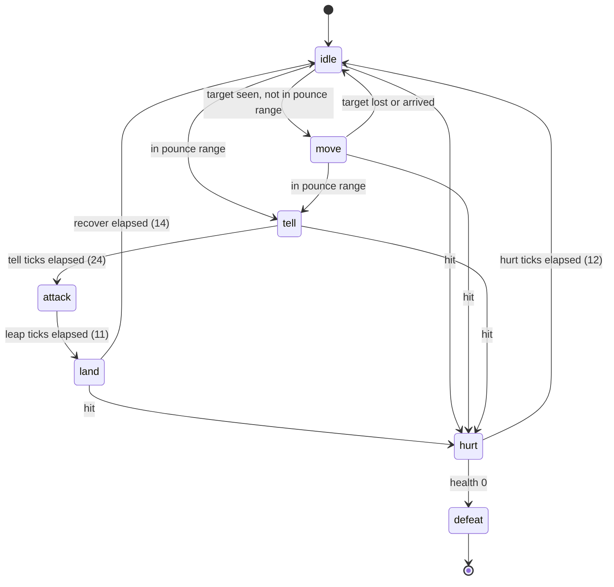

# TROG-01: Troglodyte family (Pygmy, Basher, Virtuoso) readability sets, design spec

**Status:** Pygmy base design edited (size confirmed, construction and six keys redrawn, keys re-frozen); Basher and Virtuoso not started. Silhouette gate passed after the key fixes (section 13); the ten in-betweens are drawn (section 8) and the review pack is in `docs/evidence/trog-01/review-pack/`. After the independent review, the landing became a key of its own (11), the defeat falls backward like the hurt (15 re-keyed, 12 leans further back), and section 2b sets the head per type. In-between targets for frames 5, 6, 9, 13 and 14 are open for execution (section 8).

**Decision record (Pygmy base, after the design edit):** height 40 px (confirmed), frame 80 x 56, pivot (30, 55), palette `trog-family-v0` (15 core colours, 5 slots allocated to the variants), family height ladder Pygmy 40 / Virtuoso 66 / Basher 66 / Juicer 84 or more (section 2b).

The sections follow `docs/02-art/gob-01-goblin-spec.md`. Replace every `<fill: ...>`; write numbers, not adjectives. The design step stops at the keys and this spec (see the top-tier budget in `docs/07-agents/agent-orchestration.md`).

## 1. Canon and tone constraints

- Approved concept: `assets/concept/floor-01/enemies/floor01-troglodyte-family-approved.png`; `docs/02-art/floor-01-late-enemy-boss-concepts.md` records the whole family sheet as owner-approved visual concept. This work order covers the **Pygmy, Basher and Virtuoso**. The Juicer is on the same sheet but is a separate boss work order and is not cropped.
- Tone (`docs/01-design/antihero-tone.md`, enemies row): threatening yet eccentric, with motivated behaviors and readable tells and some absurd visual contrasts; never a purely serious faceless army and never comedic with no danger. 1980s-1990s action cinema is used for attitude only, never copied designs.
- Scope: one family, three readability sets (one per type), designed in one session (pipeline rule: families are designed together). The tag list and the frame tables below are the per-type template; the designer sets them for each type.
- Canon facts that must survive in pixels (from the approved docs and the concept board, not design decisions):
  - One species with shared cues: pale reddish-pink skin, wild dark hair (dreadlocked), pointed ears, wide mouth with yellow fangs and drool, ragged loincloths, hands with long fingers, bare feet.
  - Pygmy: small, hunched, lean, fast-looking; the key studies show move, leap and pounce.
  - Basher: bulky and heavily muscled, wrapped forearms and a necklace, trash on the shoulders; the studies show wind-up, smash and recovery.
  - Virtuoso: lean and tall, a ragged purple robe, gold bells and a bell on the back, a very long pink tongue; the studies show feint, tongue strike and retract.
- Design reading of the tone: the family reads as grotesque, nasty and a little absurd. The Pygmy is a gaunt, hunched, ribbed scavenger with a too-large head, matted dreadlocks, drool and a rag loincloth: it looks hungry and mean, not cute and not heroic. The danger is the tell (a coiled crouch with a gaping mouth) and the pounce; the absurd note is the oversized head and spindly reach. Attitude from 1980s-90s creature features only, no copied designs.

### Where the canon, size and mechanics are defined (checked 2026-11-18)

| Topic | Source | What it says |
| --- | --- | --- |
| Visual approval, all three | `docs/02-art/floor-01-late-enemy-boss-concepts.md` lines 12 to 14 and 36; `docs/02-art/floor-01-enemy-concept-roster.md` ("Later approved enemy and boss concepts") | The family sheet is an owner-approved visual concept; native scale and timings are pending |
| Pygmy | late-enemy doc line 12 | Small, aggressive, fast-looking silhouette with readable leap preparation; final native scale and attack timings pending |
| Basher | late-enemy doc line 13 | Bulkier melee-oriented member; heavy wind-up and impact poses; physical class, stats, damage and hitboxes **not** approved |
| Virtuoso | late-enemy doc line 14 | Leaner, unnerving silhouette with a prominent tongue-extension cue; tongue reach and poison mechanics need gameplay design, not inference from the sheet |
| Source accuracy | late-enemy doc line 24 | The book describes reptilian upper bodies reminiscent of Komodo dragons and long bent scaly legs; the approved sheet takes stronger humanoid/horror liberties; **do not silently reinterpret the sheet as book-accurate anatomy** |
| Setting | `docs/02-art/floor-01-art-atlas-v1.md` line 47 (panel 09) | Troglodyte territory sits in the Juicer's gym; fluorescent/accented light only there |
| Size | none | The only numbers are Carl 52 and Donut 40 printed on the sheet's lineup panel, which are not accepted native sizes |
| Production slot | `docs/07-agents/pixel-art-pipeline.md` lines 18, 19, 51, 103 | Batch 9 (Gym) with AREA-GYM-01; "Troglodyte base" is Medium (B), "Troglodyte variants" are Easy (C) |
| Backlog | `docs/04-production/backlog.md` line 13 | Records the visual approval of Pygmy, Basher, Virtuoso and the Juicer only; no work order, size, stats or mechanics |
| Juicer | `docs/02-art/floor-01-juicer-gym-standalone-concept.md` line 43 | A separate boss work order with its own scale note; out of scope here |

### Guardrails (copied from the late-enemy doc)

- Do not reinterpret the approved sheet as literal book anatomy, and do not claim the sheet is book-accurate (late-enemy doc line 24).
- Tongue reach, poison, leap range, smash damage, physical classes and hitboxes are **not** approved; the studies illustrate poses, not mechanics. Printed scale labels (Carl about 52 px, Donut about 40 px) are not accepted native sizes.
- Do not include the Juicer; keep his scale decision separate.
- Convert from original editable pixel grids / `.aseprite`, never by tracing or cropping the sheet.

### VFX and special states on the sheet

- Pygmy: a dust or splash mark at the pounce landing, a small "!" alert mark.
- Basher: a ground-impact debris and dust burst on the smash.
- Virtuoso: the extended tongue (a long moving part that is a gameplay-relevant silhouette), drool and swinging bells, a "!" alert mark on the feint.
- None of these is a projectile. Impact dust, the tongue strike's reach and any poison effect would be separate decisions or work orders; the sheet shows no poison effect.

### Packet inputs

- Concept crops in `docs/evidence/trog-01/packet/` (x,y,w,h in the 1448x1086 concept):
  - `concept_crop_1.png` = `50,265,250,205`: Pygmy
  - `concept_crop_2.png` = `320,180,330,290`: Basher
  - `concept_crop_3.png` = `665,175,335,295`: Virtuoso
  - `concept_crop_4.png` = `15,535,300,145`: Pygmy key study (move, leap, pounce)
  - `concept_crop_5.png` = `330,535,350,145`: Basher key study (wind-up, smash, recovery)
  - `concept_crop_6.png` = `695,535,335,145`: Virtuoso key study (feint, tongue strike, retract)
  - `concept_crop_7.png` = `135,775,365,140`: Basher facial studies (three)
  - `concept_crop_8.png` = `135,910,365,140`: Virtuoso facial studies (three)
  - `concept_crop_9.png` = `770,810,410,225`: the three types side by side in the scale-reference panel (Carl and Donut and the Juicer are cropped out)
  - The sheet has no dedicated shared-construction panel; the face crops and the side-by-side crop are the shared-construction references.
- `scale_lineup.png`: Carl 52, Donut 40, goblin 36, plus three empty candidate slots at 40, 48 and 56 px for the proposed base (the Pygmy). By eye in the sheet's lineup panel (Carl about 70 px tall in the 1448x1086 image), the Pygmy is about 50 px, the Basher about 83 px and the Virtuoso about 80 px at Carl's 52 px; the Pygmy is hunched, so its standing height would be larger. These are estimates to test, not approved sizes. The default 64 x 56 frame is a placeholder only, too small for the Basher and Virtuoso.
- Readability set (tags): `idle` (2-4), `move` (4-6), `tell` (1-2), `attack` (2-3), `hurt` (1), `defeat` (2-3); about 12 to 20 frames. Concrete tag names and frame counts are the designer's choice (section 4 and `frame_pivot_template.json` carry the toolkit defaults). Apply the set to each type.

## Difficulty and route

**Proposed base: the Pygmy** (a packet proposal for the designer to confirm). Reasons:

- It has the lowest cost: the smallest sprite and the simplest states (move, leap, pounce), with no tongue and no heavy impact debris.
- Setting the shared construction (skin ramp, hair, ears, fangs, loincloth, hands) at the smallest pixel budget is the constraint-first order: the Basher and Virtuoso then add detail rather than strip it. They are redrawn at their own sizes, never scaled up.
- The alternative is the Basher, the most typical troglodyte body and closest to the Juicer, but it scores 3 (Hard) as a base because it is both new and large with an impact burst.

**Difficulty scores** (1 point each: new design, above about 40 px, complex construction, VFX or special states):

| Type | New design | Above 40 px | Complex construction | VFX / special states | Score | Class and route |
| --- | --- | --- | --- | --- | --- | --- |
| Pygmy (base) | yes | arguable: 40 to 56 px candidates, scores at 41 px or more | no | no: leap dust is small and inside the readability set | 1 to 2 | Easy to Medium; **expected Medium (B)** at 48 px |
| Basher (variant) | no | yes: about 83 px by eye | no | yes: smash debris and dust burst | 2 | Medium (B) by the table, not Easy |
| Virtuoso (variant) | no | yes: about 80 px by eye | yes: a long tongue as a moving part | no (the tongue is counted as construction; drool and bells are small) | 2 | Medium (B) by the table, not Easy |

Reasoning: the expected "variants are Easy" only holds if the variants stay at or below about 40 px or are drawn as pure recolours, which the sheet contradicts; at the sizes the sheet implies, each scores 2. If the smash debris and tongue VFX were deferred, the Basher would score 1 and the Virtuoso 1 (Easy). The designer must decide the sizes first, because the class follows from them.

## 2. Size decision

Carl is 52 px (about 6 ft), Donut 40 px, the goblin 36 px (see `scale_lineup.png`). The Pygmy is hunched, so the idle opaque height is the top of the hair to the soles, not a standing height.

| Option | Idle opaque height | Ratio to Carl | Implied real height | Why / why not |
| --- | --- | --- | --- | --- |
| A | 40 px | 0.77 | about 4.6 ft crouched (a taller standing height if it straightened) | Small next to Carl, 4 px taller than the goblin, same height as Donut but a very different silhouette and colour. Scores 1 in the difficulty table (not above 40 px). The Basher and Virtuoso then land near 64 to 66 px (see 2b), a 1.2x Carl brute instead of a 1.6x one. |
| B | 48 px | 0.92 | about 5.5 ft crouched | Almost Carl's height: the "small" canon is lost, and the family sizes rise to about 80 px (frames around 128 x 96). The packet proposal. |
| C | 56 px | 1.08 | about 6.5 ft crouched | Taller than Carl; contradicts "small" outright. |

Decision: **40 px** (option A), confirmed by the design edit for the whole family, not for the Pygmy alone.

- Family ratios, measured on the side-by-side panel (`concept_crop_9.png`, opaque tops to soles): Pygmy about 67 px, Basher about 110 px, Virtuoso about 113 px with hair, so Basher : Pygmy is about 1.64 and Virtuoso : Pygmy about 1.69.
- At a 40 px base the ladder is Pygmy 40, Basher and Virtuoso about 66 (1.27x Carl, brutes that loom over him without filling the screen), and the Juicer boss free to sit clearly above them at 84 px or more, in the same band as the other Floor 1 bosses (the Hoarder is 112 px).
- At 48 px the ladder becomes 48 / 79 / 81, the variants need frames of about 128 x 96, the Pygmy is nearly Carl's height (0.92) and loses its "small" canon, and the Juicer is pushed to about 110 px or more just to stay the biggest troglodyte on a 360 px screen. 48 px buys a larger face, and the edit gets that face at 40 px instead (below).
- Face budget at 40 px: the head is now 14 x 12 px (one skull and one jaw circle of radius 5.6 and 5.3, constant in every pose), so the face template is 11 x 9 px: a 3-row heavy brow and bulging bloodshot eye (4 white, 3 red, 2 pupil), a 7 px yellow teeth row over a 9 px dark gash, lower fangs and a 2 px drool strand. At 1x on lit brick the eye white, red rim and teeth read as three separate accents (`keys-x3.png`, `key0-scale.png`).

## 2b. Shared construction (for the Basher, Virtuoso and Juicer work orders; not drawn here)

These rules are the family contract. The Pygmy implements them in `scripts/author_trog01.py` (`HEAD_R`, `head`, `jaw`, `MOP`, `ROPES`, `EAR`, `hair`, `FACES`, `build`). The Basher, Virtuoso and Juicer are redrawn at their own sizes from these rules, never scaled up from Pygmy pixels. Lengths are given at the Pygmy's 40 px as a fraction of the idle height `H` so the larger types can scale the numbers, not the pixels.

**Height ladder (decided here; each variant confirms it in its own size study, within plus or minus 2 px):**

| Type | Idle opaque height | Ratio to the Pygmy | Ratio to Carl (52) | Frame (proposed) | Posture |
| --- | --- | --- | --- | --- | --- |
| Pygmy | 40 | 1.00 | 0.77 | 80 x 56 | hunched, knuckles near the floor |
| Basher | 66 | 1.65 | 1.27 | 112 x 80 | hunched brute, head sunk below the shoulder line |
| Virtuoso | 66 (hair included) | 1.65 | 1.27 | 112 x 80, wider for the tongue strike | taller, less hunched, lean |
| Juicer (boss, own work order) | 84 or more | 2.1 or more | 1.6 or more | own decision | must out-mass the Basher by at least 20 % in height |

**Order of parts (back to front), the same in every type:** far limbs (darker `far` ramp), torso, near leg, loincloth, head (skull then jaw), dropped jaw when the mouth is open, hair mop and ropes, near arm and fingers, ear, then the face template. Each part after the first gets a 1 px `K` outline where it overlaps an earlier part, so the near arm always separates from the torso and the ear always separates from the hair.

**Body plan:** a hunched biped. Torso: a thick line from the hips to the shoulder hump, radius 0.10 to 0.11 H, hips behind and lower than the hump. Arms are long enough that the hand reaches the floor in the idle (shoulder to wrist about 0.55 H); limbs taper from about 0.05 H to 0.02 H. Deep-bent legs, bare feet, three long fingers per hand (`hand`). 1 px rib strokes on the flank. The Basher widens torso and shoulders to about 0.11 to 0.12 H radius (about 7 to 8 px at 66) and keeps the 0.55 H arm, so its knuckles touch the floor in the idle as well. The Virtuoso keeps the Pygmy's radii in px (so it reads leaner at 66) and lengthens each limb about 15 %; with its straighter spine its hands hang at about 0.15 H above the floor in the idle.

**Scaled details (stated as fractions of H so the 66 px types do not guess):** claws 0.11 to 0.13 H long (4 to 5 px at 40, 7 to 8 px at 66), 3 per hand; rope dreads: Pygmy 4, Basher 5, Virtuoso 6 to 7, rope radius 0.024 H (0.95 px at 40, 1.5 px at 66), longest rope 0.45 H (Pygmy and Basher) or 0.6 H (Virtuoso); grime smudges 4 to 6 at 40 px and 8 to 10 at 66 px, at least 2 on lit surfaces; the outline stays 1 px `K` at every size (never 2 px).

**Head (per type; measured on `concept_crop_9.png` as head width / opaque height and head-to-hump offset):** two circles, a skull circle behind and about 0.025 H above a jaw circle (the jaw circle is about 0.93 of the skull radius), thrust forward of the shoulders. The head size is constant across poses within a type. The open-mouth faces add a dropped jaw (a thick line under the front circle, `jaw`, 0 to 1 drop). The big head is the **Pygmy's** absurd note, not a family constant:

| Type | Head width | Skull radius | Jaw centre relative to the hump top (idle) | Spine (hips to hump) from horizontal | Notes |
| --- | --- | --- | --- | --- | --- |
| Pygmy | 0.35 H (14 px at 40) | 0.14 H (5.6 px) | 0 to 0.03 H **below** the hump top, 0.25 H ahead of it | about 30 degrees | the head leads; above the hump only in the hurt recoil |
| Basher | 0.25 H (16 to 17 px at 66) | 0.10 H (6.5 px) | 0.05 to 0.08 H **below** the hump top (3 to 5 px at 66), sunk between the trapezius masses, 0.12 H ahead | about 35 degrees | a small head on a big body is the brute read; never larger than 0.27 H |
| Virtuoso | 0.22 to 0.24 H (15 to 16 px at 66) | 0.09 H (6 px) | 0.10 to 0.14 H **above** the hump top (7 to 9 px at 66), on a visible 0.08 H neck, 0.10 H ahead | about 55 degrees (less hunched) | the head is up so the tongue strike has a clear line; the head-above-hump rule is waived for this type |
| Juicer | own work order | | | | follows the Basher's head ratio or smaller |

**Face (template, then redraw larger):** placed from the jaw centre (hx, hy). Heavy `K` brow at hx..hx+3; a bulging eye 2 rows by 3 columns (2 x 2 `w` white, 1 or 2 `K` pupil at the front, 2 or 3 `e` red pixels behind and below: bloodshot, never a clean white eye); mouth from the back of the cheek (hx-3) to the front edge (hx+6), at least two thirds of the head length. Idle: clenched `t` teeth row over a dark `o` gash and lower fangs. Roar (tell and attack): a 3-row gaping `o` mouth that breaks the front outline, `q` tongue at the bottom, top and bottom teeth, two drool strands. Pain: the eye squeezed to a `K` slit, no red. Dead: crossed eye, tongue out past the lip. The larger types keep this order and the accents (eye white, red rim, yellow teeth, drool), and add rows (Basher: heavier brow, a 2 to 3 row teeth band; Virtuoso: a narrower mouth that opens taller to release the tongue).

**Hair (dreads, not horns):** a matted crown mop (polygon, `MOP`) sitting on the back two thirds of the skull, about 0.15 H above the skull top, and heavy rope dreads (radius 0.95 px at 40, about 1.5 px at 66) hanging **down and back** from it over the nape and the shoulder hump; the longest ropes reach about 0.45 H behind the jaw centre and end below the jaw line. One short front lock ends above the brow. Rules that keep it from reading as horns at 1x: no rope point ever rises above the crown; every rope ends lower than it starts; the forehead in front of the mop stays skin; the ear (skin) sits on the dark mop and points straight back, below the crown line; every third column of lit hair (`I`) drops to `H` so the mop reads as separate ropes; the mop's top and back edge has three 1 px notches, and ropes 0 to 2 carry a 1 px bead or knot (`t`, `w`, `t`) one point before the tip. Motion streams the tips back and up toward the horizontal (`sweep` 0.6 on the walk, 1.0 in the leap); the hurt recoil whips them forward (`sweep` -0.6). Larger types keep the mop-plus-ropes rule with more and longer ropes (the Virtuoso's reach the middle of the back).

**Skin and grime:** one ramp for the family, `d` `#5a2c3f`, `s` `#8c4651`, `m` `#bf6f64`, `l` `#e5a08c` (torch-lit upper-left rim), with the far limbs on `K`/`d`/`d`/`s`. Pale reddish-pink, cooled so it separates from the orange brick. Grime is part of the construction, not decoration: 2 px `d` smudges on lit or mid skin (4 to 6 per key at 40 px, more on the larger types), and the two rows above the contact row (soles, knuckles) are dirt-caked `d`. Rib strokes are `d` where they cross the lit rim and `s` on mid skin. No run of more than 5 clean `l` pixels: the 4th and 5th of a longer run drop to `m`. No clean, evenly lit skin.

**Cloth:** a ragged loincloth, `c` `#3b2f2c` dominant with `C` `#72604d` only on the lit top and left fold, hanging **down** from just below the hip centre (the rump skin shows above it) with three torn points on the hem; it never juts up or back. Bare hands and feet in every type. Planted hands (`planted_hand`) splay three 1 px claws 4 to 5 px long forward along the contact row; the middle finger is its own part, so a 1 px `K` gap separates the claws. In the strike the reaching claws are 1.4x longer and lead the silhouette (they are the hitbox). A hurt pose never points a hand at the player.

**Palette allocation:** the 15 core colours (`K d s m l H I c C w e t T o q`) are shared and frozen. The 5 free slots are allocated so that even a single family atlas stays at 20: Basher 2 (forearm wrap grey, mid and light; the necklace and shoulder trash reuse `w`, `t`, `c`, `C`), Virtuoso 3 (purple robe deep, mid, light; the gold bells reuse `t` and `T`, the tongue reuses `q` with `s` and `o` for its shade). The Juicer is a boss with its own atlas: the 15 core colours plus up to 5 of its own.

**Frame and pivot convention:** facing right, pivot on the contact row, about 0.35 H of margin behind the pivot for trailing legs and ropes, and more room ahead than behind for the reach. Airborne tags never touch the contact row; grounded tags always do.

## 3. Frame, pivot, boxes and atlas

- Frame **80 x 56**, pivot **(30, 55)**, contact row **55** (the lowest opaque row of every grounded frame). The pounce reaches 30 px ahead of the pivot and 29 px behind it; the idle stays inside -14 to +20.
- Grounded tags: `idle`, `walk`, `attack_tell`, `attack_land`, `hurt`, `down`. Airborne tag (no pixel on row 55): `attack_leap`.
- Boxes are placeholders in px from the pivot (x forward, y up), re-measured from the edited keys; not approved mechanics (`BOXES` in `scripts/author_trog01.py`, also in the manifest). Hurtboxes cover the trunk and head and leave out the hair mop above the skull, the hanging ropes and the planted hands; the hitbox covers both claws and the open jaw:

| Box | x | y | Frames |
| --- | --- | --- | --- |
| Standing (opaque extent) | -14 to 21 | 0 to 39 | idle |
| Hurtbox idle/walk | -14 to 21 | 0 to 33 | 0 to 6 |
| Hurtbox tell | -16 to 19 | 0 to 22 | 7, 8 |
| Hurtbox land | -14 to 20 | 0 to 15 | 11 |
| Hurtbox leap | -22 to 21 | 6 to 31 | 9, 10 |
| Hurtbox hurt | -14 to 2 | 0 to 39 | 12 |
| Hurtbox down | -22 to 19 | 0 to 12 | 13 to 15 |
| Attack hitbox (strike frame only) | 14 to 32 | 13 to 33 | 10 |

- Authored facing right; the runtime mirrors around the pivot column.
- One atlas, frames 0 to 15, one layer: `body`.

## 4. Readability-set animation list

Tick windows are at 60 Hz. The attack is a pounce in three tags so the airborne frames keep their own contact rule: `attack_tell` (grounded coil), `attack_leap` (airborne launch and strike) and `attack_land` (grounded landing and recovery, a spent pose of its own; landing dust is deferred to the VFX order because `c`/`C` dust does not show on the lit floor).

| Role | Tag | Frames | Playback | Ticks | Notes |
| --- | --- | --- | --- | --- | --- |
| idle | `idle` | 3 | loop | 12 + 8 + 12 = 32 | breathing cycle |
| move | `walk` | 4 | loop | 4 x 6 = 24 | a crouched scuttle, 0.4 s per cycle; the speed comes from the gameplay spec |
| tell | `attack_tell` | 2 | once | 6 + 18 = 24 | an 18-tick hold of the coil is the read window |
| attack | `attack_leap` | 2 | once | launch 3 + strike 8 = 11 | the hitbox is active on frame 10 only |
| (recover) | `attack_land` | 1 | once | 14 | landing key: spent, off balance, vulnerable (the punish window) |
| hurt | `hurt` | 1 | once | 12 | |
| defeat | `down` | 3 | hold | 4 + 8, then a state-driven hold | |

Tell-to-attack read: the attack starts 24 ticks after the tell begins; the leap starts at tick 24, the strike pose and hitbox are active on ticks 27 to 34, and the Pygmy is back in a grounded, hurtable crouch at tick 35 for 14 ticks (to tick 48). The design edit lengthened the strike from 6 to 8 ticks: 9 airborne ticks (150 ms) were too short to show a pounce arc and gave the hitbox almost no travel; 11 ticks (183 ms) still reads as fast. The three-tag split stays: `attack_tell` is the 24-tick read window (the 18-tick coil hold is the lowest grounded silhouette with the jaw hanging open), `attack_leap` is the only airborne tag (so the contact rule stays per tag), and `attack_land` is a separate 14-tick grounded punish window that gameplay can address by name. Leap range, damage and speed are placeholders. The tell pose (the lowest grounded silhouette, hands planted, mouth wide open) must be readable for at least 18 ticks (300 ms) before the leap.

Frame table:

| # | Tag | Pose | Ticks | Author |
| --- | --- | --- | --- | --- |
| 0 | `idle` | **KEY** hunched crouch, knuckles near the floor, head thrust forward, dreads up | 12 | key |
| 1 | `idle` | idle breath, head and shoulders 1 px lower, dread tips swayed 1 px back | 8 | in-between |
| 2 | `idle` | key posture, dread tips swayed 1 px forward | 12 | in-between |
| 3 | `walk` | **KEY** scuttle contact: body low and forward, near hand planted ahead, far leg trailing | 6 | key |
| 4 | `walk` | walk, near leg and hand planted sliding back, far arm swinging forward, body up 1 px | 6 | in-between |
| 5 | `walk` | walk passing, legs gathered under the hips, body highest | 6 | in-between |
| 6 | `walk` | walk contact B, mirror of 3 with the limbs swapped | 6 | in-between |
| 7 | `attack_tell` | tell onset, halfway from idle to 8, mouth closed | 6 | in-between |
| 8 | `attack_tell` | **KEY** coiled: haunches raised and loaded, shoulders and head dropped forward, hands planted, mouth wide | 18 | key |
| 9 | `attack_leap` | launch, 0.7 of the way from 8 to 10, feet off the floor | 3 | in-between |
| 10 | `attack_leap` | **KEY** strike: body stretched flat in the air, one claw high and one low around the gaping mouth, legs trailing | 8 | key |
| 11 | `attack_land` | **KEY** spent landing: squashed flat, rump settled low, head dipped between splayed claws, far leg skidding behind, panting | 14 | key |
| 12 | `hurt` | **KEY** thrown back, trunk leaning back, near knee bent onto the back foot, near arm flung back and up, eye shut, mouth open | 12 | key |
| 13 | `down` | backward fall beat, about 45 degrees, feet still on the floor | 4 | in-between |
| 14 | `down` | floor impact, flat, limbs flung wide | 8 | in-between |
| 15 | `down` | **KEY** fallen backward: on its back, head behind, feet toward the player, tongue out, crossed eye | hold | key |

## 5. State diagram



## 6. Palette

Family palette `trog-family-v0`, 15 of at most 20 colours; five slots are free for the Basher and Virtuoso (see 2b). Whether the three types share one atlas palette is decided as: yes, one shared palette per family, extended by those five slots, no per-type recolours of the skin ramp.

The 24 packet candidates are mostly background navy (about 15 of them), so the creature colours were picked by eye. The warm pinks (`#e5916a`, `#ebac81`, `#db7854`) informed the skin ramp, which was pinked and cooled so it does not merge with the orange brick; `#9b3b2f`, `#6f362d` and `#462427` informed the shade and mouth tones.

| Key | Name | Hex | Role |
| --- | --- | --- | --- |
| `K` | outline_plum | `#1a1017` | outline and eye pupil |
| `d` | skin_deep | `#5a2c3f` | skin shadow, far-limb base |
| `s` | skin_shade | `#8c4651` | skin shade, rib strokes |
| `m` | skin_mid | `#bf6f64` | skin body |
| `l` | skin_light | `#e5a08c` | torch-side rim |
| `H` | hair_deep | `#1d1721` | dreadlocks |
| `I` | hair_mid | `#403442` | dreadlock highlight |
| `c` | cloth_deep | `#3b2f2c` | loincloth shade, dust |
| `C` | cloth_mid | `#72604d` | loincloth, dust |
| `w` | eye_white_drool | `#efe4c4` | eye white and drool (accent) |
| `e` | eye_red | `#d83a22` | red rim of the awake eye (accent, absent when hurt or dead) |
| `t` | fang_yellow | `#e6bd3a` | fangs and teeth (accent) |
| `T` | fang_shade | `#967022` | fang shade |
| `o` | mouth_dark | `#4a1020` | open mouth |
| `q` | tongue_pink | `#c8566a` | tongue (defeat) and the Virtuoso's tongue |

## 7. Key poses

Design units are px right of the pivot column and up from the contact row. Frozen by `pixelart freeze`; the fixture records the keys after the design edit.

| Frame | Tag | Silhouette and pose notes | Readability reason |
| --- | --- | --- | --- |
| 0 | `idle` | Top row 16 (40 px), x -14 to 20. Hips (-10, 15) rise to the shoulder hump (3, 24); head jaw centre (13, 25), skull (9, 26), at hump height and ahead of it; the mop tops out at y 38 and the ropes hang down the back over the hump to about (-5, 23); near arm from (4, 21) to the hand at (15, 3). Snarl face, 6 grime smudges. | A hunched, long-armed silhouette with a big head and a hanging dread mop that no other Floor 1 enemy has; the head leads. |
| 3 | `walk` | Top row 21 (35 px), x -18 to 26. Body drops 4 px and leans forward; head (16, 20); near hand reaches to (21, 3); far leg trails to (-17, 2); ropes stream back (sweep 0.6). | Lower and longer than the idle: reads as a scuttle. |
| 8 | `attack_tell` | Top row 27 (29 px), x -17 to 21. Rump up at (-12, 17.5), shoulders down at (3, 12), head dropped to (13, 14) with the jaw hanging open (roar): a forward-tilted wedge; hands planted with claws splayed along the floor; legs folded; the rag hangs straight down. | The lowest, most compact grounded pose with a gaping mouth: "about to spring". |
| 10 | `attack_leap` | Top row 17, bottom row 50 (5 px off the floor), x -29 to 30. Body flat from (-13, 17) to (4, 22); head (15, 24) roaring; near claw low at (24, 16), far claw high at (25, 29); legs trail to (-28, 11); ropes stream straight back (sweep 1.0). | The longest horizontal bar of the set; two claws and the mouth form the strike front. |
| 11 | `attack_land` | Top row 33 (23 px), x -26 to 29. Torso squashed flat from the hips (-11, 9) to the shoulders (4, 10), the rump settled low (not loaded); head (15, 8) dipped 6 px below the tell head, between the claws; near arm splayed far forward to the claws at (23, 2); far arm folded under the chest; near leg folded, far leg skidding out behind to (-25, 1); ropes flopped forward by the impact (sweep -0.8); `pant` face: lid dropped over the eye, slack 1-row mouth short of the front, no roar (at most 12 `o` against 30 in the tell). | Flatter, longer and lower than the tell (top row 33 against 27), with a closed, panting face: "spent, hit it now", never "about to spring". |
| 12 | `hurt` | Top row 10 (46 px), x -23 to 11. Torso tilted back from the hips (-1, 14) to the shoulders (-8, 26); head (-4, 31) with the skull tilted 2.5 px higher, its centre about 5 px behind the hip column; near knee bent forward to (4, 9) with the weight on the back foot (-4, 1); near arm flung back and up to the wrist (-18, 35) with the fingers fanned open; far arm limp forward-down; ropes whip forward (sweep -0.6); eye a shut slit, no red; a 3-row open pain mouth without the tongue. Nothing points at the player. | The tallest pose and the only one with the head above the back: a recoil. |
| 15 | `down` | Top row 35 (21 px), x -28 to 20. Fallen **backward**, the same direction the hurt throws it: on its back with the hips at (7, 4) and the shoulders at (-6, 5); head (-10, 6) behind, chin on the chest, mop and ropes spilled on the floor behind it; knee raised at (10, 10), feet toward the player at x 17 to 20; near arm flung up to (2, 17); crossed eye, tongue out. | Lowest, flat on the floor, the red eye gone; continuous with the backward recoil of 12. |

## 8. In-between list

For the execution tier. No design decisions are needed beyond the notes. Drawn by `scripts/author_trog01.py` (`POSES`, `INBETWEEN`): frames 7, 9 and 13 are blends of two keys' part rules, the rest are hand-set limbs on the key's parts. Frame 11 is a key now. Round 2: frames 5, 6, 9, 13 and 14 were redrawn to the targets below (all in-betweens re-checked against the seven re-frozen keys).

| # | Pose notes |
| --- | --- |
| 1 | Idle breath: head and shoulders 1 px lower, dread tips shifted 1 px. |
| 2 | Idle: back to 0 with the dreads swayed 1 px the other way. |
| 4 | Walk: near leg planted, far arm swinging forward, body up 1 px. |
| 5 | Walk passing pose: both legs gathered under the hips, body highest of the cycle. **Target (E1):** lift the near hand 1 to 2 px off the contact row (wrist at about (14, 4.5)) so the forward reach into 6 reads as a step, not a skate. |
| 6 | Walk: far hand planted, near leg trailing, mirror of 3 with the limbs swapped. **Target (E1):** a true limb swap. The far (`d`) arm is planted ahead with its claws at about x +25 on the contact row; the near (lit) arm is mid-swing and off the floor (wrist at about (12, 6), no pixel of it on row 55); the near leg trails to about (-17, 2) and lifts its heel. Frame 6 must differ from 3 in the arm that is planted, not only the leg ramp, so the 3 / 6 seam is no longer a 12-tick held silhouette. V16 must still pass. |
| 7 | Tell onset: halfway from the idle to 8 (hips up, head half down, mouth closed). |
| 9 | Launch: body stretched, feet leaving the floor, one frame before 10. **Target (E2):** an upward push-off within the existing 3 ticks. The body is angled 20 to 25 degrees nose-up (hips at about (-10, 10), shoulders at about (3, 16)); the hind legs are extended down and back with the near toe 1 px off the floor (bottom row 53 or 52); the claws are coming up past the head. Then 9 to 10 reads as up and over: 10 is the apex and strike (ticks 27 to 34), and the descent is the runtime arc during the last ticks of 10 into the squash of key 11. Ticks are unchanged (3 + 8). |
| 11 | Now a key (section 7); no in-between work. |
| 13 | **Target (D2):** a backward fall beat: 30 to 34 px tall (top row 21 to 25), torso tilted about 45 degrees back from the hips at about (2, 9) to the shoulders at about (-6, 17), head at about (-8, 22) still with the pain face, toes still on the floor at about (8, 1), near arm flung up and back toward (-14, 28). The direction is continuous from 12 to 15. |
| 14 | **Target (D2):** floor impact on the back: the key-15 layout with the head and mop bounced 1 px up, the raised knee 1 px higher, and the arms flung 1 to 2 px wider; top row at least 33. |

## 9. Validators and readability rules

Run by `python3 -m scripts.pixelart validate assets/source/characters/troglodyte/trog_01.pixelart.json` (rules V01 to V16; all configured rules pass, V10 is not configured).

- V04 palette: at most 20 colours (15 used); V05 isolated pixels: 0; V06 orphan pixels: at most 9 per frame.
- V07/V08 contact rows: grounded tags end on row 55; `attack_leap` never touches it (bottom row at most 52).
- V09 frozen keys: SHA-256 per key frame, fixture `tests/fixtures/trog-01_keys.json` (6 keys: 0, 3, 8, 10, 12, 15).
- V12 unique frames: on (all 16 frames differ).
- V16 foot drift: `rules.foot_drift` `{"max_px": 9, "tags": ["walk"]}`, loop seam included (same limit as HOARD-01). Measured with the contact-row foot and hand runs: every step of the walk is at most 9 px.
- V13 bounding boxes (after the review: the land rule is `R-land-flat-and-spent`, top at least row 28 and at most 60 wide; the down rule covers 14 and 15, at most 54 wide; frame 13 has its own `R-down-fall-beat`, top at least row 18): idle height 40 (top row 16); walk lower than idle (top at least 18); tell lowest and at most 44 wide (top at least 22); land low (top at least 22) and at most 56 wide with its dust; leap clear of the floor and top at most 22; hurt tallest (top at most 14); down low (top at least 32, at most 50 wide).
- V14 key counts: red eye in the idle; the tell and leap mouth (dark `o`, at least 8 pixels); no red eye when hurt or down; the tongue (`q`, at least 3 pixels) in the defeat key.
- Extra tests: `tests/test_art_trog01.py` (generator parity, ticks, size, airborne contact, tell lowest, landing diff).

## 10. Evidence

```text
python3 -m scripts.pixelart validate assets/source/characters/troglodyte/trog_01.pixelart.json --out <dir>
python3 -m scripts.pixelart evidence assets/source/characters/troglodyte/trog_01.pixelart.json --out <dir>
python3 -m scripts.pixelart review-pack assets/source/characters/troglodyte/trog_01.pixelart.json --out <dir>
python3 scripts/author_trog01.py key0-scale      # docs/evidence/trog-01/key0-scale.png
```

`docs/evidence/trog-01/key0-scale.png` (960 x 360): key 0 at 1x on lit Floor 1 next to Carl and GOB-01 (left, 640 x 360, no scaling), and a 4x copy of key 0 (right). `docs/evidence/trog-01/keys-x3.png` (`python3 scripts/author_trog01.py keys-x3`): the seven keys left to right (0, 3, 8, 10, 11, 12, 15) on lit Floor 1 brick, enlarged 3x. The review pack (`docs/evidence/trog-01/review-pack/`: x4 contact sheet, lit 640 x 360 scene at 3x with the Pygmy on brick, tell-to-attack strip, `validator_summary.txt`) is committed with the in-betweens.

VFX notes (separate work orders, out of scope here): the landing dust is 9 pixels inside the frame; a bigger pounce splash or ground streak and the small "!" alert mark from the sheet are VFX/UX work orders. The Basher's smash debris and the Virtuoso's tongue strike are likewise separate.

## 11. Files

| File | Role |
| --- | --- |
| `assets/source/characters/troglodyte/trog_01.grid.json` / `.ase` | pixel-grid source and Aseprite master (16 frames) |
| `assets/manifests/trog-01.json` | manifest (tick rows, boxes, attack ticks) |
| `assets/source/characters/troglodyte/trog_01.pixelart.json` | the asset config |
| `scripts/author_trog01.py` | deterministic authoring script (`frames`, `key0-scale`, `keys-x3`) |
| `tests/fixtures/trog-01_keys.json` | frozen draft keys |
| `tests/test_art_trog01.py` | spec tests |
| `docs/evidence/trog-01/key0-scale.png`, `keys-x3.png` | scale evidence, six keys at 3x on brick |

## 12. Rights and provenance

Fan-concept art under the owner-reported `ART-PUBLICATION-ALL-V1` scope (see `docs/04-production/rights-and-release.md`). No tracing of the concept, no image-model raster output.

### Rights/Provenance

- Concept: owner-approved reference under `ART-PUBLICATION-ALL-V1`; crops are for reference only, never traced or exported.
- Packet: script output plus a medium-tier executor (stage P).
- Draft spec and keys (Pygmy only): Claude Sonnet.
- In-betweens + execution (in-betweens, V16 opt-in, regenerated grid, `.ase`, manifest and evidence, review pack; round 2 redraw of 5, 6, 9, 13, 14): Claude Sonnet.
- Design edit (size decision, shared construction, head/hair/face redesign, six keys redrawn and re-frozen, boxes and strike ticks): Claude Opus.
- Silhouette gate: an independent reviewer (FIX-KEYS); the key fixes after it: Claude Opus.
- No third-party assets, no copied designs or dialogue, no image-model raster output.
- Review fixes (D1 landing key 11, D2 backward defeat and hurt lean, D3 per-type head table and scaled details, E1/E2 in-between targets): Claude Opus.

## 13. Design edit: resolved questions and what remains open

- Size: 40 px confirmed for the family ladder (section 2); the packet's 48 px is rejected.
- Dreads read as horns: fixed by the mop-plus-hanging-ropes rule (section 2b, Hair); no rope rises above the crown.
- Face at about 10 x 10 px: the head is now 14 x 12 px and the face template 11 x 9 px with three separate accents (section 2).
- `attack_land` stays a separate tag (section 4).
- Silhouette gate (FIX-KEYS) applied: the hurt arm is flung back and up with the torso tilted back and a pain mouth (it no longer reads as a grab); the rag hangs down with torn points; the tell rump is 1.5 px higher and the head 1 px lower; claws are longer and gapped; the mop is notched and beaded; there is more grime, and ribs are visible at 1x. Keys re-frozen.
- Still open: pounce range, damage and boxes are placeholders; the independent art-director review of the in-betweens is next.

## 14. Executor notes (in-betweens)

- **Walk cycle (round 2).** 3 contact A (near hand and near foot planted ahead, far foot trailing). 4: near leg and hand sliding back, far arm swinging forward, body up 1 px. 5: passing, feet under the hips, body highest, the near hand lifted (wrist (14, 4.5), fingertips off row 55) while the far hand comes down ahead (tip at about x +20 on the contact row). 6: a true limb swap: the far (dark) leg and far hand are planted ahead with claws at about x +25, the near (lit) arm is mid-swing at wrist (12, 6) with no pixel on row 55, and the near leg trails with its heel lifted. So 6 differs from 3 in the planted arm, not only the leg ramp. V16 (max 9 px, loop seam included) matches every planted foot and hand to the nearest one in the next frame, so the trailing far foot stays a dragging toe in 4 and 5 and the far toe in 5 sits at x -5.2; the 5 to 6 step is exactly 9 px. `far_fingers` (claws of a planted far hand in the far ramp) is a `build` option used by frame 6 only.
- **Frame 9 (round 2).** A nose-up push-off inside the existing 3 ticks: hips (-11, 10), shoulders (3, 16), hind legs thrown down and back with the near toe at about y 4.2 (the lowest opaque row is at most 52, V08), both claws coming up past the head, ropes streaming back (sweep 0.8). 9 to 10 reads as up and over; the descent stays the runtime arc.
- **Frames 13 and 14 (round 2).** 13 is a backward fall beat, drawn as parts: hips (2, 9), shoulders (-6, 17), head (-8, 21) with the pain face, toes on the floor at (8, 1), near arm flung up and back to (-14, 28), ropes whipping forward; its top is row 22 (target 21 to 25; the head is 1 px lower than the (-8, 22) in the target note so the mop top lands inside the band). 14 is key 15 with the head and mop 1 px up, the raised knee 3 px higher at the knee point (10, 11), the arms 1 to 2 px wider and the ropes swayed. The direction is continuous 12 to 13 to 14 to 15 (head behind the hips, feet toward the player).
- **Frame 11.** A key now (landing); no in-between work, no dust (deferred to VFX).
- **Idle (1, 2).** The hand and both feet stay planted; only the shoulders, head, face, near arm root, ribs and the dread tips move.
- **Not changed.** Idle, tell onset (7) and the boxes were re-checked against the re-frozen keys and needed no change (the keys 0, 3, 8, 10 are bit-identical to round 1).
