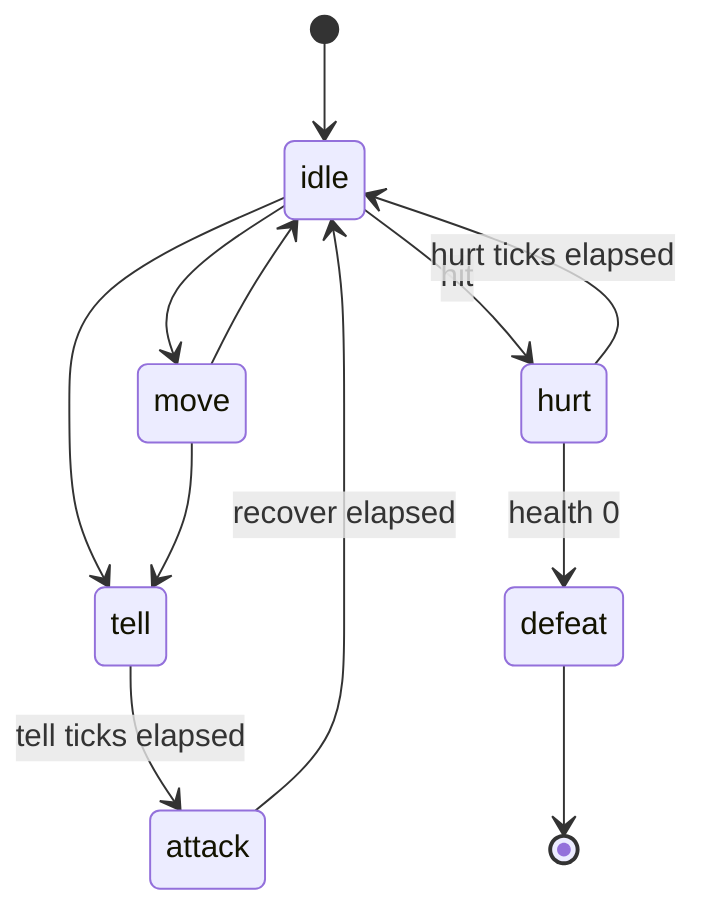

# TROG-01: Troglodyte family (Pygmy, Basher, Virtuoso) readability sets, design spec

**Status:** packet ready; design pending. Execution pending. Review pending.

**Decision record:** height <fill> px, frame <fill> x <fill>, pivot (<fill>, <fill>). Proposed by <fill>; decided by <fill>.

The sections follow `docs/02-art/gob-01-goblin-spec.md`. Replace every `<fill: ...>`; write numbers, not adjectives. The design step stops at the keys and this spec (see the top-tier budget in `docs/07-agents/agent-orchestration.md`).

## 1. Canon and tone constraints

- Approved concept: `assets/concept/floor-01/enemies/floor01-troglodyte-family-approved.png`; `docs/02-art/floor-01-late-enemy-boss-concepts.md` records the whole family sheet as owner-approved visual concept. This work order covers the **Pygmy, Basher and Virtuoso**. The Juicer is on the same sheet but is a separate boss work order and is not cropped.
- Tone (`docs/01-design/antihero-tone.md`, enemies row): threatening yet eccentric, with motivated behaviors and readable tells and some absurd visual contrasts; never a purely serious faceless army and never comedic with no danger. 1980s-1990s action cinema is used for attitude only, never copied designs.
- Scope: one family, three readability sets (one per type), designed in one session (pipeline rule: families are designed together). The tag list and the frame tables below are the per-type template; the designer sets them for each type.
- Canon facts that must survive in pixels (from the approved docs and the concept board, not design decisions):
  - One species with shared cues: pale reddish-pink skin, wild dark hair (dreadlocked), pointed ears, wide mouth with yellow fangs and drool, ragged loincloths, hands with long fingers, bare feet.
  - Pygmy: small, hunched, lean, fast-looking; the key studies show move, leap and pounce.
  - Basher: bulky and heavily muscled, wrapped forearms and a necklace, trash on the shoulders; the studies show wind-up, smash and recovery.
  - Virtuoso: lean and tall, a ragged purple robe, gold bells and a bell on the back, a very long pink tongue; the studies show feint, tongue strike and retract.
- Design reading of the tone: <fill: how the family reads as grotesque, nasty and slightly absurd, never heroic or comic with no danger>.

### Where the canon, size and mechanics are defined (checked 2026-11-18)

| Topic | Source | What it says |
| --- | --- | --- |
| Visual approval, all three | `docs/02-art/floor-01-late-enemy-boss-concepts.md` lines 12 to 14 and 36; `docs/02-art/floor-01-enemy-concept-roster.md` ("Later approved enemy and boss concepts") | The family sheet is an owner-approved visual concept; native scale and timings are pending |
| Pygmy | late-enemy doc line 12 | Small, aggressive, fast-looking silhouette with readable leap preparation; final native scale and attack timings pending |
| Basher | late-enemy doc line 13 | Bulkier melee-oriented member; heavy wind-up and impact poses; physical class, stats, damage and hitboxes **not** approved |
| Virtuoso | late-enemy doc line 14 | Leaner, unnerving silhouette with a prominent tongue-extension cue; tongue reach and poison mechanics need gameplay design, not inference from the sheet |
| Source accuracy | late-enemy doc line 24 | The book describes reptilian upper bodies reminiscent of Komodo dragons and long bent scaly legs; the approved sheet takes stronger humanoid/horror liberties; **do not silently reinterpret the sheet as book-accurate anatomy** |
| Setting | `docs/02-art/floor-01-art-atlas-v1.md` line 47 (panel 09) | Troglodyte territory sits in the Juicer's gym; fluorescent/accented light only there |
| Size | none | The only numbers are Carl 52 and Donut 40 printed on the sheet's lineup panel, which are not accepted native sizes |
| Production slot | `docs/07-agents/pixel-art-pipeline.md` lines 18, 19, 51, 103 | Batch 9 (Gym) with AREA-GYM-01; "Troglodyte base" is Medium (B), "Troglodyte variants" are Easy (C) |
| Backlog | `docs/04-production/backlog.md` line 13 | Records the visual approval of Pygmy, Basher, Virtuoso and the Juicer only; no work order, size, stats or mechanics |
| Juicer | `docs/02-art/floor-01-juicer-gym-standalone-concept.md` line 43 | A separate boss work order with its own scale note; out of scope here |

### Guardrails (copied from the late-enemy doc)

- Do not reinterpret the approved sheet as literal book anatomy, and do not claim the sheet is book-accurate (late-enemy doc line 24).
- Tongue reach, poison, leap range, smash damage, physical classes and hitboxes are **not** approved; the studies illustrate poses, not mechanics. Printed scale labels (Carl about 52 px, Donut about 40 px) are not accepted native sizes.
- Do not include the Juicer; keep his scale decision separate.
- Convert from original editable pixel grids / `.aseprite`, never by tracing or cropping the sheet.

### VFX and special states on the sheet

- Pygmy: a dust or splash mark at the pounce landing, a small "!" alert mark.
- Basher: a ground-impact debris and dust burst on the smash.
- Virtuoso: the extended tongue (a long moving part that is a gameplay-relevant silhouette), drool and swinging bells, a "!" alert mark on the feint.
- None of these is a projectile. Impact dust, the tongue strike's reach and any poison effect would be separate decisions or work orders; the sheet shows no poison effect.

### Packet inputs

- Concept crops in `docs/evidence/trog-01/packet/` (x,y,w,h in the 1448x1086 concept):
  - `concept_crop_1.png` = `50,265,250,205`: Pygmy
  - `concept_crop_2.png` = `320,180,330,290`: Basher
  - `concept_crop_3.png` = `665,175,335,295`: Virtuoso
  - `concept_crop_4.png` = `15,535,300,145`: Pygmy key study (move, leap, pounce)
  - `concept_crop_5.png` = `330,535,350,145`: Basher key study (wind-up, smash, recovery)
  - `concept_crop_6.png` = `695,535,335,145`: Virtuoso key study (feint, tongue strike, retract)
  - `concept_crop_7.png` = `135,775,365,140`: Basher facial studies (three)
  - `concept_crop_8.png` = `135,910,365,140`: Virtuoso facial studies (three)
  - `concept_crop_9.png` = `770,810,410,225`: the three types side by side in the scale-reference panel (Carl and Donut and the Juicer are cropped out)
  - The sheet has no dedicated shared-construction panel; the face crops and the side-by-side crop are the shared-construction references.
- `scale_lineup.png`: Carl 52, Donut 40, goblin 36, plus three empty candidate slots at 40, 48 and 56 px for the proposed base (the Pygmy). By eye in the sheet's lineup panel (Carl about 70 px tall in the 1448x1086 image), the Pygmy is about 50 px, the Basher about 83 px and the Virtuoso about 80 px at Carl's 52 px; the Pygmy is hunched, so its standing height would be larger. These are estimates to test, not approved sizes. The default 64 x 56 frame is a placeholder only, too small for the Basher and Virtuoso.
- Readability set (tags): `idle` (2-4), `move` (4-6), `tell` (1-2), `attack` (2-3), `hurt` (1), `defeat` (2-3); about 12 to 20 frames. Concrete tag names and frame counts are the designer's choice (section 4 and `frame_pivot_template.json` carry the toolkit defaults). Apply the set to each type.

## Difficulty and route

**Proposed base: the Pygmy** (a packet proposal for the designer to confirm). Reasons:

- It has the lowest cost: the smallest sprite and the simplest states (move, leap, pounce), with no tongue and no heavy impact debris.
- Setting the shared construction (skin ramp, hair, ears, fangs, loincloth, hands) at the smallest pixel budget is the constraint-first order: the Basher and Virtuoso then add detail rather than strip it. They are redrawn at their own sizes, never scaled up.
- The alternative is the Basher, the most typical troglodyte body and closest to the Juicer, but it scores 3 (Hard) as a base because it is both new and large with an impact burst.

**Difficulty scores** (1 point each: new design, above about 40 px, complex construction, VFX or special states):

| Type | New design | Above 40 px | Complex construction | VFX / special states | Score | Class and route |
| --- | --- | --- | --- | --- | --- | --- |
| Pygmy (base) | yes | arguable: 40 to 56 px candidates, scores at 41 px or more | no | no: leap dust is small and inside the readability set | 1 to 2 | Easy to Medium; **expected Medium (B)** at 48 px |
| Basher (variant) | no | yes: about 83 px by eye | no | yes: smash debris and dust burst | 2 | Medium (B) by the table, not Easy |
| Virtuoso (variant) | no | yes: about 80 px by eye | yes: a long tongue as a moving part | no (the tongue is counted as construction; drool and bells are small) | 2 | Medium (B) by the table, not Easy |

Reasoning: the expected "variants are Easy" only holds if the variants stay at or below about 40 px or are drawn as pure recolours, which the sheet contradicts; at the sizes the sheet implies, each scores 2. If the smash debris and tongue VFX were deferred, the Basher would score 1 and the Virtuoso 1 (Easy). The designer must decide the sizes first, because the class follows from them.

## 2. Size decision

Carl is 52 px (about 6 ft), Donut 40 px, the goblin 36 px (see `scale_lineup.png`).

| Option | Idle opaque height | Ratio to Carl | Implied real height | Why / why not |
| --- | --- | --- | --- | --- |
| A | 40 px | <fill> | <fill> | <fill> |
| B | 48 px | <fill> | <fill> | <fill> |
| C | 56 px | <fill> | <fill> | <fill> |

Decision: <fill: height and the reason, one paragraph; the proposer and the decider are different agents>.

## 3. Frame, pivot, boxes and atlas

- Frame <fill> x <fill>, pivot (<fill>, <fill>), contact row <fill> (the lowest opaque row of every grounded frame).
- Grounded tags: <fill>. Airborne tags (no pixel on the contact row): <fill or none>.
- Standing box <fill> x <fill>; hurtbox <fill>; attack hitbox <fill> on the impact frame.
- Authored facing right; the runtime mirrors around the pivot column.
- One atlas, frames 0 to <fill>, layers: <fill: for example body, weapon>.

## 4. Readability-set animation list

Readability set: idle, move, tell, attack, hurt, defeat (about 12 to 20 frames until the asset has a gameplay work order). Tick windows are at 60 Hz.

| Role | Tag | Frames | Playback | Tick-window proposal | Reference |
| --- | --- | --- | --- | --- | --- |
| idle | `idle` | 2-4 | loop | 8-12 ticks per frame, a 32-40 tick breathing cycle | GOB-01: 12 + 8 + 12 + 8 |
| move | `walk` | 4-6 | loop | 5 ticks per frame, speed from the gameplay spec | GOB-01: 6 x 5 = 30 ticks |
| tell | `attack_tell` | 1-2 | once | at least 18 ticks of readable hold, about 24 total | GOB-01: 6 + 18 |
| attack | `attack_swing` | 2-3 | once | smear 2, impact 3-4 (shown on exactly the hitbox-active ticks) | GOB-01: 2 + 4, then recover 20 |
| hurt | `hurt` | 1 | once | 8-12 ticks | GOB-01: 4 + 8 |
| defeat | `down` | 2-3 | hold | floor impact 4, settle 8, then a state-driven hold | GOB-01: 4 + 8 + hold |

Frame table (`frame_pivot_template.json` carries the same rows):

| # | Tag | Pose | Ticks | Author |
| --- | --- | --- | --- | --- |
| 0 | `idle` | <fill: pose> | 12 | <fill: key or Sonnet> |
| 1 | `idle` | <fill: pose> | 8 | <fill: key or Sonnet> |
| 2 | `idle` | <fill: pose> | 12 | <fill: key or Sonnet> |
| 3 | `walk` | <fill: pose> | 5 | <fill: key or Sonnet> |
| 4 | `walk` | <fill: pose> | 5 | <fill: key or Sonnet> |
| 5 | `walk` | <fill: pose> | 5 | <fill: key or Sonnet> |
| 6 | `walk` | <fill: pose> | 5 | <fill: key or Sonnet> |
| 7 | `attack_tell` | <fill: pose> | 6 | <fill: key or Sonnet> |
| 8 | `attack_tell` | <fill: pose> | 18 | <fill: key or Sonnet> |
| 9 | `attack_swing` | <fill: pose> | 2 | <fill: key or Sonnet> |
| 10 | `attack_swing` | <fill: pose> | 4 | <fill: key or Sonnet> |
| 11 | `hurt` | <fill: pose> | 4 | <fill: key or Sonnet> |
| 12 | `hurt` | <fill: pose> | 8 | <fill: key or Sonnet> |
| 13 | `down` | <fill: pose> | 4 | <fill: key or Sonnet> |
| 14 | `down` | <fill: pose> | 8 | <fill: key or Sonnet> |
| 15 | `down` | <fill: pose> | hold | <fill: key or Sonnet> |

## 5. State diagram



## 6. Palette

Shared family palette: skin, hair, loincloth and fang ramps should be one set across the three types (the sheet shows one skin family); type accents (the Virtuoso's purple robe, gold bells and pink tongue, the Basher's wraps and trash) are the extra keys. Whether the three types share one atlas palette of at most 20 colours is a design decision (<fill>).

At most <fill: 20> colours. Candidates from the concept crop (median cut, by pixel share; see `palette_candidates.json`). These are candidates, not decisions.

| # | Candidate | Share | Decision (key, name, role) |
| --- | --- | --- | --- |
| 1 | `#0e1926` | 11.8 % | <fill: key, name, role> |
| 2 | `#0e1a29` | 7.1 % | <fill: key, name, role> |
| 3 | `#e5916a` | 5.8 % | <fill: key, name, role> |
| 4 | `#04040b` | 5.8 % | <fill: key, name, role> |
| 5 | `#202638` | 5.3 % | <fill: key, name, role> |
| 6 | `#ebac81` | 4.4 % | <fill: key, name, role> |
| 7 | `#6f362d` | 4.2 % | <fill: key, name, role> |
| 8 | `#1a1017` | 4.0 % | <fill: key, name, role> |
| 9 | `#9b3b2f` | 4.0 % | <fill: key, name, role> |
| 10 | `#db7854` | 3.9 % | <fill: key, name, role> |
| 11 | `#9e5b47` | 3.8 % | <fill: key, name, role> |
| 12 | `#0e1822` | 3.7 % | <fill: key, name, role> |
| 13 | `#151d2a` | 3.7 % | <fill: key, name, role> |
| 14 | `#08101b` | 3.7 % | <fill: key, name, role> |
| 15 | `#4a363b` | 3.7 % | <fill: key, name, role> |
| 16 | `#0e1d2d` | 3.6 % | <fill: key, name, role> |
| 17 | `#091524` | 3.5 % | <fill: key, name, role> |
| 18 | `#f7d8ad` | 3.4 % | <fill: key, name, role> |
| 19 | `#c95c41` | 3.3 % | <fill: key, name, role> |
| 20 | `#462427` | 2.9 % | <fill: key, name, role> |
| 21 | `#77574e` | 2.8 % | <fill: key, name, role> |
| 22 | `#0d1420` | 2.5 % | <fill: key, name, role> |
| 23 | `#4d1217` | 1.8 % | <fill: key, name, role> |
| 24 | `#111824` | 1.4 % | <fill: key, name, role> |

The chosen palette must separate this asset from the warm brick and the cold arch of Floor 1 at 1x, and fit the A1 lighting.

## 7. Key poses

One key per readability tag (about 6 to 8 keys): idle 0, move contact, tell hold, attack impact, hurt, defeat. Each key lists silhouette, joint positions, palette use and the readability reason. Keys are frozen once the review passes (`pixelart freeze`).

| Frame | Tag | Silhouette and pose notes | Readability reason |
| --- | --- | --- | --- |
| <fill> | <fill> | <fill> | <fill> |

## 8. In-between list

For the execution tier; no design decisions needed. One row per non-key frame, as in section 9 of the GOB-01 spec.

| # | Pose notes |
| --- | --- |
| <fill> | <fill> |

## 9. Validators and readability rules

Run by `python3 -m scripts.pixelart validate <asset-config>` (rules V01 to V15 in `scripts/pixelart/validators.py`). Parametrize in the asset config:

- V04 palette: at most <fill> colours; V05 isolated pixels: 0; V06 orphan pixels: at most <fill> per frame.
- V07/V08 contact rows: grounded tags end on the contact row, airborne tags never touch it.
- V09 frozen keys: SHA-256 per key frame, fixture `tests/fixtures/trog-01_keys.json`.
- V13/V14 readability rules (write each as a bbox or key-count rule): <fill: for example the tell is the highest point, the hurt eyes are white>.

## 10. Evidence

```text
python3 -m scripts.pixelart validate <asset-config> --out <dir>
python3 -m scripts.pixelart evidence <asset-config> --out <dir>
python3 -m scripts.pixelart review-pack <asset-config> --out <dir>
```

The review pack holds exactly three images (contact sheet x4, lit scene 640 x 360 shown x3, tell to attack strip) and the validator report.

## 11. Files

| File | Role |
| --- | --- |
| `assets/source/<fill>/trog-01.grid.json` / `.ase` | pixel-grid source and Aseprite master |
| `assets/manifests/trog-01.json` | manifest |
| `<fill>/trog-01.pixelart.json` | the asset config (from `frame_pivot_template.json`) |
| `tests/fixtures/trog-01_keys.json` | frozen keys |

## 12. Rights and provenance

Fan-concept art under the owner-reported `ART-PUBLICATION-ALL-V1` scope (see `docs/04-production/rights-and-release.md`). Record in the PR's `Rights/Provenance` section which model designed, executed and reviewed the art. No tracing of the concept, no image-model raster output.

### Rights/Provenance stub

- Concept: owner-approved reference under `ART-PUBLICATION-ALL-V1`; crops are for reference only, never traced or exported.
- Packet: script output plus a medium-tier executor (stage P).
- Designed by: pending. Executed by: pending. Independently reviewed by: pending.
- No third-party assets, no copied designs or dialogue, no image-model raster output.
