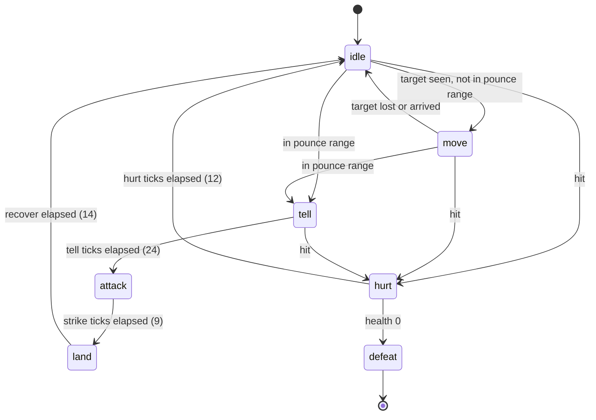

# TROG-01: Troglodyte family (Pygmy, Basher, Virtuoso) readability sets, design spec

**Status:** Pygmy base design drafted (spec and six draft keys); Basher and Virtuoso not started. In-betweens are copies. Review pending.

**Decision record (draft, Pygmy base):** height 40 px, frame 80 x 56, pivot (30, 55), palette `trog-family-v0` (15 of 20 colours). Proposed by the draft designer; to be confirmed by the senior designer.

The sections follow `docs/02-art/gob-01-goblin-spec.md`. Replace every `<fill: ...>`; write numbers, not adjectives. The design step stops at the keys and this spec (see the top-tier budget in `docs/07-agents/agent-orchestration.md`).

## 1. Canon and tone constraints

- Approved concept: `assets/concept/floor-01/enemies/floor01-troglodyte-family-approved.png`; `docs/02-art/floor-01-late-enemy-boss-concepts.md` records the whole family sheet as owner-approved visual concept. This work order covers the **Pygmy, Basher and Virtuoso**. The Juicer is on the same sheet but is a separate boss work order and is not cropped.
- Tone (`docs/01-design/antihero-tone.md`, enemies row): threatening yet eccentric, with motivated behaviors and readable tells and some absurd visual contrasts; never a purely serious faceless army and never comedic with no danger. 1980s-1990s action cinema is used for attitude only, never copied designs.
- Scope: one family, three readability sets (one per type), designed in one session (pipeline rule: families are designed together). The tag list and the frame tables below are the per-type template; the designer sets them for each type.
- Canon facts that must survive in pixels (from the approved docs and the concept board, not design decisions):
  - One species with shared cues: pale reddish-pink skin, wild dark hair (dreadlocked), pointed ears, wide mouth with yellow fangs and drool, ragged loincloths, hands with long fingers, bare feet.
  - Pygmy: small, hunched, lean, fast-looking; the key studies show move, leap and pounce.
  - Basher: bulky and heavily muscled, wrapped forearms and a necklace, trash on the shoulders; the studies show wind-up, smash and recovery.
  - Virtuoso: lean and tall, a ragged purple robe, gold bells and a bell on the back, a very long pink tongue; the studies show feint, tongue strike and retract.
- Design reading of the tone: the family reads as grotesque, nasty and a little absurd. The Pygmy is a gaunt, hunched, ribbed scavenger with a too-large head, matted dreadlocks, drool and a rag loincloth: it looks hungry and mean, not cute and not heroic. The danger is the tell (a coiled crouch with a gaping mouth) and the pounce; the absurd note is the oversized head and spindly reach. Attitude from 1980s-90s creature features only, no copied designs.

### Where the canon, size and mechanics are defined (checked 2026-11-18)

| Topic | Source | What it says |
| --- | --- | --- |
| Visual approval, all three | `docs/02-art/floor-01-late-enemy-boss-concepts.md` lines 12 to 14 and 36; `docs/02-art/floor-01-enemy-concept-roster.md` ("Later approved enemy and boss concepts") | The family sheet is an owner-approved visual concept; native scale and timings are pending |
| Pygmy | late-enemy doc line 12 | Small, aggressive, fast-looking silhouette with readable leap preparation; final native scale and attack timings pending |
| Basher | late-enemy doc line 13 | Bulkier melee-oriented member; heavy wind-up and impact poses; physical class, stats, damage and hitboxes **not** approved |
| Virtuoso | late-enemy doc line 14 | Leaner, unnerving silhouette with a prominent tongue-extension cue; tongue reach and poison mechanics need gameplay design, not inference from the sheet |
| Source accuracy | late-enemy doc line 24 | The book describes reptilian upper bodies reminiscent of Komodo dragons and long bent scaly legs; the approved sheet takes stronger humanoid/horror liberties; **do not silently reinterpret the sheet as book-accurate anatomy** |
| Setting | `docs/02-art/floor-01-art-atlas-v1.md` line 47 (panel 09) | Troglodyte territory sits in the Juicer's gym; fluorescent/accented light only there |
| Size | none | The only numbers are Carl 52 and Donut 40 printed on the sheet's lineup panel, which are not accepted native sizes |
| Production slot | `docs/07-agents/pixel-art-pipeline.md` lines 18, 19, 51, 103 | Batch 9 (Gym) with AREA-GYM-01; "Troglodyte base" is Medium (B), "Troglodyte variants" are Easy (C) |
| Backlog | `docs/04-production/backlog.md` line 13 | Records the visual approval of Pygmy, Basher, Virtuoso and the Juicer only; no work order, size, stats or mechanics |
| Juicer | `docs/02-art/floor-01-juicer-gym-standalone-concept.md` line 43 | A separate boss work order with its own scale note; out of scope here |

### Guardrails (copied from the late-enemy doc)

- Do not reinterpret the approved sheet as literal book anatomy, and do not claim the sheet is book-accurate (late-enemy doc line 24).
- Tongue reach, poison, leap range, smash damage, physical classes and hitboxes are **not** approved; the studies illustrate poses, not mechanics. Printed scale labels (Carl about 52 px, Donut about 40 px) are not accepted native sizes.
- Do not include the Juicer; keep his scale decision separate.
- Convert from original editable pixel grids / `.aseprite`, never by tracing or cropping the sheet.

### VFX and special states on the sheet

- Pygmy: a dust or splash mark at the pounce landing, a small "!" alert mark.
- Basher: a ground-impact debris and dust burst on the smash.
- Virtuoso: the extended tongue (a long moving part that is a gameplay-relevant silhouette), drool and swinging bells, a "!" alert mark on the feint.
- None of these is a projectile. Impact dust, the tongue strike's reach and any poison effect would be separate decisions or work orders; the sheet shows no poison effect.

### Packet inputs

- Concept crops in `docs/evidence/trog-01/packet/` (x,y,w,h in the 1448x1086 concept):
  - `concept_crop_1.png` = `50,265,250,205`: Pygmy
  - `concept_crop_2.png` = `320,180,330,290`: Basher
  - `concept_crop_3.png` = `665,175,335,295`: Virtuoso
  - `concept_crop_4.png` = `15,535,300,145`: Pygmy key study (move, leap, pounce)
  - `concept_crop_5.png` = `330,535,350,145`: Basher key study (wind-up, smash, recovery)
  - `concept_crop_6.png` = `695,535,335,145`: Virtuoso key study (feint, tongue strike, retract)
  - `concept_crop_7.png` = `135,775,365,140`: Basher facial studies (three)
  - `concept_crop_8.png` = `135,910,365,140`: Virtuoso facial studies (three)
  - `concept_crop_9.png` = `770,810,410,225`: the three types side by side in the scale-reference panel (Carl and Donut and the Juicer are cropped out)
  - The sheet has no dedicated shared-construction panel; the face crops and the side-by-side crop are the shared-construction references.
- `scale_lineup.png`: Carl 52, Donut 40, goblin 36, plus three empty candidate slots at 40, 48 and 56 px for the proposed base (the Pygmy). By eye in the sheet's lineup panel (Carl about 70 px tall in the 1448x1086 image), the Pygmy is about 50 px, the Basher about 83 px and the Virtuoso about 80 px at Carl's 52 px; the Pygmy is hunched, so its standing height would be larger. These are estimates to test, not approved sizes. The default 64 x 56 frame is a placeholder only, too small for the Basher and Virtuoso.
- Readability set (tags): `idle` (2-4), `move` (4-6), `tell` (1-2), `attack` (2-3), `hurt` (1), `defeat` (2-3); about 12 to 20 frames. Concrete tag names and frame counts are the designer's choice (section 4 and `frame_pivot_template.json` carry the toolkit defaults). Apply the set to each type.

## Difficulty and route

**Proposed base: the Pygmy** (a packet proposal for the designer to confirm). Reasons:

- It has the lowest cost: the smallest sprite and the simplest states (move, leap, pounce), with no tongue and no heavy impact debris.
- Setting the shared construction (skin ramp, hair, ears, fangs, loincloth, hands) at the smallest pixel budget is the constraint-first order: the Basher and Virtuoso then add detail rather than strip it. They are redrawn at their own sizes, never scaled up.
- The alternative is the Basher, the most typical troglodyte body and closest to the Juicer, but it scores 3 (Hard) as a base because it is both new and large with an impact burst.

**Difficulty scores** (1 point each: new design, above about 40 px, complex construction, VFX or special states):

| Type | New design | Above 40 px | Complex construction | VFX / special states | Score | Class and route |
| --- | --- | --- | --- | --- | --- | --- |
| Pygmy (base) | yes | arguable: 40 to 56 px candidates, scores at 41 px or more | no | no: leap dust is small and inside the readability set | 1 to 2 | Easy to Medium; **expected Medium (B)** at 48 px |
| Basher (variant) | no | yes: about 83 px by eye | no | yes: smash debris and dust burst | 2 | Medium (B) by the table, not Easy |
| Virtuoso (variant) | no | yes: about 80 px by eye | yes: a long tongue as a moving part | no (the tongue is counted as construction; drool and bells are small) | 2 | Medium (B) by the table, not Easy |

Reasoning: the expected "variants are Easy" only holds if the variants stay at or below about 40 px or are drawn as pure recolours, which the sheet contradicts; at the sizes the sheet implies, each scores 2. If the smash debris and tongue VFX were deferred, the Basher would score 1 and the Virtuoso 1 (Easy). The designer must decide the sizes first, because the class follows from them.

## 2. Size decision

Carl is 52 px (about 6 ft), Donut 40 px, the goblin 36 px (see `scale_lineup.png`). The Pygmy is hunched, so the idle opaque height is the top of the hair to the soles, not a standing height.

| Option | Idle opaque height | Ratio to Carl | Implied real height | Why / why not |
| --- | --- | --- | --- | --- |
| A | 40 px | 0.77 | about 4.6 ft crouched (a taller standing height if it straightened) | Small next to Carl, 4 px taller than the goblin, same height as Donut but a very different silhouette and colour. Scores 1 in the difficulty table (not above 40 px). The Basher and Virtuoso then land near 64 to 66 px (see 2b), a 1.2x Carl brute instead of a 1.6x one. |
| B | 48 px | 0.92 | about 5.5 ft crouched | Almost Carl's height: the "small" canon is lost, and the family sizes rise to about 80 px (frames around 128 x 96). The packet proposal. |
| C | 56 px | 1.08 | about 6.5 ft crouched | Taller than Carl; contradicts "small" outright. |

Decision: **40 px** (option A). The sheet's lineup puts the Pygmy clearly below Carl and well below the Basher and Virtuoso; at 40 px it keeps that order, stays inside the Easy-to-Medium budget, keeps the airborne frame inside a 80 x 56 cell, and leaves the face about 10 x 10 px, which is enough for a red-rimmed eye, brow, wide mouth with fangs and a drool strand. The cost is a thinner face than 48 px would give. Proposed by the draft designer (Claude Sonnet), departing from the packet's 48 px proposal; the decider is the senior designer who edits this draft.

## 2b. Shared construction (for the Basher and Virtuoso work orders; not drawn here)

These are the rules the Pygmy sets. The Basher and Virtuoso are redrawn at their own sizes from these rules, never scaled up from the Pygmy pixels.

- **Body plan:** a hunched biped with long, thin arms that reach the floor, a lean ribbed torso (1 px shade strokes on the flank, `ribs`), deep-bent legs and bare feet. Hips and shoulders are thick lines of radius 4 to 4.6 px at 40 px; limbs taper 2.4 to 0.8 px. The Basher widens the torso and shoulders (radius about 7 at 66 px) and keeps the long arms and bare feet. The Virtuoso keeps the lean torso and lengthens every limb about 15 %.
- **Head:** a large, forward-thrust head, about one quarter of the idle height wide (10 px at 40 px, so about 16 px at 64 px), set low and ahead of the shoulders, pointing right in the authored facing. One pointed ear swept back and up (a 3-point polygon), one near-side red-rimmed eye (2 px of eye white `w`, a dark pupil, a red `e` pixel under it), a K brow bar above the eye, a wide mouth line that reaches the back of the cheek, and two to four yellow fangs `t` hanging over the lip with a shade fang `T`, plus a 2 px drool strand `w`. The four face templates (`snarl`, `roar`, `pain`, `dead`) are in `FACES`; larger types redraw them with more rows, not by scaling.
- **Hair:** dark `H`/`I` dreadlocks: 3 to 4 thin (about 1.5 px) ropes standing up and back from the crown, a short forelock over the brow, thicker and longer on the larger types. Hair is behind the head and ears. The silhouette must not read as horns: keep the ropes bent and uneven.
- **Skin ramp:** one ramp for the family, `d` `#5a2c3f` (deep, cool), `s` `#8c4651`, `m` `#bf6f64`, `l` `#e5a08c` (torch-lit), with the far limbs on a darker `K`/`d`/`d`/`s` ramp. Pale reddish-pink, cooled and pinked so it separates from the orange brick; the upper-left rim is `l`.
- **Cloth:** a ragged loincloth with a torn hem, `c` `#3b2f2c` and `C` `#72604d`. Bare hands with three long fingers and bare feet in every type.
- **Palette:** 15 of 20 colours used (`K d s m l H I c C w e t T o q`). Five slots are kept free: one grey wrap tone for the Basher (forearm wraps, necklace string, trash), three for the Virtuoso's purple robe ramp, one gold for his bells. His long pink tongue reuses `q`. Variants must not take more than these five.
- **Frame and pivot convention:** facing right, pivot on the contact row, about 6 px of margin behind the pivot for hair and trailing legs and the body reach ahead of the pivot is larger than the margin behind it. Sizes of the other types are not decided here: by the sheet's by-eye ratios (Basher about 1.66x, Virtuoso about 1.6x the Pygmy) they would be about 66 and 64 px, to be confirmed by their own size studies.

## 3. Frame, pivot, boxes and atlas

- Frame **80 x 56**, pivot **(30, 55)**, contact row **55** (the lowest opaque row of every grounded frame). The pounce reaches 30 px ahead of the pivot and 29 px behind it; the idle stays inside -14 to +20.
- Grounded tags: `idle`, `walk`, `attack_tell`, `attack_land`, `hurt`, `down`. Airborne tag (no pixel on row 55): `attack_leap`.
- Boxes are placeholders in px from the pivot (x forward, y up), measured from the key bounding boxes, not approved mechanics (`BOXES` in `scripts/author_trog01.py`, also in the manifest):

| Box | x | y | Frames |
| --- | --- | --- | --- |
| Standing (opaque extent) | -14 to 20 | 0 to 39 | idle |
| Hurtbox idle/walk (trunk and head, not the reaching arm or the dreads) | -14 to 17 | 0 to 36 | 0 to 6 |
| Hurtbox tell/land | -17 to 14 | 0 to 24 | 7, 8, 11 |
| Hurtbox leap | -24 to 18 | 5 to 37 | 9, 10 |
| Hurtbox hurt | -12 to 12 | 0 to 43 | 12 |
| Hurtbox down | -19 to 14 | 0 to 20 | 13 to 15 |
| Attack hitbox (impact frame only) | 12 to 30 | 16 to 34 | 10 |

- Authored facing right; the runtime mirrors around the pivot column.
- One atlas, frames 0 to 15, one layer: `body`.

## 4. Readability-set animation list

Tick windows are at 60 Hz. The attack is a pounce in three tags so the airborne frames keep their own contact rule: `attack_tell` (grounded coil), `attack_leap` (airborne launch and strike) and `attack_land` (grounded landing and recovery, with a little dust).

| Role | Tag | Frames | Playback | Ticks | Notes |
| --- | --- | --- | --- | --- | --- |
| idle | `idle` | 3 | loop | 12 + 8 + 12 = 32 | breathing cycle |
| move | `walk` | 4 | loop | 4 x 6 = 24 | a crouched scuttle, 0.4 s per cycle; the speed comes from the gameplay spec |
| tell | `attack_tell` | 2 | once | 6 + 18 = 24 | an 18-tick hold of the coil is the read window |
| attack | `attack_leap` | 2 | once | launch 3 + strike 6 = 9 | the hitbox is active on frame 10 only |
| (recover) | `attack_land` | 1 | once | 14 | landing, dust, vulnerable recovery |
| hurt | `hurt` | 1 | once | 12 | |
| defeat | `down` | 3 | hold | 4 + 8, then a state-driven hold | |

Tell-to-attack read: the attack starts 24 ticks after the tell begins; the leap starts at tick 24, the strike pose and hitbox are active on ticks 27 to 32, and the Pygmy is back in a grounded, hurtable crouch at tick 33 for 14 ticks (to tick 46). Leap range, damage and speed are placeholders. The tell pose (the lowest grounded silhouette, hands planted, mouth wide open) must be readable for at least 18 ticks (300 ms) before the leap.

Frame table:

| # | Tag | Pose | Ticks | Author |
| --- | --- | --- | --- | --- |
| 0 | `idle` | **KEY** hunched crouch, knuckles near the floor, head thrust forward, dreads up | 12 | key |
| 1 | `idle` | copy of 0 | 8 | copy |
| 2 | `idle` | copy of 0 | 12 | copy |
| 3 | `walk` | **KEY** scuttle contact: body low and forward, near hand planted ahead, far leg trailing | 6 | key |
| 4 | `walk` | copy of 3 | 6 | copy |
| 5 | `walk` | copy of 3 | 6 | copy |
| 6 | `walk` | copy of 3 | 6 | copy |
| 7 | `attack_tell` | copy of 8 | 6 | copy |
| 8 | `attack_tell` | **KEY** coiled: haunches raised and loaded, shoulders and head dropped forward, hands planted, mouth wide | 18 | key |
| 9 | `attack_leap` | copy of 10 | 3 | copy |
| 10 | `attack_leap` | **KEY** strike: body stretched flat in the air, arms thrown forward with spread fingers, legs trailing, mouth wide | 6 | key |
| 11 | `attack_land` | the tell crouch plus 9 dust pixels inside the frame | 14 | generated (tell + dust) |
| 12 | `hurt` | **KEY** thrown upright and back, head snapped up, near arm flung, eye shut, mouth open | 12 | key |
| 13 | `down` | copy of 15 | 4 | copy |
| 14 | `down` | copy of 15 | 8 | copy |
| 15 | `down` | **KEY** on its back, limbs splayed, tongue out, crossed eye | hold | key |

## 5. State diagram



## 6. Palette

Family palette `trog-family-v0`, 15 of at most 20 colours; five slots are free for the Basher and Virtuoso (see 2b). Whether the three types share one atlas palette is decided as: yes, one shared palette per family, extended by those five slots, no per-type recolours of the skin ramp.

The 24 packet candidates are mostly background navy (about 15 of them), so the creature colours were picked by eye. The warm pinks (`#e5916a`, `#ebac81`, `#db7854`) informed the skin ramp, which was pinked and cooled so it does not merge with the orange brick; `#9b3b2f`, `#6f362d` and `#462427` informed the shade and mouth tones.

| Key | Name | Hex | Role |
| --- | --- | --- | --- |
| `K` | outline_plum | `#1a1017` | outline and eye pupil |
| `d` | skin_deep | `#5a2c3f` | skin shadow, far-limb base |
| `s` | skin_shade | `#8c4651` | skin shade, rib strokes |
| `m` | skin_mid | `#bf6f64` | skin body |
| `l` | skin_light | `#e5a08c` | torch-side rim |
| `H` | hair_deep | `#1d1721` | dreadlocks |
| `I` | hair_mid | `#403442` | dreadlock highlight |
| `c` | cloth_deep | `#3b2f2c` | loincloth shade, dust |
| `C` | cloth_mid | `#72604d` | loincloth, dust |
| `w` | eye_white_drool | `#efe4c4` | eye white and drool (accent) |
| `e` | eye_red | `#d83a22` | red rim of the awake eye (accent, absent when hurt or dead) |
| `t` | fang_yellow | `#e6bd3a` | fangs and teeth (accent) |
| `T` | fang_shade | `#967022` | fang shade |
| `o` | mouth_dark | `#4a1020` | open mouth |
| `q` | tongue_pink | `#c8566a` | tongue (defeat) and the Virtuoso's tongue |

## 7. Key poses

Design units are px right of the pivot column and up from the contact row. Frozen by `pixelart freeze` once the review passes (the fixture currently records the draft).

| Frame | Tag | Silhouette and pose notes | Readability reason |
| --- | --- | --- | --- |
| 0 | `idle` | Top 40 px (rows 16 to 55), x -14 to 20. Hips (-10, 15) rise to the shoulder hump (3, 25); head at (12, 26) pushed ahead of the shoulders; near arm hangs from (4, 22) to the hand at (15, 3); four dreads fan up and back. Snarl face. | A hunched, long-armed silhouette that no other Floor 1 enemy has; the head leads. |
| 3 | `walk` | Top row 20, x -18 to 26. Body drops 4 px and leans forward; near hand reaches to (21, 3); the far leg trails to (-17, 2); dreads stream backward. | Lower and longer than the idle: reads as a scuttle, not a stand. |
| 8 | `attack_tell` | Top row 25 (31 px), x -17 to 22. Hips up at (-12, 16), shoulders down at (3, 13), head dropped to (12, 15) with the mouth wide, both hands planted at (17 to 19, 1); legs folded. | The lowest, most compact grounded pose with a gaping mouth: "about to spring". |
| 10 | `attack_leap` | Top row 18, bottom row 50 (3 px off the floor), x -29 to 30. Body flat from (-13, 17) to (4, 23); arms thrown to (25, 22); legs trail to (-25, 6); roar face. | A long horizontal bar, longer than any other pose; arms and mouth forward mark the hitbox. |
| 12 | `hurt` | Top row 12 (44 px), x -12 to 22. Torso arched back from (-8, 14) to (0, 28), head snapped up at (5, 34), near arm flung forward; eye a shut stroke, no red. | The tallest pose and the only one with the head above the back: it reads as a recoil. |
| 15 | `down` | Top row 35 (21 px), x -19 to 22. On its back; knee raised at (-9, 10); near arm up; head at (11, 6); tongue out, crossed eye. | Lowest, flat on the floor; the red eye is gone. |

## 8. In-between list

For the execution tier. No design decisions are needed beyond the notes. Frames 11 (generated from the tell pose plus dust) is the only non-key frame that is not a straight copy.

| # | Pose notes |
| --- | --- |
| 1 | Idle breath: head and shoulders 1 px lower, dread tips shifted 1 px. |
| 2 | Idle: back to 0 with the dreads swayed 1 px the other way. |
| 4 | Walk: near leg planted, far arm swinging forward, body up 1 px. |
| 5 | Walk passing pose: both legs gathered under the hips, body highest of the cycle. |
| 6 | Walk: far hand planted, near leg trailing, mirror of 3 with the limbs swapped. |
| 7 | Tell onset: halfway from the idle to 8 (hips up, head half down, mouth closed). |
| 9 | Launch: body stretched, feet leaving the floor, one frame before 10. |
| 11 | Landing: keep the crouch of 8 with the head rebounding 1 px; dust stays at the 9 px level (see VFX below). |
| 13 | Down: hurt pose falling back, feet off the floor by 1 px. |
| 14 | Down: floor impact, the body flat and the limbs still flung wide. |

## 9. Validators and readability rules

Run by `python3 -m scripts.pixelart validate assets/source/characters/troglodyte/trog_01.pixelart.json` (rules V01 to V15; currently 13 pass, 3 skipped).

- V04 palette: at most 20 colours (15 used); V05 isolated pixels: 0; V06 orphan pixels: at most 9 per frame.
- V07/V08 contact rows: grounded tags end on row 55; `attack_leap` never touches it (bottom row at most 52).
- V09 frozen keys: SHA-256 per key frame, fixture `tests/fixtures/trog-01_keys.json` (6 keys: 0, 3, 8, 10, 12, 15).
- V12 unique frames: off, because the in-betweens are copies of the keys until the executor draws them. Switch it on when they exist.
- V13 bounding boxes: idle height 40 (top row 16); walk lower than idle (top at least 18); tell, land lowest and at most 44 wide (top at least 22); leap clear of the floor and top at most 22; hurt tallest (top at most 14); down low (top at least 32, at most 50 wide).
- V14 key counts: red eye in the idle; the tell and leap mouth (dark `o`, at least 8 pixels); no red eye when hurt or down; the tongue (`q`, at least 3 pixels) in the defeat key.
- Extra tests: `tests/test_art_trog01.py` (generator parity, ticks, size, airborne contact, tell lowest, landing diff).

## 10. Evidence

```text
python3 -m scripts.pixelart validate assets/source/characters/troglodyte/trog_01.pixelart.json --out <dir>
python3 -m scripts.pixelart evidence assets/source/characters/troglodyte/trog_01.pixelart.json --out <dir>
python3 -m scripts.pixelart review-pack assets/source/characters/troglodyte/trog_01.pixelart.json --out <dir>
python3 scripts/author_trog01.py key0-scale      # docs/evidence/trog-01/key0-scale.png
```

`docs/evidence/trog-01/key0-scale.png` (960 x 360): key 0 at 1x on lit Floor 1 next to Carl and GOB-01 (left, 640 x 360, no scaling), and a 4x copy of key 0 (right). The full review pack (contact sheet, lit scene, tell-to-attack strip) is not generated at this draft stage.

VFX notes (separate work orders, out of scope here): the landing dust is 9 pixels inside the frame; a bigger pounce splash or ground streak and the small "!" alert mark from the sheet are VFX/UX work orders. The Basher's smash debris and the Virtuoso's tongue strike are likewise separate.

## 11. Files

| File | Role |
| --- | --- |
| `assets/source/characters/troglodyte/trog_01.grid.json` / `.ase` | pixel-grid source and Aseprite master (16 frames) |
| `assets/manifests/trog-01.json` | manifest (tick rows, boxes, attack ticks) |
| `assets/source/characters/troglodyte/trog_01.pixelart.json` | the asset config |
| `scripts/author_trog01.py` | deterministic authoring script (`frames`, `key0-scale`) |
| `tests/fixtures/trog-01_keys.json` | frozen draft keys |
| `tests/test_art_trog01.py` | spec tests |
| `docs/evidence/trog-01/key0-scale.png` | scale evidence |

## 12. Rights and provenance

Fan-concept art under the owner-reported `ART-PUBLICATION-ALL-V1` scope (see `docs/04-production/rights-and-release.md`). No tracing of the concept, no image-model raster output.

### Rights/Provenance

- Concept: owner-approved reference under `ART-PUBLICATION-ALL-V1`; crops are for reference only, never traced or exported.
- Packet: script output plus a medium-tier executor (stage P).
- Draft spec and keys (Pygmy only): Claude Sonnet. Key edit and independent review: pending.
- No third-party assets, no copied designs or dialogue, no image-model raster output.

## 13. Open questions for the senior designer

- Size 40 px against the packet's 48 px: confirm or change; the frame (80 x 56) and the family sizes follow.
- The dreads read a little like horns at 1x: thicker, more bent ropes may be needed. The face (eye, fangs) is only about 10 x 10 px: check it at gameplay scale.
- The in-betweens are copies, so the walk is a slide for now; the pounce range, damage and boxes are placeholders.
- Whether `attack_land` should be a separate tag (as drawn) or merged into the attack once the airborne rule is settled.
