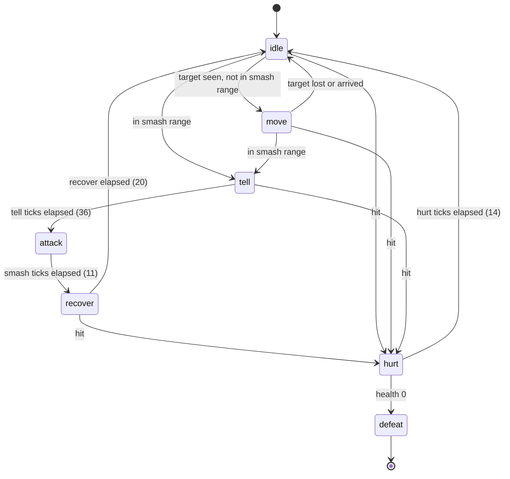

# TROG-02: Troglodyte Basher readability set, design spec

**Status:** executed, awaiting independent review. Hero key 0 (`idle`) passed the silhouette gate after the seven FIX-KEY0 fixes and is frozen; the three deviations from TROG-01 2b are accepted and folded into it (section 13). Keys 3, 8, 10, 11, 12, 15 and the nine in-betweens are drawn and frozen (7 keys), the validators pass (14 pass, 0 fail, 2 skipped) and the review pack is in `docs/evidence/trog-02/review-pack/`. Executor notes: section 14.

**Decision record:** idle opaque height 66 px (family ladder), frame 112 x 88, pivot (48, 87), palette `trog-family-v0` core (15) plus 2 Basher slots (`g`, `G`) = 17 of 20, 16 frames with 7 keys in the same slots as the Pygmy (0, 3, 8, 10, 11, 12, 15), all tags grounded, smash debris and dust deferred to the VFX work order. Difficulty 1 point: **Easy (C)**.

The Basher is a variant of the TROG-01 Pygmy base. It is redrawn at its own size from the family construction in `docs/02-art/trog-01-spec.md` section 2b, never scaled up from Pygmy pixels. Section numbers follow the TROG-01 spec.

## 1. Canon and tone constraints

- Canon (cited, not re-decided): `docs/02-art/trog-01-spec.md` section 1. The Basher is the "bulkier melee-oriented member; heavy wind-up and impact poses" of the owner-approved family sheet (`docs/02-art/floor-01-late-enemy-boss-concepts.md` line 13); its physical class, stats, damage and hitboxes are **not** approved. Shared cues: pale reddish-pink skin, dark dreads, pointed ears, wide mouth with yellow fangs and drool, ragged loincloth, long-fingered hands, bare feet. Basher cues: bulky and heavily muscled, wrapped forearms, a necklace, trash on the shoulders; the key study shows wind-up, smash and recovery.
- Packet references: `docs/evidence/trog-01/packet/concept_crop_2.png` (figure), `concept_crop_5.png` (wind-up, smash, recovery), `concept_crop_7.png` (face row), `concept_crop_9.png` (side by side). Reference only, never traced.
- Tone (`docs/01-design/antihero-tone.md`, enemies row): threatening yet eccentric. Design reading: a slow, hunched, ape-backed brute whose head is absurdly small for its shoulders, with junk piled on its back and a tooth-and-bone necklace. It is dangerous because of the wind-up and the floor smash. It is grimy, not heroic: no clean muscle-man anatomy, no armour, no polished skin. Attitude comes from 1980s-90s creature features only, with no copied designs.

## Difficulty and route

One point each: new design, above about 40 px, complex construction, VFX or special states.

| Criterion | Basher | Why |
| --- | --- | --- |
| New design | no | a variant: it keeps the family construction, ramps, face order and hair rule |
| Above 40 px | **yes** | 66 px |
| Complex construction | no | no long moving part; the wraps, necklace and trash are stamps or small parts on the family canvas |
| VFX / special states | no | the smash debris and dust burst are **deferred** to their own VFX work order (the sprite carries none) |
| **Score** | **1** | **Easy (C)**, as `docs/07-agents/pixel-art-pipeline.md` expects for troglodyte variants |

## 2. Size decision

The height comes from the family ladder (`trog-01-spec.md` 2b): **66 px** idle opaque height (top of the mop to the knuckles and soles), 1.65x the Pygmy's 40 px and 1.27x Carl's 52 px. Key 0 measures exactly 66 (rows 22 to 87). In `docs/evidence/trog-02/key0-scale.png` it looms over Carl by about a quarter without filling the screen, and it leaves the Juicer (84 px or more) clearly above it.

Construction numbers at H = 66 (design units: px right of the pivot column, up from the contact row):

| Part | Value | Rule |
| --- | --- | --- |
| Head | skull r 6.5 (0.10 H), jaw r 6.0, skull 4.5 behind and 1.6 above the jaw centre; head width 17 px (0.26 H) | 2b: 0.25 H, never above 0.27 H; constant in every pose |
| Head placement (idle) | jaw centre (14, 52); trapezius peak (-1, 60.5) | the jaw centre is 8.5 px (0.13 H) **below** the peak and 15 px ahead of it |
| Spine | hips (-18, 31) to the shoulder (5, 47): about 35 degrees | 2b |
| Torso radii | 8.0 hips, 10.0 belly, 9.5 shoulder; trapezius masses r 8.0 to 9.0 | 2b says 7 to 8 px; widened to 9 to 10 so the brute reads at 1x (see below) |
| Near arm | deltoid disc (3, 39) r 5.5 (its own part, so a 1 px `K` rim separates it from the chin and the chest); upper arm (4, 38) r 5.0 to the elbow (12, 31) r 4.6 to (17, 25); forearm part (17, 25) r 4.8 to the wrist (22, 11) r 3.6; shoulder to wrist about 31 px (0.47 H) | the shoulder hangs below the jaw (jaw bottom y 46, deltoid top 44.5); knuckles on the floor in the idle |
| Hands | `planted_fist(x, y)`: a fist mass r 3.6 under the wrist, a knuckle block r 1.6 (2 to 3 rows) on the contact row 5.4 px long, and two 1 to 2 px claw tips at its front (the third claw hidden in profile); each a separate part, so `K` lines show the curled fingers. The far fist is the same in the `far` ramp | a fist on its knuckles, not a rake |
| Legs | short, thick and deep-bent: near thigh r 7.5, knee r 5.6, shin r 4.5, foot r 1.8; far leg 6.4, 4.8, 3.6, 2.2 | bare feet, dirt-caked on the two rows above the contact row |
| Hair | flat mop about 3 px (0.05 H) above the skull top with two rope-tip notches on its top edge; 5 ropes r 1.5, the longest 0.45 H behind the jaw; a short front lock; **dull** knots on ropes 0 to 2 (`T`, `C`, `T`), never `w` | 2b hair rule (no rope rises above the crown) |
| Ear | pointed, straight back, skin over the mop, below the crown | 2b |

Two deviations from the first 2b values, **accepted at the silhouette gate** and folded into `trog-01-spec.md` 2b:

1. **Head sink, 0.13 H instead of 0.05 to 0.08 H.** With the jaw centre 3 to 5 px below the trapezius peak, the first two drafts showed the head sitting **on top of** the shoulders at 1x, like a Pygmy head on a big body. With the head 8 to 9 px below the peak and the trapezius masses rising level with the skull, it reads as "sunk between the shoulders" (the concept). The test `test_small_head_on_a_big_body` pins 0.12 to 0.14 H.
2. **Mop height, 0.05 H instead of about 0.15 H above the skull top.** A tall mop on a 17 px head doubled the head's apparent size and broke the "small head" read. The flatter mop also keeps the idle at exactly 66 px.

Torso radii of 9 to 10 px (first 2b value 7 to 8; also accepted) are the same kind of fix: at 7 to 8 px the 66 px figure read as a lanky ape, not a brute.

## 3. Frame, pivot, boxes and atlas

- Frame **112 x 88**, pivot **(48, 87)**, contact row **87**. The 88 px height leaves room for the wind-up (key 8, fists overhead, up to 81 px tall). The 48 px behind the pivot hold the backward fall (key 15) and the trailing far leg; the 63 px ahead hold the smash reach.
- Key 0 extent: x -31 to +30, rows 22 to 87.
- All tags are grounded (V07: the lowest opaque row of every frame is 87). There is no airborne tag: the Basher never leaves the floor.
- Authored facing right; the runtime mirrors around the pivot column. One atlas, one layer `body`.
- Boxes are **placeholders**, in px from the pivot (x forward, y up). Each box is re-measured from the drawn keys by the execution stage and none is an approved mechanic. Hurtboxes cover the trunk and head and leave out the trash heap, the ropes and the fingers. The hitbox covers both fists on the floor:

| Box | x | y | Frames |
| --- | --- | --- | --- |
| Standing (opaque extent) | -31 to 30 | 0 to 65 | 0 (measured) |
| Hurtbox idle/walk | -26 to 24 | 0 to 58 | 0 to 6 |
| Hurtbox tell (wind-up) | -22 to 18 | 0 to 70 | 7, 8 |
| Hurtbox smash | -24 to 30 | 0 to 48 | 9, 10 |
| Hurtbox recover | -24 to 30 | 0 to 44 | 11 |
| Hurtbox hurt | -26 to 8 | 0 to 70 | 12 |
| Hurtbox down | -40 to 24 | 0 to 24 | 13 to 15 |
| Smash hitbox (impact frame only) | 24 to 46 | 0 to 14 | 10 |

## 4. Readability-set animation list

Ticks are at 60 Hz. The Basher is slow and heavy: a long wind-up hold is its read, and a long spent recovery is the punish window. That makes three attack tags, the same split as the Pygmy so that gameplay can address each window by name.

| Role | Tag | Frames | Playback | Ticks | Notes |
| --- | --- | --- | --- | --- | --- |
| idle | `idle` | 3 | loop | 14 + 10 + 14 = 38 | slow, heavy breathing |
| move | `walk` | 4 | loop | 4 x 8 = 32 | a lumbering knuckle-walk, 0.53 s per cycle; the speed comes from the gameplay spec |
| tell | `attack_tell` | 2 | once | 8 + 28 = 36 | a 28-tick (467 ms) hold of the wind-up is the read window |
| attack | `attack_smash` | 2 | once | downswing 3 + impact 8 = 11 | the hitbox is active on frame 10 only |
| (recover) | `attack_recover` | 1 | once | 20 | spent, fists still on the floor: the punish window |
| hurt | `hurt` | 1 | once | 14 | |
| defeat | `down` | 3 | hold | 5 + 10, then a state-driven hold | |

**Tell-to-attack read:** the wind-up starts at tick 0. The rise (frame 7) runs ticks 0 to 7 and the wind-up hold (frame 8) ticks 8 to 35. The downswing (frame 9) runs ticks 36 to 38, the impact with the hitbox active (frame 10) ticks 39 to 46, and the recovery (frame 11) ticks 47 to 66. The tell is 12 ticks longer than the Pygmy's 24 because a heavy hitter must be telegraphed more. The attack itself is just as fast (11 ticks), so the smash still lands as a slam, not a push. The wind-up pose (the tallest grounded silhouette, fists locked overhead, mouth gaping) must stay readable for at least 28 ticks. Damage, reach and the debris area are placeholders.

Frame table:

| # | Tag | Pose | Ticks | Author |
| --- | --- | --- | --- | --- |
| 0 | `idle` | **KEY (drawn, frozen)** hunched brute, both fists knuckle-planted, small head sunk forward between the shoulders | 14 | key |
| 1 | `idle` | breath: torso, masses and head 1 px lower, ropes swayed 1 px back (`sway` 1) | 10 | in-between |
| 2 | `idle` | key posture, ropes swayed 1 px forward (`sway` -1) | 14 | in-between |
| 3 | `walk` | **KEY** knuckle-walk contact A: near fist planted far ahead, far fist planted behind it, near leg pushing back | 8 | key |
| 4 | `walk` | body up 1 px, near fist sliding back, far fist lifting | 8 | in-between |
| 5 | `walk` | passing: both fists near the chest line, body highest, near fist 2 px off the floor | 8 | in-between |
| 6 | `walk` | contact B: far fist planted ahead, near fist off the floor, legs swapped | 8 | in-between |
| 7 | `attack_tell` | rise: halfway from 0 to 8, arms coming up past the chest, mouth closed (snarl) | 8 | in-between |
| 8 | `attack_tell` | **KEY** wind-up: reared up, both fists locked together overhead, mouth gaping | 28 | key |
| 9 | `attack_smash` | downswing: 0.6 of the way from 8 to 10, fists at head height ahead, ropes lifted | 3 | in-between |
| 10 | `attack_smash` | **KEY** impact: both fists slammed into the floor far ahead, body pitched forward and low | 8 | key |
| 11 | `attack_recover` | **KEY** spent: slumped over the planted fists, head dropped, panting | 20 | key |
| 12 | `hurt` | **KEY** thrown back: torso tilted back, head above the trapezius, near arm flung back and up | 14 | key |
| 13 | `down` | backward fall beat, about 45 degrees, feet still on the floor | 5 | in-between |
| 14 | `down` | floor impact on the back: the key-15 layout with the head and belly bounced 1 px up | 10 | in-between |
| 15 | `down` | **KEY** fallen backward on its back, feet toward the player, tongue out | hold | key |

## 5. State diagram



Whether a hit during the wind-up interrupts the smash (no super armour) is a gameplay decision; the diagram assumes it does, the same as the Pygmy.

## 6. Palette

Family palette `trog-family-v0`: the 15 core colours are imported unchanged from `scripts/author_trog01.py` (`PALETTE`; see `trog-01-spec.md` section 6), plus the Basher's 2 allocated slots. The total is 17 of 20. One family atlas holding the Pygmy, the Basher and the Virtuoso stays at 20, because the Virtuoso keeps 3 slots.

| Key | Name | Hex | Role |
| --- | --- | --- | --- |
| `K d s m l` | outline and skin ramp | core | the same ramp as the Pygmy; the far limbs use `K d d s` |
| `H I` | hair | core | dreads |
| `c C` | cloth | core | loincloth, wrap shade (`c`), trash heap (`c`/`C`) |
| `w e t T o q` | accents and mouth | core | eye, drool, teeth, tusks, necklace beads (`t`/`w`), bone on the heap (`w`), can (`t`/`T`) |
| `g` | wrap_mid | `#6b604f` | **Basher slot 1**: forearm wraps, mid |
| `G` | wrap_light | `#9c8f74` | **Basher slot 2**: forearm wraps, torch-lit side (dirty linen, not white) |

Wraps are **colour bands on the forearm skin** (`wrap_bands`), not parts with their own silhouette, so the wrapped forearm is no wider than the bare one (a separate grey cylinder read as an armoured gauntlet at the gate). Inside a band (a design-y range), lit skin and the 2 px lit edge go to `G`, the rest to `g`, deep shade to `c`, and the band's lowest row is a `c` fold. At least one skin row stays between bands. Key 0 bands: y 21.5 to 25, 16.5 to 19.5, 11 to 14.5 (three bands, 2 skin rows between). No `e` (eye red) anywhere outside the awake eye, because V14 counts it in hurt and defeat.

## 7. Key poses

Coordinates are design units. Key 0 is the reference. For keys 3 to 15, the joints below are the starting rule set for `POSES` in `scripts/author_trog02.py`; the drawn key must meet the bbox and count targets in section 9, and joints may move by up to 2 px to meet them.

| Frame | Tag | Silhouette and pose (joints) | Readability reason |
| --- | --- | --- | --- |
| 0 | `idle` | **Drawn, gated.** Top row 22 (66 px), x -31 to 30. Torso (-18, 31) to (-7, 40) to (5, 47); trapezius masses (-6, 47) r 8.5, (-1, 51.5) r 9, (5, 50) r 8; jaw centre (14, 52). Deltoid (3, 39) r 5.5; near arm (4, 38) to (12, 31) to (17, 25), forearm to the wrist (22, 11) with three wrap bands; `planted_fist(22, 9)`. Far arm (0, 41) to (8, 25) to the wrist (11.5, 9), `planted_fist(11.5, 8)` in the far ramp. Near leg (-13, 30) to the knee (-4, 20) to (-7, 8) to the toes (3, 1.5); far leg back to (-27, 6). Ragged loin at (-13, 28), 13 deep. Three trash lumps on the upper back (x -24 to -7) with a can (`t`/`T`) and a bone (`w`). A necklace V of 7 alternating `t`/`w` beads under the jaw, with a 2 px `w` pendant. Snarl face. 10 grime smudges (2 x 2 `d`) on the forearm skin, knee, belly, thigh, feet and back; 4 creases in `d`, the pec and elbow ones 2 px wide. | A shoulder-heavy, low, wide hunch. The head is small and forward, the arm hangs from a rimmed shoulder, and the forearms carry cloth bands. Nothing else on Floor 1 has this mass. |
| 3 | `walk` | Top row at least 24 (64 px or less). Body 2 px lower and 3 px forward: torso (-17, 29) to (-5, 38) to (8, 45); masses +3 x, -2 y; jaw (17, 50). Near arm reaches far ahead to the wrist (28, 10), fist planted with claws to about x 38; far arm trailing, wrist planted at (4, 10). Near leg pushing back: (-12, 28) to (-6, 18) to (-14, 6) to the toes (-9, 1.4). Far leg forward: (-19, 28) to (-14, 17) to (-16, 5) to (-11, 1.4). Ropes `sweep` 0.5. Snarl face. | Longer and lower than the idle, leading with one fist: a lumbering advance. |
| 8 | `attack_tell` | Top row 7 to 12 (76 to 81 px; the tallest frame). Reared up: hips (-10, 30) to (-6, 42) to the shoulders (-2, 54), spine about 75 degrees; masses (-6, 58) r 8.5 and (0, 57) r 8; jaw (6, 58) with `jaw_b(drop=1)`, `roar` face. Both upper arms rise from the shoulders to the elbows at about (-5, 68) and (4, 68). The forearms meet overhead: wrists at (-1, 75) and the two fists locked into one block about 8 px wide, top at y 79 to 80; wrap bands on both forearms. Wide braced stance: near leg (-6, 28) to (2, 16) to (0, 5) to (6, 1.4), far leg (-14, 28) to (-20, 16) to (-22, 5) to (-17, 1.4). Loin hangs straight. Ropes hang down the back (`sweep` 0). At most 50 wide. | The only tall, narrow pillar in the set, with the fists overhead and a gaping mouth: "the hammer is up". |
| 10 | `attack_smash` | Top row at least 38 (50 px or less), at most 84 wide. Pitched forward and down: hips (-16, 30), the high point; shoulders (10, 34); jaw (21, 36), down between the shoulders, `roar` face. Both arms straight down and forward; both fists flat on the contact row with the knuckles at x 28 to 42 (near fist in front, far fist 3 px behind and darker); wraps visible. Near leg braced (-12, 28) to (-4, 16) to (-10, 5) to (-4, 1.4); far leg kicked back (-20, 28) to (-28, 14) to (-34, 4) to (-30, 1.4). Ropes flung forward (`sweep` -0.8). **No debris or dust in the sprite** (VFX order). | The longest and lowest frame, with the fists on the floor far ahead: impact. It contrasts with 8 at once (tallest to lowest). |
| 11 | `attack_recover` | Top row at least 42 (46 px or less). Key 10 slumped: hips (-15, 26), shoulders (8, 32), jaw (18, 31), 5 px lower than the impact head; fists still on the floor at x 26 to 38 with the fingers relaxed; far leg drawn in to (-24, 3). `pant` face (lid over the eye, slack mouth, at most 16 `o`). Ropes flopped down (`sweep` 0). | Low, closed and spent: "hit it now", never "about to smash again". |
| 12 | `hurt` | Top row at most 16 (72 px or more; taller than the idle). Torso tilted back from the hips (-6, 28) to the shoulders (-14, 50); jaw (-8, 58), **above** the trapezius (the only pose where it is), `pain` face (`jaw_b(drop=0.6)`). Near arm flung back and up to the wrist (-28, 58), fingers fanned; far arm limp forward and down to (2, 26), off the floor. Near knee bent forward to (4, 16); the weight on the back foot (-8, 1.4). Ropes whip forward (`sweep` -0.6). No hand points at the player. | An upright recoil with the head thrown back: unmistakably not the wind-up, because the arms are apart and the head is up and back. |
| 15 | `down` | Top row at least 60 (28 px or less), at most 76 wide. On its back, fallen backward: shoulders (-14, 9), hips (6, 7), the belly mass up to y 18; head (-26, 8) behind, the mop and ropes spilled on the floor; knee raised (10, 16), feet toward the player at x 18 to 24; near arm flung up to (-4, 24) with its wraps; trash lumps tumbled off behind the head. `dead` face (crossed eye, `q` tongue). | Flat and low with the red eye gone, continuous with the backward recoil of 12. |

Faces (`FACES` in the script, 14 columns, top-left at (hx - 5, hy + 5); the gated `snarl` has two 1 x 2 upper fangs and two 1 x 4 lower tusks on a 2-row gash, with no yellow pixels joined into a ring, and the other templates follow that rule): `snarl` (idle, walk, rise), `roar` (wind-up, downswing, impact), `pant` (recover), `pain` (hurt, fall beat), `dead` (impact on the back and the fallen key). The Basher's own facial note is the **underbite**: two lower tusks rise through the gash past the upper teeth (from the face row in `concept_crop_7.png`).

## 8. In-between list

For the execution stage. No design decisions are needed beyond these notes. Blends (`blend` and `shifted` in `author_trog01.py` can be imported or mirrored) and hand-set limbs on the keys' parts.

| # | Pose notes |
| --- | --- |
| 1 | Idle breath: torso end, masses and head 1 px lower; ropes `sway` 1. |
| 2 | Idle: key 0 with ropes `sway` -1. |
| 4 | Walk: body up 1 px; the near fist slides 3 px back on the floor; the far fist lifts 2 px and swings forward. |
| 5 | Walk passing: both fists under the chest line, near fist 2 px off the floor (no pixel of it on row 87 from the near hand), body highest (top row about 23). |
| 6 | Walk contact B: a true limb swap. The far (`far` ramp) fist is planted ahead at about x 30; the near fist is mid-swing off the floor; legs swapped from 3. It must differ from 3 in which fist is planted. |
| 7 | Rise: halfway from 0 to 8, hips up 1, shoulders up 6, arms raised to the chest with the fists at about (12, 46), `snarl` face (the mouth opens only on 8). |
| 9 | Downswing: 0.6 of the way from 8 to 10. Fists locked at about (24, 40) ahead of the head, body pitched about 45 degrees, `roar`, ropes lifted (`sweep` 0.6). |
| 13 | Fall beat: torso about 45 degrees back from the hips (0, 22) to the shoulders (-14, 36), head (-18, 42), `pain` face, toes on the floor at about (8, 1.4), near arm flung back. Top row 40 to 46. |
| 14 | Floor impact on the back: the key-15 layout with the head and belly 1 px up, the raised knee 1 px higher, arms 1 to 2 px wider. `dead` face. |

## 9. Validators and acceptance targets

Run `python3 -m scripts.pixelart validate assets/source/characters/troglodyte/basher/trog_02.pixelart.json`. Design stage: V01 to V15 pass on key 0 (V08, V10 and V16 not configured). When execution adds the frames, it extends `tags`, `roles`, `frozen_keys.frames` (0, 3, 8, 10, 11, 12, 15) and these rules:

- V04 palette: at most 20 (17 used). V05 isolated: 0. V06 orphans: at most 12 per frame.
- V07 contact: every tag is grounded; the lowest opaque row is 87 in every frame.
- V12 unique frames: on.
- V13 bounding boxes: idle `top` 22 and `bottom` 87 (66 px); walk `min_top` 24; tell (8) `max_top` 12 and `max_width` 50; tell onset (7) `max_top` 22; smash impact (10) `min_top` 38 and `max_width` 84; recover (11) `min_top` 42; hurt `max_top` 16; down (14, 15) `min_top` 60 and `max_width` 76; fall beat (13) `min_top` 40.
- V14 key counts: `e` at least 1 in 0 to 8; `o` at least 10 in 8 and 10; `o` at most 16 in 11; `e` = 0 in 12 to 15; `q` at least 3 in 15; `G` at least 12 in 0 (wraps visible).
- V16 foot drift: `{"max_px": 12, "tags": ["walk"]}`, loop seam included.
- Read targets (checked by eye at 1x on lit brick, the silhouette gate): the wind-up (8) and the impact (10) are told apart by their height alone. The recover (11) has a closed mouth and a lower head than 10. The hurt (12) shows the arms apart and the head up and back. The head never looks larger than a third of the shoulder width.
- Extra tests (`tests/test_art_trog02.py`): generator parity, key 0 frozen, frame/pivot/66 px, core-plus-2 palette, head width and sink, idle accents, face template widths. Execution adds tick windows (`idle` 38, `walk` 32, `attack_tell` 36, `attack_smash` 11, `attack_recover` 20, `hurt` 14, `down` 15 + hold), all frames grounded, the tell tallest, and the impact lowest of the attack tags.

## 10. Evidence

```text
python3 scripts/author_trog02.py frames          # grid and manifest (16 frames)
python3 scripts/pixel_grid_to_ase.py build assets/source/characters/troglodyte/basher/trog_02.grid.json assets/source/characters/troglodyte/basher/trog_02.ase
python3 -m scripts.pixelart freeze assets/source/characters/troglodyte/basher/trog_02.pixelart.json
python3 scripts/author_trog02.py key0-scale      # needs bash scripts/export_assets.sh first
```

`docs/evidence/trog-02/key0-scale.png` (1088 x 360): key 0 at 1x on lit Floor 1 next to Carl and the Pygmy (TROG-01 key 0), 640 x 360 unscaled, plus a 4x copy of key 0 on the right. Execution adds the review pack (`python3 -m scripts.pixelart review-pack ...`) and a manifest `assets/manifests/trog-02.json` with the tick rows, boxes and attack ticks.

VFX (separate work orders, not in the sprite): the smash debris and dust burst on frame 10 and the "!" alert.

## 11. Files

| File | Role |
| --- | --- |
| `scripts/author_trog02.py` | deterministic authoring script; imports the family canvas, core palette and despeckle from `scripts/author_trog01.py` |
| `assets/source/characters/troglodyte/basher/trog_02.grid.json` / `.ase` | pixel-grid source and Aseprite master (16 frames) |
| `assets/source/characters/troglodyte/basher/trog_02.pixelart.json` | asset config |
| `tests/fixtures/trog-02_keys.json` | frozen key 0 |
| `tests/test_art_trog02.py` | spec tests |
| `docs/evidence/trog-02/key0-scale.png` | scale evidence |

## 12. Rights and provenance

Fan-concept art under the owner-reported `ART-PUBLICATION-ALL-V1` scope (see `docs/04-production/rights-and-release.md`). No tracing of the concept, no image-model raster output, no third-party assets.

### Rights/Provenance

- Concept: the owner-approved family sheet under `ART-PUBLICATION-ALL-V1`; packet crops are reference only.
- Spec + hero key (key 0): Claude Opus.
- Silhouette gate (FIX-KEY0, an independent reviewer) and the seven key-0 fixes after it: Claude Opus.
- Keys 3/8/10/11/12/15 + in-betweens + execution: Claude Sonnet.
- Silhouette gate and independent review: pending.

## 13. Gate result and open questions

- Silhouette gate on key 0: FIX-KEY0, applied. The 1x silhouette and the size ladder passed. The fixes: (1) fangs plus an underbite instead of a closed yellow ring; (2) dull rope knots, so no light pixel sits in a dark rope at eye height; (3) a rimmed deltoid, so the arm hangs from the shoulder, not from the chin; (4) the wraps as cloth bands on the skin, one value step darker, no wider than the arm; (5) a knuckle fist instead of a rake of long fingers; (6) thicker legs; (7) grime and creases that read at 1x (2 x 2 `d` smudges, 2 px pec and elbow creases). Key 0 is re-frozen and the scale evidence regenerated. There is no further gate before execution.
- The three deviations (head sink 0.13 H, flatter mop with notches, torso r 9 to 10) are accepted and folded into `trog-01-spec.md` 2b.
- Open: whether the wind-up can be interrupted by a hit (super armour) is a gameplay decision. The smash reach, damage and debris area are placeholders until the gameplay spec sets them.

## 14. Executor notes (keys 3 to 15 and the in-betweens)

Every key and in-between reuses the key-0 construction in `scripts/author_trog02.py`. Add a pose dict to `POSES`, list it in `KEY_FRAMES` or `INBETWEEN`, and extend `TAGS`, the config and the fixture (`pixelart freeze`). Never edit `idle0` or its frozen hash.

- **Parts, every frame:** `deltoid` placed at the near shoulder joint (r 5.5, top at least 1.5 px below the jaw bottom in grounded poses; in 8 it rides up beside the head, still below the jaw line). `near_arms` (upper arm r 5.0 to 4.6) and `near_arms_fore` (r 4.8 to 3.6). `wrap_bands`: three bands, each 3 to 3.5 design units long, spaced 5 to 5.5 along the forearm. In poses where the forearm is not near vertical (8, 9, 10, 12), give the band ranges in design y over the forearm's own y span so that each band crosses the forearm. If a band shrinks below 2 rows, drop it rather than drawing a sliver. `G` must stay at 12 or more in 0 and at 8 or more wherever the forearm is visible.
- **Hands:** `planted_fist(x, y)` wherever a fist is on the floor (0, 3, 4, 6, 10, 11, the far fist too). Off the floor, use a closed fist: the fist-mass part only (r 3.6) plus one claw tip. The locked double fist in 8 is two fist masses touching, the near one in front. The hurt hand (12) is the only open hand: three 1 px fingers, r 0.55, fanned up and back, 4 to 5 px long.
- **Face per frame:** `snarl` 0 to 7; `roar` with `jaw_b(drop=1)` 8 to 10; `pant` 11; `pain` with `jaw_b(drop=0.6)` 12 and 13; `dead` 14 and 15. If a template's yellow pixels join into a ring in a pose, move a fang 1 column; never add yellow.
- **Hair:** `hair(hx, hy, sweep, sway)` with the `sweep` values in section 7. The knots stay dull. No rope point above the crown, except where the hurt and fall whip the tips forward.
- **Grime and creases:** 8 to 10 smudges per key (2 x 2 `d`), at least 2 on lit skin, at least 1 on a forearm gap and 1 on a knee. The pec and elbow creases stay 2 px wide wherever those muscles show. In-betweens copy the nearer key's smudges, shifted with their parts.
- **Trash and necklace:** the three trash lumps ride with the trapezius masses (same offset). In 15 they tumble off behind the head, 2 to 4 px apart on the floor. The necklace V hangs from the jaw: below it in grounded poses, swung toward the head in 8 and back toward the chin in 10 and 11, and off to the side on the chest in 15.
- **Checks before reporting:** `python3 -m scripts.pixelart validate` with the section 9 rules, `pytest -k "trog"`, and `key0-scale` plus the review pack regenerated.

### Executor notes (execution stage)

Taken conservatively; none changes a design decision (size, palette, frame, pivot, boxes, ticks, face and wrap rules).

- **Walk top-row rule (section 9, V13):** `walk min_top 24` applies to the key (frame 3) as written. The in-betweens 4 and 5 are specified one pixel and "about 23" high (sections 4 and 8), so a rule of 24 on every walk frame contradicts them. The config therefore carries `min_top 24` for frame 3 and `min_top 23` for frames 4 to 6 (still lower than the idle at 22). Nothing was relaxed below the spec's own in-between targets.
- **Fall beat 13 versus its bbox target:** the joints in section 8 (head at (-18, 42), top row 40 to 46) cannot both hold: a head with its mop at y 42 reaches row 32, and V13 requires `min_top 40` (top y at most 47). The target wins: shoulders (-10, 28), head (-14, 33) and hips (2, 14) put the top at row 41, a 45-degree backward fall between the hurt (top row 14) and the floor impact (top row 60). Flagged for the reviewer: if the taller head was meant, the V13 value must change in the spec.
- **Section 7 joints moved by up to 2 px or less than a part's own length:** the elbows of the wind-up (8) sit at (-6, 66) and (4, 66) with the fists at y 75 (top row 7); both arms are foreshortened overhead (about 26 px of arm against 33 at rest), as section 7's elbows at y 68 and wrists at 75 imply. The key 12 near arm is bent (upper arm back, forearm up to the wrist (-28, 56)) so the arm keeps its length; the key 15 and 14 near arm is bent for the same reason and capped so the top row stays at 60 or more.
- **Downswing (9):** the roar face stamp is drawn over the arm pixels, so the arms swing in front of the chest below the mouth (fists at (25, 39) instead of ahead of the head at head height), with the head 4 px higher at (12, 54). Wrap bands there are widened (about 4 y units) because the forearm is shallow.
- **Walk and V16:** the far fist trails at wrist (2, 10) in frame 3 and the far foot at toe -9 (section 7 says -11, within 2 px); the far foot lands at toe -3 in frame 4 and the far fist lands at wrist x 20 in frame 5, so that every planted run has a neighbour within 12 px on the next frame (the rule counts fists as contacts). The 6 to 3 seam swaps which fist is planted ahead (far in 6, near in 3). The rule passes with the loop seam included.
- **Far wraps:** frames 8, 10 and 12 carry a far-forearm wrap overlay (`far_wraps`, the far ramp, one slice of the forearm) in addition to the near forearm bands; the near bands keep `G` at 8 or more in every frame that shows a forearm (min 9).
- **Frame 1 and 2:** frame 1 moves the torso end, masses, head, trash heap, necklace and deltoid 1 px down with the ropes swayed 1; frame 2 is key 0 with the ropes swayed -1 (hair only).
- **Boxes in the manifest** are the section 3 table clipped to each frame group's measured opaque extent (hit box from the fist pixels on the floor in frame 10). They remain placeholders.
