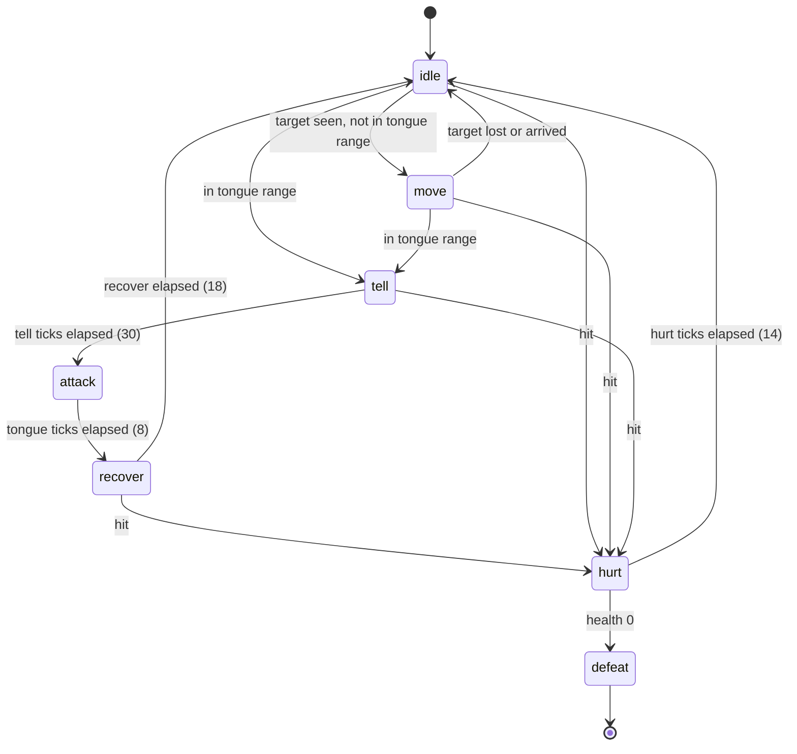

# TROG-03: Troglodyte Virtuoso readability set, design spec

**Status:** execution drawn, awaiting independent review. All 16 frames are generated by `scripts/author_trog03.py` (7 frozen keys at 0, 3, 8, 10, 11, 12, 15 and 9 in-betweens); the validators V01 to V16 pass; the silhouette gate on key 0 passed with the fixes recorded in section 15. Sections 4, 7, 8 and 14 remain the design source. Boxes, ticks and the tongue reach are placeholders, not approved mechanics.

**Decision record:** idle opaque height 66 px with the hair (family ladder), frame 128 x 88, pivot (44, 87), palette `trog-family-v0` core (15) plus 3 Virtuoso slots (`u`, `v`, `V`, the purple robe) = 18 of 20, 16 frames with 7 keys in the same slots as the Pygmy and the Basher (0, 3, 8, 10, 11, 12, 15), all tags grounded. The tongue is **drawn in the sprite** in the attack frames at a fixed placeholder reach; slime, spit, a whip trail and any poison effect are deferred to a separate VFX work order. Walk: 4 frames, 6 px ground step per 8-tick frame (0.75 px per tick, 45 px/s), 2 px weight bob, V16 `max_px` 7. Difficulty 2 points (section "Difficulty and route").

The Virtuoso is a variant of the TROG-01 Pygmy base. It is redrawn at its own size from the family construction in `docs/02-art/trog-01-spec.md` section 2b, never scaled up from Pygmy or Basher pixels. Section numbers follow the TROG-01 and TROG-02 specs.

## 1. Canon and tone constraints

- Canon (cited, not re-decided): `docs/02-art/trog-01-spec.md` section 1. The Virtuoso is the "leaner, unnerving silhouette with a prominent tongue-extension cue" of the owner-approved family sheet (`docs/02-art/floor-01-late-enemy-boss-concepts.md` line 14). **Tongue reach and poison mechanics need gameplay design, not inference from the sheet**: every reach, box and tick here is a placeholder. Shared cues: pale reddish-pink skin, dark dreads, pointed ears, wide mouth with yellow fangs and drool, ragged cloth, long-fingered hands, bare feet. Virtuoso cues: lean and tall, a ragged purple robe, gold bells and a bell on the back, a very long pink tongue; the key study shows feint, tongue strike and retract.
- Packet references (reference only, never traced): `docs/evidence/trog-01/packet/concept_crop_3.png` (figure), `concept_crop_6.png` (feint, tongue strike, retract), `concept_crop_8.png` (face row), `concept_crop_9.png` (side by side).
- Tone (`docs/01-design/antihero-tone.md`): unnerving and grotesque with an absurd note. The danger is the reach: a lean thing that stands just out of arm's range and then lashes a tongue across half the screen. The absurd note is the tongue that never quite fits back in the mouth (it lolls over the lip even at rest) and the jingling bells of a creature that is meant to be stalking. Creature-feature attitude only, no copied designs.

## Difficulty and route

One point each (`docs/07-agents/pixel-art-pipeline.md`, routing by difficulty): new design, above about 40 px, complex construction, VFX or special states.

| Criterion | Virtuoso | Why |
| --- | --- | --- |
| New design | no | a variant: it keeps the family construction, ramps, face order and hair rule |
| Above 40 px | **yes** | 66 px |
| Complex construction | **yes** | the tongue is a long moving part whose shape changes per frame (bunched, whipping, straight, slack) and is the gameplay-relevant silhouette and the hitbox |
| VFX / special states | no | the tongue is a sprite part; slime, spit, whip trail and poison are **deferred** to a VFX work order |
| **Score** | **2** | **Medium** by the table, which names route B plus a silhouette gate. This work order runs route C (spec and one hero key, gate on the hero key, execution from the spec), with the tongue fully specified in sections 7, 8 and 14. See section 13 for the risk this leaves. |

## 2. Size decision

The height comes from the family ladder (`trog-01-spec.md` 2b): **66 px** idle opaque height, hair included (top of the mop to the soles), 1.65x the Pygmy's 40 px and 1.27x Carl's 52 px. Key 0 measures exactly 66 (rows 22 to 87). In `docs/evidence/trog-03/key0-scale.png` it stands level with the Basher but reads half as wide, which is the family contrast the sheet shows (`concept_crop_9.png`).

Construction numbers at H = 66 (design units: px right of the pivot column, up from the contact row):

| Part | Value | Rule (2b) |
| --- | --- | --- |
| Head | skull r 6.0 (0.09 H), jaw r 5.6, skull 4 behind and 1.5 above the jaw centre; head width 15.6 px (0.236 H) | 0.22 to 0.24 H; constant in every pose |
| Head placement (idle) | jaw centre (8, 51.5); hump disc (0, 39) r 5.0, top 44 | jaw centre 7.5 px (0.11 H) **above** the hump top and 8 px (0.12 H) ahead of it |
| Neck | (3, 40) to (6.5, 47), r 2.6 to 2.3, about 6 px visible between the hump and the jaw | 0.08 H visible neck |
| Spine | hips (-8, 24) to belly (-3, 31.5) to shoulder (2, 38): 54.5 degrees | about 55 degrees, less hunched |
| Torso radii | 4.4 hips, 4.8 belly, 4.6 shoulder | the Pygmy's radii in px, so it reads lean at 66 |
| Arms | near: shoulder (3, 37), elbow (6, 19), wrist (24, 15), r 2.2 to 1.4, 36.6 px shoulder to wrist (0.55 H); far: (0, 38), (1, 20), (18, 16) in the far ramp | about 15 % longer than the Pygmy's arm in H: the upper arm hangs, the forearm reaches forward |
| Hands | `drooping_hand(x, y, droop)`: a palm r 1.6 and three 1 px claws (r 0.55) about 8 px long (0.12 H), curling down and forward; each its own part, so `K` gaps separate them. Claw tips end at row 78, **9 px (0.14 H) above the contact row** | hands about 0.15 H above the floor; never planted |
| Legs | long and bent: near hip (-7, 23), knee (2, 13.5), ankle (-3, 4.5), heel (-3, 2.2), toes (6, 1.3), r 2.8 to 1.2; far leg (-10, 23), (-7, 13), (-14, 4.5), toes (-6, 1.3), r 2.6 to 1.2 | bare feet, dirt-caked on the two rows above the contact row |
| Hair | mop about 4 px (0.06 H) above the skull top with notches on its top edge; 6 ropes r 1.5 (5 dreads plus a short front lock), the longest 0.6 H behind the jaw (to the middle of the back); dull knots `T`, `C`, `T` on ropes 0 to 2 | 2b hair rule; the knots stay dull (the TROG-02 gate) |
| Ear | long and pointed, straight back over the mop, below the crown | 2b |
| Robe | a ragged **shawl** over the hump and down the back (polygon, behind the near leg) and a torn **skirt** (`skirt`) from the hips, short at the front and long at the back with three deep torn cuts; `robe` ramp `u u v V`, sparse `u` weave flecks | replaces the loincloth (concept: purple robe) |
| Bells | one **back bell** (`bell`, about 7 x 7 px, `bell` ramp `K T T t`) hanging on a 1 px `c`/`C` cord from the shawl behind the hip, drawn in front of the skirt so its flare shows; three small 2 x 3 stamped bells (`small_bell`): two on the skirt hem tips, one on the chest cord under the jaw | canon: gold bells and a bell on the back |
| Face | `leer` (13 columns, top-left at (hx - 5, hy + 6)): 1-row `K` brow, a staring eye (4 `w`, 1 `K` pupil at the front, 2 `e` behind, 2 `e` under it), nostril, upper fangs, a 2-row dark mouth opening the front outline, lower fangs, and the **tongue tip lolling over the lower lip and down past the chin** (14 `q`), with a 3 px drool strand | the Virtuoso's narrow mouth that opens tall; the tongue is always visible |

Measured key 0: x -21 to +32 (54 px wide), rows 22 to 87, contact spans on row 87 at x -12..-6 (far foot) and -1..6 (near foot), 17 colours used.

## 3. Frame, pivot, boxes and atlas

- Frame **128 x 88**, pivot **(44, 87)**, contact row **87**. The 44 px behind the pivot hold the fallen key 15 (head and mop at about x -40) and the trailing leg of the strike. The 83 px ahead hold the tongue strike: the tip reaches about x +76 (column 120) with a margin for its outline and curl. The 88 px height leaves room for the reared feint (key 8, about 70 px tall) and the hurt recoil (about 71 px).
- Key 0 extent: x -21 to +32, rows 22 to 87.
- All tags are grounded (V07: the lowest opaque row of every frame is 87). The Virtuoso never leaves the floor.
- Authored facing right; the runtime mirrors around the pivot column. One atlas, one layer `body`.
- Boxes are **placeholders**, in px from the pivot (x forward, y up), re-measured by the execution stage; none is an approved mechanic. Hurtboxes cover the trunk and head and leave out the ropes, the bell, the claws and the tongue (whether the tongue can be hit is a gameplay question, section 13). The hitbox covers the outer third of the extended tongue:

| Box | x | y | Frames |
| --- | --- | --- | --- |
| Standing (opaque extent) | -21 to 32 | 0 to 65 | 0 (measured) |
| Hurtbox idle/walk | -14 to 16 | 0 to 60 | 0 to 6 |
| Hurtbox feint | -12 to 14 | 0 to 68 | 7, 8 |
| Hurtbox lash/strike | -14 to 26 | 0 to 56 | 9, 10 |
| Hurtbox retract | -14 to 20 | 0 to 52 | 11 |
| Hurtbox hurt | -18 to 6 | 0 to 70 | 12 |
| Hurtbox down | -40 to 22 | 0 to 22 | 13 to 15 |
| Tongue hitbox (strike frame only) | 56 to 78 | 34 to 48 | 10 |

## 4. Readability-set animation list

Ticks are at 60 Hz. The Virtuoso is a ranged melee threat: a clear, mid-length feint (the read), a very fast lash (the reach is the danger, not the speed of the wind-up) and a slack retract that is the punish window. Three attack tags, the same split as the Pygmy and the Basher.

| Role | Tag | Frames | Playback | Ticks | Notes |
| --- | --- | --- | --- | --- | --- |
| idle | `idle` | 3 | loop | 12 + 10 + 12 = 34 | twitchy breathing; the back bell swings 1 px each way |
| move | `walk` | 4 | loop | 4 x 8 = 32 | a long-legged stalk, 0.53 s per cycle, **0.75 px per tick (45 px/s)** at runtime; section 8 contact plan |
| tell | `attack_tell` | 2 | once | 6 + 24 = 30 | the feint: a 24-tick (400 ms) hold, reared back with the mouth gaping and the tongue bunched |
| attack | `attack_tongue` | 2 | once | lash 2 + strike 6 = 8 | the hitbox is active on frame 10 only |
| (recover) | `attack_recover` | 1 | once | 18 | the tongue hangs slack to the floor while it is reeled in: the punish window |
| hurt | `hurt` | 1 | once | 14 | |
| defeat | `down` | 3 | hold | 5 + 10, then a state-driven hold | |

**Tell-to-attack read:** the feint starts at tick 0. The onset (frame 7) runs ticks 0 to 5 and the feint hold (frame 8) ticks 6 to 29. The lash (frame 9) runs ticks 30 and 31, the strike with the hitbox active (frame 10) ticks 32 to 37, and the retract (frame 11) ticks 38 to 55. The tell sits between the Pygmy's 24 ticks and the Basher's 36: the Virtuoso is not heavy, but its reach is long, so the player must get a fair warning at a distance. The strike is the fastest attack of the family (2 ticks from the feint pose to the full reach). The feint pose (reared up, head back, mouth open tall with the tongue bunched inside) must read for at least 24 ticks; the strike and the feint differ in silhouette at once (tall and narrow against long and level). Damage, reach and the poison question are placeholders.

Frame table:

| # | Tag | Pose | Ticks | Author |
| --- | --- | --- | --- | --- |
| 0 | `idle` | **KEY (drawn, frozen)** lean stalker, head up on its neck, long arms hanging forward, tongue tip lolling, bell on the back | 12 | key |
| 1 | `idle` | breath: torso end, hump, neck and head 1 px lower; ropes `sway` 1; back bell 1 px back | 10 | in-between |
| 2 | `idle` | key posture; ropes `sway` -1; back bell 1 px forward | 12 | in-between |
| 3 | `walk` | **KEY** contact A (both feet down, body low): near foot just planted ahead, far foot at the end of its stance behind | 8 | key |
| 4 | `walk` | passing, far leg swinging: body 2 px up; far foot lifted; near foot planted 6 px further back | 8 | in-between |
| 5 | `walk` | contact B (both feet down, body low): far foot just planted ahead, near foot at the end of its stance | 8 | in-between |
| 6 | `walk` | passing, near leg swinging: body 2 px up; near foot lifted; far foot planted 6 px further back | 8 | in-between |
| 7 | `attack_tell` | feint onset: halfway from 0 to 8, head starting back, mouth still the `leer` | 6 | in-between |
| 8 | `attack_tell` | **KEY** feint: reared back on the back leg, head pulled up and back, mouth gaping tall, tongue bunched in the mouth, near claws raised | 24 | key |
| 9 | `attack_tongue` | lash: body halfway from 8 to 10, the tongue half out in a whipping S curve | 2 | in-between |
| 10 | `attack_tongue` | **KEY** strike: lunging forward, head thrust ahead, the tongue shot out straight and level to its full reach | 6 | key |
| 11 | `attack_recover` | **KEY** retract: slumped, head low, the tongue hanging slack from the mouth to the floor | 18 | key |
| 12 | `hurt` | **KEY** thrown back: torso tilted back, head above the hump and back, tongue snapped in, arms flung | 14 | key |
| 13 | `down` | backward fall beat, about 45 degrees, feet still on the floor | 5 | in-between |
| 14 | `down` | floor impact on the back: the key-15 layout with the head and chest bounced 1 px up | 10 | in-between |
| 15 | `down` | **KEY** fallen backward on its back, knees up, the tongue spilled out across the floor | hold | key |

## 5. State diagram



Whether a hit during the feint cancels the strike is a gameplay decision; the diagram assumes it does, as for the Pygmy and the Basher.

## 6. Palette

Family palette `trog-family-v0`: the 15 core colours are imported unchanged from `scripts/author_trog01.py` (`PALETTE`; see `trog-01-spec.md` section 6), plus the Virtuoso's 3 allocated slots. The total is 18 of 20. One family atlas holding the Pygmy, the Basher (2 slots) and the Virtuoso stays at exactly 20.

| Key | Name | Hex | Role |
| --- | --- | --- | --- |
| `K d s m l` | outline and skin ramp | core | the same ramp as the Pygmy; the far limbs use `K d d s` |
| `H I` | hair | core | dreads |
| `c C` | cloth | core | bell cord |
| `w e t T o q` | accents and mouth | core | eye, drool, fangs; **gold bells** (`t` lit, `T` body); `q` tongue |
| `u` | robe_deep | `#2f1c3a` | **Virtuoso slot 1**: robe shade and weave flecks |
| `v` | robe_mid | `#583768` | **Virtuoso slot 2**: robe body |
| `V` | robe_light | `#8a5c8c` | **Virtuoso slot 3**: torch-lit robe edge (dusty, never a clean violet) |

Ramps added in `scripts/author_trog03.py`: `robe` (`u u v V`), `bell` (`K T T t`), `cord` (`c c C C`) and `tongue` (`o s q q`: `q` body and lit top edge, `s` underside, `o` only for the deepest fold). The tongue reuses `q` with `s` and `o` as 2b allocates; a wet sheen is 1 px `w` glints on the top edge, at most one per 10 px of tongue. No `e` anywhere outside the awake eye (V14 counts it in hurt and defeat).

## 7. Key poses

Coordinates are design units. Key 0 is the reference. For keys 3 to 15 the joints below are the starting rule set for `POSES` in `scripts/author_trog03.py`; the drawn key must meet the bbox and count targets in section 9, and joints may move by up to 2 px to meet them. Each key's top row was checked against its target with the rule "top row is about 74 minus the jaw-centre y" (the mop top sits 11.8 above the jaw centre), which holds whenever the head is the highest part.

| Frame | Tag | Silhouette and pose (joints) | Readability reason |
| --- | --- | --- | --- |
| 0 | `idle` | **Drawn, frozen.** Section 2 table. Top row 22 (66 px), x -21 to 32. | A lean, upright stalker with the head held up on a neck, long forearms reaching ahead and claws hanging clear of the floor: nothing like the Pygmy's knuckle-crouch or the Basher's mass. |
| 3 | `walk` | Top row 24 (jaw 2 px lower than key 0). Body 2 px lower and 2 px forward: torso (-7, 22), (-1, 29.5), (4, 36); hump (2, 37) r 5; neck (5, 38) to (8.5, 45); jaw (10, 49.5); ropes `sweep` 0.4; skirt `lean` -1.5. Near leg forward, just planted: hip (-5, 21), knee (6, 12), ankle (4, 4), heel (4, 2.2), toes (12, 1.3); its contact run centred at **x +8**. Far leg behind at the end of its stance, heel starting to lift: hip (-9, 21), knee (-9, 11), ankle (-12, 4.5), heel (-11, 2.6), toes (-2, 1.3); its contact run centred at **x -4**. Near arm swung back (counter to the near leg): shoulder (5, 35), elbow (5, 18), wrist (20, 14); far arm swung forward: (2, 36), (5, 19), (22, 16). Claws stay at least 7 px above the floor. `leer` face. | Longer stride and lower than the idle; the head stays level and leads. |
| 8 | `attack_tell` | Top row 16 to 18 (at least 70 px; the tallest frame). Reared back on the back leg: torso (-8, 25), (-6, 34), (-2, 43), about 75 degrees; hump (-4, 44) r 5; neck (-1, 45) to (2, 52); jaw (4, 57) with `jaw_b(drop=1)` (8 px above the hump top). `gape` face. Near arm raised forward at chest height, the feint: shoulder (-1, 42), elbow (8, 40), wrist (15, 46), claws spread up and forward (`drooping_hand` with `droop` -0.6, so they curl up). Far arm drawn back and down: (-3, 42), (-9, 30), (-5, 21). Near leg forward, light on the toes: hip (-5, 24), knee (3, 14), ankle (3, 4), toes (10, 1.3); far leg braced back: hip (-9, 24), knee (-14, 13), ankle (-19, 4), toes (-14, 1.3). Ropes hang down the back (`sweep` 0). Back bell swung 2 px back. At most 50 wide. | The only tall, narrow pose with a gaping mouth and a visible bunched tongue: "it is about to spit something at you". |
| 10 | `attack_tongue` | Top row 26 to 30 (56 to 62 px). Lunging: torso (-6, 22), (2, 29), (10, 34), about 35 degrees; hump (8, 36) r 5; neck (11, 37) to (15, 42); jaw (18, 46), at least 4 px above the hump top; `gape` face with `jaw_b(drop=1)`. **Tongue** (`tongue` part, drawn after the near arm): from the mouth (23, 43) to (50, 43.5) to (70, 42) to the curled tip (74, 40) to (73, 37.5), radii 2.0, 1.8, 1.5, 2.2, 1.6: straight and level for its first 45 px, then a curled bulb. The tip reaches **x +74 to +77** (columns 118 to 121). Near arm forward and low: (11, 33), (16, 21), (27, 19), `drooping_hand`; far arm flung back for balance: (7, 34), (0, 23), (-7, 18). Front leg lunging: hip (-4, 21), knee (8, 13), ankle (8, 4), toes (15, 1.3); back leg extended: hip (-8, 21), knee (-15, 11), ankle (-24, 4), heel (-22, 2.5), toes (-18, 1.3). Skirt `lean` -2.5, ropes `sweep` 0.8, back bell swung 3 px back. Width 92 to 104. **No slime or spray in the sprite** (VFX order). | The longest frame of the family by far, with a single level pink line to the tip: the reach reads at 1x before the body does. Opposite of 8 (tall to long). |
| 11 | `attack_recover` | Top row at least 28 (58 px or less). Slumped: torso (-8, 22), (-2, 29), (5, 35); hump (3, 36) r 5; neck (6, 37) to (10, 41); jaw (12, 44); `slack` face (lid half over the eye, at least 1 `e` still visible under it, mouth open 2 rows). **Tongue** hanging slack from the mouth front: (17, 41), (24, 31), (32, 16), (38, 5), then lying on the floor (44, 1.6) to (52, 1.6), radii 1.8, 1.6, 1.4, 1.3, 1.3, 1.2 (the floor part is the only non-foot contact of the set). Arms limp: near (6, 34), (9, 18), (17, 11), `drooping_hand` `droop` 1.0, claws at least 3 px above the floor; far (3, 35), (5, 18), (12, 12). Legs as key 0 but knees 1 px lower. Ropes `sweep` 0. | Low and spent with the tongue in a sagging curve: "it can't strike now", never confused with 10 (straight and level). |
| 12 | `hurt` | Top row at most 17 (70 px or more; taller than the idle). Torso tilted back from the hips (-6, 26) to (-8, 37) to the shoulders (-10, 46); hump (-10, 47) r 5; neck (-8, 49) to (-6, 54); jaw (-6, 58), `pain` face with `jaw_b(drop=0.6)`, **tongue snapped in** (at most 4 `q`). Near arm flung back and up: (-9, 45), (-18, 50), (-26, 58), fingers fanned up; far arm limp forward and down to (6, 26). Near knee bent forward to (4, 14), the weight on the back foot (-10, 1.3). Ropes whip forward (`sweep` -0.6); back bell swung out 3 px behind. No hand points at the player. | An upright recoil with the head thrown back and the tongue gone: not the feint, because the arms are apart and the mouth is not gaping. |
| 15 | `down` | Top row at least 62 (26 px or less), at most 84 wide. On its back, fallen backward: hips (6, 6), belly (-4, 7), shoulders (-14, 7); head on the floor behind with the jaw centre at (-26, 8) and the crown pointing back (rotate the `MOP`, `ROPES` and `EAR` offsets 90 degrees, so the hair spills along the floor to about x -40); knees raised to (10, 15) and (14, 13), feet toward the player at x 16 to 24; near arm flung up and back to (-6, 20); far arm along the floor. `dead` face (crossed eye, no `e`). **Tongue** spilled out of the mouth and lying along the floor in front of the face and under the shoulder, 16 to 20 px long, `q` at least 16. Back bell on the floor beside the hips, mouth toward the player. | Flat and low with the red eye gone and the tongue out: unmistakably finished. |

Faces (`FACES` in the script, 13 columns, top-left at (hx - 5, hy + 6)); every template keeps the 1-row brow, the eye at the same columns and the fangs as separate 1 px teeth, never a closed yellow ring:

- `leer` (drawn): idle, walk, feint onset 7.
- `gape` (feint 8, lash 9, strike 10): eye wide (4 `w`, 1 `K`, 2 `e`), the mouth a 5-row `o` opening that breaks the front outline, upper fangs on top, lower fangs at the bottom, two `w` drool strands. In 8 the tongue is a bunched `q` mass of at least 8 px filling the lower half of the mouth; in 9 and 10 the mouth shows only the tongue root (the `tongue` part continues it).
- `slack` (retract 11): the lid (`K`) over the top half of the eye, 1 `e` under it, the mouth open 2 rows; the tongue root at the front corner joins the `tongue` part.
- `pain` (hurt 12, fall beat 13): eye squeezed to a `K` slit, no `e`, a 3-row open yelp with fangs, at most 4 `q` behind the lower fangs.
- `dead` (14, 15): crossed eye (`K` x), no `e`; the tongue root at the mouth corner joins the spilled `tongue` part.

## 8. In-between list

For the execution stage. No design decisions are needed beyond these notes. Blends (`blend` and `shifted` in `author_trog01.py` can be imported) and hand-set limbs on the keys' parts.

| # | Pose notes |
| --- | --- |
| 1 | Idle breath: torso end, hump, shawl, neck and head 1 px lower (jaw (8, 50.5)), ropes `sway` 1, back bell and its cord end 1 px back (x -18). Feet, legs and skirt unchanged. The tongue tip moves with the face. |
| 2 | Idle: key 0 with ropes `sway` -1 and the back bell 1 px forward (x -16). |
| | **Walk contact plan (design).** A biped stalk at a ground step of **6 px per 8-tick frame**: the runtime moves the sprite **0.75 px per tick (45 px/s)** and every planted foot moves back exactly 6 px per frame in the sprite, never forward, including across the loop seam. The hands never touch the floor (claws at least 7 px above it in every walk frame). Each foot is planted for 3 frames and lifted for 1. Contact-run centres on row 87: **near foot** planted in 3, 4, 5 at x **+8, +2, -4**, lifted in 6 (passing over x +2, sole 3 px up); **far foot** planted in 5, 6, 3 at x **+8, +2, -4**, lifted in 4 (passing over x +2, sole 3 px up). Seam 6 to 3: far foot +2 to -4 (planted, -6); near foot lands at +8. The contact frames 3 and 5 have both feet down and the body low (top row 24); the passing frames 4 and 6 carry the body 2 px higher (top row 22, never taller than the 66 px idle): a **2 px weight drop on every contact**. Arms counter-swing 3 px: the near wrist at x 20, 23, 26, 23 and the far wrist at 22, 19, 16, 19 in frames 3, 4, 5, 6. Hips and shoulders ride the body; knees take half the foot move; ankles and toes take all of it. Add a `WALK_PLAN` table and a `walk_frame` derivation as in `scripts/author_trog02.py`, derived from key 3. |
| 4 | Walk passing (far leg swinging): body (torso, hump, shawl, neck, head, skirt, bell) +2 y; near foot -6 x (planted, run centre +2); far foot lifted 3 and moved forward to about x +2 (passing the near leg); arms per the plan. |
| 5 | Walk contact B: body at key-3 height; near foot -12 x from key 3 (planted, end of stance, run centre -4, heel lifting); far foot planted ahead at run centre +8. Mirror of key 3 by leg. |
| 6 | Walk passing (near leg swinging): body +2 y; far foot -6 x (planted, run centre +2); near foot lifted 3, passing at about x +2. Seam to 3: far foot +2 to -4. |
| 7 | Feint onset: halfway from 0 to 8 (blend the joints 0.5), `leer` face, the near arm starting to rise (wrist at about (20, 30)), ropes `sweep` 0. Top row at most 22. |
| 9 | Lash: body 0.5 of the way from 8 to 10 (jaw at about (11, 52)), `gape` face, ropes `sweep` 0.4. **Tongue** half out in an S curve: from the mouth (16, 49) to (26, 53) to (36, 47) to the tip (44, 50), radii 2.0, 1.8, 1.6, 2.0. No hitbox. Top row at least 20. |
| 13 | Fall beat: torso from the hips (0, 14) to the shoulders (-12, 30), about 50 degrees back; jaw (-14, 38), `pain` face; near arm flung back to (-30, 34), far arm forward and down to (8, 8); toes on the floor at about (14, 1.3); ropes `sweep` -0.4. Top row 38 to 46. |
| 14 | Floor impact: the key-15 layout with the head and chest 1 px up, the knees 1 px higher, the tongue not yet fully spilled (10 to 14 px). `dead` face. |

## 9. Validators and acceptance targets

Run `python3 -m scripts.pixelart validate assets/source/characters/troglodyte/virtuoso/trog_03.pixelart.json`. Design stage: V01 to V15 pass on key 0 (V08, V10 and V16 not configured). When execution adds the frames, it extends `tags`, `roles`, `frozen_keys.frames` (0, 3, 8, 10, 11, 12, 15) and these rules. Each target was checked against the joints in sections 7 and 8.

- V04 palette: at most 20 (18 in the palette). V05 isolated: 0. V06 orphans: at most 12 per frame.
- V07 contact: every tag is grounded; the lowest opaque row is 87 in every frame.
- V12 unique frames: on.
- V13 bounding boxes: idle (0, 2) `top` 22 and `bottom` 87 (66 px), idle breath (1) `min_top` 23; walk `min_top` 24 on the contact frames 3 and 5 and 22 on the passing frames 4 and 6 (the 2 px bob, never taller than the idle); feint onset (7) `max_top` 22; feint (8) `max_top` 18 and `max_width` 50; lash (9) `min_top` 20; strike (10) `min_top` 26 and `max_width` 104 (the extra test checks a width of at least 92: the tongue must reach); retract (11) `min_top` 28; hurt (12) `max_top` 17; fall beat (13) `min_top` 38; down (14, 15) `min_top` 62 and `max_width` 84.
- V14 key counts: `e` at least 1 in 0 to 11; `e` = 0 in 12 to 15; `q` 6 to 20 in 0 to 7 (only the lolling tip: the tongue never grows outside the attack); `q` at least 8 in 8 (bunched); `o` at least 12 in 8 and 10; `q` at least 60 in 10 (the extended tongue) and at least 30 in 11; `q` at most 4 in 12; `q` at least 16 in 15; `V` at least 20 in 0; `t` at least 8 in every frame (the bells stay visible).
- V16 foot drift: `{"max_px": 7, "tags": ["walk"]}`, loop seam included: the 6 px ground step plus 1 px of rasterization. A walk that slides (a planted foot moving forward or by more than 7 px) or pops fails it.
- Read targets (checked by eye at 1x on lit brick, the silhouette gate): the feint (8) and the strike (10) are told apart by shape alone (tall and narrow against long and level). The retract (11) shows a sagging tongue and a lower head than 10. The hurt (12) shows the arms apart, the head up and back and no tongue. The bells read as gold glints in every frame, and the back bell never merges with the dark ropes.
- Extra tests (`tests/test_art_trog03.py`): generator parity, key 0 frozen, frame/pivot/66 px, core-plus-3 palette, head width, head above the hump on a neck, spine angle, hands clear of the floor, idle accents, face template widths. Execution adds the tick windows (`idle` 34, `walk` 32, `attack_tell` 30, `attack_tongue` 8, `attack_recover` 18, `hurt` 14, `down` 15 + hold), all frames grounded, the feint tallest of the attack tags, the strike the widest frame (at least 92 px) and the walk contact plan (the planted foot moves -6 per frame, seam included).

## 10. Evidence

```text
python3 scripts/author_trog03.py frames          # grid (16 frames) and manifest
python3 scripts/pixel_grid_to_ase.py build assets/source/characters/troglodyte/virtuoso/trog_03.grid.json assets/source/characters/troglodyte/virtuoso/trog_03.ase
python3 -m scripts.pixelart freeze assets/source/characters/troglodyte/virtuoso/trog_03.pixelart.json
python3 scripts/author_trog03.py key0-scale      # needs bash scripts/export_assets.sh first
python3 scripts/author_trog03.py walk-strip      # walk strip with the loop seam + GIF
python3 scripts/author_trog03.py attack-strip    # tell-strike-retract strip + GIF
python3 -m scripts.pixelart review-pack assets/source/characters/troglodyte/virtuoso/trog_03.pixelart.json --out docs/evidence/trog-03/review-pack
```

`docs/evidence/trog-03/key0-scale.png` (1152 x 360): key 0 at 1x on lit Floor 1 next to Carl, the Pygmy (TROG-01 key 0) and the Basher (TROG-02 key 0), 640 x 360 unscaled, plus a 4x copy of key 0 on the right. Execution adds a manifest `assets/manifests/trog-03.json` (tick rows, boxes, attack ticks), the review pack (`python3 -m scripts.pixelart review-pack ...`) and a walk strip with the loop seam (as `write_walk_strip` in `scripts/author_trog02.py`).

VFX and audio (separate work orders, not in the sprite): slime or spit on the strike, a tongue whip trail on frame 9, any poison effect, the "!" alert on the feint, and the bell jingle (audio).

## 11. Files

| File | Role |
| --- | --- |
| `scripts/author_trog03.py` | deterministic authoring script; imports the family canvas, core palette, `L` and despeckle from `scripts/author_trog01.py` |
| `assets/source/characters/troglodyte/virtuoso/trog_03.grid.json` / `.ase` | pixel-grid source and Aseprite master |
| `assets/source/characters/troglodyte/virtuoso/trog_03.pixelart.json` | asset config |
| `assets/manifests/trog-03.json` | tick rows, attack ticks, placeholder boxes |
| `tests/fixtures/trog-03_keys.json` | frozen keys 0, 3, 8, 10, 11, 12, 15 |
| `tests/test_art_trog03.py` | spec tests |
| `docs/evidence/trog-03/key0-scale.png` | scale evidence (lit brick, 4x copy) |
| `docs/evidence/trog-03/walk_strip_x3.png`, `gif_walk_x3.gif` | walk with the loop seam |
| `docs/evidence/trog-03/tell_strike_strip_x2.png`, `gif_attack_x2.gif` | feint onset, feint, lash, strike, retract |
| `docs/evidence/trog-03/review-pack/` | the three review images plus `validator_summary.txt` |

## 12. Rights and provenance

Fan-concept art under the owner-reported `ART-PUBLICATION-ALL-V1` scope (see `docs/04-production/rights-and-release.md`). No tracing of the concept, no image-model raster output, no third-party assets.

### Rights/Provenance

- Concept: the owner-approved family sheet under `ART-PUBLICATION-ALL-V1`; packet crops are reference only.
- Spec + hero key (key 0): Claude Opus.
- Silhouette gate fixes, keys 3, 8, 10, 11, 12, 15, the in-betweens and execution: Claude Sonnet (the gate fixes were prescribed by the gate reviewer).
- Independent review: pending.

## 13. Open questions

- **Route:** the score is 2 (Medium by the table) because of the tongue; the work order runs route C. Recommendation: the silhouette gate also looks at key 10 (the strike) once the execution stage draws it, before the in-betweens, because the tongue is the asset's hardest part and its gameplay silhouette.
- **Tongue in the sprite at a fixed reach** (about 52 px from the mouth, tip at x +74 to +77). If gameplay wants a variable reach, the tongue must become a separate segment sprite (a root, a tiling middle and a tip) driven by the runtime: that is a separate work order and would replace the `tongue` part in 9, 10 and 11.
- Whether the tongue is itself a hurtbox (can it be hit or cut) and whether the strike poisons are gameplay decisions; the boxes in section 3 assume not.
- Whether a hit during the feint cancels the strike (as assumed in section 5).

## 14. Executor notes (keys 3 to 15 and the in-betweens)

Every key and in-between reuses the key-0 construction in `scripts/author_trog03.py`. Add a pose dict to `POSES`, list it in `KEY_FRAMES` or `INBETWEEN`, and extend `TAGS`, the config and the fixture (`pixelart freeze`). Never edit `idle0` or its frozen hash. A small `mk(...)` helper like the Basher's is recommended so that the radii, robe, bells, face stamp, grime and creases move with the joints.

- **Radii, every frame:** torso 4.4, 4.8, 4.6; hump r 5.0; neck 2.6 to 2.3; near arm 2.2, 1.8, 1.4; far arm 1.9, 1.6, 1.3; near leg 2.8, 2.2, 1.6, 1.3, 1.3, 1.2; far leg 2.6, 2.1, 1.5, 1.3, 1.3, 1.2. Never widen the torso: lean is the read.
- **Head:** `head(hx, hy)` and the face stamp at the same (hx, hy); `jaw_b(drop)` only with `gape` (drop 1) and `pain` (drop 0.6). The jaw centre stays at least 4 px above the hump top in every grounded pose except the fall (13 to 15).
- **Tongue:** a `tongue` part (ramp `o s q q`) drawn after the near arm and before the ear, so it reads in front of the arm. Radii never below 1.2 (a 1 px tongue vanishes at 1x) and never above 2.2 except at the curled tip. Stamp a `w` glint on its top edge at most once per 10 px. In 10 keep the first 45 px straight and level (within 2 px of y 43); a sag there reads as the retract. In 11 the tongue must sag through at least 3 rows per 10 px and touch the floor ahead of the near foot.
- **Hands:** `drooping_hand(x, y, droop)` in every frame; never planted. In 8 a negative droop curls the claws up for the feint. The hurt hand (12) is fanned up and back and never points at the player.
- **Robe:** the shawl polygon rides with the hump (shift by the hump's move); the skirt hangs from the hip joint with `lean` set per section 7. Keep at least 20 `V` in grounded upright poses; the robe never covers the neck or the face.
- **Bells:** the back bell hangs from the shawl's back corner on its cord; its swing per frame is in sections 7 and 8 (back 1 to 3 px in motion, forward 1 px in idle 2). The two hem bells ride the skirt's torn tips; the chest bell rides 3 px below the jaw. `t` at least 8 in every frame.
- **Hair:** `hair(hx, hy, sweep, sway)` with the `sweep` values in section 7; knots stay dull. No rope point above the crown, except where the hurt and the fall whip the tips forward. For 14 and 15 add a rotated hair helper (offsets turned 90 degrees so the crown points back along the floor).
- **Grime and creases:** 8 to 10 smudges per key (2 x 2 `d`), at least 2 on lit skin, at least 1 on a forearm and 1 on a knee; 2 rib strokes above the skirt and the elbow and knee creases wherever they show. In-betweens copy the nearer key's smudges, shifted with their parts.
- **Checks before reporting:** `python3 -m scripts.pixelart validate` with the section 9 rules, `pytest -k "trog or pixelart"`, `key0-scale`, the walk strip and the review pack regenerated.

### Executor notes: what the execution stage decided (conservative readings)

- **Walk feet.** Every walk foot uses one template (`foot(cx, lift)`: ankle at cx - 3.5, toe tip at cx + 3.5, heel and toes on the floor), because the key-3 far-foot points in section 7 (heel -11, toes -2) give a contact run centred at -6.5, not the planned -4. The measured row-87 runs are exactly +8 / +2 / -4 (near foot, frames 3, 4, 5) and +8 / +2 / -4 (far foot, frames 5, 6, 3), 9 px wide, so the two feet never merge in frames 3 and 5. A lifted foot rises 3 px with its heel.
- **Walk body height.** Key 3 puts the jaw at y 49.0 (section 7 says 49.5) and the neck end at 44.5: at 49.5 the measured top row was 23, and the contact frames need 24 (passing frames 22). Inside the 2 px joint tolerance.
- **Feint back bell.** In 8 the bell rides with the shoulder and is not swung back (section 7 says 2 px back): the 2 px swing made the frame 51 px wide and the rule is at most 50. Frames 10, 12 and 13 swing it back 3, 3 and 2 px from its riding position.
- **Hem bells and grime** are placed from the joints (`mk`), not copied from key 0: two hem bells on the skirt, one chest bell below the neck, ten grime smudges and four creases per frame. Frames 13 to 15 restamp the hem bells so that `t` stays at 8 or more.
- **Wet glints:** one `w` per 12 tongue columns on the top edge (generated, never a hand edit).
- **Fallen frames (14, 15).** The head lies behind the shoulders: the skull 4.5 px behind the jaw centre, the mop and ear turned 90 degrees counter-clockwise and flattened to the floor, three ropes spilled back by hand-set points, the face stamp turned 90 degrees by pixel mapping. The shawl is a flat polygon over the chest; the back bell lies on its side with its mouth toward the player at (-3, 4). The tongue starts at the rotated mouth corner and runs about 21 px along the floor (15), 18 px (14, not fully spilled).
- **Lash (9) and onset (7)** are `blend` of the neighbouring keys; 9 adds the S-curve tongue and the `gape` face; 7 keeps the `leer` face.
- **Config.** `t` (bells and fangs) is required at 8 or more in every frame (section 9); key 0 had a 12 minimum in the design stage, which stays true (22) but is no longer a rule. Boxes in the manifest are the section 3 table clipped to the measured extents.
- **Review items (E1, E2, O1).** Walk passing frames 4 and 6: the lifted foot passes at x +4 (2 px ahead of the planted foot at +2) and 4.5 px up (section 8 says x +2, 3 px up), so it no longer stacks onto the planted foot as one block; planted contacts are unchanged (+8 / +2 / -4, -6 per frame, seam included) and V16 still passes at `max_px` 7. Frames 7 and 9: the blended near hand held its claws level (a pointing finger); both now use `drooping_hand` with droop 0.6 at the blended wrist. Review-pack scene: the strike (10) is added a second time at x 945 against the torch-lit brick bay, and the walk (3) and fallen (15) actors move to x 745 and 850.
- **Open for the reviewer:** the retract tongue (11) crosses the near claws in front; the feint (8) tongue is a bunched mass inside the mouth only.

## 15. Silhouette gate (key 0) and fixes

The gate reviewed key 0 at 1x and passed the design (identity and family, head and neck, size ladder, tone, plans, palette) with two small fixes and one note. All three are done.

1. **Drool (pixel fix).** The 3 px drool strand floated 1 px in front of the tongue tip (x +15, rows 41 to 43). It now hangs from the tip at x +13, rows 43 to 45, 4-connected to the lowest `q` pixel (the face template carries it as an always-drawn `W`). Key 0 was re-frozen in `tests/fixtures/trog-03_keys.json`; only those five pixels changed.
2. **Scale image.** `docs/evidence/trog-03/key0-scale.png` is re-staged so that Carl, the Pygmy, the Basher and the Virtuoso all stand on torch-lit brick (world x 800 to 960, right of the pipe, same floor row), with the 4x copy kept.
3. **Frame size note.** The Virtuoso's frame is 128 x 88, not the 112 x 80 of the `trog-01-spec.md` section 2b ladder table, because of the fixed-reach tongue; the note is added there.
