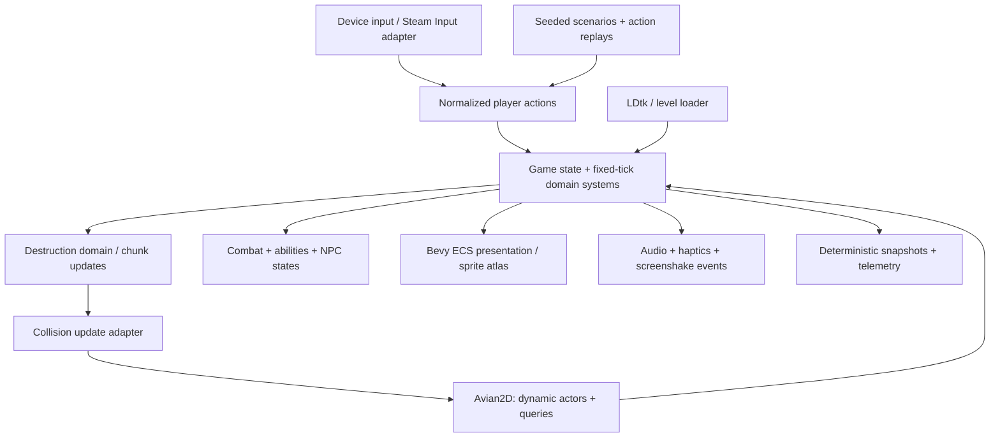

# Technical architecture — Rust / Bevy

## Status and constraints

**Rust + Bevy 0.20.1 is the accepted, sole runtime stack** (ADR-0001). All gameplay and rendering logic must be testable with cargo and headless scenarios; integration problems are to be resolved inside this stack, not via a second-engine prototype. Primary runtime Linux x86_64 with Steam Deck-class constraints; controller-first. Windows/Steam are later targets.

## High-level dependency direction



**Do not** bind game rules to renderer-side animations or depend on presentational particle state. Collision and terrain semantics must come from one authoritative material grid; rendered tiles follow the grid.

## Target workspace (not yet created)

```text
crates/
  game/           # binary; Bevy bootstrap; scenes, state transition
  core/           # simulation clock, IDs, seeded RNG, events
  movement/       # platformer controller and motion tuning
  combat/         # attacks, damage, inventory of tiny slice
  terrain/        # chunked material grid, damage & invariants
  actors/         # character abilities and enemies
  levels/         # authored map schema, loaders and validity checks
  replay/         # recorded normalized inputs, scenario runner
  tools/          # asset and map validation (optional separate CLI)
assets/source/    # source sprites and level projects
assets/generated/ # generated artifacts, never edited by hand
```

Use crates only if they enforce genuine domain boundaries; avoid an explosion of small crates causing CI compile overhead. The goal is an easily inspectable Rust implementation.

## Expected engine components

- **Bevy:** ECS scheduling, windows, 2D camera, render, input, audio, asset handles, atlas presentation.
- **Avian2D 0.8:** dynamic/kinematic bodies and queries; **avoid 1 rigid body per terrain cell**.
- **bevy_ecs_tilemap 0.20:** tile rendering; destructible chunk views may require a separate optimized batching approach after profiling.
- **bevy_ecs_ldtk 0.16 / LDtk 1.5.3:** authored static level extraction. Runtime destruction should not mutate LDtk source project files.
- **Aseprite:** source authoring and CLI export. Integrate generated atlas metadata rather than embedding numeric rectangles in gameplay code.

Version relationships were checked for November 2026; they need validation with `cargo check` before production pinning. Links: [source register](../06-research/sources.md).

## ECS system schedule (proposed)

1. `InputCapture` collects normalized actions; optional replay replaces devices.
2. `FixedPreUpdate`: buffer actions, advance timers, seed-controlled spawns.
3. `FixedUpdate`: movement intent, physics/collision query, combat hits, terrain damage, actor AI.
4. `FixedPostUpdate`: detect destroyed support, chunk dirty sets, pathing invalidations, checkpoint conditions.
5. `Update`: convert authoritative events to animation/FX/audio, interpolate presentation, render UI.

Capture original event ordering in tests. Avoid hidden logic mutating the grid from rendering callbacks. Define an explicit order for bomb explosion and post-explosion player collision reconciliation.

## Performance and failure modes

- Performance targets are hypotheses: stable 60 fps, preferably under 16.67 ms per frame and bounded frame-time spikes on Steam Deck. Benchmark actual hardware.
- Explosion batches should be bounded per fixed tick; dirty chunks rebuild no more often than needed.
- Central game state should support deterministic save/reload for the current room, checkpoint and replay.
- Keep shader effects optional; disable/reduce expensive lighting and debris on low-power hardware.
- Instrument terrain edit count, collision rebuild duration, number of live dynamic bodies, worst frame time, stutter.

## Development phases

**Phase 1:** Bevy boot + two controllable placeholders + camera + sample arena. **Phase 2:** material grid + bombs + collision invariants. **Phase 3:** proper sprites/animations and co-op. **Phase 4:** progression, broader levels, Steam integration only after slice proves fun.
