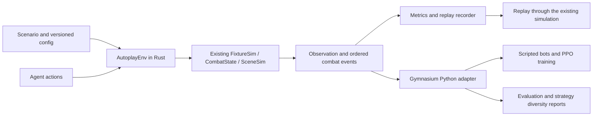

# AUTOPLAY-01 — Headless gameplay simulation, automated evaluation, and ML training

**Status:** design specification / agent implementation contract (2026-11-20). **Not implemented by this PR.** The initial delivery is a local, reproducible, Bevy-free evaluation/training harness; deploying learned policies as game NPCs is explicitly later research. No new game mechanics or existing replay semantics are approved by this document.

**Reconciliation (2026-11-20):** checked against main `46210b1d` (after #118, #120, #122, #123) and the unmerged COMBAT-FUN-02 design (#124). Every open choice is closed by an adopted default with an `AP-Q##` ID in [section 10](#10-adopted-defaults-ap-q); the owner may change any of them in a follow-up PR. Where an `AP-Q` entry is more precise than older text in this document, the `AP-Q` entry wins.

**Goal:** answer three different questions with one shared simulator:

1. **Is the encounter solvable, fair across a range of player capabilities, and regression-free?**
2. **Which strategies, actions, environmental interactions and edge cases can automated players discover?**
3. **Can trained policies teach us how to improve enemy/companion behavior without sacrificing authored, readable, deterministic combat?**

**Crucial distinction:** win rate, optimal play, coverage and reaction time are measurable; *fun, comedy, meaningful spectacle, visual clarity and human difficulty* cannot be inferred from an RL reward or from one optimal agent. Human controller playtests remain necessary.

## 1. Why now / upstream design authority

The first [DEMO-01 questionnaire](../04-production/demo-01-questionnaire.md) identified boring/repetitive basic fighting, enemy-to-enemy contacts that were hard to perceive, Donut feeling passive, insufficient evade choices, and apparently repetitive deaths. The full feedback and COMBAT-FUN-02 remediation plan currently live in **PR #124**, which is still a separate open design branch at the time of authoring. **AUTOPLAY-01 is a parallel enabling workstream**, not a rewrite, prerequisite, or duplicate implementation of COMBAT-FUN-02.

Read `AGENTS.md`, [Rust/Bevy architecture](architecture.md), [testing strategy](testing.md), [combat feel](../01-design/combat-feel-hybrid-physics.md), [controller grammar](../01-design/mvp-controller-contract.md), [party rules](../01-design/party-2p-open-questions.md), [player and enemy roles](../01-design/combat-first-encounter-design.md), and [agent work order](../07-agents/autoplay-01-workorder.md).

### Existing code (re-verified on main `46210b1d`)

- `src/combat_scene.rs` has `Fixture` (a `&'static` data record with `pub` fields, including `seed`, `enemies`, `llamas`, `charges`, `boss`, `script`, `ticks`), `CombatState::new`, `step`/`step_party`, `take_new_events`, `state_hash` and **`FixtureSim::new(kit,view_h,fixture)` / `step(raw: RawInput)` / `state_hash()` / `restart()`**. `FIXTURES` lists **20** corridor fixtures and `EXPECTED_HASHES` pins **20** goldens (13 legacy, 2 DEATH-D, 5 llama).
- `FixtureSim::restart` is **not** a reset: it keeps `deaths`, `restarts`, `elapsed` and the event log. A fresh `FixtureSim::new` is the only full reset.
- After Carl's last HP goes, a non-demo fixture **restarts** (not a demo checkpoint respawn) 49 ticks after the defeat tick (`RESTART_DELAY_TICKS = 50` counted from it). `CombatState.hero_defeated` and the `HeroDefeated` event are readable right after the defeating `step`, so no hook is needed to stop first.
- `src/corridor.rs` holds `SceneSim` / `CorridorWorld`. Reaching the corridor's `exit_east` sets `world.complete` and freezes `world.tick`; the combat side keeps counting `CombatState.elapsed`.
- `src/input.rs` defines `RawInput { move_x, jump, attack, physical, ability, pause, swap }`; `InputFrame::advance` generates **press edges** from held-button transitions (one detector in `SceneSim`, one in `CombatState`; feed one `RawInput` per tick and let both advance). Do not convert held buttons into repeated presses. Same-tick Attack+Physical fires the Jab and drops the kick press. **`ability` has no behaviour in the Carl combat path** (held state is hashed, nothing consumes it) and `swap` is consumed only by `PartyState`, so `FixtureSim` ignores it.
- `src/party.rs` and `src/party_scene.rs` contain hero ownership, solo/2P drive and paired input fixtures; the faithful 2P path is `PartyFixtureSim::step_slots`. **Do not drive two humans as two independent single-hero combat simulations**.
- `src/demo.rs` holds the B0–B6 hall, checkpoints and probe fixtures, plus `demo::complete(&CombatState)` (all goblins and llamas dead); headless tests and `scripts/ci_floor01_combat.sh` already compare committed event and state hashes.
- There is **no gameplay RNG** on main: `Fixture.seed` is a per-fixture constant mixed into the hash and nothing draws from it. Every sim field is `pub`, so the observation module, not Rust privacy, enforces what a policy may see.
- Sim-path globals are immutable lazily parsed data only (`OnceLock` death profiles and boss data); there are no mutable statics, atomics or RNG statics.

**Merged work and v1 scope:** Donut Q10 swat/pounce and mana (#123) runs only in the live party and `FixtureSim` never calls `with_donut`, so it is **excluded** from v1 (AUTOPLAY-02). CINE-01 (#122) is a presentation observer that never writes to combat state; the headless env **bypasses** it and no reward reads it. AUDIENCE-01 (#118) is HUD-only and **excluded**; agent reward is never linked to it. THE JUICER boss (#120) needs the arena kit and party defeat rules and is **excluded** from v1. **v1 is Carl-only single fights.** COMBAT-FUN-02 (#124) is unmerged design; its changes stay behind `cf02_rules` and are handled by AP-Q05, AP-Q11 and AP-Q12.

The current project is a **single Rust package with Bevy 0.20.1** and existing Python validation scripts. `docs/03-tech/testing.md` notes that a proposed generic scenario runner is *not implemented*; do not describe it as available. There is no current Gymnasium/PyO3 environment in main. No rendering is required for the simulator.

## 2. Architecture and ownership



**One authoritative simulator.** A new Bevy-free Rust module wraps the **actual** Floor 01 simulation. It must not reimplement jumping, collision, enemy damage, RNG, spells, hazards, camera decisions, or movement in Python. Build and step the existing domain in the same order as the current headless fixture path. Presentation and audio are absent from training; replay can be rendered later by the existing game.

**Adopted layout (AP-Q01, AP-Q02):**

```text
src/autoplay/mod.rs                     # AutoplayEnv, config, errors (Bevy-free, stage A)
src/autoplay/{action,observation,episode,reward,scenario}.rs   # stage A
src/autoplay/{bots,metrics,replay}.rs   # stage B
src/bin/autoplay.rs                     # native CLI (list/evaluate/replay/benchmark), stage B
assets/data/autoplay/reward_profiles_v1.json   # RewardV1 numbers as data (AP-Q15)
tools/autoplay/native/Cargo.toml        # standalone PyO3 crate, own [workspace] and Cargo.lock
tools/autoplay/native/src/lib.rs        # thin binding for the Rust API
tools/autoplay/pyproject.toml           # isolated Python package + reproducible deps
tools/autoplay/python/autoplay/
    __init__.py
    env.py                             # Gymnasium adapter
    bots.py                            # scripted baseline policies
    evaluate.py                        # metrics and held-out evaluation
    train.py                           # optional CPU PPO experiment
    __main__.py                        # CLI
tools/autoplay/tests/                  # check_env + replay + seeded integration
docs/evidence/autoplay-01/README.md    # actual measured evidence and limitations
```

Keep PyO3, NumPy, Gymnasium, PyTorch, and Stable-Baselines3 **out of the game's default runtime and Cargo build path**: the shipped game binary and the root `cargo test --locked --all-targets` never compile them. The native env is ordinary Bevy-free lib code with no new dependency (serde and serde_json are already pinned); `tools/autoplay/native` is a standalone package with a path dependency on the game library, never a member of a root workspace. The **gameplay contract** is written in Rust and testable with `cargo test` without installing Python. The PyO3/maturin bridge is optional tooling; if a benchmark proves per-step overhead excessive, implement a Rust batch-step entry point, **not a second gameplay simulator**.

**Dependency rule:** verify and pin compatible current package versions during implementation; do not add unreviewed crates to the shipping game or claim a particular binding version already works. Python dependencies are tooling-only and local-first, with a lockfile. No cloud trainer, online telemetry, account/API key, hosted model, or GPU dependency is required for the MVP.

## 3. Native environment contract — AUTOPLAY-01A (mandatory)

A Rust wrapper should expose semantics equivalent to:

```rust
pub struct AutoplayConfig {
    // scenario_id, max_ticks, hero/mode, reward_id, observation_id,
    // action_repeat, content/ruleset version
}

impl AutoplayEnv {
    pub fn new(config: AutoplayConfig, assets_root: &Path) -> Result<Self, Error>;
    pub fn reset(&mut self, seed: u64) -> Result<(ObservationV1, ResetInfo), Error>;
    pub fn step(&mut self, action: ActionV1) -> Result<StepV1, Error>;
}
```

These are **contract sketches**, not prescriptive names, compiler-ready declarations, or existing APIs. Any implementation must preserve their observable semantics:

- **Reset** reconstructs the complete original initial state from a known fixture or validated scenario. It clears held-button edges, events, accumulated reward/metrics and episode timers. `FixtureSim::restart` preserves `deaths`, `restarts`, `elapsed` and events, so reset **constructs a new `FixtureSim`** from a cached `EnvKit` and checks the initial hash (AP-Q11).
- **Step** advances **one actual game tick at 60 Hz by default** using a normalized `RawInput`. Action repeats are permitted only as a documented optional wrapper; if an action is held across four ticks it is **one held button**, not four new button presses. Aggregate ordered events from **each tick**, not only at the end of the repeat.
- **Observations** are read-only. The observation extractor never advances physics, RNG, AI or action-edge detectors and never feeds the output back into the authoritative world.
- **Terminal handling:** start with a short, named **single-hero Carl vs goblins** encounter. End when all designated hostiles are defeated (success) or Carl is defeated (failure); **terminate on the defeating step**, long before the fixture's automatic restart (49 ticks later). Stop at `max_ticks` as **truncated**, not defeated. Exact rules, same-tick precedence and the `exit_east` case are AP-Q09 and AP-Q10. A call to `step` after termination/truncation must raise a clear error until reset. Avoid an ambiguous "one episode = repeated checkpoint lives" in v1.
- **Time and reproducibility:** the episode always records current tick, scenario ID/version, fixture/asset checksum, code commit, effective seed, ruleset/observation/action/reward versions and player policy ID. On main **no gameplay RNG exists**, so the reset seed changes nothing in the simulation; it seeds policy-side randomness only and the env reports `seed_affects_sim = false` (AP-Q11). Do not claim varying seeds represent different levels. The tick counter is the env's own count of executed ticks, equal to `CombatState.elapsed` on a fresh sim, never `world.tick`.
- **Coverage of modes:** v1 must be fully playable with Carl and the currently supported fixture. A future `PartyAutoplayEnv` must share the same native core and accept **two simultaneous per-slot inputs**, with proper `PartyState` ownership and solo bot drive; no independent simulations for Carl and Donut.
- **Scenario safety:** use existing fixture IDs and environment kits first (`cp01_single_goblin`, `cp02_two_goblins`; `cp02_kick_contact` uses Passive goblins, so it is a contact probe for parity tests, not a fight). The v1 roster is AP-Q17. Reject unsupported fixtures with a descriptive error rather than silently simplifying the level. For future dynamic spawns, validate layout reachability and material/hazard rules; do not add bespoke movement or physics to the harness.

### ActionV1: explicit and compatible with the controller

Python: `MultiDiscrete([3, 2, 2, 2, 2, 2])`, index order:

| Index | Name | Values | Maps to `RawInput` |
| --- | --- | --- | --- |
| 0 | horizontal | 0 = left, 1 = neutral, 2 = right | `move_x = -1.0 / 0.0 / 1.0` |
| 1 | jump | 0 / 1 | `jump` held |
| 2 | primary | 0 / 1 | `attack` held |
| 3 | physical | 0 / 1 | `physical` held |
| 4 | special (reserved) | 0 / 1 | `ability` held; no Carl behaviour on main, `available[0] = 0` |
| 5 | solo swap (reserved) | 0 / 1 | `swap` held; ignored by `FixtureSim`, `available[1] = 0` |

- Pause/select/respawn and hardware device ownership are **not policy actions** in v1 (`pause` is always false). Never give the agent unearned story abilities. Reserved components are forwarded unchanged (the sim's real no-op) and counted as *attempted unavailable action* (AP-Q03). Never secretly grant a capability.
- Simultaneous button presses are forwarded through **the game's actual input priority**, not invented priority in the adapter. Track ineffective actions as metrics rather than rewriting the combat rules. COMBAT-FUN-02 will change that priority under `cf02_rules`; the adapter never encodes it.
- An action with the wrong length or an out-of-range value is an error, never clamped (AP-Q04). The Down input arrives as ActionV2 (AP-Q05).
- `action_repeat` defaults to 1, and is explicitly versioned when changed. If action repeat >1, stop immediately on terminal/truncation and report exact ticks executed (AP-Q16).

### ObservationV1: fixed, bounded, player-like, not omniscient

The observation should be a stable Gymnasium `spaces.Dict` of normalized `float32` tensors plus binary masks, suitable for `MultiInputPolicy`:

| Key | Initial conceptual shape | Content |
| --- | --- | --- |
| `self` | fixed vector | Carl-relative motion, facing, grounded/hurt/visible action state, normalized known health; **no hidden future events** |
| `enemies` | [16, fixed features] | Only **visible** hostile silhouettes: relative position, facing, type, observed tell/airborne/downed state, not private cooldowns or next decisions |
| `enemy_mask` | [16] | 1 only for populated, perceived entries, remaining padding 0 |
| `hazards` | [8, fixed features] | Perceived support/block/breakable hazard positions and visible states, not hidden trigger timing |
| `hazard_mask` | [8] | Populated visible hazard entries |
| `available` | [2] | Whether the controlled character can currently use the special and solo swap |

The exact v1 feature lists, scales and perception mask are AP-Q06 and AP-Q07; they are the binding schema for stage A.

**Binding requirement:** before committing code, write the exact feature order, dtype, normalization scales and declared tensor shape to a versioned schema file/constant, matching the `observation_space` bounds; document whether the visible viewport is a fixed 640x360 sensor or the simulation's scroll-camera frame. Do not silently expose all enemy health, invisible enemies, hidden fuses, threat RNG, scripted future spawns, exact animation invulnerability windows or all-world coordinates merely because Rust has access. For >16 visible enemies or >8 visible hazards, explicitly reject the scenario or introduce a **documented deterministic nearest/visible ordering and overflow statistic**; never silently truncate and claim complete observations. Missing entities use zero padding plus the mask. No rendered pixels, wall-clock time, external vision model or LLM is required.

**Debug/evaluation vs policy input:** a *privileged* diagnostics record may contain all true events, hidden states and complete outcomes for QA. It stays in a separate diagnostics accessor and the episode artifact, never in per-step `info` (AP-Q08), and must never be concatenated to policy observations. Do not use debug event logs as input for a learned policy.

### RewardV1: separate learning incentives from evaluation metrics

Support at least two named, versioned reward profiles, never infer 'fun' from either:

- `sparse-v1`: +1 on scenario success, -1 on player defeat or `abandoned`, 0 otherwise; timeout is its own explicit outcome.
- `combat-v1`: recommended **tuning hypothesis**, not an approved final score: +10 success, -10 defeat or `abandoned`, +1 per **distinct legitimate enemy defeat**, -1 per player hurt event, -0.001 per actual tick (numbers as data, AP-Q15); no reward for cosmetic blood/gibs, HUD labels, camera slow motion or repeated presentation events. Avoid double-counting an enemy across contacts, replay, respawn or an action-repeat bundle. Expose the reward breakdown in `info`.

Agent reward is **not** the game's future live-viewer audience scoring and must not be linked to the player HUD. Keep ``reward_id` separate from the authoritative simulator.

### Termination and scenario outcomes

- `terminated=True` only on a game-defined success, actual defeat, or `abandoned` (Carl reached `exit_east` with required hostiles alive; terminal because the corridor run ended and the world is frozen); `truncated=True` only on time/step budget or declared external evaluation cutoff. Record `outcome` as `success`, `defeat`, `abandoned`, `timeout` or explicit error (AP-Q09).
- A scenario cannot accidentally "succeed" because a scripted enemy is off-screen or its spawn was not loaded. Define the set of required hostiles/objectives in the scenario manifest and test it.
- Capture failures like unreachable exit, softlock, indefinite no-progress or invalid terrain as **diagnostic flags**, not fabricated player defeat, unless their rules are explicitly part of the scenario.
- No game balance tuning is performed inside the adapter; all gameplay knobs remain owned by the appropriate gameplay work order.

## 4. Playback, metrics, and evaluation — AUTOPLAY-01B (mandatory)

Implement **Rust first**, Python report consumption second.

### Native replay

A versioned episode artifact (e.g. JSONL metadata + compressed action sequence) records:

- `run_id`, scenario ID, fixture + asset hash, commit, reset/effective seed, reward/action/observation versions, bot/policy ID, runtime flags, number of ticks and terminal outcome.
- **Every actual normalized per-tick action**, including held edges; if the Python decision spans several ticks, expand to actual tick actions or encode with unambiguous action-repeat semantics.
- Ordered, deduplicated gameplay event IDs and selected tick/state hashes at least at episode end and important transition checkpoints; `--verify-replay` must reconstruct the same authoritative events/hashes from reset.
- The file format, header fields and checkpoint cadence are AP-Q19.
- A seed and scenario identity are **not substitutes** for the action trace. Reject schema/content mismatches unless the caller explicitly accepts a documented migration.

The native CLI must replay without Python, the ML model, rendering, audio or external services. Reuse existing event-log semantics and `scripts/ci_floor01_combat.sh` expectations where possible; do not change existing fixture goldens just to build a runner.

### Diagnostics (each episode and aggregate)

Required fields: success/defeat/timeout, total fixed ticks, received damage, defeated enemies, attack attempts vs connected hits by move, knockbacks and enemy-body contacts, distinct defeat causes, player hurt/deaths, used terrain hazard interactions, time standing still/no progress, terminal position, swaps/companion assistance when enabled, invalid/unavailable actions, seed/fixture/rules version, and replay path.

**Do not invent attribution:** when the existing event set cannot reliably tell who caused a contact/hit/finish, emit `unknown` or `not_observable`, add a narrow follow-up to the existing event contract, and keep evaluation honest. The attribution sources and fallbacks are AP-Q14.

Aggregate: distribution and 95% uncertainty interval of success rate (Wilson or bootstrap), medians and percentiles for time/damage, per-move usage/hit rates, repeated optimal-action proportion, and a **strategy fingerprint** from action families/terrain/contact outcomes. Diversity can be described by unique observable fingerprints and distributional entropy; **neither proves creativity or fun**. Always show episode count and seed/scenario spread; no single scalar "difficulty" score.

### Basic player policies and profiling

Ship at least three *deterministic and reproducible* baseline policies:

1. `random_legal`: seed-controlled legal action sampling (smoke/coverage; not a human skill proxy).
2. `approach_and_attack`: basic approach, face, use primary/physical, limited jump; intentionally imperfect.
3. `reactive_survivor`: simple threat-distance/tell reaction, defensive positioning and selective attacks; no access to privileged game events/private future state.

Optional deliberately **capability-limited** variants of (2) and (3) can model response delay, input noise and restricted move vocabulary. Do not label them "novice, intermediate, expert human difficulty" until actual human traces are used for calibration.

Benchmarks: compare total simulated ticks/second, reset overhead, Rust-only loop, Python single-env loop and Python batched loop (if provided) on **named hardware**, including CPU, build profile and tool versions. No made-up 100x multiplier or strict performance target without evidence. The initial implementation must be faster than wall-clock gameplay in an honest release headless test or publish the observed bottleneck and remediation plan.

### Seed separation and generalization

A fixed deterministic scenario can produce identical outcomes for any arbitrary seed. For generalization, create **at least two distinct, validated, deterministic fixture configurations/initial positions** and split them into **development and hold-out scenarios** before training. If generating seeded geometry or enemy variations later, use only reachable, valid and reproducible layouts. No train/test overlap through the same fixture renamed differently. Keep evaluation bots and held-out conditions constant across game commits; comparisons require a matched seed/scenario roster and artifact manifest.

## 5. Python bridge and runnable learning experiment — AUTOPLAY-01C (mandatory first ML proof)

- Bind the native Rust environment in-process using **PyO3 + maturin** (or document a measured reason to use a different Rust binding). Python implements `gymnasium.Env` `reset(seed,options)->(observation,info)` and `step(action)->(observation,reward,terminated,truncated,info)`. Observation and action spaces are exact; run `gymnasium.utils.env_checker.check_env` in the opt-in tooling CI job (AP-Q20; no torch in CI). Python tests verify non-mutating observation, action-edge behavior, terminal/timeout rules, deterministic repeated runs, seed disclosure and replay parity.
- Provide a **single local setup / smoke command** (script or documented one-liner) that builds the optional native extension, installs pinned tooling, runs a baseline bot, writes replay/metrics and checks replay in native Rust. GPU must not be required.
- Provide a **short, bounded PPO smoke test** using Stable-Baselines3 with `MultiInputPolicy` and the Gymnasium env. Example interface (exact command names are recommended, may be adjusted with documentation):
  - `python -m autoplay evaluate --scenario cp01_single_goblin --policy reactive_survivor --episodes 50 --out artifacts/autoplay-01/eval`
  - `python -m autoplay train --algorithm ppo --scenario cp01_single_goblin --steps 10000 --seed 42 --out artifacts/autoplay-01/ppo-smoke`
  - Replays: `python -m autoplay evaluate` writes native `autoplay-episode/1` files (`--replays none|first|all`, default `first`, under `<out>/replays/<scenario>/<policy>/`) through the binding; verify them with the native `autoplay replay --episode FILE --verify` (a `python -m autoplay replay` wrapper was not added, the native executable is the single verifier)
  - `cargo run --release --bin autoplay -- benchmark --scenario cp01_single_goblin --episodes 1000`
- Training is only required to demonstrate **the pipeline functions**: it initializes, produces a checkpoint and a metrics report, and reloads the model to run evaluation. **Do not assert that a 10k-step PPO policy is strong**, beats heuristics, solves all scenarios or approximates human skill. Compare it fairly to fixed baselines on hold-out scenarios, including failure modes and action diversity.
- Version and persist policy metadata: Python deps, algorithm/settings, observation/reward/action versions, commit and content hash, training/test scenario lists and reset seed. Do not commit large checkpoints, private datasets or generated model weights to the normal game repo. Add `artifacts/autoplay-01` and tool build products to ignored paths if not already ignored.
- For efficiency, benchmark and optionally add Rust `step_many` (one env, successive actions) or `batch_step` (multiple independent environments) without changing transition semantics. Be explicit about per-environment terminal handling and Gymnasium vector autoreset policies; **never hide a reset or drop the final observation**.

## 6. Evaluation practice / integration with COMBAT-FUN-02

Use a stable, named scenario manifest and scorecard rather than one "cleverest bot" victory. For every combat/mechanics change:

1. Rebuild against the same committed scenario/observation/action/reward versions; reject incompatible artifacts or mark migration.
2. Run fixed heuristic/replay regression suite in normal CI on paired fixture/seed lists. Report change in success rate, median damage, time, contact outcomes, strategy diversity and possible softlocks. A passing win-rate gate is **not** automatic gameplay approval.
3. Run trained-policy evaluation on a **frozen** baseline checkpoint where compatible. Avoid re-training in routine PR CI; training belongs to manual/offline jobs.
4. For relevant changes, run optimization/probing across a **bounded sweep of explicit gameplay knobs** (later Optuna integration optional), never merge automatically selected difficulty values.
5. Produce short per-case **replays** for the easiest win, hardest loss, unexpected exploit, ignored move, and an environmental/co-op opportunity if available; render with existing Bevy tooling when the event needs a visual verdict (for now only `cp*` scenarios can be rendered; `ap_*` scenarios need a coordinated CF02-file edit to the FIXTURES-only lookup, AP-Q17).
6. Review the same encounters with humans and controllers. Calibrate policy families from actual player performance only after consented, versioned, non-identifying traces exist; don't use account-level personal metrics by default.
7. Preserve game narrative progression and CINE-01's rare skill gate. A reward encouraging ordinary gore frequency, early unearned special attacks, or automatic Donut last-hit steals is a test failure, not success.

**Illustrative diagnostic:** if an agent always succeeds via a repeated jab, test whether all other moves are dominated, whether the training reward overvalues raw kills, or whether the observation/action interface accidentally hides contextual opportunities. Don't immediately raise enemy health or buff every other move.

## 7. Later extensions: NOT part of initial implementation

### AUTOPLAY-02 — Proper local 2P / multi-agent simulation

Drive `PartyFixtureSim::step_slots` (swap request, hero inputs, drive and `CombatState::step_party` in the game's order; `SceneSim::step_party` alone skips combat) with **simultaneous** per-slot actions. Expose a PettingZoo `ParallelEnv` adapter only after both heroes are really simulated, with accurate character unlocks, AI handoff, death rules, shared camera/visibility and team vs individual rewards. Run `parallel_api_test` and manual two-pad checks; a fake second independent Carl sim does not count.

Its one-seat subset, AUTOPLAY-02a (one policy seat, the in-game companion active), is specified in [section 11](#11-autoplay-02a--solo-party-env-one-policy-seat-companion-active); it covers **no-orders runs only** (the command input is out of its action space, see its scope and conflict 4).

### AUTOPLAY-03 — NPC policy research

Train or search for enemy positioning, safe pressure, tactical pauses and Donut assistance **offline**. Benchmark authored FSM/utility AI against learned policies with human playtests. Never ship a model solely because it wins or scores higher: adversaries must telegraph and allow fair counterplay, and Donut must assist without stealing player agency. Default runtime solution remains transparent, deterministic **authored AI or distilled rules** unless a learned policy beats it on player experience, performance, explainability and reproducibility. Any runtime policy must be bounded, versioned, deterministic under recorded inference inputs and have a documented CPU/Deck performance budget, model license/provenance, debug traces, and safe fallback.

### AUTOPLAY-04 — Smart scenario generation and tuning

Optuna/parameter search, adversarial exploration, scenario mutation and counterexample minimization, only over valid authored constraints with held-out test conditions. Every discovered exploit becomes a standard deterministic regression fixture. **No autonomous merge of balance numbers**.

## 8. Acceptance checklist

**P0 deliverable, end to end:**

- [ ] Native Rust `AutoplayEnv` can reset, observe and step a real combat fixture **without rendering**; new state and event hashes match the existing fixture's tick/replay semantics.
- [ ] Repeated same scenario, seed and per-tick actions give **identical** observed authoritative states/events/outcome; reset twice from an ended episode is identical; held attack press edge is not double-fired.
- [ ] At least two genuinely different valid fixture setups, with hold-out separation; explicit outcome and step budget; no terminal episode silently respawns.
- [ ] Exact documented action and observation v1; no hidden future or all-world policy inputs; Gymnasium `check_env` succeeds.
- [ ] Three baseline policies, local CLI, event-driven metrics, JSON/CSV reports, reproducible replay and native replay verification, measured release throughput.
- [ ] Optional Python tool install (no change to default game runtime) plus bounded PPO smoke train/save/load/evaluate command; no GPU requirement.
- [ ] Tests for random vs scripted input, event dedup, truncated vs terminated, observation visibility, unavailable ability, fixture overflow, incompatible replay schema, concurrent independent envs, and comparison with preexisting headless fixed-tick hashes.
- [ ] Standard Rust CI + Python tool unit checks pass on the final implementation head; no regression in original game scenario hashes and no unsolicited gameplay/asset changes.
- [ ] Clear report distinguishing what is objectively measurable from what remains a human judgement. No claims that game difficulty/fun or intelligent NPCs are "solved".

**Out of scope:** image-input RL, visual LLM agents, live distribution of neural policy inference, forced 2P MARL, automatic game balance commits, player data collection, online services, full Floor 01 generation, and rebuilding any physics/collision behavior for the trainer.

## 9. Official integration references (verify versions when executing)

- Gymnasium environment/reset/step/checker: https://gymnasium.farama.org/api/env/
- PettingZoo simultaneous actions, future: https://pettingzoo.farama.org/api/parallel/
- Stable-Baselines3 PPO: https://stable-baselines3.readthedocs.io/en/master/modules/ppo.html
- PyO3: https://pyo3.rs/
- maturin: https://www.maturin.rs/
- Optuna, future: https://optuna.org/

**Release/IP policy:** all training fixtures and artifacts use the project's original sources and rights constraints. Training outputs are internal evaluation tools; this does not confer a license to distribute franchise-derived character content or model checkpoints.

## 10. Adopted defaults (AP-Q)

Adopted under the AGENTS.md "Design defaults" rule. **Each value is a default the owner may change in a follow-up PR**; implementation PRs cite the ID they implement. Values marked "data" live in versioned data or constants and are written into every episode header.

| ID | Adopted value | Rationale |
| --- | --- | --- |
| AP-Q01 | Native env (stages A/B) is a Bevy-free module tree `src/autoplay/` in the main crate plus the auto-discovered `src/bin/autoplay.rs`. The only shared-file edit is one `pub mod autoplay;` line in `src/lib.rs`. No new Cargo dependency; `src/autoplay/` never imports `bevy` (a unit test greps its sources). | A separate crate depending on the lib compiles all of Bevy anyway and needs a workspace or a second lock file; in-crate code is covered by the normal `cargo test --locked --all-targets`, fmt and clippy at no extra cost. |
| AP-Q02 | PyO3 binding `tools/autoplay/native` is a **standalone** package: its own empty `[workspace]` table, its own committed `Cargo.lock` (seeded from the root lock so shared crates resolve identically), own target dir, path dependency on the game lib. Root `Cargo.toml` is unchanged; no root workspace. | The shipped binary and root `cargo test` never see PyO3 or NumPy. A workspace member would put PyO3 into root `--all-targets` builds. |
| AP-Q03 | ActionV1 = `MultiDiscrete([3,2,2,2,2,2])` as in section 3. Indices 4 (`ability`) and 5 (`swap`) are **reserved**: forwarded unchanged to `RawInput`, `available = [0,0]` in v1. Metrics count, per component, `unavailable_held_ticks` (value 1 while unavailable) and `unavailable_presses` (0 to 1 transitions). No reward term. | Keeps the action space stable for AUTOPLAY-02 swap and later specials; forwarding avoids adapter-invented rules; the attempt is honestly accounted. |
| AP-Q04 | Input construction: stage A builds `RawInput` from explicit fields on a neutral base and adopts `RawInput::NONE` as that base when CF02-00 adds the const (until then `RawInput::default()`). Wrong action length or out-of-range value returns `InvalidAction`; nothing is clamped. | A later `RawInput` field cannot silently change an action; invalid policies fail loudly. |
| AP-Q05 | Action versioning: the config carries `action_version`. **ActionV2** = ActionV1 + index 6 `down` (0/1), `MultiDiscrete([3,2,2,2,2,2,2])`, added only after CF02-A merges; an ActionV1 action maps to `down = 0`. ActionV1 replays are verifiable while the recorded ruleset's semantics are unchanged (the header records `action_version` and `cf02_rules` and replays under the recorded values); any gameplay drift is detected by the AP-Q19 checkpoint hashes and reported, never silently accepted. A v1 policy may be **evaluated** under `cf02_rules = true` (it can never press Down, so stomp and dive are unreachable; reports say so); training with cf02 uses ActionV2. | Appending keeps index meaning stable; the Down move set is CF02's, not ours to emulate. |
| AP-Q06 | ObservationV1 (all `float32`, bounds in brackets; schema const `OBS_V1` with names and scales). `self` [14]: `vx/480`, `vy/480` [-1,1]; `facing` ±1; `grounded`; `health/HERO_HEALTH` [0,1]; `hurt` (`hurt_ticks>0`); `invulnerable` flag (no remaining count; rule knowledge, see below); `busy`; `move_jab`, `move_haymaker`, `move_push_kick` one-hot of the current Carl move; `hit_stop` flag; `x_in_view = (x - cam_left)/640`, `y_in_view = (layout_y(y) - cam.top())/360` [0,1], where `y` is Carl's **foot-line** y, `layout_y` is the existing y-up (sim) to y-down (layout pixel) conversion of env_kit.rs (about line 287) and `cam.top()` is the y-down `view_top` of `ScrollCamera`; the sim is y-up, so the raw difference `y - cam_top` is never used. `x` is shared by sim and camera, so `x_in_view` needs no conversion. **Sign convention:** `dy` and `vy` (own and enemy) stay in the sim's y-up frame, so positive is up, which keeps `dy` and `vy` consistent in sign; only `y_in_view` is y-down (screen). A bot author must not assume a screen-down `dy`. `enemies` [16,14]: `dx/640`, `dy/360` [-1,1]; `facing` ±1; `kind_goblin`, `kind_llama`; `vx/480`, `vy/480`; `grounded`; `tell`, `swing` (Smear or Impact), `recover` from `attack_phase()`; `staggered` (Hurt); `launched` (living Launched or Downed); `damaged` (health below max; rule or memory knowledge a player has, "this goblin was hit", not a claimed on-screen cue). `hazards` [8,6]: `dx`, `dy`, `kind_block`, `kind_charge`, `kind_glob`, `active`; **always masked to zero in v1** because the v1 roster has no hazards. `available` [2] = `[0,0]`. Unknown future goblin modes map to all-zero mode flags plus a diagnostics counter. **Clamping:** every feature is clamped to its declared bound before it is returned (fall `vy` under gravity 1050 is unbounded in principle, prototype.rs:18, feel.rs:154), and a diagnostics counter `obs_clipped` counts clamped values, so `observation_space` and `check_env` always hold. **Knowledge classes:** `invulnerable` and `damaged` are labelled as rule or memory knowledge a player has (i-frames follow a hurt; this goblin was hit), because the renderer shows no Carl invulnerability cue (only Donut blinks, floor01_scene.rs:3296-3299) and no goblin damage cue; this matches owner question 1. | State a player can read from the screen or knows from the rules and from memory; no exact health, cooldowns, fuse timing or scripted triggers. CF02 additions (lying state, morale tells) go into ObservationV2. |
| AP-Q07 | Perception mask: an entity is visible iff `!scene.is_offscreen(x, 0.0)`, the sim's own 640 px scroll-camera frame (the same camera frame as the existing offscreen rules, which apply `is_offscreen` to the hero with an `offscreen_margin_px`; here the margin is 0 and the subject is each enemy) at `view_h = 360`. Defeated enemies (`!alive()`: Down, Corpse, killing-launch Airborne) are omitted. Order: ascending `abs(dx)`, ties by enemy id. Scenario validation rejects any fixture whose enemies plus llamas exceed 16; a runtime overflow counter must stay 0. | Uses the game's real view instead of an invented sensor; deterministic ordering; no silent truncation. |
| AP-Q08 | Per-step `info` holds only non-privileged bookkeeping: `tick`, `outcome`, `terminal_reason`, `reward_breakdown`, unavailable-action counters, versions, `requested_seed`, `sim_seed`, `seed_affects_sim`, `cf02_rules`. Privileged diagnostics (all events, enemy health and cooldowns, hashes, hidden timers) come from a separate `diagnostics()` accessor and the episode artifact. Rust bots implement `fn act(&mut self, obs: &ObservationV1) -> ActionV1` and get nothing else. The obs-only rule extends to the Python bots (`bots.py`) and to the policy path of the Python adapter: bots and policies read only the observation and never `info`. Python `reset(seed=None)` draws a seed from the adapter's own RNG and records it as `requested_seed`. **Leakage test:** a differential test builds pairs of sims that differ only in hidden state (an enemy outside the view, a changed `attack_cooldown`, `hurt_cooldown`, a script, or an enemy `health` pair where both values are below max or both are at max) and asserts byte-identical observations; `damaged` (AP-Q06) is the one intentional health-derived bit, so a pair that crosses the max boundary is expected to differ in exactly that bit, and a second test asserts that; a schema test pins length, order and bounds. | The type signature and the differential test make leakage a test failure rather than a review hope. |
| AP-Q09 | Terminal rules, checked after every tick: **defeat** when `combat.hero_defeated` turns true (the defeating step; no hook needed); **success** per AP-Q10; **abandoned** when `scene.world.complete` (exit reached with required hostiles alive). All three set `terminated`. Same-tick precedence: defeat > success > abandoned (the game itself restarts after a defeat); a same-tick clear plus defeat sets diagnostic `simultaneous_clear`. **timeout** sets `truncated` when executed ticks reach `max_ticks`. The returned observation is the post-tick observation of the final tick. Any later `step` returns `EpisodeOver` until `reset`. | Matches game rules and Gymnasium semantics; it is terminal because the corridor run ended (the world is frozen: `CorridorWorld::step` returns early once `complete` is set, corridor.rs:198-201), not a truncation. The full `CombatState` is not absorbing, since the goblins keep stepping. |
| AP-Q10 | Victory: success when the distinct `EnemyDefeated.target` ids seen this episode cover the scenario's required roster (goblin ids `0..n` in v1). A test asserts it agrees with `demo::complete(&combat)` on every roster scenario; `demo::complete` is not the runtime authority. | Event-driven, exactly once per enemy, and works for non-demo fixtures. |
| AP-Q11 | Reset and seed: `reset(seed)` builds a fresh `FixtureSim::new(&kit, 360, fixture)` from the env's cached `EnvKit` and asserts its initial `state_hash` equals the manifest value. On main the seed only seeds policy-side RNG (bots, Python sampling) and `seed_affects_sim = false`. The config field `sim_seed` is `fixture` (default), `fixed(u64)` or `from_reset`; non-default values are rejected until CF02-G lands, then they feed the CF02 temperament draw (stateless SplitMix64 of seed, restarts, goblin, draw) through a narrow seed-override hook owned by the CF02 lane, so an evaluation can hold temperaments fixed or sweep them. That is the honest meaning of the env seed from then on. `seed_affects_sim` is defined as true iff the reset seed reaches the sim (`sim_seed = from_reset` with `cf02_rules = true`); `fixed(u64)` changes the sim but not via the reset seed, so it reports `seed_affects_sim = false` and records the fixed value as `sim_seed`. | No false claim of variety today; one documented plug-in point for CF02-Q58 variety without leaking `&'static Fixture`s. |
| AP-Q12 | `cf02_rules: bool` in the env config, default `false`, recorded in reset `info`, the episode header and every report; replay rejects a mismatch. Stage A rejects `true` until CF02-00 exposes the switch to `FixtureSim`. With `cf02_rules = true` and ObservationV1 the report carries `obs_schema_partial = true`. | CF02 changes input precedence (unified press buffer), moves and events; mixing rulesets silently would break replay parity. |
| AP-Q13 | State isolation: each env owns its `FixtureSim`, its `EnvKit` clone and its counters; `src/autoplay/` has no `static` with interior mutability. Tests: two envs stepped interleaved equal two envs stepped sequentially, and four envs on `std::thread::scope` threads equal the single-thread run. | The audit found only immutable `OnceLock` data on the sim path; the tests keep it that way. |
| AP-Q14 | Attribution: drain `take_new_events()` once per tick. Kill credit by `EnemyDefeated.target`, de-duplicated by id; instigator `Some(0)` carl, `Some(1)` donut, `None` unknown. `Hit` attacker from the `move_id` family (Jab/Haymaker/PushKick carl; Swat/Pounce/MagicMissile donut; otherwise unknown). Carl's attacker from `HeroHurt.source`. Whiffs are **derived** (a Carl `MoveStarted` instance with no Carl-attributed `Hit` of the same instance; Donut keeps its own instance counter) and labelled `derived`. Hazard damage to Carl is `not_observable`. Unknown or future event variants go to an `other_events` count through a wildcard arm, so CF02's appended events never break the build. | Uses only fields that exist; never guesses. |
| AP-Q15 | RewardV1 numbers as data in `assets/data/autoplay/reward_profiles_v1.json` (embedded with `include_str!`): `sparse-v1` = success +1, defeat -1, abandoned -1, timeout 0; `combat-v1` = success +10, defeat -10, abandoned -10, timeout 0, `enemy_defeated` +1 (required roster only, once per id), `carl_hurt` -1 per `HeroHurt` with hero Carl, `tick` -0.001 per executed tick. Default `reward_id = combat-v1`. `HeroHurt` is also logged on the lethal hit (combat_scene.rs:2148, before the `health_left == 0` branch at :2158), so a defeat scores -10 plus -1 under `combat-v1`; reward tests pin this. | Matches the section 3 hypothesis; abandoning a fight is not cheaper than losing it. |
| AP-Q16 | `max_ticks = 1800` (30 s at 60 Hz) for every v1 scenario; `action_repeat = 1` default, allowed 1..=8, buttons held across the bundle, stops mid-bundle on terminal or timeout, rewards summed, executed ticks reported. | The scripted fixtures resolve a fight in 200-300 ticks; 30 s leaves room for weak bots without endless episodes. |
| AP-Q17 | v1 roster (corridor kit, Carl-only, Chase goblins, no hazards). Development: `cp01_single_goblin` (1 @560) and `ap_two_goblins_wide` (2, @480 and @704). Hold-out: `cp02_two_goblins` (2 @520/@552) and `ap_single_goblin_far` (1, @776). `ap_*` are autoplay-owned `static Fixture`s in `src/autoplay/scenario.rs` (struct update from an existing fixture, e.g. `Fixture { .., ..CP02_TWO_GOBLINS }`; exact columns chosen in stage A, must pass `CombatState::new` validation, which only checks that each spawn is on Carl's walking line, so the B1 segment spanning x 512..816 must cover 704/776, checked in stage A). The struct update would inherit `script`, `seed`, `summary` and `ticks`, so each `ap_*` fixture sets an explicit `name`, `summary`, a distinct `seed` and `script: &[]`, and a test asserts that `ap_*` names never collide with `Fixture::by_name` or `FIXTURES`. **Initial visibility:** the scroll camera starts on Carl's lead point (x 400 plus `LEAD_PX` 24 while facing right), so the initial view is x 104..744 and the right view edge is at x 744; stage A keeps every spawn at least 16 px from the initial view edge and asserts each roster scenario's initial `enemy_mask` in a test (so `ap_two_goblins_wide`'s far goblin at @704 is visible, 40 px inside the edge, and `ap_single_goblin_far` at @776 is 32 px outside it and intentionally starts off-screen with an empty observation). `ap_*` replays cannot be rendered by `floor01_scene` or the CI script, which use a FIXTURES-only lookup, without a coordinated CF02-file edit; section 6 item 5 applies to `cp*` scenarios only for now. A layout fingerprint (kit, `carl_x`, enemy columns and AI, llamas, shore, charges, boss; not name, script or ticks) must be unique across the roster, so script-only variants such as `cp01_goblin_attacks` count as duplicates. Any other fixture is rejected as unsupported. | Two genuinely different layouts per split; scripts are invisible to a policy, so they cannot create variety. |
| AP-Q18 | Parity: a crate-visible `step_raw(RawInput)` (tests and replay only, not on the policy API) is **not gated by terminal rules**: it may record the terminal it would have produced but never returns `EpisodeOver`. It feeds `fixture.input(scene.world.tick + 1)` exactly as `step_scripted` does (combat_scene.rs:2593-2596) for `fixture.ticks` ticks, running past the success tick (cp01's goblin dies near tick 137 of 200). The parity test compares the result against (a) a live reference `FixtureSim::new(..).run_scripted(fixture.ticks).state_hash()` and (b) copied literal values of the three golden hashes for `cp01_single_goblin`, `cp02_two_goblins` and `cp02_kick_contact`; each literal carries a comment naming its source, and the test never references the private `EXPECTED_HASHES` const (it lives in the CF02-owned `#[cfg(test)] mod tests` of src/combat_scene.rs). `ap_*` scenarios get their own goldens inside `src/autoplay/`, never in `EXPECTED_HASHES`. | Proves the env drives the real sim in the existing order without touching existing goldens. |
| AP-Q19 | Episode artifact: JSONL via the existing serde_json. Line 1 header: `schema = "autoplay-episode/1"`, commit, scenario id and fingerprint, 64-bit kit content hash (existing hashing helper, no new crate), `action_version`, `obs_version`, `reward_id`, `cf02_rules`, `sim_seed`, `requested_seed`, policy id, `action_repeat`, `max_ticks`. Then one line per executed tick with the compact action; every 60 ticks and at the end a line with the rolling event hash (folded with `CombatEvent::mix_into`) and `state_hash`; a final line with outcome and tick count. Replay verification rebuilds from reset and compares every checkpoint; an unknown `schema` is rejected. | Small, diffable, verifiable without Python. |
| AP-Q20 | Python and CI: Rust stages run only in the existing cargo CI (no workflow edit). Stage C adds one **new, non-required** workflow `.github/workflows/autoplay-tools.yml` (manual dispatch plus pull requests touching `src/autoplay/**` or `tools/autoplay/**`): Python 3.12, maturin build, `pytest` for check_env, determinism, terminal and replay parity; no torch and no SB3. The native crate path-depends on the Bevy lib with `bevy_audio` and `vorbis`, so the job installs the same Linux build packages as game.yml (`pkg-config libasound2-dev libudev-dev libx11-dev libxi-dev libxrandr-dev libxcursor-dev libxkbcommon-dev libxkbcommon-x11-0 libwayland-dev libvulkan-dev`; the three audio/udev packages alone fail on `wayland-sys`), uses `Swatinem/rust-cache`, and runs `cargo fmt --check`, `cargo clippy --release --locked --all-targets -- -D warnings` and `cargo test --release --locked` inside `tools/autoplay/native` (release, to share the build with the wheel), because root fmt and clippy do not cover a standalone package. "Light" means no torch or SB3, not a fast build: the job still compiles Bevy. PPO runs locally only. Local setup: `uv venv --python 3.12` in a venv outside the repository (`scripts/check_docs.py` walks every `*.md` and `*.json` below the checkout; `tools/autoplay/scripts/smoke.sh` defaults to `~/.cache/dungeon-floorbreak-autoplay/venv`), `uv.lock` committed. The workflow also builds the native `autoplay` binary and runs the Python replay-verify tests against it. Pins: pyo3 0.30.1, numpy crate 0.30.0, maturin 1.16.0, gymnasium 1.4.0, numpy 2.5.4, pytest 9.2.0; extra `train`: stable-baselines3 2.9.2 and torch 2.15.0+cpu from the PyTorch CPU index (cp312 wheel, about 200 MB). CPU only. | Keeps the heavy stack off CI and the game; the light job catches binding drift. Local python3 is 3.14, so the venv pins 3.12 to match CI and the torch wheel. |
| AP-Q21 | Stage split: four small PRs in order A, B, C, D (C needs the frozen A schema and the B replay format). Shared files: **A** `src/lib.rs` (one line, possible one-line conflict with CF02's `pub mod cf02;`); **B** none; **C** `.gitignore` (tool build products, venv) and the new workflow file; **D** `docs/04-production/backlog.md` and a line in `docs/03-tech/testing.md`. No stage edits any file in the CF02 collision list. | Lets the coordinator sequence each stage against #124 with at most a one-line conflict. |

**Owner-only questions (open, not blocking):**

1. Should agents see exact enemy health? v1 exposes only `damaged` (AP-Q06).
2. Should the scenario design block the corridor exit during fights instead of scoring `abandoned` (AP-Q09)?
3. When, if ever, should the opt-in Python job become a required check (AP-Q20)?

**Living-horizon statement:** AUTOPLAY-01 adds no moves, abilities, unlocks, floor mechanics or co-op rules; it is a measurement tool and fits [the character progression horizon](../01-design/character-progression-horizon.md) unchanged. Reserved actions keep `available = 0`, so it never grants an unearned ability.

## 11. AUTOPLAY-02a — solo-party env (one policy seat, companion active)

**Status:** design addendum (2026-11-20), **not implemented**. Adopted defaults under the AGENTS.md "Design defaults" rule; **each AP-Q value below is a default the owner may change in a follow-up PR.** Sections 1-10 stay binding for the `solo` mode; where this section is silent, the matching v1 AP-Q applies unchanged to `party_solo`.

**Scope.** AUTOPLAY-02a is the one-seat subset of AUTOPLAY-02 (section 7): the policy drives **one** hero (Carl or Donut) through the game's real party path, and the other hero is the game's own uncontrolled AI (`PartyTuning::uncontrolled_hero`: today `FollowAndJumpBot`; COMPANION-AI-01 adds `Companion(profile)`). Episodes score **party** outcomes with the companion active. It is the evaluation harness of COMPANION-AI-01 stage 01E ([companion design section 17 (d)](companion-ai-command-system.md#d-autoplay-02a-dependency-01e), CA-31). Simultaneous two-policy play and the PettingZoo `ParallelEnv` stay AUTOPLAY-02.

**No-orders only.** 02a runs **no-orders** episodes: the policy's action space has no way to give the companion a command (the COMPANION command input is held L1 plus a face chord, and L1 is the reserved, stripped swap index of AP-Q23), so 02a cannot produce the "ordered" half of 01E's no-orders/ordered comparison or order metrics. Ordered runs arrive later (conflict 4).

**Code facts (verified at main `a5e16b6a`).** `PartyFixtureSim::step_slots` (src/party_scene.rs) runs swap request, `hero_inputs`, `set_drive` and `CombatState::step_party` in the interactive scene's order, and calls `party.restart()` after a combat restart. `PartyFixtureSim::new` builds a solo party with **Carl controlled**; `PartyState` has no pub setter for the controlled hero, and `PartyState::restart` gives control back to Carl. In solo, `hero_inputs` routes slot 0 to the controlled hero and an idle input to the other one. The `ProfileSetId::name()` values `cf02_assist` and `companion_v0` (src/companion/profile.rs) exist on main; `UncontrolledHero::Companion` does not yet (COMPANION 01A-wire adds it). `PartyFixture` and `PartyFixtureSim` fields (`base`, `two_player`, `tuning`, `script`, `pilot`, `donut`; `scene`, `combat`, `party`) are `pub`. Donut's state is readable through pub views (`donut_mana_view`, `donut_move_view`, `donut_cast`, `donut_bolts`, `donut_mana_tuning`, src/combat_scene/donut.rs). `is_party_defeat` (D1) ends the attempt when either hero is at 0 HP, and `solo_last_hp_guard` keeps the uncontrolled hero at 1 HP or more in solo. The live path checks the exit for both heroes (`check_exit(true)`, src/corridor.rs). The HUD plate shows both heroes' health and Donut's mana bar, with `COMPANION` on an AI-driven plate (src/donut_hud.rs).

| ID | Adopted value | Rationale |
| --- | --- | --- |
| AP-Q22 | **Mode.** `AutoplayConfig.mode` is `solo` (the v1 `FixtureSim` env, Carl only, unchanged and the default) or `party_solo { seat, companion_profile }`. `seat` is a hero, `carl` or `donut`, serialized by name; its numeric value is the hero index (0 Carl, 1 Donut), equal to the AP-Q14 instigator id. `obs_version` is a **new** `AutoplayConfig` field (the v1 config has none), derived from `mode`: 1 for `solo`, 2 for `party_solo`, and recorded in the replay header; a config that sets a different value for its mode is rejected. `party_solo` requires a party reward profile (AP-Q32) and `solo` rejects one. Code lives in `src/autoplay/party/` (`mod.rs`, `scenario.rs`, `env.rs`, `observation.rs`, `metrics.rs`), next to and sharing the v1 action, config, replay and bot modules. The env type is `PartyAutoplayEnv` in `src/autoplay/party/env.rs`, with `reset`, `step` and `observe -> ObservationV2`; `AutoplayEnv` (built on `FixtureSim`) stays the `solo` env. `AutoplayEnv::new` rejects `party_solo` with `InvalidConfig` naming `PartyAutoplayEnv`, and `PartyAutoplayEnv::new` rejects `solo` the same way. In `party_solo` the Carl-specific v1 `EpisodeMetrics` fields (`standing_still_ticks`, `terminal_position`, `heroes`) describe the **seat** hero. The sim is `PartyFixtureSim` built with `PartyFixtureSim::new(&kit, 360, fixture)` and stepped only through `step_slots`; the env never calls `SceneSim::step_party` or `CombatState::step_party` itself. | One native core for both modes; the party fixture path already is the interactive scene's order, so no harness rule is invented. |
| AP-Q23 | **Seat semantics.** The seat is fixed for the whole episode. The policy's action fills slot 0 (P1); slot 1 is always `RawInput::NONE` (src/input.rs, from CF02-00). Seat **entry** (B1): `reset` itself runs **one entry tick** for **both** seats, so the seats stay tick-matched: slot 0 is `{swap: seat == donut, ..NONE}` and slot 1 is idle. For `seat = donut` the game's own `request_swap` executes the swap on that tick (fresh party: cooldown 0, not hurt), and `hero_inputs`, which runs after it, already routes the tick to Donut; for `seat = carl` the same tick runs with no swap. The entry tick is env tick 1: its events are drained as **reset events** (folded into the episode metrics, never into a step reward), it counts toward `max_ticks`, and the terminal rules are checked after it (the roster cannot end on tick 1; a test asserts it). `reset` checks the fresh, **pre-entry** `PartyFixtureSim::state_hash` against a pinned value kept per (`ap2a_*` layout, `uncontrolled_hero`) static in `scenario.rs` (AP-Q11 applies); the /2 header `initial_hash` is that value, and the post-entry state is covered by the checkpoints. After the entry tick the env asserts `party.controlled_hero() == seat` and fails `reset` with `SeatEntryFailed` otherwise (never a silent Carl episode), so `SeatEntryFailed` is a **reset** error. **The reset observation is taken after entry**: the camera already follows the seat hero, although the party swap camera pan (8 px/tick, party Q7) may still be running for a few ticks, and the first policy action is applied on env tick 2. The injected entry swap is **not a policy action**: it is not counted in the AP-Q03 unavailable counters or in the action usage, and it is not an action line in the replay. The header records `seat_entry = swap_entry_tick` (donut) or `idle_entry_tick` (carl). ActionV1 index 5 (`swap`) is **reserved and stripped** in `party_solo`: it is never forwarded (forwarding would change the seat), `available[1] = 0`, and a **policy** press of it is counted under the AP-Q03 unavailable counters. A test holds index 5 for a whole episode and asserts the controlled hero equals the seat on every tick. L1 being reserved is also why 02a is no-orders only (scope, conflict 4). | No shared-file hook: the entry swap is the real game input a player would make on the first tick. Stripping is the controller layer not binding a reserved button, not a rule change. Planned hook, **conditional** on the owner's D-CTRL decision (ADR-0009 item 4: the L1 press-edge swap stays untouched until gamepad playtests prove the alternative): if COMPANION adopts swap-on-release, the PR that changes the swap timing adds `PartyState::new_solo_controlled(tuning, hero)` in src/party.rs and 02a switches to it (see AP-Q34). |
| AP-Q24 | **Companion selector.** `companion_profile` is an id from a closed registry in `src/autoplay/party/scenario.rs`: `follow_and_jump_bot` (maps to `UncontrolledHero::FollowAndJumpBot`, available now). After COMPANION 01A-wire: `cf02_assist` (`Companion(Cf02Assist)`), `companion_v0_never` and `companion_v0_factual` (`Companion(CompanionV0)` with `ca19_kill_policy` `never` or `factual`). An id whose backing variant or kill-policy selection does not exist on the build returns `UnsupportedCompanion`. The tuning is selected by scenario statics, not by mutating `sim.party` after construction: each roster layout is instantiated per available `uncontrolled_hero` value by a `macro_rules!` in `scenario.rs` (`PROVISIONAL_TUNING` with only `uncontrolled_hero` replaced). The header records the id, the `uncontrolled_hero` debug name, `kill_policy` (`n/a` for `follow_and_jump_bot`), `companion_data_hash` (`follow_and_jump_bot` records `none`; companion ids record `companion::profile::PROFILE_HASH`, src/companion/profile.rs; the verifier compares it only when it is not `none`, so a companion data edit never rejects unrelated `follow_and_jump_bot` replays) and `party_tuning_hash`: an FNV-1a hash over an **explicit field-by-field encoding** of `PartyTuning` (each field's name and its value in declaration order; integers as fixed-width little-endian bytes, bools as one byte; `PartyTuning` has no floats today, and any future float is encoded by `to_bits`). **Enums** (`EnemyTargetRule`, `DonutHurtbox`, `CameraFollow`, `UncontrolledHero`, `PlateGlyphs`) are encoded by an exhaustive `match` to a fixed `u8` tag per variant, never by `as` or `Debug`; `Companion(set)` adds the `ProfileSetId` tag byte. The hash never goes through a `Debug` string, whose format is not guaranteed across toolchains. The encoder destructures `PartyTuning` without `..`, so a new field is a compile error until the encoding covers it, and a test pins the hash of the roster tuning. **Rules context (D1):** all arms of one 01E comparison run with the same `cf02_rules`. Until CF02 exposes the switch on the party fixture path, that value is `false`. `cf02_assist` then runs as COMPANION profile data without CF02 rules, a combination outside the COMPANION CA-22 flag table (which pairs `Companion(Cf02Assist)` only with `--cf02`, `cf02_rules = true`) and covered by no golden; the header records `cf02_rules = false` and reports label the arm `cf02_assist (no cf02 rules)`. Once the switch exists, 01E re-runs all four arms under `true`. **Kill-policy selector:** the PR that lands it (01A-wire or 01E, conflict 2) also enables `companion_v0_factual` in this registry, one line in an AUTOPLAY-owned file approved by the coordinator. | Names match COMPANION's 01E comparison set (`FollowAndJumpBot`, `cf02_assist`, `companion_v0` with `never` and `factual`); statics keep `PartyFixtureSim::new` the only construction path. |
| AP-Q25 | **Scenarios.** No existing party fixture is a 02a roster scenario: the two-player ones need two humans, and `solo_swap_continuity`, `solo_guard_floors_at_one` and `solo_follower_dodge` are scripted feature probes with goblins behind Carl and non-default tunings; boss and `q10_*` fixtures are feature probes or need the arena kit. They are used only by the parity test (AP-Q35). The roster is new `ap2a_*` `static PartyFixture`s in `src/autoplay/party/scenario.rs`, `two_player: false`, `script: &[]`, `pilot: Pilot::None`, on the corridor kit with the v1 roster columns so solo and party results are layout-matched. Development: `ap2a_single_goblin` (1 Chase @560), `ap2a_two_goblins_wide` (@480, @704), `ap2a_two_goblins_wide_biscuit` (same, `DonutSetup::unlocked(8)`). Hold-out: `ap2a_two_goblins` (@520, @552), `ap2a_single_goblin_far` (@776), `ap2a_two_goblins_biscuit` (@520, @552, `unlocked(8)`). Others use `DonutSetup::NONE`. Each `base` is a new `Fixture` with an explicit name, summary and distinct seed. The AP-Q17 fingerprint is extended with `two_player`, the tuning encoding of AP-Q24 and the Donut setup; it must be unique across the roster. The fingerprint uses the tuning encoding with `uncontrolled_hero` replaced by a fixed placeholder tag, so the companion variant is not part of it and the same layout with different companions shares one fingerprint; the header keeps the full `party_tuning_hash` and records the companion separately. A test asserts `ap2a_*` names never collide with `PartyFixture::by_name` or `Fixture::by_name`, and records each scenario's `enemy_mask` of the **reset observation** (taken after the entry tick, AP-Q23) **per seat** (the camera follows the seat hero, so it can differ from v1 and between seats). Any other id passed to the **env** is `UnsupportedScenario`; the parity test does not go through the env's scenario lookup but through a crate-private constructor (AP-Q35). `max_ticks = 1800` as AP-Q16. | Reuses the v1 layouts so the companion's effect is the only difference; the biscuit pair makes Magic Missile and AI mana use reachable for 01E. |
| AP-Q26 | **Action for the seat.** ActionV1 unchanged: horizontal, jump, primary (`attack`), physical, special (`ability`), swap. Carl seat: as v1. Donut seat: primary reaches `route_primary` (Swat before the biscuit; Magic Missile when unlocked and castable; otherwise the dry press, or Swat with the playtest `empty_press: "swat"`), physical is Pounce, jump and move as Carl. The game resolves the route; the adapter never chooses Swat or Cast. **Unavailable** actions are only index 4 (no behaviour for either hero, forwarded unchanged, `available[0] = 0`) and index 5 (AP-Q23). A dry press is **not** an unavailable action: it is a real game outcome, counted from `Mana(CastRejected)` events as `dry_presses` in the party metrics. ActionV2 (AP-Q05, after CF02-A) appends `down` and forwards it to the seat hero; whatever CF02 defines for that hero is the game's rule, and down presses are counted per hero. | The game owns Q10 routing and mana gating; the env only forwards and measures. |
| AP-Q27 | **ObservationV2** (`OBSERVATION_VERSION_V2 = 2`, schema const `OBS_V2`, all `float32`, clamped as AP-Q06). `self` [22]: indices 0-13 are the ObservationV1 `self` features of the **seat** hero (Donut sources: vx, vy, facing, grounded and invulnerable from `scene.world.donut_body`, not the legacy mirror `world.donut`; hurt from `combat.hurt_ticks_of(Donut)`; health as health / `DONUT_HEALTH`; `busy = donut_move_view().is_some() || donut_cast().is_some()` (a running cast counts); the three Carl move flags 0; `hit_stop = combat.donut.hit_stop > 0`, the blow freeze, which is pub. Donut's attacker freeze from her own moves, `donut_kit.moves.hit_stop_left()`, sits behind the private `donut_kit` field and is **not observable** until a pub view exists; 02a adds no accessor, because that would break "no shared files", and records the gap), then 14 `is_carl`, 15 `is_donut`, 16 `move_swat`, 17 `move_pounce`, 18 `move_magic_missile` (a cast or bolt start in progress), 19 `mana/max` [0,1] (0 for Carl or locked), 20 `magic_unlocked`, 21 `can_cast` (`donut_mana_view().is_some_and(|(m, _)| m >= donut_mana_tuning().missile_cost)`, for both blocks; equal to `DonutMana::can_start_cast`, src/donut_mana.rs, which sits behind the private `donut_kit` and is not called directly; for the ally block this is a function of HUD-visible values only: the mana bar in whole segments (one-to-one with `mana_max` 8), the unlocked state and the constant `missile_cost`, because an AI-driven plate shows no ability chips) `ally` [24]: the same 22 features for the companion hero, then 22 `dx/640`, 23 `dy/360` (companion foot point minus seat foot point, y-up as AP-Q06). `ally_mask` [1]. `enemies` [16,14], `enemy_mask`, `hazards` [8,6], `hazard_mask`: the v1 layout, with `dx`, `dy` relative to the seat hero. `available` [2] = `[0,0]`. `ObservationV2::as_v1()` returns `self[0..14]` plus the unchanged enemy, hazard and available blocks, so the three stage-B bots run unchanged for either seat (the replay header records `obs_projection = v1` next to the policy id). | V1 stays a prefix, so v1 bots and features keep their meaning; mana and identity are HUD-visible, so they are fair input. |
| AP-Q28 | **Ally visibility and leakage.** `ally_mask = 1` iff `!scene.is_offscreen(companion_x, 0.0)` (the AP-Q07 rule applied to the companion). With mask 0 every positional, motion and move feature of `ally` is zero (0-3, 5-13, 16-18, 22, 23); the HUD-plate features stay (4 health, 14-15 identity, 19 mana, 20 unlocked, 21 can_cast, a function of the visible mana bar, AP-Q27), because the plate shows them on and off screen. The companion's AI internals are **never** observed: no follower trail or regroup counter, dodge latch, `CompanionView`, the director `Decision`, order state, `ai_started`, `can_start_move`, kill policy or profile id. A player-visible intent cue (for example COMPANION's AI-plate state icon, CA-35) may be added only as an appended ObservationV3 block once COMPANION ships it. Enemy perception and ordering are AP-Q07 relative to the seat hero. Leakage tests (extending AP-Q08, run for both seats): byte-identical observations for pairs that differ only in (a) the follower's hidden state with equal visible state (the follower trail and `bot_offscreen` are private to `CorridorWorld` and `SceneSim` and cannot be set directly, so the pair is built from two input histories that end at equal visible state; the test asserts that equality from the pub views before comparing, and a construction that does not reach it fails loudly; a second test checks that `observe` builds every feature from the pub views listed in AP-Q27 and AP-Q28 only), (b) the companion's x while off screen, (c) `invulnerable_ticks` values that are both non-zero, (d) Donut's mana regen timer at equal mana (the timer is inside the private `donut_kit`, so the pair is built from two input histories that reach equal mana with different regen timers, as for (a); the test asserts equal visible state first), (e) every v1 hidden-state pair; observations must differ for a visible ally move. A source test asserts `src/autoplay/party/observation.rs` never names a path under `crate::companion` or `crate::combat_scene::companion` (a prefix check, robust to renames of `Decision`, `CompanionDirector`, `CompanionView`, `ProfileSet` or `KillPolicy`). | The policy sees what a player sees: the ally on screen plus its HUD plate; COMPANION's intent stays private unless the game shows it. |
| AP-Q29 | **Terminal rules** (checked after every tick, AP-Q09 precedence defeat > success > abandoned). **defeat** when `combat.hero_defeated` turns true: the D1 party defeat of either hero, on the defeating step, 49 ticks before the restart; the party metrics record `defeated_hero` (`seat` or `companion`); with the roster tuning `solo_last_hp_guard` keeps the companion at 1 HP or more, so a companion defeat is unreachable and a test asserts it. **success** when the AP-Q10 roster is cleared by anyone (any instigator, including `unknown`). **abandoned** when `scene.world.complete` (either hero reached the exit; the live path checks both). **timeout** truncates at `max_ticks`. The env never runs into a restart, so `party.restart()` (which would return control to Carl) is never reached in an episode. | Same rule as the game (D1) and as v1; a team clear is a team success. |
| AP-Q30 | **Party metrics** (additive, no schema break): `EpisodeMetrics` gains an optional `party` object, serialized only in `party_solo`, so `solo` metrics and CSVs stay byte-identical and `METRICS_SCHEMA` stays `autoplay-metrics/1`. Contents: `seat`, `companion_profile`, `kill_policy`, `assist_window_ticks`, `defeated_hero`; per hero (`carl`, `donut`, `unknown`): `damage_dealt` (sum of attributed `Hit.damage`), `hits` (attributed `Hit` events, including damage 0), `zero_damage_hits`, `kills` (AP-Q14 instigator) split into `kills_direct` (`DefeatCause::Melee`) and `kills_indirect` (every other `DefeatCause`: `ShoreBlock`, `ShoreBlockEdge`, `DropHazard`, `Explosion`, and any future variant such as a CF02-B wall slam or body contact; `GoblinContact` deals no damage and is no cause), `kills` being their sum, `assists` (AP-Q31), `glances` (`DonutGlance`), `dry_presses`; `seat_kills_assisted_by_companion`; `companion_direct_kills_after_seat_contribution` (companion-credited **direct** kills where the seat hero had a qualifying contribution within the window: the kill-steal proxy for `ca19_kill_policy = factual`) and `companion_indirect_kills_after_seat_contribution` (the same for indirect kills, reported separately because under `never` the companion can only kill indirectly, CA-20 `ai_indirect_kills`, so an unsplit proxy would mix the two policies' mechanisms; on the `ap2a_*` roster there is no shore, rack or charge, so every kill is `Melee`, the indirect counters are structurally 0 and `companion_v0_never` cannot kill at all: reports state this, and 01E must not read it as a finding); `companion_hit_share` = companion hits / (Carl + Donut hits), `null` at 0 (CF02-Q39 ceiling 25 %); `unknown_kills_with_contributions`; `assist_lag_histogram` (lag from the other hero's latest qualifying contribution to each attributed kill, 15-tick buckets up to `2N` plus `>2N` and `none`; its input is the latest same-enemy qualifying contribution by the other hero **regardless of the assist window**, kept per enemy and hero for the episode, so lags past N fill the `N..2N` and `>2N` buckets, and `none` means that hero never contributed); `ally_offscreen_ticks`; `companion_events` (counts of COMPANION's `CompanionEvent` kinds, absent until COMPANION exposes the drain). The party CSVs are new files `party_episodes.csv` and `party_aggregate.csv`. Attribution never guesses: no family or no instigator is `unknown`. `METRICS_SCHEMA` stays `/1`, so the presence of `party` is the mode discriminator, and aggregate reports never pool `solo` and `party_solo` rows. | Gives 01E per-hero credit, assist and steal numbers from one harness, without touching the v1 artifacts. |
| AP-Q31 | **Assist.** `ASSIST_WINDOW_TICKS = 90` (N, 1.5 s at 60 Hz; a constant in `src/autoplay/party/metrics.rs`, recorded in the header and metrics). For each `EnemyDefeated { target: e, instigator: Some(h) }` drained at env tick `k`, every hero `h2 != h` with at least one **qualifying contribution** on the same enemy id `e` at env tick `t` with `k - N <= t <= k` gets exactly **one** assist for that kill (several contributions count once; several heroes may each get one; the killer never assists its own kill). A qualifying contribution is a `Hit` event with `target == e` whose `move_id` family attributes it to `h2` (AP-Q14), **including damage-0 hits** (the `ca19_kill_policy = never` glance logs a `Hit` with damage 0 and keeps the hit reaction). `DonutGlance` (no stagger, no state change), `GoblinContact` chains, shore, hazard and blast events, unknown-family hits and contributions after `k` do not qualify. Ticks come from a **per-real-tick counter** kept by the env: it is incremented in the env's `tick()` for every simulated tick (the entry tick included; one policy step with `action_repeat = r` advances it by `r`), so it equals `combat.elapsed` while no restart happens, and an event is stamped with the counter value of the tick that drained it, never with the policy-step index and never with the event's `tick` field (the world tick freezes at the exit, AP-Q09). A kill with `instigator: None` gives no assist and counts in `unknown_kills_with_contributions` when any hero contributed. | One precise, testable definition that COMPANION reuses (CA-31); 90 ticks covers one companion action cadence (CF02-Q16, 60 ticks) plus the follow-up to a finisher; the lag histogram lets the owner retune N from data. |
| AP-Q32 | **Reward.** RewardV1 profiles stay `solo`-only (their `carl_hurt` term names a hero). New file `assets/data/autoplay/reward_profiles_party_v1.json` (embedded with `include_str!`): `sparse-party-v1` = success +1, defeat -1, abandoned -1, timeout 0; `combat-party-v1` (default in `party_solo`) = success +10, defeat -10, abandoned -10, timeout 0, `enemy_defeated` +1 per required id once **whatever the instigator** (team credit), `seat_hurt` -1 per `HeroHurt` of the seat hero, `companion_hurt` 0, `tick` -0.001. Seat-only kill credit appears in metrics, never in reward. | Team credit does not teach the seat to race the companion for kills; the companion's own hurts are mostly its AI's choices, so they start at 0 as data. |
| AP-Q33 | **Replay.** `solo` keeps writing `autoplay-episode/1` byte-identically. `party_solo` writes `autoplay-episode/2`: the /1 header fields plus `mode`, `seat`, `seat_entry`, `obs_projection` (with the policy id), `companion_profile`, `uncontrolled_hero`, `kill_policy`, `companion_data_hash`, `party_tuning_hash`, `donut_setup` (`locked` or `unlocked:<mana>`), `assist_window_ticks`, with `obs_version = 2` and `initial_hash` as defined in AP-Q23 (the fresh pre-entry state). Tick, checkpoint and end lines keep the /1 format; the checkpoint hash is `PartyFixtureSim::state_hash` (party hash). The injected entry tick (env tick 1, run by `reset`, AP-Q23) is not an action line, and the first action line is tick 2; verify re-derives the entry tick from `seat_entry`. Rejection: the existing /1 reader rejects /2 as unsupported; the /2 verifier rejects a /1 file, and any mismatch of mode, seat, companion id, kill policy, companion data hash, tuning hash or Donut setup between header and build, with an error naming the field. | Explicit versioning; a companion data change cannot replay silently under the old label. |
| AP-Q34 | **Dependencies and shared files.** Shared-file needs: **none** (`pub mod autoplay;` already exists; everything is in `src/autoplay/party/`, `src/bin/autoplay.rs` flags, the new reward data file and docs). Buildable now with `follow_and_jump_bot`: stages 02a-A to 02a-C. Needs COMPANION 01A-wire: the `cf02_assist`, `companion_v0_*` ids (stage 02a-D) and the `CompanionEvent` drain accessor. `cf02_rules = true` is rejected in `party_solo` until CF02 exposes the switch on the party fixture path (AP-Q12 applies; arms run `cf02_rules = false` meanwhile, AP-Q24 D1); ActionV2 after CF02-A. Any PR that adds a `PartyTuning` field also extends the encoder in `src/autoplay/party/` and re-pins its hash test, and the coordinator sequences this with the src/party.rs chain: "none" is true for 02a's own PRs, not for those. Planned hook: if D-CTRL adopts COMPANION's release swap (companion design section 5, Prototype A; ADR-0009 item 4; CA-12 is a spike only until then), a press on the entry tick would fire on the next tick at the earliest, so the PR that changes the swap timing and switches 02a to the constructor adds `pub fn PartyState::new_solo_controlled(tuning: PartyTuning, hero: HeroId) -> Self` in src/party.rs (solo, given hero controlled, timers 0); the coordinator sequences it with the src/party.rs chain (CF02-00, 01A-wire, C2, 01D). 02a treats this as planned, so the change cannot surprise it; the obligation is mirrored in the COMPANION work order. | Starts on today's game without touching COMPANION or CF02 files. |
| AP-Q35 | **Stage split and acceptance.** **02a-A party core**: mode config, `ap2a_*` statics, seat entry, swap stripping, terminal rules, crate-visible `step_raw(SlotInputs)` for parity. **Parity path:** parity does not use the env's scenario lookup (`UnsupportedScenario` applies to the env only): it uses a crate-private constructor that takes any `&'static PartyFixture`, with no roster validation, no seat entry and no swap stripping, and `step_raw(SlotInputs)` forwards both slots verbatim, including the swap and slot 1, because `solo_swap_continuity` and the duo fixtures need them. Tests: parity: `step_raw` driven by `fixture.inputs(scene.world.tick + 1, ..)` for `fixture.base.ticks` ticks equals a live `PartyFixtureSim::run_scripted` hash and copied literal values (comment naming the source) of the 7 party goldens and the corridor-kit `q10_*` goldens, never referencing the private test consts; seat entry for both seats (`reset` runs the entry tick for both, the reset observation is post-entry, the controlled hero equals the seat afterwards, `SeatEntryFailed` is a reset error, the injected swap is absent from the unavailable counters and the action usage, and the first replay action line is tick 2); index 5 never swaps; seat isolation (on every tick the companion hero's routed input from `hero_inputs` is idle and the seat hero's equals the policy action with swap stripped); terminal and precedence per AP-Q29; state isolation per AP-Q13; roster validation and fingerprints; unsupported scenario, companion and `cf02_rules` errors. **02a-B ObservationV2**: schema test (length, order, bounds), `as_v1()` layout test (`self` prefix and unchanged blocks), initial masks per seat, leakage tests AP-Q28. **02a-C metrics, reward, replay, CLI**: assist unit tests on synthetic event streams (contribution at `k - N` counts, at `k - N - 1` not; same tick counts; other enemy id not; killer's own hit not; two contributions give one assist; damage-0 `Hit` counts, `DonutGlance` not; unknown killer gives no assist; env tick used when the world tick is frozen; the same kill with `action_repeat = 4` gives the same assists and lags as with 1, so contributions are not rounded to the policy-step bundle); reward pins; /2 round trip and every rejection; `autoplay eval --mode party_solo --seat carl|donut --companion-profile <id>`; evidence report (three bots x two seats x roster). **02a-D companion switch** (after COMPANION 01A-wire): registry ids, per-profile `ap2a_*` goldens inside `src/autoplay/`, `CompanionEvent` counts. **02a-E** (optional, after AUTOPLAY stage C): Python `party_solo` adapter with `check_env`. | Small PRs; A to C need nothing from COMPANION or CF02. |

**Conflicts recorded (not resolved here):**

1. COMPANION section 17 (d) writes the mode as `party_solo { seat: 0|1, companion_profile }`; AP-Q22 serializes the seat by hero name, with 0 and 1 as its numeric value. Same meaning, no change to the COMPANION doc needed.
2. COMPANION keeps `ca19_kill_policy` in profile-set data, `never` in both sets through 01D. 01E compares `companion_v0` with `never` and `factual` on the same seeds, which needs both selectable on one build (two profile sets or a pub override). The COMPANION lead provides that selector in 01A-wire or 01E, and the PR that lands it also enables `companion_v0_factual` in the AP-Q24 registry (one line in an AUTOPLAY-owned file, approved by the coordinator), so the chain is not circular; AP-Q24 records the result and never edits companion data. Until the selector exists, 02a-D ships `cf02_assist` and `companion_v0_never` only.
3. COMPANION section 17 (d) leaves the assist window N open; AP-Q31 sets it (90 ticks) as the AUTOPLAY definition COMPANION reuses; the COMPANION design section 17 (d) and work order are updated to say so.
4. COMPANION 01E asks for a "both-role no-orders/ordered comparison" and order metrics ([companion work order](../07-agents/companion-ai-01-workorder.md)); the command input is held L1 plus a face chord (companion design section 5, Prototype A), and L1 is the stripped swap index of AP-Q23. **02a therefore covers no-orders runs only.** Ordered runs need a later action extension, an ActionV3 command input specified after COMPANION 01D fixes the L1 contract, or 01E runs its ordered half on fixtures. Owner: the AUTOPLAY lead, sequenced after 01D; until then 01E reports no-orders numbers from 02a and does not claim an ordered comparison from it.
5. The 01E comparison arms (`FollowAndJumpBot`, `cf02_assist`, `companion_v0` with `never` and `factual`) must run under one rules context. `party_solo` rejects `cf02_rules = true` until CF02 exposes the switch on the party fixture path (AP-Q34), so **all arms run with `cf02_rules = false`**, recorded in the header and in report labels (AP-Q24). The profile `cf02_assist` with `cf02_rules` off is **undefined in the COMPANION flag table** (companion design section 17 (c), CA-22, which pairs `Companion(Cf02Assist)` only with `--cf02`) and has no golden; 02a does not use that table row and runs the arm as profile data only. Once the switch exists, 01E re-runs all four arms under `true`. Owner of that re-run: the COMPANION lead (01E). No new AP-Q id: this is a recorded condition of AP-Q24 and AP-Q34, not a new value.

**Living-horizon statement:** AUTOPLAY-02a adds no moves, abilities, unlocks, floor mechanics or co-op rules; it measures the existing party and companion. It fits [the character progression horizon](../01-design/character-progression-horizon.md) unchanged.
