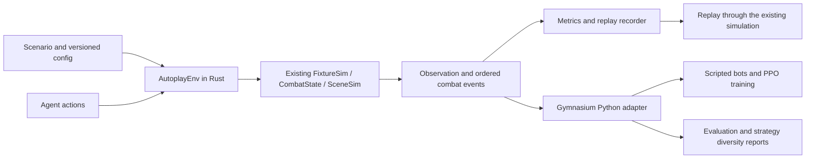

# AUTOPLAY-01 — Headless gameplay simulation, automated evaluation, and ML training

**Status:** design specification / agent implementation contract (2026-11-20). **Not implemented by this PR.** The initial delivery is a local, reproducible, Bevy-free evaluation/training harness; deploying learned policies as game NPCs is explicitly later research. No new game mechanics or existing replay semantics are approved by this document.

**Goal:** answer three different questions with one shared simulator:

1. **Is the encounter solvable, fair across a range of player capabilities, and regression-free?**
2. **Which strategies, actions, environmental interactions and edge cases can automated players discover?**
3. **Can trained policies teach us how to improve enemy/companion behavior without sacrificing authored, readable, deterministic combat?**

**Crucial distinction:** win rate, optimal play, coverage and reaction time are measurable; *fun, comedy, meaningful spectacle, visual clarity and human difficulty* cannot be inferred from an RL reward or from one optimal agent. Human controller playtests remain necessary.

## 1. Why now / upstream design authority

The first [DEMO-01 questionnaire](../04-production/demo-01-questionnaire.md) identified boring/repetitive basic fighting, enemy-to-enemy contacts that were hard to perceive, Donut feeling passive, insufficient evade choices, and apparently repetitive deaths. The full feedback and COMBAT-FUN-02 remediation plan currently live in **PR #124**, which is still a separate open design branch at the time of authoring. **AUTOPLAY-01 is a parallel enabling workstream**, not a rewrite, prerequisite, or duplicate implementation of COMBAT-FUN-02.

Read `AGENTS.md`, [Rust/Bevy architecture](architecture.md), [testing strategy](testing.md), [combat feel](../01-design/combat-feel-hybrid-physics.md), [controller grammar](../01-design/mvp-controller-contract.md), [party rules](../01-design/party-2p-open-questions.md), [player and enemy roles](../01-design/combat-first-encounter-design.md), and [agent work order](../07-agents/autoplay-01-workorder.md).

### Existing code (verified on main when drafted)

- `src/combat_scene.rs` has `Fixture`, `CombatState::new`, `CombatState::step`/`step_party`, `take_new_events`, `state_hash` and **`FixtureSim::new(kit,view_h,fixture)` / `step(raw: RawInput)` / `state_hash()` / `restart()`**.
- `src/corridor.rs` holds `SceneSim` / `CorridorWorld`, with deterministic single/party stepping, reset, positions, camera and world state.
- `src/input.rs` defines `RawInput { move_x, jump, attack, physical, ability, pause, swap }`; `InputFrame::advance` generates **press edges** from held-button transitions. Do not skip this logic or convert held buttons into repeated presses.
- `src/party.rs` and `src/party_scene.rs` contain hero ownership, solo/2P drive and paired input fixtures; **do not drive two humans as two independent single-hero combat simulations**.
- `src/demo.rs` holds the B0–B6 hall, checkpoints and probe fixtures; headless tests and `scripts/ci_floor01_combat.sh` already compare committed event and state hashes.

The current project is a **single Rust package with Bevy 0.20.1** and existing Python validation scripts. `docs/03-tech/testing.md` notes that a proposed generic scenario runner is *not implemented*; do not describe it as available. There is no current Gymnasium/PyO3 environment in main. No rendering is required for the simulator.

## 2. Architecture and ownership



**One authoritative simulator.** A new Bevy-free Rust module wraps the **actual** Floor 01 simulation. It must not reimplement jumping, collision, enemy damage, RNG, spells, hazards, camera decisions, or movement in Python. Build and step the existing domain in the same order as the current headless fixture path. Presentation and audio are absent from training; replay can be rendered later by the existing game.

**Recommended layout (adapt paths to the existing repo, not the contracts):**

```text
src/autoplay.rs                         # pure Rust API and single-hero v1
src/autoplay_observation.rs             # observation extraction, visibility policy
src/autoplay_metrics.rs                 # event-driven metrics, reward, terminal conditions
src/bin/autoplay.rs                     # native CLI (run/eval/replay/benchmark)
tools/autoplay/native/Cargo.toml        # isolated optional PyO3 binding crate
tools/autoplay/native/src/lib.rs        # thin binding for the Rust API
tools/autoplay/pyproject.toml           # isolated Python package + reproducible deps
tools/autoplay/python/autoplay/
    __init__.py
    env.py                             # Gymnasium adapter
    bots.py                            # scripted baseline policies
    evaluate.py                        # metrics and held-out evaluation
    train.py                           # optional CPU PPO experiment
    __main__.py                        # CLI
tools/autoplay/tests/                  # check_env + replay + seeded integration
docs/evidence/autoplay-01/README.md    # actual measured evidence and limitations
```

Keep PyO3, NumPy, Gymnasium, PyTorch, and Stable-Baselines3 **out of the game's default runtime and Cargo build path**. Prefer a small separate `tools/autoplay/native` Cargo package with a path dependency on the existing Rust game library. The **gameplay contract** is written in Rust and testable with `cargo test` without installing Python. The PyO3/maturin bridge is optional tooling; if a benchmark proves per-step overhead excessive, implement a Rust batch-step entry point, **not a second gameplay simulator**.

**Dependency rule:** verify and pin compatible current package versions during implementation; do not add unreviewed crates to the shipping game or claim a particular binding version already works. Python dependencies are tooling-only and local-first, with a lockfile. No cloud trainer, online telemetry, account/API key, hosted model, or GPU dependency is required for the MVP.

## 3. Native environment contract — AUTOPLAY-01A (mandatory)

A Rust wrapper should expose semantics equivalent to:

```rust
pub struct AutoplayConfig {
    // scenario_id, max_ticks, hero/mode, reward_id, observation_id,
    // action_repeat, content/ruleset version
}

impl AutoplayEnv {
    pub fn new(config: AutoplayConfig, assets_root: &Path) -> Result<Self, Error>;
    pub fn reset(&mut self, seed: u64) -> Result<(ObservationV1, ResetInfo), Error>;
    pub fn step(&mut self, action: ActionV1) -> Result<StepV1, Error>;
}
```

These are **contract sketches**, not prescriptive names, compiler-ready declarations, or existing APIs. Any implementation must preserve their observable semantics:

- **Reset** reconstructs the complete original initial state from a known fixture or validated scenario. It clears held-button edges, events, accumulated reward/metrics and episode timers. Merely calling the combat `restart` method may preserve attempt counters or different runtime state; prove exact reset parity.
- **Step** advances **one actual game tick at 60 Hz by default** using a normalized `RawInput`. Action repeats are permitted only as a documented optional wrapper; if an action is held across four ticks it is **one held button**, not four new button presses. Aggregate ordered events from **each tick**, not only at the end of the repeat.
- **Observations** are read-only. The observation extractor never advances physics, RNG, AI or action-edge detectors and never feeds the output back into the authoritative world.
- **Terminal handling:** start with a short, named **single-hero Carl vs goblins** encounter. End when all designated hostiles are defeated (success) or Carl is defeated (failure); **terminate before the fixture's automatic 50-tick respawn**. Stop at `max_ticks` as **truncated**, not defeated. A call to `step` after termination/truncation must raise a clear error until reset. Avoid an ambiguous "one episode = repeated checkpoint lives" in v1.
- **Time and reproducibility:** the episode always records current tick, scenario ID/version, fixture/asset checksum, code commit, effective seed, ruleset/observation/action/reward versions and player policy ID. A seed is not guaranteed to alter a static deterministic fixture; if no gameplay RNG uses it, say so plainly and do not claim varying seeds represent different levels.
- **Coverage of modes:** v1 must be fully playable with Carl and the currently supported fixture. A future `PartyAutoplayEnv` must share the same native core and accept **two simultaneous per-slot inputs**, with proper `PartyState` ownership and solo bot drive; no independent simulations for Carl and Donut.
- **Scenario safety:** use existing fixture IDs and environment kits first (e.g. `cp01_single_goblin`, `cp02_two_goblins`/`cp02_kick_contact`). Reject unsupported fixtures with a descriptive error rather than silently simplifying the level. For future dynamic spawns, validate layout reachability and material/hazard rules; do not add bespoke movement or physics to the harness.

### ActionV1: explicit and compatible with the controller

Python: `MultiDiscrete([3, 2, 2, 2, 2, 2])`, index order:

| Index | Name | Values | Maps to `RawInput` |
| --- | --- | --- | --- |
| 0 | horizontal | 0 = left, 1 = neutral, 2 = right | `move_x = -1.0 / 0.0 / 1.0` |
| 1 | jump | 0 / 1 | `jump` held |
| 2 | primary | 0 / 1 | `attack` held |
| 3 | physical | 0 / 1 | `physical` held |
| 4 | special | 0 / 1 | `ability` held (story-locked when unavailable) |
| 5 | solo swap | 0 / 1 | `swap` held (not available in Carl-only v1) |

- Pause/select/respawn and hardware device ownership are **not policy actions** in v1. Never give the agent unearned story abilities. Invalid locked inputs may map to normal in-game no-op, but must be counted as *attempted unavailable action*. Never secretly grant a capability.
- Simultaneous button presses are forwarded through **the game's actual input priority**, not invented priority in the adapter. Track ineffective actions as metrics rather than rewriting the combat rules.
- `action_repeat` defaults to 1, and is explicitly versioned when changed. If action repeat >1, stop immediately on terminal/truncation and report exact ticks executed.

### ObservationV1: fixed, bounded, player-like, not omniscient

The observation should be a stable Gymnasium `spaces.Dict` of normalized `float32` tensors plus binary masks, suitable for `MultiInputPolicy`:

| Key | Initial conceptual shape | Content |
| --- | --- | --- |
| `self` | fixed vector | Carl-relative motion, facing, grounded/hurt/visible action state, normalized known health; **no hidden future events** |
| `enemies` | [16, fixed features] | Only **visible** hostile silhouettes: relative position, facing, type, observed tell/airborne/downed state, not private cooldowns or next decisions |
| `enemy_mask` | [16] | 1 only for populated, perceived entries, remaining padding 0 |
| `hazards` | [8, fixed features] | Perceived support/block/breakable hazard positions and visible states, not hidden trigger timing |
| `hazard_mask` | [8] | Populated visible hazard entries |
| `available` | [2] | Whether the controlled character can currently use the special and solo swap |

**Binding requirement:** before committing code, write the exact feature order, dtype, normalization scales and declared tensor shape to a versioned schema file/constant, matching the `observation_space` bounds; document whether the visible viewport is a fixed 640x360 sensor or the simulation's scroll-camera frame. Do not silently expose all enemy health, invisible enemies, hidden fuses, threat RNG, scripted future spawns, exact animation invulnerability windows or all-world coordinates merely because Rust has access. For >16 visible enemies or >8 visible hazards, explicitly reject the scenario or introduce a **documented deterministic nearest/visible ordering and overflow statistic**; never silently truncate and claim complete observations. Missing entities use zero padding plus the mask. No rendered pixels, wall-clock time, external vision model or LLM is required.

**Debug/evaluation vs policy input:** a *privileged* diagnostics record may contain all true events, hidden states and complete outcomes for QA. It must stay in `info`/artifacts and must never be accidentally concatenated to policy observations. Do not use debug event logs as input for a learned policy.

### RewardV1: separate learning incentives from evaluation metrics

Support at least two named, versioned reward profiles, never infer 'fun' from either:

- `sparse-v1`: +1 on scenario success, -1 on player defeat, 0 otherwise; timeout is its own explicit outcome.
- `combat-v1`: recommended **tuning hypothesis**, not an approved final score: +10 success, -10 defeat, +1 per **distinct legitimate enemy defeat**, -1 per player hurt event, -0.001 per actual tick; no reward for cosmetic blood/gibs, HUD labels, camera slow motion or repeated presentation events. Avoid double-counting an enemy across contacts, replay, respawn or an action-repeat bundle. Expose the reward breakdown in `info`.

Agent reward is **not** the game's future live-viewer audience scoring and must not be linked to the player HUD. Keep ``reward_id` separate from the authoritative simulator.

### Termination and scenario outcomes

- `terminated=True` only on a game-defined success or actual defeat; `truncated=True` only on time/step budget or declared external evaluation cutoff. Record `outcome` as `success`, `defeat`, `timeout` or explicit error.
- A scenario cannot accidentally "succeed" because a scripted enemy is off-screen or its spawn was not loaded. Define the set of required hostiles/objectives in the scenario manifest and test it.
- Capture failures like unreachable exit, softlock, indefinite no-progress or invalid terrain as **diagnostic flags**, not fabricated player defeat, unless their rules are explicitly part of the scenario.
- No game balance tuning is performed inside the adapter; all gameplay knobs remain owned by the appropriate gameplay work order.

## 4. Playback, metrics, and evaluation — AUTOPLAY-01B (mandatory)

Implement **Rust first**, Python report consumption second.

### Native replay

A versioned episode artifact (e.g. JSONL metadata + compressed action sequence) records:

- `run_id`, scenario ID, fixture + asset hash, commit, reset/effective seed, reward/action/observation versions, bot/policy ID, runtime flags, number of ticks and terminal outcome.
- **Every actual normalized per-tick action**, including held edges; if the Python decision spans several ticks, expand to actual tick actions or encode with unambiguous action-repeat semantics.
- Ordered, deduplicated gameplay event IDs and selected tick/state hashes at least at episode end and important transition checkpoints; `--verify-replay` must reconstruct the same authoritative events/hashes from reset.
- A seed and scenario identity are **not substitutes** for the action trace. Reject schema/content mismatches unless the caller explicitly accepts a documented migration.

The native CLI must replay without Python, the ML model, rendering, audio or external services. Reuse existing event-log semantics and `scripts/ci_floor01_combat.sh` expectations where possible; do not change existing fixture goldens just to build a runner.

### Diagnostics (each episode and aggregate)

Required fields: success/defeat/timeout, total fixed ticks, received damage, defeated enemies, attack attempts vs connected hits by move, knockbacks and enemy-body contacts, distinct defeat causes, player hurt/deaths, used terrain hazard interactions, time standing still/no progress, terminal position, swaps/companion assistance when enabled, invalid/unavailable actions, seed/fixture/rules version, and replay path.

**Do not invent attribution:** when the existing event set cannot reliably tell who caused a contact/hit/finish, emit `unknown` or `not_observable`, add a narrow follow-up to the existing event contract, and keep evaluation honest.

Aggregate: distribution and 95% uncertainty interval of success rate (Wilson or bootstrap), medians and percentiles for time/damage, per-move usage/hit rates, repeated optimal-action proportion, and a **strategy fingerprint** from action families/terrain/contact outcomes. Diversity can be described by unique observable fingerprints and distributional entropy; **neither proves creativity or fun**. Always show episode count and seed/scenario spread; no single scalar "difficulty" score.

### Basic player policies and profiling

Ship at least three *deterministic and reproducible* baseline policies:

1. `random_legal`: seed-controlled legal action sampling (smoke/coverage; not a human skill proxy).
2. `approach_and_attack`: basic approach, face, use primary/physical, limited jump; intentionally imperfect.
3. `reactive_survivor`: simple threat-distance/tell reaction, defensive positioning and selective attacks; no access to privileged game events/private future state.

Optional deliberately **capability-limited** variants of (2) and (3) can model response delay, input noise and restricted move vocabulary. Do not label them "novice, intermediate, expert human difficulty" until actual human traces are used for calibration.

Benchmarks: compare total simulated ticks/second, reset overhead, Rust-only loop, Python single-env loop and Python batched loop (if provided) on **named hardware**, including CPU, build profile and tool versions. No made-up 100x multiplier or strict performance target without evidence. The initial implementation must be faster than wall-clock gameplay in an honest release headless test or publish the observed bottleneck and remediation plan.

### Seed separation and generalization

A fixed deterministic scenario can produce identical outcomes for any arbitrary seed. For generalization, create **at least two distinct, validated, deterministic fixture configurations/initial positions** and split them into **development and hold-out scenarios** before training. If generating seeded geometry or enemy variations later, use only reachable, valid and reproducible layouts. No train/test overlap through the same fixture renamed differently. Keep evaluation bots and held-out conditions constant across game commits; comparisons require a matched seed/scenario roster and artifact manifest.

## 5. Python bridge and runnable learning experiment — AUTOPLAY-01C (mandatory first ML proof)

- Bind the native Rust environment in-process using **PyO3 + maturin** (or document a measured reason to use a different Rust binding). Python implements `gymnasium.Env` `reset(seed,options)->(observation,info)` and `step(action)->(observation,reward,terminated,truncated,info)`. Observation and action spaces are exact; run `gymnasium.utils.env_checker.check_env` in CI. Python tests verify non-mutating observation, action-edge behavior, terminal/timeout rules, deterministic repeated runs, seed disclosure and replay parity.
- Provide a **single local setup / smoke command** (script or documented one-liner) that builds the optional native extension, installs pinned tooling, runs a baseline bot, writes replay/metrics and checks replay in native Rust. GPU must not be required.
- Provide a **short, bounded PPO smoke test** using Stable-Baselines3 with `MultiInputPolicy` and the Gymnasium env. Example interface (exact command names are recommended, may be adjusted with documentation):
  - `python -m autoplay evaluate --scenario cp01_single_goblin --policy reactive_survivor --episodes 50 --out artifacts/autoplay-01/eval`
  - `python -m autoplay train --algorithm ppo --scenario cp01_single_goblin --steps 10000 --seed 42 --out artifacts/autoplay-01/ppo-smoke`
  - `python -m autoplay replay --episode artifacts/autoplay-01/eval/episode_0001.jsonl --verify` (may delegate to native executable)
  - `cargo run --release --bin autoplay -- benchmark --scenario cp01_single_goblin --episodes 1000`
- Training is only required to demonstrate **the pipeline functions**: it initializes, produces a checkpoint and a metrics report, and reloads the model to run evaluation. **Do not assert that a 10k-step PPO policy is strong**, beats heuristics, solves all scenarios or approximates human skill. Compare it fairly to fixed baselines on hold-out scenarios, including failure modes and action diversity.
- Version and persist policy metadata: Python deps, algorithm/settings, observation/reward/action versions, commit and content hash, training/test scenario lists and reset seed. Do not commit large checkpoints, private datasets or generated model weights to the normal game repo. Add `artifacts/autoplay-01` and tool build products to ignored paths if not already ignored.
- For efficiency, benchmark and optionally add Rust `step_many` (one env, successive actions) or `batch_step` (multiple independent environments) without changing transition semantics. Be explicit about per-environment terminal handling and Gymnasium vector autoreset policies; **never hide a reset or drop the final observation**.

## 6. Evaluation practice / integration with COMBAT-FUN-02

Use a stable, named scenario manifest and scorecard rather than one "cleverest bot" victory. For every combat/mechanics change:

1. Rebuild against the same committed scenario/observation/action/reward versions; reject incompatible artifacts or mark migration.
2. Run fixed heuristic/replay regression suite in normal CI on paired fixture/seed lists. Report change in success rate, median damage, time, contact outcomes, strategy diversity and possible softlocks. A passing win-rate gate is **not** automatic gameplay approval.
3. Run trained-policy evaluation on a **frozen** baseline checkpoint where compatible. Avoid re-training in routine PR CI; training belongs to manual/offline jobs.
4. For relevant changes, run optimization/probing across a **bounded sweep of explicit gameplay knobs** (later Optuna integration optional), never merge automatically selected difficulty values.
5. Produce short per-case **replays** for the easiest win, hardest loss, unexpected exploit, ignored move, and an environmental/co-op opportunity if available; render with existing Bevy tooling when the event needs a visual verdict.
6. Review the same encounters with humans and controllers. Calibrate policy families from actual player performance only after consented, versioned, non-identifying traces exist; don't use account-level personal metrics by default.
7. Preserve game narrative progression and CINE-01's rare skill gate. A reward encouraging ordinary gore frequency, early unearned special attacks, or automatic Donut last-hit steals is a test failure, not success.

**Illustrative diagnostic:** if an agent always succeeds via a repeated jab, test whether all other moves are dominated, whether the training reward overvalues raw kills, or whether the observation/action interface accidentally hides contextual opportunities. Don't immediately raise enemy health or buff every other move.

## 7. Later extensions: NOT part of initial implementation

### AUTOPLAY-02 — Proper local 2P / multi-agent simulation

Use `PartyState` and `SceneSim::step_party` with **simultaneous** per-slot actions. Expose a PettingZoo `ParallelEnv` adapter only after both heroes are really simulated, with accurate character unlocks, AI handoff, death rules, shared camera/visibility and team vs individual rewards. Run `parallel_api_test` and manual two-pad checks; a fake second independent Carl sim does not count.

### AUTOPLAY-03 — NPC policy research

Train or search for enemy positioning, safe pressure, tactical pauses and Donut assistance **offline**. Benchmark authored FSM/utility AI against learned policies with human playtests. Never ship a model solely because it wins or scores higher: adversaries must telegraph and allow fair counterplay, and Donut must assist without stealing player agency. Default runtime solution remains transparent, deterministic **authored AI or distilled rules** unless a learned policy beats it on player experience, performance, explainability and reproducibility. Any runtime policy must be bounded, versioned, deterministic under recorded inference inputs and have a documented CPU/Deck performance budget, model license/provenance, debug traces, and safe fallback.

### AUTOPLAY-04 — Smart scenario generation and tuning

Optuna/parameter search, adversarial exploration, scenario mutation and counterexample minimization, only over valid authored constraints with held-out test conditions. Every discovered exploit becomes a standard deterministic regression fixture. **No autonomous merge of balance numbers**.

## 8. Acceptance checklist

**P0 deliverable, end to end:**

- [ ] Native Rust `AutoplayEnv` can reset, observe and step a real combat fixture **without rendering**; new state and event hashes match the existing fixture's tick/replay semantics.
- [ ] Repeated same scenario, seed and per-tick actions give **identical** observed authoritative states/events/outcome; reset twice from an ended episode is identical; held attack press edge is not double-fired.
- [ ] At least two genuinely different valid fixture setups, with hold-out separation; explicit outcome and step budget; no terminal episode silently respawns.
- [ ] Exact documented action and observation v1; no hidden future or all-world policy inputs; Gymnasium `check_env` succeeds.
- [ ] Three baseline policies, local CLI, event-driven metrics, JSON/CSV reports, reproducible replay and native replay verification, measured release throughput.
- [ ] Optional Python tool install (no change to default game runtime) plus bounded PPO smoke train/save/load/evaluate command; no GPU requirement.
- [ ] Tests for random vs scripted input, event dedup, truncated vs terminated, observation visibility, unavailable ability, fixture overflow, incompatible replay schema, concurrent independent envs, and comparison with preexisting headless fixed-tick hashes.
- [ ] Standard Rust CI + Python tool unit checks pass on the final implementation head; no regression in original game scenario hashes and no unsolicited gameplay/asset changes.
- [ ] Clear report distinguishing what is objectively measurable from what remains a human judgement. No claims that game difficulty/fun or intelligent NPCs are "solved".

**Out of scope:** image-input RL, visual LLM agents, live distribution of neural policy inference, forced 2P MARL, automatic game balance commits, player data collection, online services, full Floor 01 generation, and rebuilding any physics/collision behavior for the trainer.

## 9. Official integration references (verify versions when executing)

- Gymnasium environment/reset/step/checker: https://gymnasium.farama.org/api/env/
- PettingZoo simultaneous actions, future: https://pettingzoo.farama.org/api/parallel/
- Stable-Baselines3 PPO: https://stable-baselines3.readthedocs.io/en/master/modules/ppo.html
- PyO3: https://pyo3.rs/
- maturin: https://www.maturin.rs/
- Optuna, future: https://optuna.org/

**Release/IP policy:** all training fixtures and artifacts use the project's original sources and rights constraints. Training outputs are internal evaluation tools; this does not confer a license to distribute franchise-derived character content or model checkpoints.
