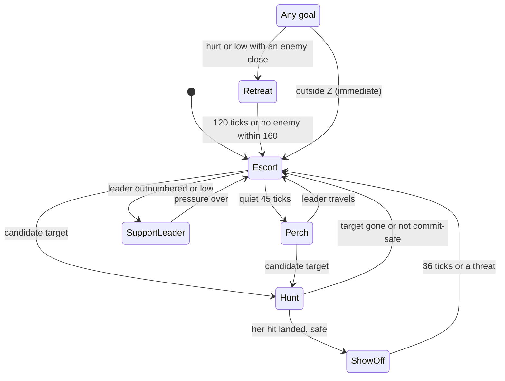

# COMPANION-AI-02 — Donut autonomy inside the camera

**Status:** design proposal, Revision 2 (2026-11-21; top-tier design, docs only). No code exists for anything in this file. Every value is an adopted default under the owner's design-defaults directive (2026-11-19) and is recorded as data with a `CA2-Q##` ID; game feel is pending the owner's play. Work order: [COMPANION-AI-02 work order](../07-agents/companion-ai-02-workorder.md). Revision 1 resolves the independent review of PR #172 and folds in the owner decisions of 2026-11-21 (section 0.1); the finding-to-fix map is [section 9](#9-revisions). Revision 2 closes the re-review's camera finding R-1 and its small items (section 9, "Revision 2").

**Depends on DONUT-MOBILITY-01 stage DM-A** (design PR #173, `docs/03-tech/donut-mobility-01.md` on its branch until it merges): Donut's agile motion (DM-A's final values in #173: 207 px/s run, 500 px/s jump launch, 114.92 px apex, 57 air ticks, 196.65 px flat jump distance) and the `NavConfig::agile()` nav preset. By owner decision (2026-11-21) the faster run and higher jump are **her default motion everywhere**, not a `--cf02`-only gate. CA2 wiring (CA2-B2 onward) is recorded with that motion; the zone and drift proofs still hold under both the legacy and the agile motion (section 3), so CA2 never depends on her being faster.

**Read with:** [Companion autonomy and command system](companion-ai-command-system.md) (sections 1, 2, 7, 8, 17 (e)), [COMPANION-AI-01 work order](../07-agents/companion-ai-01-workorder.md), [Donut character bible](../02-art/donut-character-bible.md) ("Locked anatomy and personality", "Expressions and animation acting"), [character progression horizon](../01-design/character-progression-horizon.md) (Donut), [input and camera](input-camera.md) ("Same-screen camera"), [antihero tone](../01-design/antihero-tone.md).

## 0. Owner request and what it means

Owner feedback (2026-11-21), verbatim: "Why AI donut doesn't move more independently? It doesn't make sense that it follows Carl so close, and also it doesn't make sense to do the same as Carl. It is better if she is free to do what we expect from that char but without making the camera zoom out, that could be the limit."

Three requirements follow from it:

1. **Distance.** She does not stand on Carl's heels. She keeps her own position in the room.
2. **A different job.** She does not fight the same goblin the same way next to him. She does what a small, proud, calculating show cat with magic would do.
3. **One hard limit: the camera.** The camera keeps following and framing the controlled hero and never zooms or widens for her. Her freedom ends at the edge of the current view. Freedom never costs a camera, fairness or safety guarantee.

### 0.1 Owner decisions (2026-11-21, planning session)

1. **Kill rule.** "It is good if Donut lets you finish the enemies but if Carl is far we should be able to kill them autonomously." The design already does this: the A08 veto applies only within 40 px on his facing side, the A12 window is 31 ticks, the claim set reaches 64 px. Once Carl walks away from a goblin he wounded and the window has passed, it is a normal Hunt target and she may kill it. A golden fixture pins it (`cf02_free_finish_abandoned`, 7.2). Kills taken from Carl stay 0 (M4).
2. **Roam range: "most of the view"** is confirmed: the 240 px leash with the soft pull past 160 px (CA2-Q04, CA2-Q06), as recommended.
3. **Shared brain.** The autonomy layer is role-neutral and IP-neutral: it speaks of a *leader* (the hero the human controls) and a *partner* (the companion-driven hero), and a partner's behaviour comes from a **role goal table** in data. v1 ships one table, `skirmisher`, assigned to Donut. AI Carl is a later work order that is mostly data (a `brawler` table: front-line fighter, bodyguard of the partner, terrain use). Code contracts say "the leader's claim set", not "Carl's claim set" (section 5.3).
4. **Donut mobility** is a separate work order, DONUT-MOBILITY-01: she is faster and jumps higher and further, human or AI, as her default motion everywhere (not only under `--cf02`). She gains a passive evasion at the biscuit, reflex mode only, which rearms after 720 ticks (12 s) without being hit. CA2 absorbs the effect on the camera and drift numbers (sections 3.1, 3.3, 3.4) and depends on its stage DM-A.

## 1. Current state (verified on `origin/main` at `62686919`, PR #170 merged)

- **Movement is a short leash.** The uncontrolled hero's movement is the follow-and-jump bot (`src/follower.rs`): it steers to `follow_distance_px` (40) behind the leader, hops onto a ledge the leader stands on, and dodges goblin tells. Under the companion, `src/companion/navfollow.rs` (01B-wire, #166) replaces it only when the route to the leader needs a jump or a drop; on flat ground the bot input is kept. The off-screen regroup (`regroup_ticks` 120) places her on a reachable anchor just outside the view behind the leader, never inside the camera and never ahead.
- **Attacks are an overlay.** `src/companion/director.rs` adds at most one legal press per tick to the follow input: an interrupt swat on a tell aimed at Carl, a pounce (30 to 80 px, same level within 24 px), and after the biscuit a Magic Missile (64 to 160 px, AI reserve of 2). The director's "close in" step moves her toward the chosen target and nothing else.
- **She fights what Carl fights.** Targets are scored by distance from her, so in practice she picks the goblin in front of Carl, next to him. PR #170 (merged) added: A11 (Carl engages only enemies on the side he faces), A12 (a goblin Carl hit in the last 31 ticks stays his on either side), A13 (she turns to an enemy behind her), A14 (the same-tick steal is a documented known limit), A15 (an idle flank spot 56 px ahead of Carl while a goblin approaches from the front), and two kill-steal counters (`steals`, `start_steals`) in the fixture harness.
- **Cameras.** The simulation scroll camera (`src/scroll_camera.rs`, hashed) follows the controlled hero only in solo: lead 24 px in the facing direction, deadzone ±40 px, at most 4 px per tick, fixed width (640 px in the Floor 01 scene). In two-player it follows the midpoint with a separation wall (`corridor.rs::apply_separation_wall`, knobs in `src/party.rs`, Q7). It never zooms. The solo swap pan under `--cf02` is eased (`SwapPanMode::Eased`, CF02-Q20; the legacy 8 px per tick cap is not read there). The presentation camera of `--camera auto` and `--demo` (`src/scene_camera.rs`, operator in `src/camera_lab/camera_op.rs`) is presentation-only, but **it takes both heroes as subjects** (`camera_inputs` builds `[Carl, Donut]`): their safety regions (body plus `SAFETY_PAD_X` 96 px) set the framing box and the width (up to 960 px at 1080p), and they bound the pan's threat bias (`MAX_BIAS_SHARE` 0.16 of the width). That is the one place where a free Donut could make a camera widen today, although at a 240 px leash only a large vertical offset would (review B-1).
- **Speed.** On `main` Carl and Donut share `RUN_SPEED` (185 px/s, about 3.08 px per tick). DONUT-MOBILITY-01 DM-A gives her 207 px/s (3.45 px per tick) and a 500 px/s jump launch (114.92 px apex, 57 air ticks, 196.65 px flat jump distance) as her default motion everywhere (owner decision 2026-11-21); Carl stays at 185, and the drift check still uses the leader's speed only (3.3).
- **Safety data.** The live nav graph is built with no hazards (`NavLevel::from_blocks(solids, Vec::new())` in `NavDriver::new`): anchor risk is the graph's own, scene hazards are not fed in.
- **Acting.** CF02-I already shows Donut's `smug` key when one of her hits lands and she then stands idle (pending 45 ticks, shown for 20; `src/combat_anim/cf02.rs`). A show-off therefore needs no new art if the simulation makes her stand still after a hit.

## 2. Her role and toolkit

**Carl is the bruiser who walks into the fight. Donut is a show cat who picks her moment.** She stays out of the scrum, takes the enemy he is not dealing with, hits and springs away, watches from high ground, sulks out of reach when she gets hurt, and preens when something goes her way. Cute by default, calculating when she plans, theatrical when she wins (bible: "neutral cute, deliberate expression change, spell anticipation, dramatic payoff, recovery to cute"). Never a turret, never a second Carl.

### 2.1 Behaviours, phase by phase

| Behaviour | Before the biscuit | After the biscuit (`--donut-biscuit`) | Supported by |
| --- | --- | --- | --- |
| Pick her own target | The enemy Carl is not working: one behind him, beside him, or waiting on the edge of the fight. Not the llama (she has no damaging move against it) | The same, plus ranged foes first (the llama, an Engineer winding up) | Existing view data plus a new claim set (section 4) |
| Harass | Hit and run: close to pounce range, pounce, spring back to about 96 px, wait, repeat. Never stands and trades blows | Keep about 112 px away and cast; step back when a goblin closes inside 72 px | Existing pounce and missile; new spacing goal |
| Interrupt a tell aimed at Carl | Unchanged (swat, Q14) | Unchanged (swat or missile, Q14, Q17) | Existing director, top priority |
| Help Carl | Only when he is outnumbered or low on health (section 4.3) | The same | Existing anti-steal rules plus the claim set |
| Finish what he left | A goblin Carl wounded and walked away from is hers once it is no longer claimed (owner decision 1) | The same | Claim set (4.2) |
| Position herself | Her own spot in the room, 96 to 240 px from Carl, re-picked only when it stops being valid | The same, at casting distance from her target | New free zone and spot executor |
| Perch | A safe high anchor in view when the fight is quiet: the cat on the shelf, including ledges only her agile jump reaches (DM-A) | The same | Nav graph anchors (agile preset; Donut-only routes are capability checked) |
| Retreat when hurt | Break off and go to the safest anchor in view, preferably with Carl between her and the enemy, preferably higher | The same; she may cast from the retreat spot | Nav graph, threat positions |
| Show off | After her hit lands and nothing threatens her, stand still for a moment; the existing `smug` key plays | The same | Existing CF02-I acting overlay, no new art |
| Travel | When Carl travels, she comes along at her own spacing, not on his heels and not copying his hops | The same | Free zone plus spot executor |

### 2.2 Out of scope for v1, with stand-ins

| Wanted later | Why not now | v1 stand-in |
| --- | --- | --- |
| Casting down from a perch onto a lower level | Magic Missile flies on her level; A09 limits her offence to targets within 24 px of her feet. An aimed or arcing missile is a new move | The perch is a rest, watch and retreat spot only |
| A taunt to pull a goblin off Carl | New move and new art | Emergent: goblins already retarget to the closer hero (Q3, with the 40 px AI bias), so an independent Donut draws some of them anyway; Retreat is the counterweight |
| Tail flick, grooming, sit on the perch | New frames (the CF02 Donut spare slot is unspent, see the [CF02 acting spec](../02-art/cf02-acting-spec.md)) | `idle` plus the existing `smug` key |
| A faster cat ("Movement: High" in [characters](../01-design/characters.md)) | Not a CA2 change: the owner decided it for human and AI alike (0.1, decision 4), delivered by DONUT-MOBILITY-01 DM-A | CA2 depends on DM-A; nothing in CA2 changes speed. The camera bound never relies on her extra speed (3.3) |
| AI Carl autonomy when the player controls Donut | Symmetric by CA-01, but the owner's request is about Donut | AI Carl keeps the current profile behaviour (no brief, 5.2). The layer is role-neutral so AI Carl is a later, mostly-data work order (5.3) |
| Commands (`Focus`, `Hold`, ...) | 01D, owner D-CTRL | None; she is useful without orders (pillar 2) |

## 3. Camera-bounded freedom

### 3.1 The free zone

Every tick the companion computes a horizontal **free zone** `Z = [zl, zr]` from the simulation scroll camera and Carl, and a vertical band from the fixed view top and height. Nothing reads the presentation camera.

For each side `s` of Carl (left, right):

```
edge_s      = distance from Carl's x to the view edge on side s, this tick
trail_cap   = view_w / 2 + DEADZONE_PX - LEAD_PX        (640/2 + 40 - 24 = 336 px)
safe_s      = min(edge_s, trail_cap) - CA2-Q03 edge margin - her half width
reach_s     = min(CA2-Q04 leash, safe_s)
Z           = [carl.x - reach_left, carl.x + reach_right]
```

**Why `trail_cap`.** When Carl runs away from her, the scroll camera settles with its centre `LEAD_PX - DEADZONE_PX` = 16 px behind him, so the trailing view edge ends exactly `trail_cap` = 336 px behind Carl, and the distance from Carl to that edge never drops below `min(edge_s now, 336)` during the pan (it only grows toward 336 or shrinks toward it). Running toward her side moves the leading edge at most to 304 px ahead of him while he closes the gap. Because she runs at least at his speed (equal under the legacy motion; 207 against 185 px/s under DM-A's agile motion, so she gains about 0.37 px per tick), **a partner who is inside `Z` and not committed to a move can stay in view under any input the human gives the leader**, just by running with him. `trail_cap` and `Z` do not depend on her speed: the scroll camera reads only the controlled body in solo, and every hero speed stays under its 4 px per tick cap. The proof is a unit test over the real `ScrollCamera`, run with both motions (work order, CA2-A).

With the defaults (edge margin 32, half width 12, leash 240) the zone is up to 240 px on each side of Carl while he stands near the centre of the view, and shrinks on the side where he stands close to the edge.

**Vertical band.** Anchors whose surface lies inside the view with `CA2-Q08` margins (48 px under the top edge for her 40 px sprite, 8 px above the bottom edge). The scroll camera has a fixed top, so this band does not move. A second vertical limit keeps her inside the automatic camera's framing of the leader (3.4): a spot's surface may be at most `CA2-Q08` 176 px above the leader's feet. At the narrowest rest width (640 x 360) the automatic camera puts the lowest framed feet at `FLOOR_SHARE` 0.8, 288 px under the view top; 176 px plus her 52 px body leaves 60 px. With DM-A she can reach 96 px ledges, so two stacked ledges are the practical limit.

**Nothing outside `Z` is ever a goal.** A target whose attack spot (where she must stand to hit it) is outside `Z` is not a candidate. An anchor outside `Z` is not a spot.

### 3.2 Comfort, soft pull and hard limit

| Distance from Carl | Effect |
| --- | --- |
| up to `CA2-Q06` comfort radius (160 px) | No pull. Any goal is fine |
| comfort radius to the zone edge | Soft pull: goals and spots lose `CA2-Q06` 2 utility per px past the comfort radius, so she drifts back unless something there is worth it |
| outside `Z` (involuntary only: knockback, a nav hold, a swap) | Hard limit: the Escort goal wins at once, every other goal is ineligible until she is back inside |

**Camera about to move.** "Carl travels" is true when he has moved in one direction for `CA2-Q07` 12 consecutive ticks or the scroll camera still wants to pan (the remaining distance its deadzone step reports, read-only). While Carl travels, Escort gains `CA2-Q07` +400, no new Perch or Show-off starts, and a Hunt continues only if its target stays commit-safe (3.3). She comes along at her own spacing (`CA2-Q07` escort spot 72 to 120 px behind him, on flat standing ground), she does not copy his hops (the follow bot's ledge hop is not used under autonomy, `CA2-Q27`), and the nav graph plans any real jump or drop the route needs.

### 3.3 Commitments: the drift check

A move, a hurt flinch or a nav transit commits her for some ticks during which she cannot run with the leader. Before she **starts** any voluntary commitment (a pounce, swat, missile or a nav transit toward a goal), the companion checks the worst case: the leader running away from her for the whole commitment.

```
d_end   = |her x at the end of the commitment - leader.x|   (pounce: she travels toward its target)
ticks   = worst case: startup + max air ticks + pin + recovery + the move's attacker hit-stop
drift   = ticks x the LEADER's run speed per tick            (Carl: 185 / 60 = 3.08 px)
allowed = d_end + drift + CA2-Q09 slack (8 px) <= safe_s on that side
```

**Worst-case commitments** (from the move tables on `main`; a CA2-A test pins each sum against the constants, so a table change moves the number, not the rule):

| Commitment | Ticks | Drift (Carl) | Landing or end point allowed within |
| --- | --- | --- | --- |
| Pounce | 10 startup + 20 air max (`pounce_air_max_ticks`, not the 14 nominal) + 2 pin + 18 recovery + 4 attacker hit-stop = 54 | 167 px | about 117 px of Carl |
| Swat | 4 + 3 + 7 + 2 attacker hit-stop = 16 | 50 px | about 234 px |
| Magic Missile | 4 + 1 + 11 = 16, plus any attacker hit-stop the move table gives | 50 px | about 234 px |
| Nav transit | the edge's simulated duration from the nav graph (her physics preset: `NavConfig::agile()` with DM-A's motion, `integrated()` under the legacy motion) | ticks x 3.08 | per edge |

The AI never cat-hops (CF02-Q55 is a human bail-out), so the hop table never sets a transit speed. Her own speed gives **no credit**: the leader's speed alone sets the drift, so the rule "every frame outside the view is involuntary" stays exact under both motions. Her extra DM-A speed helps only after the commitment, when she runs back with him.

Interrupts get no exemption: the interrupt stays top priority, but an interrupt that fails the worst case is skipped rather than taking her out of the frame (with a 16 tick swat this only matters near the leash). Each skip is counted (M16). The check uses data the companion already has; it is deterministic and integer-rounded like every other utility.

**The leader's speed assumption.** The proof assumes the leader moves at most at his run speed. A boss pound or knockback, a body-drive launch, a respawn or a swap pan can move him or the camera faster. Those are not covered by the drift check; they are **involuntary causes** in the exact predicate of M5 (7.1).

**Result:** every frame she spends outside the view is involuntary: a hit's knockback or stun, a nav route the level blocks, the leader moved faster than his run speed, a solo swap pan. Those are measured separately (section 7) and recovered by Escort and, as before, by the camera-safe regroup.

### 3.4 When Carl runs and the view scrolls

1. She is inside `Z` and free: she runs with him, at his speed or faster (DM-A); Escort brings her to her travel spacing. No camera effect, no teleport.
2. She is committed (mid-pounce): the drift check guaranteed she ends the move in view; she then runs with him.
3. She was knocked out of the view, or the route is blocked: Escort steers toward him through the nav graph. Under DM-A she closes on a running leader at about 22 px/s and on a standing one at 207 px/s (before DM-A she only held the gap), so the regroup should fire less often; M12's baseline is measured with the agile motion on. If she stays off-screen for `regroup_ticks` (120, unchanged, `CA2-Q26`) the existing camera-safe regroup places her on a reachable anchor just outside the view behind him: never a pop-in inside the camera, never ahead of him, never across a gate. No new teleport is added.
4. A solo swap pan (eased under `--cf02`, CF02-Q20) runs from the old controlled hero to the new one. Swapping back to Carl while she stands far from him can leave her off-screen; that is the player's choice, it is an involuntary cause, and case 3 applies.

**She never drags the camera.** The scroll camera reads only the controlled body in solo (already true; a test pins it). For the presentation camera, `CA2-Q25` (revised by review B-1): under `cf02_free` in solo, while the partner is companion-driven, `scene_camera::camera_inputs` moves her from `subjects` to a new presentation-only list `CameraInput::bound_only` (empty for every existing caller, so every current series is unchanged). In `src/camera_lab/camera_op.rs` a bound-only subject:

- is **excluded** from `framing_box_in`, hence from `required_width_in`, the zoom target, the pan target centre and the vertical framing box; from `target_cy`'s "lowest feet" choice; from `something_outside` (the `urgent` flag also hurries a widening transit, so she must not set it); and from any threat that is built relative to an actor ("a large foe next to an actor" uses framing subjects only). **She can never widen, zoom or re-centre the camera.**
- is **included** in two clamps only, each with her camera body (`DONUT_HALF_WIDTH` 16 by `DONUT_HALF_HEIGHT` 14, the subject `camera_inputs` already builds; wider than her 12 px gameplay half width) plus the `CA2-Q25` bound pad of 40 px instead of the 96 px `SAFETY_PAD_X`:
  - **Horizontal: the total threat-driven shift** (review R-1). Let `tx0` be the centre of the leader-only framing box (framing subjects only, clipped to the bounds; no threats, no bias) and `tx1` the target `step_pan` computes today (the threat-extended box centre plus the leader-clamped bias). The pan target becomes `tx0 + clamp(tx1 - tx0, lo.min(0), hi.max(0))` with `hi = her.x - half_w - pad - (tx0 - wb / 2)` and `lo = her.x + half_w + pad - (tx0 + wb / 2)`, where `wb` is the narrower of the current width and the width a running zoom transit is heading to (a zoom-in during a shift cannot cut her). The clamp runs after the existing leader bias clamp and before the existing room-edge clamp. Its range always contains 0, so she can only shorten a shift the threats asked for: she never pulls the target past the leader-only centre and never moves the camera for herself (never-worse semantics, as the bias clamp has today). The leader stays safe: his safety region is inside at shift 0 (the leader-only box) and at the unclamped shift (today's clamp), the shifts that keep it inside form an interval, and her clamp only moves the shift between those two. The room-edge clamp only moves the target toward the room interior, which she is inside.
  - **Vertical:** `target_cy` first computes today's result from the framing subjects alone, including its own `lo > hi` fallback to the leader's box centre. Her range (body plus pad inside the view) is then applied as a second clamp only when it intersects the leader's `[lo, hi]`; when it does not, her range is ignored for that tick and the leader-only value stands. Her body never enters `y0`/`y1`, the "lowest feet" choice or the fallback, so no fallback can re-centre on her. The rise limit (3.1) is a spot-validity condition rechecked every tick, not only when a spot is chosen (review FU-B): a spot that ends up more than 176 px above the leader's feet after he drops stops being valid, and Escort takes over.
- **Pan pace while her bound holds** (check I-1). `step_pan` caps the pan at the impact pace (`MAX_PAN_IMPACT` 1.5 px per tick) whenever `impact_hold` is set (any hit-stop or a camera kick), and only `urgent` overrides it. A held impact pace would let her outrun a target her bound is moving (a 7 to 8 tick hit-stop costs about 14 px, more than her 8.1 px margin). Rule: on a tick when the bound-only subject's body plus pad is not inside the current view, or when her clamp changed the pan target this tick, `step_pan` uses the normal pace (`MAX_PAN`, `PAN_ACCEL`) instead of the impact pace; `urgent` still wins. This changes the pace only, never the target or the width, so "she never moves the camera for herself" still holds in the target sense. With `bound_only` empty the rule is a no-op, so every existing series is unchanged.
- **Width and urgency.** The zoom width still comes from the threat-extended, partner-free box, so M7's width invariance holds by construction. A threat that her clamp leaves partly outside the view may set `urgent` through `threats_in_view`, hence the emergency pan pace and, at rest sets above 640, an urgent widening transit. That is caused by the threat, not by her, and it is acceptable: the target is still her clamped one, a widening keeps the view centre, and `PAN_RATE`, which sets the lag below, is the same at both paces.

**Why it holds at 640.** 640 is the narrowest width the operator uses (`MIN_W`), and on a 1280-wide output (Steam Deck, 720p) it is the only rest width, so `auto_cap` is 640. The pan is a bounded-acceleration follower with `PAN_RATE` 0.11: a target moving at u px per tick is trailed by at most u / 0.11, and its tracking demand (0.11 u, at most 0.38 px/tick² at u = 3.45) stays under `PAN_ACCEL` 0.5, so the follower is monotone and does not pass a target it is approaching. A target that steps back past the centre (a threat dropped) can leave an overshoot of at most about v² / (2 accel) + v / 2 (22.5 px at the 5 px/tick cap), which is always less than the distance to the old target that such a speed requires (at least 41 px at 5 px/tick), so the centre never passes the old target either.

- **No threat shift.** The target is `tx0`, the leader's own centre. She is at most 240 + 16 = 256 px from it, and that target moves at the leader's speed, so the lag is at most 3.08 / 0.11 = 28 px: 256 + 28 = 284 < 320.
- **A threat shift held by her bound.** The target keeps her body plus 40 px inside the target view and, while her bound holds it, moves at most at her own speed: under DM-A 3.45 / 0.11 = 31.4 px of lag plus 0.5 px of `View.left` rounding, which leaves her body at least 8.1 px inside. The bound always applies at the leash: at `tx0` her region reaches at most 256 + 40 = 296 < 320 px from the centre, and Carl's 108 px region plus 240 + 16 + 40 is 404 ≤ 640. The pad is data with a floor: a CA2-A test pins `pad >= ceil(max partner run px per tick / PAN_RATE) + 4` (36 with DM-A), so a faster motion fails a test instead of silently breaking M8.
- **The review's case** (named test in the work order, B2). Carl at C, Donut at C - 240 (camera body C - 256 to C - 224), a llama aiming at Carl at C + 300 (camera threat half width 47), 640 rest width. The box is [C - 108, C + 347], 455 px wide, so the llama is admitted; the box centre is C + 119.5 and the leader-clamped bias +36.1 (0.4 of 90.25, because the llama faces Carl), so today's target C + 155.6 would give the view [C - 164, C + 476], with her fully off screen. Her bound gives `hi` = 24: the target becomes C + 24 and the view [C - 296, C + 344]. Her body is 40 px inside the left edge, the llama's body (C + 277 to C + 323) is in view and its threat box about 97 % inside (the rule asks for 95 %), so not even `urgent` is set.

Vertically, the 176 px rise limit (3.1) keeps her inside the leader's vertical framing and the `target_cy` clamp covers the rest. If the leader drops one level (96 px) while she is perched, her 28 px camera body still fits (span 352 ≤ 360); after two drops her range no longer intersects the leader's, it is ignored, and the per-tick rise-limit check makes Escort bring her down.

**What the owner will still see.** Under `--camera auto` the camera still widens for **threats** (a llama aiming, an Engineer winding up), exactly as today. That widening is not caused by her: M7 pins her width effect at zero.

Two-player is untouched: the companion never runs in 2P, and the midpoint camera with its separation wall stays as it is. When the human controls Donut and Carl is AI, both stay framing subjects as today (the rule follows the partner role under `cf02_free`, and AI Carl has no role in v1).

### 3.5 Safety: hazards, pits and ledges

- **Spots** are taken only from open nav anchors with risk below `CA2-Q29` (250, half of `UNSAFE_RISK`), on flat standing ground at least `CA2-Q29` 16 px from an end that drops or a wall (no ledge edge, hole or wall under or beside her body), inside `Z` and the vertical band. Validation uses a **pure flat-span helper at an arbitrary point**: `flat_span_at(solids, x, foot_y)` returns the flat standing interval through `(x, foot_y)` inset by the body half width plus the 16 px. It generalises #170's private `flat_span(scene, id)` (which only measures around her current body and is built only when `cf02_duo_a15_flank` is on); it is not gated by A15, and A15's `CompanionView.flank_span` is not used under `cf02_free` (review F-1).
- **Routes** go through the nav graph (`NavDriver`, built with `NavConfig::agile()` whenever her body has DM-A's agile motion, `integrated()` under the legacy motion; DM-A owns that preset selection), which never plans an edge into an unsafe anchor and never bypasses a gate or a destroyed bridge (01B). A route with no safe plan is a hold at the graph's safe anchor, as today. Donut-only edges (ledges only her agile jump reaches) are valid routes and their anchors valid spots, subject to `Z` and the vertical band like any other.
- **Hazard feed.** The live graph gets the scene's hazard rectangles that can hurt a hero (`CA2-Q29`; the work order lists the verification step, since today the live graph receives none). Hazards that only hurt enemies (for example a rack drop aimed at goblins) are not fed in.
- **Enemy lanes.** A spot inside an active swing box, a llama spit line or an Engineer's ram lane (`lane_clear`) loses 300 utility; the follow layer's dodge (`dodge_input`) keeps priority over any goal.
- **No exploiting the guards.** The solo last-HP guard (D1-M1) and off-screen immunity (D1-M4) of the D1 follower stay last-resort safeguards (the "D1-" prefix keeps them apart from this spec's metrics M1 and M4). The design keeps her in view, so D1-M4 rarely applies, and Retreat keeps her from tanking on D1-M1 (spec section 8).
- **Evasion (DM-B)** unlocks at the biscuit, reflex mode only, and rearms after 720 ticks (12 s) without being hit. It is passive and adds no commitment, so the drift check is unaffected. No utility, spot score or eligibility may read whether her evasion is armed: the same rules hold for a human and an AI Donut.

## 4. Interaction with Carl

### 4.1 Kept from PR #170 (the hard fairness floor)

- **A08, A11, A12, A13, A14 stay as they are** and stay the veto: she never starts a lethal move on an enemy Carl engages (facing side, his running move, or hit by him in the last 31 ticks, on either side). The A14 same-tick limit stays documented.
- Credit stays factual (CA-19, CA-20); a defeat credited to the companion never triggers a CINE-01 moment (CA-29).
- Both steal counters (`steals`, `start_steals`) must stay 0 in every autonomy fixture.

### 4.2 Target split: the claim set

Each tick the companion computes **the leader's claim set** `C` (the leader is Carl in v1):

- every enemy he engages under A08, A11 and A12, and
- the nearest standing enemy on the side he faces, on his level (feet within 24 px), within `CA2-Q10` 64 px of him: the one he is about to work.

"Engages" is one pure predicate, `leader_engages(view, set, leader, target)`, extracted from the body of `CompanionDirector::steals_the_finish` (A12 recent hit at any side, then A11 facing side, then A08 his running move or his knockdown within the finisher reach). `steals_the_finish` keeps its gates (rule on, `factual` policy, human leader, the HP reserve) and calls the predicate, so its result is unchanged bit for bit; the claim set calls the same predicate without the HP gate. One definition, no copy (review F-2b).

**Claimed enemies are never Hunt targets** (`CA2-Q11`, review B-2). An enemy in `C` is removed from the Hunt candidate list; it is not a ranking penalty. Only Support-leader (4.3) may target a claimed enemy, under the conditions given there. Her Hunt score for an unclaimed enemy `e` (integers, higher wins, ties by `StableEntityId`):

| Term | Value |
| --- | --- |
| Base by state | lying or staggered 300, standing 200; llama after the biscuit 260; Engineer in its rear or point phase 260 |
| Isolation | + min(distance from `e` to the leader, 192) / 2 |
| Coming at the leader's back (the A11 side, moving toward him) | + `CA2-Q15` 300 |
| Travel | - distance from her / 2 |
| Current target (stickiness) | + `CA2-Q16` 150 |
| In `C` | not a Hunt candidate (`CA2-Q11`) |
| Attack spot outside `Z`, or fails the drift check | not a candidate |
| Before the biscuit: a llama | not a candidate (`CA2-Q31`) |

So with two goblins she takes the one Carl is not working, and with one goblin that Carl is working she has no Hunt target at all and leaves it to him.

**Finishing what he left (owner decision 1).** Claims expire on their own: once Carl has walked more than 64 px away (out of the front claim and the 40 px A08 reach) and his last hit on that goblin is older than the A12 window (31 ticks), the goblin is no longer in `C`, so it becomes an ordinary Hunt candidate and she may kill it (`factual` policy). Nothing new is needed; the golden `cf02_free_finish_abandoned` (7.2) pins the order of events, and kills taken from Carl stay 0 (M4).

### 4.3 How much she helps him

- **Always:** the interrupt (a tell aimed at Carl) stays the top priority, unchanged.
- **Carl outnumbered** (`CA2-Q13`: two or more enemies within 96 px of him): Support-leader. She takes the enemy nearest Carl that is not in `C`. If every enemy within 96 px of him is in `C`, Support-leader is not eligible on this trigger.
- **Carl low** (`CA2-Q12`: health 2 or less of 4): Support-leader and a closer escort (within the comfort radius). She prefers an unclaimed enemy within 96 px of him; only when there is none may she take an enemy in `C`, and then never as a finish (A08 still vetoes it, and the `kills` guard of the director applies).
- **Otherwise she does her own thing.** One goblin, Carl on it: she does not join, before or after the biscuit. She takes a spot at her spacing (on a perch if one is close), watches for a tell to interrupt, and shows off if something goes her way. This answers "it doesn't make sense to do the same as Carl" while keeping her useful. (Revision 1 drops the post-biscuit "non-lethal missile on his target", review F-6: it belonged to no goal and blurred the split.)

## 5. Decision structure

### 5.1 Goals

A small goal selector, the **autonomy layer**, sits above the existing director and replaces the follow layer as the source of her movement under the autonomy profile. It does not press buttons. Goal names are role-neutral (5.3); the utilities and eligibility below are the `skirmisher` role table that Donut uses in v1.

| Goal | Utility (CA2-Q18) | Eligible when | Movement (goal steering) | Brief: what the director may target (`GoalBrief.allowed`) |
| --- | --- | --- | --- | --- |
| Interrupt | (director, 2000) | a tell aimed at the leader in range (Q14, Q17), commit-safe (3.3) | the director's own approach, for the interrupt only | the interrupt, unchanged |
| Retreat | 1800 | a hurt in the last 90 ticks with a standing enemy within 96 px (128 px while her health is 2 or less); cooldown over (`CA2-Q21`) | to the retreat spot (`CA2-Q22`) | interrupts only |
| Support-leader | 1400 | the leader outnumbered or low, with a support target (4.3) | to the attack spot of the support target, inside the brief's band | the support target only, while in band |
| Hunt | 1200 | an **unclaimed** candidate exists (4.2; never an enemy in `C`) | to its attack spot: before the biscuit the pounce band, preferring 56 px; after it 112 px, backing off under 72 px; then the recoil (`CA2-Q19`, `CA2-Q20`) | the hunt target only, while in band; nothing during the recoil |
| Escort | 800 (+400 while the leader travels; wins at once outside `Z`) | always | to the escort spot: 72 to 120 px behind the leader while he travels, her current spot otherwise | interrupts only |
| Show-off | 700 | her hit landed in the last 45 ticks, no **standing** enemy within 128 px (lying, staggered and defeated ones do not count), no tell aimed at either hero, cooldown over (`CA2-Q24`) | none: stand still 36 ticks facing the leader (the `smug` key plays); ends at once on a tell aimed at either hero or a hurt | nothing |
| Perch | 600 | no Hunt candidate, the leader has not travelled for 45 ticks, a perch exists (`CA2-Q23`) | to the highest safe anchor in `Z` within 200 px of the leader | interrupts only |
| Idle | 100 | always | hold | interrupts only |

**Retreat triggers (review F-7).** Health does not regenerate inside an attempt (only a restart or a DEMO-01 respawn restores it), and in solo the last-HP guard keeps an AI Donut at 1 HP or more. A level-triggered "low" rule would therefore fire forever. Revision 1 makes **a hurt the only trigger**: low health only widens its enemy radius from 96 to 128 px. One cooldown (180 ticks, from the end of a Retreat) covers every trigger. A Retreat lasts at most 120 ticks, so the Retreat share of combat ticks is bounded by the hits she takes; M15 measures it beside M13.

**Under a boss** (`view.boss` is some, review FU-2): only Interrupt, Retreat, Escort and Idle are eligible until COMPANION-AI-01E specifies boss behaviour (`CA2-Q35`). A boss blow is also the main way the leader moves faster than his run speed, an involuntary cause in M5.

**Hysteresis.** The current goal gets +150 and keeps for at least `CA2-Q16` 24 ticks unless an immediate trigger fires: an interrupt, a Retreat trigger, or leaving `Z`. Spots are re-picked only when the current spot becomes invalid or Carl's x has moved more than `CA2-Q30` 48 px from the reference he had when the spot was picked, so she does not twitch with his every step.

**Spot choice.** Candidates are anchor points sampled every 16 px along open, safe anchors inside `Z` and the vertical band (a bounded list: the view holds a few dozen). Score = goal-specific term (distance to the wanted spacing, height for Perch and Retreat, Carl between her and the nearest enemy +64 for Retreat) minus the soft pull minus enemy-lane penalties; ties by anchor id, then x.



The director's interrupt sits outside this graph: it overrides any goal on the tick it is legal, as today.

### 5.2 How it plugs in

```
per tick, the partner companion-driven under a set with autonomy.enabled and a role assigned:
  view      = companion_view(...)                        (unchanged perception)
  zone      = FreeZone::compute(view, camera facts)      (new, pure)
  brief     = autonomy.decide(view, zone, nav, set)      (new, pure: goal, spot, allowed targets, press band)
  press     = director.step_briefed(view, set, Some(&brief))
  movement  = dodge
              > the director's approach, ONLY while its goal is an interrupt
              > goal steering to brief.spot (nav go-to, then flat approach; spacing and recoil)
              goal steering and the interrupt approach are clamped to Z; dodge and committed
              nav transits are exempt
```

**The brief is the gate (review B-3).** On `main` the director plans a support target every 6 ticks whatever the goal, and a live plan overwrites `move_x` to close in (or back off) toward its 30 to 80 px or 64 to 160 px band; that would walk her straight back in after every pounce and cancel the recoil, the cast spacing, Retreat and Show-off. With a brief:

- `GoalBrief.allowed` lists the only enemies the director may plan or keep a plan on. It is **empty** (interrupts only) for Retreat, Escort, Perch and Idle, during the Hunt recoil window (`CA2-Q19`: 30 ticks after her pounce or swat ends) and for Show-off (which also allows no interrupt press, as before). With nothing allowed, `best_support` returns no plan.
- The filter runs in `best_support` **and in `revalidate` on every tick**, so a plan made a tick before a goal change dies on the next tick, not at the next 6-tick plan.
- **Under a brief the director writes no `move_x` and no turn for a support plan.** Goal steering owns all movement: it brings her to the attack spot inside the brief's press band (before the biscuit the pounce band 30 to 80 px, aiming at 56; after it 72 to 160 px, aiming at 112 and backing off under 72) and, once in band, faces the target with one tick of `move_x` toward it. The director presses only when the target is in both its own reach band and the brief's band and she already faces it. All its vetoes (cadence Q16, mana reserve, A08 to A13, the `kills` guard, press edge, CA-26) apply unchanged.
- The **interrupt** keeps the director's approach, as today, because it is commit-checked (3.3) and outranks every goal.

- **New pure module** `src/companion/autonomy.rs`: `FreeZone`, the drift check, the claim set (`LeaderClaims`), the goal selector and spot choice, the `AutonomyState` (5.4), `hash_into`. No Bevy, no `HashMap`, no RNG, integer utilities, stable tie breaks. The predicate `leader_engages` lives in a small new pure module `src/companion/engage.rs` (4.2).
- **Director:** a new `step_briefed(view, set, brief: Option<&GoalBrief>)`; `step_traced(view, set)` stays as the `None` wrapper, so no call site changes until the wiring PR (review F-2a). `None` is today's code path, byte for byte, so every existing set and golden is unchanged.
- **Navfollow:** a go-to entry point that steers to a spot instead of to the leader (the `follow` logic with the goal body and no 40 px wait band); on flat ground the wiring steers with the existing `approach` helper. Committed transits, closure handling and the camera-safe regroup are reused unchanged.
- **Wiring** in `src/combat_scene/companion.rs`: under `cf02_free`, the partner's follow input comes from the goal steering instead of the follow bot; dodge keeps priority; `step_briefed` replaces the `step_traced` call for the partner; the autonomy state is mixed into the scene hash only while she is companion-driven under that set.
- **Replaced under `cf02_free`:** the follow bot's leash and ledge hop for Donut, and A15's flank spot (`cf02_duo_a15_flank` false; spot validation uses `flat_span_at`, 3.5). **Unchanged everywhere:** `companion_v0`, `cf02_assist`, `--companion off`, two-player.
- **AI Carl under `cf02_free`** (the human controls Donut, review F-12): Carl has no role in v1, so his director gets `None` (no brief) and keeps the `cf02_assist` behaviour byte for byte; A15 is Donut-only anyway (`flank_spot` returns `None` for Carl), and both heroes stay framing subjects of the automatic camera.

### 5.3 Role-neutral layer (owner decision 3)

The layer never names a character. It speaks of the **leader** (the hero the human controls in solo) and the **partner** (the companion-driven hero it steers). Contracts:

| Concept | Name in code and data |
| --- | --- |
| The claim set | `LeaderClaims` ("the leader's claim set"), built from `leader_engages` |
| Goals | `Goal::{Retreat, SupportLeader, Hunt, Escort, ShowOff, Perch, Idle}`; the interrupt stays the director's |
| Zone, drift, spot choice | `FreeZone`, `DriftCheck`, `SpotChoice`: leader and partner positions, the leader's run speed from his body motion, the partner's move tables and nav preset |
| Data block | `autonomy` in each profile set (renamed from `donut_autonomy`): `enabled`, the shared zone, travel, claim, support and safety knobs (CA2-Q03 to Q10, Q12, Q13, Q16, Q17, Q25 to Q30, Q34, Q35) |
| Role goal table | `autonomy.roles.<role>`: per-goal utility and enable flag plus the role's own knobs (CA2-Q11, Q14, Q15, Q18 to Q24, Q31). v1 ships one role, `skirmisher` |
| Role assignment | `autonomy_role` in each hero block of the set: Donut `skirmisher`, Carl `none` (CA2-Q02) |

Goal *kinds* are code; which goals a role has, their weights and spacings are data. The skirmisher's moves are found through the director's action list (pounce, swat, missile), never by hero name. **AI Carl later** is a separate work order: a `brawler` table (front-line fighter, bodyguard of the partner, use of terrain) assigned to Carl. It is mostly data; the goal kinds the skirmisher lacks (a bodyguard spot, a terrain action) are that work order's new code. The fan-concept names stay in this document and in the profile data, which is the replaceable layer.

### 5.4 Autonomy state lifecycle (review F-5)

`AutonomyState` holds plan-like fields (goal, goal start tick, target, spot and the leader x it was picked against, the recoil end, the travel counter) and cooldowns (Retreat, Show-off, Perch). **Cooldowns are stored as absolute "until" ticks**, so they never tick while unhashed and a swap round trip stays deterministic. Mirroring `CompanionDirector::clear_plan` (whose action cadence survives a swap, Q16):

| Event | Plan-like fields | Cooldowns |
| --- | --- | --- |
| Solo swap: the partner becomes human | cleared (`clear_plan`) | kept |
| The hero becomes companion-driven again | start at Escort, since = now; a spot is picked on the next decision tick | kept |
| The partner is defeated | cleared; nothing is decided while down (as the director's `HeroDown`) | kept |
| The leader is defeated | cleared; goal Idle, no new commitment, interrupts only | kept |
| `respawn_at` (DEMO-01 checkpoint), a defeat retry or a restart (`CompanionRuntime::reset`) | reset to default | reset |
| Arena lock or unlock (CF02-F), a camera bound change | no special rule: the next tick revalidates spot and target against the new `Z`; anything outside it is dropped | kept |

The state is hashed only while the partner is companion-driven under `cf02_free`, as before; with the table above the hash after a swap round trip depends only on the inputs.

## 6. Adopted defaults

All values are data in `assets/data/gameplay/companion_ai_v0.json`, block `autonomy` (with the role table `autonomy.roles.skirmisher`, 5.3), adopted by the orchestrator's design-defaults rule; the owner may change any of them in a follow-up PR. The block is present in every set with `enabled` false in `companion_v0` and `cf02_assist`. Rows marked *R1* changed in Revision 1 and rows marked *R2* in Revision 2 (section 9).

| ID | Knob | Value | Reason |
| --- | --- | --- | --- |
| CA2-Q01 | New profile set `cf02_free` = `cf02_assist` values plus `autonomy.enabled` true and Donut's `autonomy_role` `skirmisher`; selected with `--companion cf02_free` | as stated | Flag gating: every existing set and golden stays byte-identical. Making it the `--cf02` default is a one-line follow-up after the owner plays it |
| CA2-Q02 | Role assignment (`autonomy_role` per hero block) *R1* | Donut `skirmisher`, Carl `none` | The owner's request; the layer is role-neutral (owner decision 3), AI Carl unchanged until its own work order |
| CA2-Q03 | `ca2_q03_edge_margin_px` | 32 | Her whole body plus 20 px stays inside the frame; the nav wait bound uses 24 |
| CA2-Q04 | `ca2_q04_leash_px` *R2* | 240 (owner confirmed, 2026-11-21) | Below the 292 px the scroll-camera geometry allows (336 - 32 - 12), so a missile or swat still passes the drift check near the leash. The automatic camera holds her through the bound-only rule (CA2-Q25), not through the leash alone. At the 640 rest width, with no threat shift she is at most 240 + 16 (camera half width) = 256 px from the leader-only target, plus at most 28 px of pan lag: 284 < 320. With a threat shift, her 40 px pad covers the 31.4 px pan lag at her own DM-A speed (3.4) |
| CA2-Q05 | `trail_cap` | derived: `view_w / 2 + DEADZONE_PX - LEAD_PX` (336) | Camera geometry (3.1); a test pins the formula against the real `ScrollCamera` |
| CA2-Q06 | `ca2_q06_comfort_px` / `_pull_per_px` | 160 / 2 | Free inside 160 px; a goal 80 px further must be worth 160 more |
| CA2-Q07 | `ca2_q07_travel_ticks` / `_escort_bonus` / `_escort_min_px` / `_escort_max_px` | 12 / 400 / 72 / 120 | She comes along when he travels, at a cat's distance, not at 40 px |
| CA2-Q08 | `ca2_q08_view_top_margin_px` / `_bottom_margin_px` / `_max_rise_px` *R1* | 48 / 8 / 176 | Her 40 px sprite stays fully in frame on a perch; the rise limit keeps her inside the automatic camera's vertical framing of the leader (288 - 176 - 52 = 60 px spare at 640 x 360) |
| CA2-Q09 | `ca2_q09_drift_slack_px`; drift speed = the **leader's** run speed from his body motion; commitment ticks = worst case from the move tables (startup + max air + pin + recovery + attacker hit-stop) or the nav edge's simulated duration *R1* | 8 | Worst case "the leader runs away the tick she commits" (3.3); no credit for her own speed |
| CA2-Q10 | `ca2_q10_claim_radius_px` | 64 | The goblin in front of Carl that he is about to work |
| CA2-Q11 | Claimed enemies in Hunt *R1* | excluded (a rule, not a penalty; the 600 penalty knob is removed) | Review B-2: a penalty only re-ranks, so a lone claimed goblin would still be hunted. Support-leader may take a claimed enemy only when the leader is low and no unclaimed enemy is within 96 px of him (4.3) |
| CA2-Q12 | `ca2_q12_carl_low_hp` | 2 | Half of `HERO_HEALTH` 4 |
| CA2-Q13 | `ca2_q13_outnumbered_count` / `_radius_px` | 2 / 96 | Two enemies at his reach |
| CA2-Q14 | isolation term cap | 192 px, weight 1/2 | Prefers enemies away from Carl without overriding travel cost |
| CA2-Q15 | `ca2_q15_back_threat_bonus` | 300 | "Guard his back" (#170's reading) stays her strongest own-target reason |
| CA2-Q16 | `ca2_q16_stickiness` / `_min_goal_ticks` | 150 / 24 | No dithering between two near-equal goals |
| CA2-Q17 | Goal re-plan cadence | `ca10_decision_cadence_ticks` (6), immediate for interrupts, Retreat triggers and leaving `Z` | Same cadence as the director |
| CA2-Q18 | Goal utilities | Retreat 1800, Support-leader 1400, Hunt 1200, Escort 800, Show-off 700, Perch 600, Idle 100 | Interrupt (2000, director) stays above all |
| CA2-Q19 | `ca2_q19_pounce_prefer_px` / `_recoil_px` / `_recoil_ticks` | 56 / 96 / 30 | Hit and run, not stand and trade; the recoil also spans most of the director's action cadence (Q16, 20 ticks). During the recoil the brief allows no target (5.2) |
| CA2-Q20 | `ca2_q20_cast_spacing_px` / `_backoff_px` | 112 / 72 | Middle of the A05 band 64 to 160 |
| CA2-Q21 | `ca2_q21_hurt_window_ticks` / `_hurt_enemy_px` / `_low_hp` / `_low_enemy_px` / `_exit_ticks` / `_exit_clear_px` / `_cooldown_ticks` *R1* | 90 / 96 / 2 / 128 / 120 / 160 / 180 | A proud cat sulks out of reach; bounded so she never hides for good. A hurt is the only trigger; `_low_hp` only widens the enemy radius to 128; one shared cooldown (review F-7: no regeneration, last-HP guard) |
| CA2-Q22 | Retreat spot terms | maximise distance to the nearest enemy, +64 when Carl is between, +4 per 16 px of height | Theatrical: she hides behind Carl or up high |
| CA2-Q23 | `ca2_q23_quiet_ticks` / `_perch_range_px` / `_max_ticks` / `_cooldown_ticks` | 45 / 200 / 600 / 240 | Watching from the shelf, not living on it |
| CA2-Q24 | `ca2_q24_hold_ticks` / `_safe_px` / `_cooldown_ticks` *R1* | 36 / 128 / 360 | Long enough for the existing `smug` overlay (needs idle within 45 ticks of the hit, shows 20). The safe radius counts **standing** enemies only (review F-8): her pounce only lands on a lying or staggered goblin, which would otherwise block every show-off |
| CA2-Q25 | Automatic camera under `cf02_free` in solo; `ca2_q25_bound_pad_px` *R2* | the partner is a **bound-only** subject (`CameraInput::bound_only`); her bound caps the **total** threat-driven pan shift relative to the leader-only centre, never-worse; bound pad 40 px (floor `ceil(max partner run px per tick / PAN_RATE) + 4` = 36, pinned by a test) | Review B-1 and re-review R-1: she never widens, zooms or re-centres the camera, and neither threats admitted to the framing box nor the threat bias can push her out; the pad covers the 31.4 px pan lag at her DM-A speed plus rounding (3.4) |
| CA2-Q26 | Off-screen regroup | unchanged (120 ticks, camera-safe nav regroup) | No new teleport |
| CA2-Q27 | Follow bot ledge hop for Donut under `cf02_free` | not used | She does not copy Carl's jumps; real routes come from the nav graph |
| CA2-Q28 | A15 flank in `cf02_free` *R1* | off | Superseded by the goal layer; spot validation uses the ungated `flat_span_at` helper, not `CompanionView.flank_span` (review F-1) |
| CA2-Q29 | `ca2_q29_spot_max_risk` / `_ledge_inset_px` / `_lane_penalty`; hero-hurting hazards fed to the live nav graph | 250 / 16 / 300 | Spots well away from danger, not only routes |
| CA2-Q30 | `ca2_q30_respot_px` | 48 | Re-pick a spot only when Carl really moved |
| CA2-Q31 | Llama before the biscuit | not a Hunt target | She has no damaging move against it; the interrupt is unchanged |
| CA2-Q32 | Hit-share ceiling in the `cf02_free` arena run | 50 % (as CF02-DUO-A03) | A partner, not the protagonist |
| CA2-Q33 | Retreat share of combat ticks in `cf02_free_arena_direct` (M15) *R1* | at most 25 % | The "feels passive" guard (review F-7); a miss is a design note, not a silent retune |
| CA2-Q34 | `ca2_q34_cause_window_ticks` (M5 involuntary predicate) *R1* | 60 | Covers a hurt's knockback and flinch, a nav hold and a swap pan before an exit (review F-4) |
| CA2-Q35 | Goals under a boss *R1* | Interrupt, Retreat, Escort, Idle only, until COMPANION-AI-01E | Review FU-2; boss blows are the main source of a leader faster than his run speed |

## 7. Acceptance and evidence

### 7.1 Metrics

Computed by a fixture harness (`autonomy_metrics()`, beside #170's `offence()`), from the authoritative state each tick. Both heroes alive, solo, no swap pan running, unless stated.

| ID | Metric | Target |
| --- | --- | --- |
| M1 | Spread: share of ticks with \|Donut x - Carl x\| > 80 px; median distance | at least 40 % and a median of at least 96 px in `cf02_free_explore_room` and `cf02_free_arena_direct`; the `cf02_assist` value on the same inputs is reported beside it |
| M2 | Shadowing: share of ticks within 64 px of Carl while both move the same way | at most 20 % |
| M3 | Distinct targets: share of her AI-started damaging moves that start on an enemy outside `C`; share of ticks both heroes have a move instance running whose target (the `CombatEvent` move instance's target, not proximity) is the same enemy | at least 70 %; at most 15 % (fixtures with two or more enemies) |
| M4 | Kill steals (`steals` and `start_steals` of #170) | 0 everywhere, except the pinned A14 known-limit test |
| M5 | Frames outside the view: self-caused. An exit episode (consecutive ticks with her body outside the scroll view) is **involuntary** when, on any tick from `CA2-Q34` 60 ticks before its first tick up to that tick, one of these hashed-state facts holds: she took a hit or is in hurt or knockback; her nav driver is in a hold or reported `Stranded`; the scroll camera's `pan_boost` (swap pan) is active; the leader's per-tick **horizontal** displacement \|dx\| exceeded his run speed per tick + 0.01 px (knockback, body-drive launch, respawn; his jumps and falls do not count, review N-1); a swap or regroup happened. Every other episode is self-caused | 0 in every fixture and in the bolt sweep (7.2) |
| M6 | Frames outside the view, any cause; ahead-side exits | 0 in every `cf02_free_*` golden; ahead-side exits 0 always |
| M7 | Camera: scroll camera input is the controlled body only; automatic-camera **rest-width** series (`rest_target()` and `zoom_changes`) identical when her position is perturbed by ±200 px (she is bound-only, so it holds by construction; the per-tick width may differ only in transit pace when a threat her clamp leaves partly outside sets `urgent`, and at the 640 rest width it is constant); zoom or width changes caused by her; a separate test that the automatic camera's left series keeps her body inside the view, including the named threat-framing case of 3.4 (a llama about 300 px away on the other side of the leader at the 640 rest width, review R-1) | pinned by tests; 0 |
| M8 | Her **body** (not her safety region) inside the automatic-camera view (640 and 960 rest widths, both aspects, headless operator probe) | every tick of every `cf02_free_*` fixture outside an M5 involuntary episode; a miss is reported with its tick and cause, and the fix is the bound pad, the rise limit or the leash, never making her a framing subject again |
| M9 | Hazards: hazard hurts, hazard entries, spots chosen at risk of `CA2-Q29` or more, unplanned falls (`Stranded` notes) | 0 |
| M10 | Retreat: distance to the nearest enemy 60 ticks after a trigger; hits taken during a retreat | at least 96 px (or on a higher anchor); at most 1 |
| M11 | Show-off: `smug` acting ticks after her hit in `cf02_free_perch_and_show_off`; show-off holds started with a standing enemy within 128 px, or running while a tell is aimed at either hero | at least 1; 0 |
| M12 | Regroup teleports | 0 in every fixture, except where the PR names an involuntary cause; baseline measured with DM-A's agile motion |
| M13 | Offence: her landed hits in `cf02_free_arena_direct`; hit share | at least the `cf02_assist` value on the same inputs; at most 50 % |
| M14 | Determinism and cost | replays twice-identical; autonomy planning time per tick reported (median and max, headless); no budget is claimed without a measurement |
| M15 | Retreat share: ticks in Retreat over ticks with a standing enemy within 160 px of either hero | at most `CA2-Q33` 25 % in `cf02_free_arena_direct`, reported beside M13 for every fixture |
| M16 | Interrupts skipped by the drift check; goblins that targeted her; *R2* Hunt candidates rejected by the drift check, beside those excluded by the claim set `C` (share of candidate evaluations) | reported per fixture (no target; the owner judges them). The drift-rejection share is the follow-up tuning signal for "feels passive" (re-review FU-A): it tells whether the drift check or the claim rule holds her back; the cheapest lever is CA2-Q03 |

### 7.2 Fixtures (all goldens, `cf02_` prefix so the frozen CI loop runs them; replays committed as #170 does)

| Fixture | What it shows | Metrics |
| --- | --- | --- |
| `cf02_free_explore_room` | No enemies. Carl walks, pauses 90 ticks, walks on, stops near a ledge. She keeps her own spacing and comes along | M1, M2, M5, M6 |
| `cf02_free_split_two_goblins` | Carl works goblin A in front; goblin B waits 160 px away, then walks at his back. She takes B; A is his | M3, M4, M5 |
| `cf02_free_lone_claimed` | One goblin, Carl on it the whole time. She never starts a damaging move on it and has no Hunt goal (review B-2) | M3, M4 |
| `cf02_free_finish_abandoned` | Owner decision 1. One goblin with fixture health 2. Carl hits it once, then walks more than 96 px away and stands. She waits while the A12 window (31 ticks) runs, then hunts it and lands the killing hit. Asserts: her first damaging press on it comes at least 32 ticks after Carl's last hit on it and while he is more than 64 px from it; the defeat is credited to her; `steals` and `start_steals` are 0 | M4, M5 |
| `cf02_free_outnumbered` | Three goblins converge on Carl. Support-leader | M3, M4 |
| `cf02_free_carl_bolts` | She hunts 150 px from Carl; on the tick her pounce starts, Carl sprints 900 px away. She lands, breaks off and runs with him; never off-screen | M5, M6, M12 |
| `cf02_free_retreat_when_hurt` | A goblin hits her; she retreats behind Carl or up high, then returns | M10 |
| `cf02_free_arena_direct` | The `cf02_arena_direct` inputs under `cf02_free` | all |
| `cf02_free_perch_and_show_off` | Quiet room with a perch; she perches; a goblin arrives; she swats it to a stagger and pounces it; "it falls" means it is knocked down or defeated (either counts; her pounce only lands on a lying or staggered goblin); with no standing enemy within 128 px she stands still and the `smug` key plays | M11 |
| `cf02_free_hazard_edge` | A fight next to a ledge and a hero-hurting hazard | M9 |
| `cf02_free_llama_biscuit` / `cf02_free_llama_prebiscuit` | Carl fights goblins while a llama spits. After the biscuit she missiles the llama at spacing; before it she leaves the llama alone and only interrupts | M3, M4 |

**Fixture tuning.** CA2-B2 and later record every `cf02_free_*` golden after DM-A has merged, with Donut's agile motion (her default everywhere by owner decision). `cf02_free_arena_direct` uses `ARENA_SOLO`. B2's fixtures contain no hero-hurting hazard, because the hazard feed lands in CA2-C (review FU-3; B2's PR body lists it as a known gap).

Non-golden tests: the bolt **sweep** (Carl starts running away on every tick of her pounce, both directions, and at every start offset of his screen position inside the deadzone; she never leaves the view); the `trail_cap` proof against the real `ScrollCamera`; zone and drift unit tests; the claim set against A08 and A11 to A13; `leader_engages` equal to the old inline predicate on a fixed set of views; the one-goblin case (no Hunt on a claimed enemy, B-2); the brief gate (no director `move_x` during the recoil, Retreat and Show-off; a plan dropped on the tick its target leaves `allowed`, B-3); the lifecycle table of 5.4 (swap round trip, respawn, reset); goal hysteresis; the `None` brief path equal to today's director output on a fixed set of views; the `trail_cap` proof and the sweep under both the legacy and the agile motion.

**Byte-identical (must not move):** every golden as it stands after #170 (merged) **and DM-A** merge, which is the baseline (DM-A itself rebaselines the goldens its motion moves): every legacy golden, `cf02_parity_off`, every `companion_*` fixture (`companion_v0`), every `--companion off` path, every `cf02_assist_*`, `cf02_arena_*` and `eng_*` golden, and the party and 2P goldens. Only `PROFILE_HASH` (a data pin) changes with the new block.

### 7.3 GIFs and images

1x captures at 640x360 with `floor01_scene --scale 1 --party-fixture <name> --capture-sequence <start>:<step>:<count>`, under `docs/evidence/companion-ai-02/` with `SHA256SUMS`:

1. `split_two_goblins_1x.gif`: Carl on goblin A, Donut taking goblin B.
2. `carl_bolts_1x.gif`: she finishes the pounce, breaks off and keeps in frame while Carl runs.
3. `retreat_when_hurt_1x.gif`.
4. `perch_and_show_off_1x.gif`: the perch, the pounce, the `smug` hold.
5. `llama_biscuit_1x.gif`: missile spacing against the llama.
6. `arena_before_after_1x.gif`: the same arena inputs, `cf02_assist` above and `cf02_free` below.
7. A still with the free zone and the goal label drawn by a presentation-only debug overlay (optional, under `--debug-combat`), plus the state diagram of 5.1 for the owner.

### 7.4 Horizon fit

Consulted the [character progression horizon](../01-design/character-progression-horizon.md). The design fits and needs no horizon update: Donut stays "mobile, fragile and cat-shaped" and becomes more of a "tactical partner"; it delivers the "never lose ... ability to act without Carl's direct assistance" line for the AI side; before the biscuit she uses only her low-damage feline actions plus positioning, after it Magic Missile is her main attack; no move, input, unlock or story item is added; it answers the open question on solo AI "without P2 spectatorship" (the companion never runs in 2P); and it follows spec section 8 ("Donut seeks safe flank/height and interrupt/casting lanes"). Carl's role (impact first, walks into the fight) is unchanged. Mongo is not affected. Revision 1 still fits: the role-neutral layer and the later AI Carl `brawler` table follow the horizon's "increasing cooperation" principle (solo switching plus an AI companion as a valuable choice) and its IP-neutral progression rule, without adding a move; the faster, higher-jumping Donut is DONUT-MOBILITY-01's change, which updates the horizon itself; CA2 only uses the routes it opens.

## 8. Open questions

- **O-CA2-1 (closed 2026-11-21):** a faster Donut. The owner decided it for human and AI alike as her default motion everywhere (0.1, decision 4); delivered by DONUT-MOBILITY-01 DM-A, absorbed in sections 3.1, 3.3 and 3.4.
- **O-CA2-2 (owner, non-blocking, review FU-1):** the bible's "fiercely loyal" and "outraged when crossed" are not yet expressed; she only sulks. A small grudge term (a Hunt bonus on the enemy that last hurt her or Carl, once she is out of Retreat; after the biscuit, a missile from her retreat spot at the goblin that hit her) would sell it without new art. Proposed for after the owner plays v1.
- **M13 comparability (review FU-4):** `cf02_arena_direct`'s inputs were recorded against today's Donut; with her elsewhere, goblin retargeting changes the fight Carl's fixed inputs meet. M13 is indicative and is reported with M16's goblin-targeted-her counts.
- Whether `cf02_free` becomes the `--cf02` default is the owner's game-feel call after playing it.
- AI Carl autonomy (the symmetric case) is a later work order: a `brawler` role table on the same layer (5.3).

## 9. Revisions

### 9.1 Revision 1

Revision 1 (2026-11-21, top tier) answers the independent review of PR #172 (verdict: changes requested) and folds in the owner decisions of 2026-11-21 (0.1) and the DONUT-MOBILITY-01 design (PR #173, section 4 of its spec). Code facts re-verified on `origin/main` `62686919`.

| Finding | Fix | Where |
| --- | --- | --- |
| B-1 automatic-camera subjects | The partner becomes a bound-only subject (`CameraInput::bound_only`): out of the framing box, width, zoom, `urgent` and actor-relative threats; in the pan's bias clamp and the vertical clamp with a 32 px pad. Rise limit 176 px. M7 narrowed to the width series plus a bound test; M8 measures the body. `camera_op.rs` is in B2's file list | 3.1, 3.4, CA2-Q04, Q08, Q25, M7, M8, WO |
| B-2 claimed enemies hunted | An enemy in `C` is never a Hunt candidate (a rule, not a penalty); Support-leader takes a claimed enemy only when the leader is low and no unclaimed one is close. New golden `cf02_free_lone_claimed` and a B1 unit test | 4.2, 4.3, 5.1, CA2-Q11, 7.2 |
| B-3 director approach overrides goals | The brief is the gate: `allowed` is empty outside Hunt and Support-leader and during the recoil; the filter also runs in `revalidate` every tick; under a brief the director writes no movement for a support plan and goal steering owns spacing; only an interrupt keeps the director's approach | 5.1, 5.2 |
| F-1 `flank_span` reuse | Pure, ungated `flat_span_at(solids, x, foot_y)` with the 16 px inset | 3.5, CA2-Q28 |
| F-2 file ownership | (a) `step_briefed` plus a `None` wrapper; (b) `leader_engages` extracted in CA2-A into `engage.rs`, golden-neutral; (c) definite B2 edit of `playtrace/replay.rs` and the `floor01_scene` parse; (d) `camera_op.rs` added to B2 | 4.2, 5.2, WO |
| F-3 commitment lengths | Worst-case ticks (pounce 54, swat 16, missile 16), the leader's run speed, nav transits from the edge's simulated duration; pounce landing within about 117 px | 3.3, CA2-Q09 |
| F-4 drift assumption, M5 | Faster-than-run leader motion is an involuntary cause; M5's predicate is exact over hashed state with a 60-tick window | 3.3, M5, CA2-Q34 |
| F-5 lifecycle | Lifecycle table; cooldowns as absolute ticks | 5.4 |
| F-6 post-biscuit poke | Dropped | 2.1, 4.3 |
| F-7 Retreat loop at 1 HP | A hurt is the only trigger; low health widens the radius; one cooldown; M15 Retreat share at most 25 % | 5.1, CA2-Q21, Q33, M15 |
| F-8 Show-off radius | Standing enemies only; M11's "it falls" is a knockdown or a defeat | 5.1, CA2-Q24, 7.2 |
| F-9 `move_x` clamp | Goal steering and the interrupt approach clamp to `Z`; dodge and committed transits are exempt | 5.2 |
| F-10 stale facts | #170 re-pinned to `62686919`; eased swap pan; swap-pan case reworded; separation wall location | header, 1, 3.4, WO |
| F-11 name collision | D1-M1, D1-M4 | 3.5 |
| F-12 AI Carl | `None` brief, `cf02_assist` behaviour, both framing subjects | 5.2 |
| FU-1 to FU-6 | FU-1 owner question O-CA2-2; FU-2 boss fallback CA2-Q35; FU-3 B2 note; FU-4 M13 indicative; FU-5 M3 by move instance; FU-6 M16 | 5.1, 7, 8 |
| Owner decision 1 (kill rule) | Golden `cf02_free_finish_abandoned` | 4.2, 7.2 |
| Owner decision 2 (roam) | 240 / 160 confirmed | CA2-Q04, Q06 |
| Owner decision 3 (shared brain) | Leader/partner contracts, `autonomy` block, `skirmisher` role table | 5.3, CA2-Q02 |
| Owner decision 4 (mobility) | Depends on DM-A; agile motion is her default everywhere; proofs under both motions; drift on the leader's speed with no credit for hers; easier catch-up; `NavConfig::agile()`; Donut-only perches; evasion (reflex at the biscuit, 720-tick rearm) never read by utilities | header, 3.1, 3.3, 3.4, 3.5, 7.2 |

### 9.2 Revision 2

Revision 2 (2026-11-21, top tier) answers the narrow re-review of Revision 1 (verdict: changes requested, one blocker, R-1). Code facts re-verified on `origin/main` `62686919` (`src/camera_lab/camera_op.rs`: `framing_box_in`, `step_pan`, `target_cy`, `compose_view`; `src/scene_camera.rs::camera_inputs`). The DM-A numbers in the header, 0.1 and section 1 now quote #173's final values (500 px/s launch, 114.92 px apex, 57 air ticks, 196.65 px flat jump, 207 px/s run, 720-tick reflex rearm); the drift check still uses only the leader's speed.

| Finding | Fix | Where |
| --- | --- | --- |
| R-1 threat framing moves the pan target past her bound | Her bound now caps the **total** threat-driven shift of the pan target (threat-extended box centre plus bias) relative to the leader-only centre `tx0`, never-worse, computed at the narrower of the current and the transit-target width; the width still comes from the partner-free box, and a clipped threat may set `urgent` (threat-caused, stated). Pad 32 -> 40 px with a test-pinned floor of 36 (her 31.4 px pan lag at 3.45 px per tick plus rounding). The "Why it holds at 640" argument is rewritten from the leader-only reference (284 < 320 without a shift; at least 8.1 px of body margin with one) and the wrong 316 px sum is gone; the review's llama case (about 300 px on the other side of Carl, 640 rest width) is worked through and is a named B2 test | 3.4, CA2-Q04, Q25, M7, WO (CA2-A, CA2-B2) |
| B-1 note: `target_cy` fallback | Today's leader-only result (with its own fallback) comes first; her range is a second clamp applied only when it intersects the leader's, otherwise ignored for that tick. Her body never enters the box, the "lowest feet" choice or the fallback | 3.4, WO (CA2-B2) |
| N-1 M5 leader speed | Only the leader's horizontal displacement \|dx\| counts; his jumps and falls do not | M5 |
| N-2 `pan_boosted()` exists | The CA2-A `corridor.rs` accessor adds only the remaining pan | WO |
| FU-A drift-rejection metric | M16 reports Hunt candidates rejected by the drift check beside those excluded by `C`, as the follow-up tuning signal for "feels passive" | M16, WO (Risks) |
| FU-B rise limit | Rechecked every tick as spot validity | 3.4 |
| FU-C, FU-D, X-1 | Not changed here: FU-C (pin the `finish_abandoned` goblin or use the review's alternative assertion) and FU-D (count lying and staggered enemies in the 64 px front claim) are fixed forward in B1/B2 and named in their briefs by the orchestrator; X-1 (reconcile #173) is handled in #173 | 4.2, 7.2 (follow-up) |

### 9.3 Revision 3

| Finding (narrow check of 3.4) | Fix | Where |
| --- | --- | --- |
| I-1 impact pace defeats the lag bound | Normal pan pace (not the impact pace) on a tick when her body plus pad is outside the current view or her clamp changed the target; `urgent` still wins; pace only, never target or width; no-op with `bound_only` empty. The named R-1 test gains an impact-hold phase | 3.4, WO (CA2-B2) |
| M7 width series | M7 pins the rest-width series (`rest_target()`, `zoom_changes`), not the per-tick width | M7, WO (CA2-B2) |
| Apex above the view (pre-existing) | From a spot more than about 145 px above the leader's feet a full DM-A jump puts her head above the 640x360 view; B2 makes the rise limit apex-aware (no jump or hop edge planned from a surface above about 137 px), rechecked per tick | WO (CA2-B2 follow-up) |
