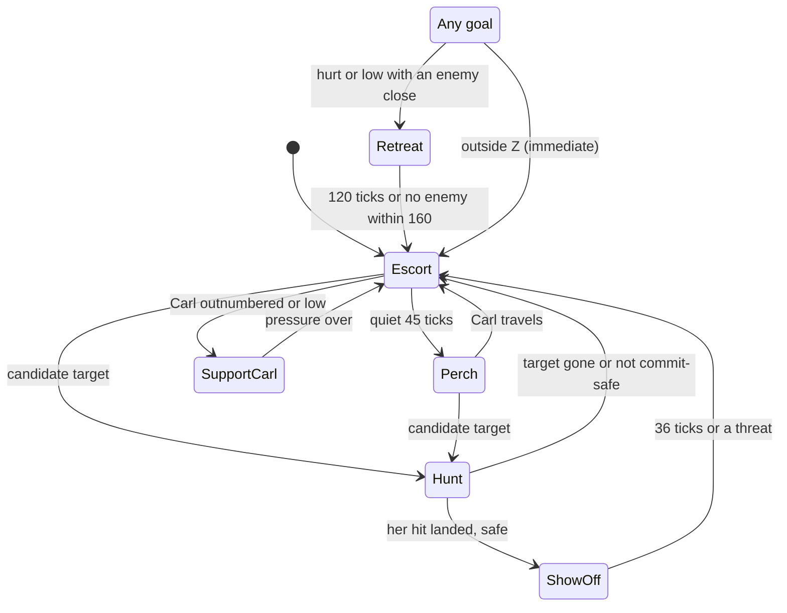

# COMPANION-AI-02 — Donut autonomy inside the camera

**Status:** design proposal (top-tier design, docs only). No code exists for anything in this file. Every value is an adopted default under the owner's design-defaults directive (2026-11-19) and is recorded as data with a `CA2-Q##` ID; game feel is pending the owner's play. Work order: [COMPANION-AI-02 work order](../07-agents/companion-ai-02-workorder.md).

**Read with:** [Companion autonomy and command system](companion-ai-command-system.md) (sections 1, 2, 7, 8, 17 (e)), [COMPANION-AI-01 work order](../07-agents/companion-ai-01-workorder.md), [Donut character bible](../02-art/donut-character-bible.md) ("Locked anatomy and personality", "Expressions and animation acting"), [character progression horizon](../01-design/character-progression-horizon.md) (Donut), [input and camera](input-camera.md) ("Same-screen camera"), [antihero tone](../01-design/antihero-tone.md).

## 0. Owner request and what it means

Owner feedback (2026-11-21), verbatim: "Why AI donut doesn't move more independently? It doesn't make sense that it follows Carl so close, and also it doesn't make sense to do the same as Carl. It is better if she is free to do what we expect from that char but without making the camera zoom out, that could be the limit."

Three requirements follow from it:

1. **Distance.** She does not stand on Carl's heels. She keeps her own position in the room.
2. **A different job.** She does not fight the same goblin the same way next to him. She does what a small, proud, calculating show cat with magic would do.
3. **One hard limit: the camera.** The camera keeps following and framing the controlled hero and never zooms or widens for her. Her freedom ends at the edge of the current view. Freedom never costs a camera, fairness or safety guarantee.

## 1. Current state (verified on `origin/main` at `8bc6c6ea` and open PR #170 head `cd0d1600`)

- **Movement is a short leash.** The uncontrolled hero's movement is the follow-and-jump bot (`src/follower.rs`): it steers to `follow_distance_px` (40) behind the leader, hops onto a ledge the leader stands on, and dodges goblin tells. Under the companion, `src/companion/navfollow.rs` (01B-wire, #166) replaces it only when the route to the leader needs a jump or a drop; on flat ground the bot input is kept. The off-screen regroup (`regroup_ticks` 120) places her on a reachable anchor just outside the view behind the leader, never inside the camera and never ahead.
- **Attacks are an overlay.** `src/companion/director.rs` adds at most one legal press per tick to the follow input: an interrupt swat on a tell aimed at Carl, a pounce (30 to 80 px, same level within 24 px), and after the biscuit a Magic Missile (64 to 160 px, AI reserve of 2). The director's "close in" step moves her toward the chosen target and nothing else.
- **She fights what Carl fights.** Targets are scored by distance from her, so in practice she picks the goblin in front of Carl, next to him. PR #170 adds: A11 (Carl engages only enemies on the side he faces), A12 (a goblin Carl hit in the last 31 ticks stays his on either side), A13 (she turns to an enemy behind her), A14 (the same-tick steal is a documented known limit), A15 (an idle flank spot 56 px ahead of Carl while a goblin approaches from the front), and two kill-steal counters (`steals`, `start_steals`) in the fixture harness.
- **Cameras.** The simulation scroll camera (`src/scroll_camera.rs`, hashed) follows the controlled hero only in solo: lead 24 px in the facing direction, deadzone ±40 px, at most 4 px per tick, fixed width (640 px in the Floor 01 scene). In two-player it follows the midpoint with a separation wall (`src/party.rs`, Q7). It never zooms. The presentation camera of `--camera auto` and `--demo` (`src/scene_camera.rs`) is presentation-only, but **it takes both heroes as framing subjects and can widen** to 960 px at 1080p. That is the one place where a free Donut could make a camera zoom out today.
- **Speed.** Carl and Donut share `RUN_SPEED` (185 px/s, about 3.08 px per tick). She cannot outrun him.
- **Safety data.** The live nav graph is built with no hazards (`NavLevel::from_blocks(solids, Vec::new())` in `NavDriver::new`): anchor risk is the graph's own, scene hazards are not fed in.
- **Acting.** CF02-I already shows Donut's `smug` key when one of her hits lands and she then stands idle (pending 45 ticks, shown for 20; `src/combat_anim/cf02.rs`). A show-off therefore needs no new art if the simulation makes her stand still after a hit.

## 2. Her role and toolkit

**Carl is the bruiser who walks into the fight. Donut is a show cat who picks her moment.** She stays out of the scrum, takes the enemy he is not dealing with, hits and springs away, watches from high ground, sulks out of reach when she gets hurt, and preens when something goes her way. Cute by default, calculating when she plans, theatrical when she wins (bible: "neutral cute, deliberate expression change, spell anticipation, dramatic payoff, recovery to cute"). Never a turret, never a second Carl.

### 2.1 Behaviours, phase by phase

| Behaviour | Before the biscuit | After the biscuit (`--donut-biscuit`) | Supported by |
| --- | --- | --- | --- |
| Pick her own target | The enemy Carl is not working: one behind him, beside him, or waiting on the edge of the fight. Not the llama (she has no damaging move against it) | The same, plus ranged foes first (the llama, an Engineer winding up) | Existing view data plus a new claim set (section 4) |
| Harass | Hit and run: close to pounce range, pounce, spring back to about 96 px, wait, repeat. Never stands and trades blows | Keep about 112 px away and cast; step back when a goblin closes inside 72 px | Existing pounce and missile; new spacing goal |
| Interrupt a tell aimed at Carl | Unchanged (swat, Q14) | Unchanged (swat or missile, Q14, Q17) | Existing director, top priority |
| Help Carl | Only when he is outnumbered or low on health (section 4.3) | The same; a non-lethal missile on his target is allowed | Existing anti-steal rules plus the claim set |
| Position herself | Her own spot in the room, 96 to 240 px from Carl, re-picked only when it stops being valid | The same, at casting distance from her target | New free zone and spot executor |
| Perch | A safe high anchor in view when the fight is quiet: the cat on the shelf | The same | Nav graph anchors (Donut-only routes are capability checked) |
| Retreat when hurt | Break off and go to the safest anchor in view, preferably with Carl between her and the enemy, preferably higher | The same; she may cast from the retreat spot | Nav graph, threat positions |
| Show off | After her hit lands and nothing threatens her, stand still for a moment; the existing `smug` key plays | The same | Existing CF02-I acting overlay, no new art |
| Travel | When Carl travels, she comes along at her own spacing, not on his heels and not copying his hops | The same | Free zone plus spot executor |

### 2.2 Out of scope for v1, with stand-ins

| Wanted later | Why not now | v1 stand-in |
| --- | --- | --- |
| Casting down from a perch onto a lower level | Magic Missile flies on her level; A09 limits her offence to targets within 24 px of her feet. An aimed or arcing missile is a new move | The perch is a rest, watch and retreat spot only |
| A taunt to pull a goblin off Carl | New move and new art | Emergent: goblins already retarget to the closer hero (Q3, with the 40 px AI bias), so an independent Donut draws some of them anyway; Retreat is the counterweight |
| Tail flick, grooming, sit on the perch | New frames (the CF02 Donut spare slot is unspent, see the [CF02 acting spec](../02-art/cf02-acting-spec.md)) | `idle` plus the existing `smug` key |
| A faster cat sprint ("Movement: High" in [characters](../01-design/characters.md)) | A body speed change affects human Donut, 2P and every party golden; an AI-only speed would break pillar 6 (same rules for AI and human) | None. The design below keeps her in view without outrunning Carl (section 3.3). Owner question O-CA2-1 |
| AI Carl autonomy when the player controls Donut | Symmetric by CA-01, but the owner's request is about Donut | AI Carl keeps the current profile behaviour |
| Commands (`Focus`, `Hold`, ...) | 01D, owner D-CTRL | None; she is useful without orders (pillar 2) |

## 3. Camera-bounded freedom

### 3.1 The free zone

Every tick the companion computes a horizontal **free zone** `Z = [zl, zr]` from the simulation scroll camera and Carl, and a vertical band from the fixed view top and height. Nothing reads the presentation camera.

For each side `s` of Carl (left, right):

```
edge_s      = distance from Carl's x to the view edge on side s, this tick
trail_cap   = view_w / 2 + DEADZONE_PX - LEAD_PX        (640/2 + 40 - 24 = 336 px)
safe_s      = min(edge_s, trail_cap) - CA2-Q03 edge margin - her half width
reach_s     = min(CA2-Q04 leash, safe_s)
Z           = [carl.x - reach_left, carl.x + reach_right]
```

**Why `trail_cap`.** When Carl runs away from her, the scroll camera settles with its centre `LEAD_PX - DEADZONE_PX` = 16 px behind him, so the trailing view edge ends exactly `trail_cap` = 336 px behind Carl, and the distance from Carl to that edge never drops below `min(edge_s now, 336)` during the pan (it only grows toward 336 or shrinks toward it). Running toward her side moves the leading edge at most to 304 px ahead of him while he closes the gap. Because she runs at his speed, **a Donut who is inside `Z` and not committed to a move can stay in view under any input the human gives Carl**, just by running with him. The proof is a unit test over the real `ScrollCamera` (work order, CA2-A).

With the defaults (edge margin 32, half width 12, leash 240) the zone is up to 240 px on each side of Carl while he stands near the centre of the view, and shrinks on the side where he stands close to the edge.

**Vertical band.** Anchors whose surface lies inside the view with `CA2-Q08` margins (48 px under the top edge for her 40 px sprite, 8 px above the bottom edge). The scroll camera has a fixed top, so this band does not move.

**Nothing outside `Z` is ever a goal.** A target whose attack spot (where she must stand to hit it) is outside `Z` is not a candidate. An anchor outside `Z` is not a spot.

### 3.2 Comfort, soft pull and hard limit

| Distance from Carl | Effect |
| --- | --- |
| up to `CA2-Q06` comfort radius (160 px) | No pull. Any goal is fine |
| comfort radius to the zone edge | Soft pull: goals and spots lose `CA2-Q06` 2 utility per px past the comfort radius, so she drifts back unless something there is worth it |
| outside `Z` (involuntary only: knockback, a nav hold, a swap) | Hard limit: the Escort goal wins at once, every other goal is ineligible until she is back inside |

**Camera about to move.** "Carl travels" is true when he has moved in one direction for `CA2-Q07` 12 consecutive ticks or the scroll camera still wants to pan (the remaining distance its deadzone step reports, read-only). While Carl travels, Escort gains `CA2-Q07` +400, no new Perch or Show-off starts, and a Hunt continues only if its target stays commit-safe (3.3). She comes along at her own spacing (`CA2-Q07` escort spot 72 to 120 px behind him, on flat standing ground), she does not copy his hops (the follow bot's ledge hop is not used under autonomy, `CA2-Q27`), and the nav graph plans any real jump or drop the route needs.

### 3.3 Commitments: the drift check

A move, a hurt flinch or a nav transit commits her for some ticks during which she cannot run with Carl. Before she **starts** any voluntary commitment (a pounce, swat, missile or a nav transit toward a goal), the companion checks the worst case: Carl running away from her for the whole commitment.

```
d_end   = |her x at the end of the commitment - carl.x|   (pounce: she travels toward its target)
drift   = commitment ticks x RUN_SPEED per tick            (pounce 44 ticks: about 136 px)
allowed = d_end + drift + CA2-Q09 slack (8 px) <= safe_s on that side
```

With the defaults (`safe_s` at most 336 - 32 - 12 = 292 px) a pounce is allowed while its landing point is within about 148 px of Carl, a missile (16 ticks, about 49 px drift) within about 235 px, and a swat (14 ticks, about 43 px) within about 241 px. Interrupts get no exemption: the interrupt stays top priority, but an interrupt that fails the worst case is skipped rather than taking her out of the frame (with a 14 tick swat this only matters at the leash). The check uses data the companion already has; it is deterministic and integer-rounded like every other utility.

**Result:** every frame she spends outside the view is involuntary: a hit's knockback or stun, a nav route the level blocks, a solo swap pan. Those are measured separately (section 7) and recovered by Escort and, as before, by the camera-safe regroup.

### 3.4 When Carl runs and the view scrolls

1. She is inside `Z` and free: she runs with him at the same speed; Escort brings her to her travel spacing. No camera effect, no teleport.
2. She is committed (mid-pounce): the drift check guaranteed she ends the move in view; she then runs with him.
3. She was knocked out of the view, or the route is blocked: Escort steers toward him through the nav graph; if she stays off-screen for `regroup_ticks` (120, unchanged, `CA2-Q26`) the existing camera-safe regroup places her on a reachable anchor just outside the view behind him: never a pop-in inside the camera, never ahead of him, never across a gate. No new teleport is added.
4. A solo swap pan (8 px per tick) can outrun her; that is the player's choice, and case 3 applies.

**She never drags the camera.** The scroll camera reads only the controlled body in solo (already true; a test pins it). For the presentation camera, `CA2-Q25`: under the autonomy profile in solo, `scene_camera::camera_inputs` passes only the controlled hero as a framing subject, so the automatic camera never widens or zooms for her. Her leash (240 px) is smaller than half the narrowest rest width (640 / 2 = 320 px) minus her width, so she still appears inside the automatic camera; a probe checks it (section 7). Two-player is untouched: the companion never runs in 2P, and the midpoint camera with its separation wall stays as it is.

### 3.5 Safety: hazards, pits and ledges

- **Spots** are taken only from open nav anchors with risk below `CA2-Q29` (250, half of `UNSAFE_RISK`), on flat standing ground at least 16 px from an anchor end that drops (PR #170's `flank_span` helper: no ledge edge, hole or wall), inside `Z` and the vertical band.
- **Routes** go through the nav graph (`NavDriver`), which never plans an edge into an unsafe anchor and never bypasses a gate or a destroyed bridge (01B). A route with no safe plan is a hold at the graph's safe anchor, as today.
- **Hazard feed.** The live graph gets the scene's hazard rectangles that can hurt a hero (`CA2-Q29`; the work order lists the verification step, since today the live graph receives none). Hazards that only hurt enemies (for example a rack drop aimed at goblins) are not fed in.
- **Enemy lanes.** A spot inside an active swing box, a llama spit line or an Engineer's ram lane (`lane_clear`) loses 300 utility; the follow layer's dodge (`dodge_input`) keeps priority over any goal.
- **No exploiting the guards.** The solo last-HP guard (M1) and off-screen immunity (M4) stay last-resort safeguards. The design keeps her in view, so M4 rarely applies, and Retreat keeps her from tanking on M1 (spec section 8).

## 4. Interaction with Carl

### 4.1 Kept from PR #170 (the hard fairness floor)

- **A08, A11, A12, A13, A14 stay as they are** and stay the veto: she never starts a lethal move on an enemy Carl engages (facing side, his running move, or hit by him in the last 31 ticks, on either side). The A14 same-tick limit stays documented.
- Credit stays factual (CA-19, CA-20); a defeat credited to the companion never triggers a CINE-01 moment (CA-29).
- Both steal counters (`steals`, `start_steals`) must stay 0 in every autonomy fixture.

### 4.2 Target split: the claim set

Each tick the companion computes **Carl's claim set** `C`:

- every enemy he engages under A08, A11 and A12, and
- the nearest standing enemy on the side he faces, on his level (feet within 24 px), within `CA2-Q10` 64 px of him: the one he is about to work.

Her target score for an enemy `e` (integers, higher wins, ties by `StableEntityId`):

| Term | Value |
| --- | --- |
| Base by state | lying or staggered 300, standing 200; llama after the biscuit 260; Engineer in its rear or point phase 260 |
| Isolation | + min(distance from `e` to Carl, 192) / 2 |
| Coming at Carl's back (the A11 side, moving toward him) | + `CA2-Q15` 300 |
| In `C` | - `CA2-Q11` 600 |
| Travel | - distance from her / 2 |
| Current target (stickiness) | + `CA2-Q16` 150 |
| Attack spot outside `Z`, or fails the drift check | not a candidate |
| Before the biscuit: a llama | not a candidate (`CA2-Q31`) |

So with two goblins she takes the one Carl is not working, and with one goblin that Carl is working she leaves it to him.

### 4.3 How much she helps him

- **Always:** the interrupt (a tell aimed at Carl) stays the top priority, unchanged.
- **Carl outnumbered** (`CA2-Q13`: two or more enemies within 96 px of him): Support-Carl. She takes the enemy nearest Carl that is not in `C`.
- **Carl low** (`CA2-Q12`: health 2 or less of 4): Support-Carl and a closer escort (within the comfort radius). Before the biscuit she may also pounce an enemy in `C`, never as a finish (A08 still vetoes it).
- **Otherwise she does her own thing.** One goblin, Carl on it: she does not join. She takes a spot at her spacing (on a perch if one is close), watches for a tell to interrupt, and shows off if something goes her way. After the biscuit she may add a non-lethal missile on his target from range (ranged, not a second melee). This answers "it doesn't make sense to do the same as Carl" while keeping her useful.

## 5. Decision structure

### 5.1 Goals

A small goal selector, the **autonomy layer**, sits above the existing director and replaces the follow layer as the source of her movement under the autonomy profile. It does not press buttons.

| Goal | Utility (CA2-Q18) | Eligible when | Movement | What the director may press |
| --- | --- | --- | --- | --- |
| Interrupt | (director, 2000) | a tell aimed at Carl in range (Q14, Q17) | director's own approach | the interrupt, unchanged |
| Retreat | 1800 | hurt in the last 90 ticks with an enemy within 96 px, or health 2 or less with an enemy within 128 px (`CA2-Q21`) | to the retreat spot (`CA2-Q22`) | interrupts only; a missile after the biscuit if the target is at 112 px or more |
| Support-Carl | 1400 | Carl outnumbered or low (4.3) | to the attack spot of the support target | the support target only |
| Hunt | 1200 | a target candidate exists (4.2) | to its attack spot: pounce band before the biscuit (prefer 56 px), 112 px after | the hunt target only, with the harass rhythm (`CA2-Q19`, `CA2-Q20`) |
| Escort | 800 (+400 while Carl travels; wins at once outside `Z`) | always | to the escort spot: 72 to 120 px behind Carl while he travels, her current spot otherwise | interrupts only |
| Show-off | 700 | her hit landed in the last 45 ticks, no enemy within 128 px, no tell aimed at either hero, cooldown over (`CA2-Q24`) | none: stand still 36 ticks facing Carl (the `smug` key plays) | nothing |
| Perch | 600 | no candidate target, Carl has not travelled for 45 ticks, a perch exists (`CA2-Q23`) | to the highest safe anchor in `Z` within 200 px of Carl | interrupts only |
| Idle | 100 | always | hold | interrupts only |

**Hysteresis.** The current goal gets +150 and keeps for at least `CA2-Q16` 24 ticks unless an immediate trigger fires: an interrupt, a Retreat trigger, or leaving `Z`. Spots are re-picked only when the current spot becomes invalid or Carl's x has moved more than `CA2-Q30` 48 px from the reference he had when the spot was picked, so she does not twitch with his every step.

**Spot choice.** Candidates are anchor points sampled every 16 px along open, safe anchors inside `Z` and the vertical band (a bounded list: the view holds a few dozen). Score = goal-specific term (distance to the wanted spacing, height for Perch and Retreat, Carl between her and the nearest enemy +64 for Retreat) minus the soft pull minus enemy-lane penalties; ties by anchor id, then x.



The director's interrupt sits outside this graph: it overrides any goal on the tick it is legal, as today.

### 5.2 How it plugs in

```
per tick, Donut companion-driven under a profile with donut_autonomy.enabled:
  view      = companion_view(...)                        (unchanged perception)
  zone      = FreeZone::compute(view, camera facts)      (new, pure)
  brief     = autonomy.decide(view, zone, nav, set)      (new, pure: goal, spot, target policy)
  movement  = dodge  >  director approach  >  goal steering to brief.spot (nav go-to, then flat approach)
              every move_x is clamped so it does not carry her out of the view
  press     = director.step_traced(view, set, Some(&brief))   (target policy filters candidates)
```

- **New pure module** `src/companion/autonomy.rs`: `FreeZone`, the drift check, the claim set, the goal selector and spot choice, the `AutonomyState` (goal, target, spot, since tick, cooldowns), `hash_into`. No Bevy, no `HashMap`, no RNG, integer utilities, stable tie breaks.
- **Director:** `step_traced` gets an optional `GoalBrief` (preferred target, claim set, zone, commit-safe predicate, allowed actions). `None` is today's code path, byte for byte, so every existing set and golden is unchanged. With a brief, a candidate outside the brief is skipped; all safety vetoes (cadence Q16, mana reserve, A08 to A13, press edge, CA-26) stay in the director and apply unchanged.
- **Navfollow:** a go-to entry point that steers to a spot instead of to the leader (the `follow` logic with the goal body and no 40 px wait band); on flat ground the wiring steers with the existing `approach` helper. Committed transits, closure handling and the camera-safe regroup are reused unchanged.
- **Wiring** in `src/combat_scene/companion.rs`: under the autonomy profile, Donut's follow input comes from the goal steering instead of the follow bot; dodge keeps priority; the autonomy state is mixed into the scene hash only while she is companion-driven under that profile.
- **Replaced under the autonomy profile:** the follow bot's leash and ledge hop for Donut, and A15's flank spot (`cf02_duo_a15_flank` false in the new set; its `flank_span` helper is reused for spot validation). **Unchanged everywhere:** `companion_v0`, `cf02_assist`, `--companion off`, two-player, AI Carl.

## 6. Adopted defaults

All values are data in `assets/data/gameplay/companion_ai_v0.json`, block `donut_autonomy`, adopted by the orchestrator's design-defaults rule; the owner may change any of them in a follow-up PR. The block is present in every set with `enabled` false in `companion_v0` and `cf02_assist`.

| ID | Knob | Value | Reason |
| --- | --- | --- | --- |
| CA2-Q01 | New profile set `cf02_free` = `cf02_assist` values plus `donut_autonomy.enabled` true; selected with `--companion cf02_free` | as stated | Flag gating: every existing set and golden stays byte-identical. Making it the `--cf02` default is a one-line follow-up after the owner plays it |
| CA2-Q02 | Autonomy applies to the Donut role only | Donut | The owner's request; AI Carl unchanged |
| CA2-Q03 | `ca2_q03_edge_margin_px` | 32 | Her whole body plus 20 px stays inside the frame; the nav wait bound uses 24 |
| CA2-Q04 | `ca2_q04_leash_px` | 240 | Below the 292 px the camera geometry allows (336 - 32 - 12), so a missile or swat still passes the drift check near the leash; inside half the narrowest automatic-camera width (320) |
| CA2-Q05 | `trail_cap` | derived: `view_w / 2 + DEADZONE_PX - LEAD_PX` (336) | Camera geometry (3.1); a test pins the formula against the real `ScrollCamera` |
| CA2-Q06 | `ca2_q06_comfort_px` / `_pull_per_px` | 160 / 2 | Free inside 160 px; a goal 80 px further must be worth 160 more |
| CA2-Q07 | `ca2_q07_travel_ticks` / `_escort_bonus` / `_escort_min_px` / `_escort_max_px` | 12 / 400 / 72 / 120 | She comes along when he travels, at a cat's distance, not at 40 px |
| CA2-Q08 | `ca2_q08_view_top_margin_px` / `_bottom_margin_px` | 48 / 8 | Her 40 px sprite stays fully in frame on a perch |
| CA2-Q09 | `ca2_q09_drift_slack_px`; drift speed `RUN_SPEED`, commitment ticks from the move tables | 8 | Worst case "Carl runs away the tick she commits" (3.3) |
| CA2-Q10 | `ca2_q10_claim_radius_px` | 64 | The goblin in front of Carl that he is about to work |
| CA2-Q11 | `ca2_q11_claim_penalty` | 600 | Larger than any bonus a single term gives: she takes a claimed enemy only when nothing else exists and a support rule allows it |
| CA2-Q12 | `ca2_q12_carl_low_hp` | 2 | Half of `HERO_HEALTH` 4 |
| CA2-Q13 | `ca2_q13_outnumbered_count` / `_radius_px` | 2 / 96 | Two enemies at his reach |
| CA2-Q14 | isolation term cap | 192 px, weight 1/2 | Prefers enemies away from Carl without overriding travel cost |
| CA2-Q15 | `ca2_q15_back_threat_bonus` | 300 | "Guard his back" (#170's reading) stays her strongest own-target reason |
| CA2-Q16 | `ca2_q16_stickiness` / `_min_goal_ticks` | 150 / 24 | No dithering between two near-equal goals |
| CA2-Q17 | Goal re-plan cadence | `ca10_decision_cadence_ticks` (6), immediate for interrupts, Retreat triggers and leaving `Z` | Same cadence as the director |
| CA2-Q18 | Goal utilities | Retreat 1800, Support-Carl 1400, Hunt 1200, Escort 800, Show-off 700, Perch 600, Idle 100 | Interrupt (2000, director) stays above all |
| CA2-Q19 | `ca2_q19_pounce_prefer_px` / `_recoil_px` / `_recoil_ticks` | 56 / 96 / 30 | Hit and run, not stand and trade; the recoil also spans most of the Q16 cadence (20) |
| CA2-Q20 | `ca2_q20_cast_spacing_px` / `_backoff_px` | 112 / 72 | Middle of the A05 band 64 to 160 |
| CA2-Q21 | `ca2_q21_hurt_window_ticks` / `_hurt_enemy_px` / `_low_hp` / `_low_enemy_px` / `_exit_ticks` / `_exit_clear_px` / `_cooldown_ticks` | 90 / 96 / 2 / 128 / 120 / 160 / 180 | A proud cat sulks out of reach; bounded so she never hides for good |
| CA2-Q22 | Retreat spot terms | maximise distance to the nearest enemy, +64 when Carl is between, +4 per 16 px of height | Theatrical: she hides behind Carl or up high |
| CA2-Q23 | `ca2_q23_quiet_ticks` / `_perch_range_px` / `_max_ticks` / `_cooldown_ticks` | 45 / 200 / 600 / 240 | Watching from the shelf, not living on it |
| CA2-Q24 | `ca2_q24_hold_ticks` / `_safe_px` / `_cooldown_ticks` | 36 / 128 / 360 | Long enough for the existing `smug` overlay (needs idle within 45 ticks of the hit, shows 20) |
| CA2-Q25 | Automatic camera subjects under `cf02_free` in solo | controlled hero only | She never makes the presentation camera widen or zoom |
| CA2-Q26 | Off-screen regroup | unchanged (120 ticks, camera-safe nav regroup) | No new teleport |
| CA2-Q27 | Follow bot ledge hop for Donut under `cf02_free` | not used | She does not copy Carl's jumps; real routes come from the nav graph |
| CA2-Q28 | A15 flank in `cf02_free` | off | Superseded by the goal layer |
| CA2-Q29 | `ca2_q29_spot_max_risk` / `_ledge_inset_px` / `_lane_penalty`; hero-hurting hazards fed to the live nav graph | 250 / 16 / 300 | Spots well away from danger, not only routes |
| CA2-Q30 | `ca2_q30_respot_px` | 48 | Re-pick a spot only when Carl really moved |
| CA2-Q31 | Llama before the biscuit | not a Hunt target | She has no damaging move against it; the interrupt is unchanged |
| CA2-Q32 | Hit-share ceiling in the `cf02_free` arena run | 50 % (as CF02-DUO-A03) | A partner, not the protagonist |

## 7. Acceptance and evidence

### 7.1 Metrics

Computed by a fixture harness (`autonomy_metrics()`, beside #170's `offence()`), from the authoritative state each tick. Both heroes alive, solo, no swap pan running, unless stated.

| ID | Metric | Target |
| --- | --- | --- |
| M1 | Spread: share of ticks with \|Donut x - Carl x\| > 80 px; median distance | at least 40 % and a median of at least 96 px in `cf02_free_explore_room` and `cf02_free_arena_direct`; the `cf02_assist` value on the same inputs is reported beside it |
| M2 | Shadowing: share of ticks within 64 px of Carl while both move the same way | at most 20 % |
| M3 | Distinct targets: share of her AI-started damaging moves that start on an enemy outside `C`; share of ticks both have a move running on the same enemy | at least 70 %; at most 15 % (fixtures with two or more enemies) |
| M4 | Kill steals (`steals` and `start_steals` of #170) | 0 everywhere, except the pinned A14 known-limit test |
| M5 | Frames outside the view: self-caused (she was inside `Z`, uncommitted or commit-checked, and left) | 0 in every fixture and in the bolt sweep (7.2) |
| M6 | Frames outside the view, any cause; ahead-side exits | 0 in every `cf02_free_*` golden; ahead-side exits 0 always |
| M7 | Camera: scroll camera input is the controlled body only; automatic-camera width and left series identical when her subject position is perturbed by ±200 px; zoom or width changes caused by her | pinned by tests; 0 |
| M8 | Her body inside the automatic-camera view (640 and 960 rest widths, headless operator probe) | every tick of every `cf02_free_*` fixture |
| M9 | Hazards: hazard hurts, hazard entries, spots chosen at risk of `CA2-Q29` or more, unplanned falls (`Stranded` notes) | 0 |
| M10 | Retreat: distance to the nearest enemy 60 ticks after a trigger; hits taken during a retreat | at least 96 px (or on a higher anchor); at most 1 |
| M11 | Show-off: `smug` acting ticks after her hit in `cf02_free_perch_and_show_off`; show-off holds with an enemy within 128 px or a tell aimed at either hero | at least 1; 0 |
| M12 | Regroup teleports | 0 in every fixture, except where the PR names an involuntary cause |
| M13 | Offence: her landed hits in `cf02_free_arena_direct`; hit share | at least the `cf02_assist` value on the same inputs; at most 50 % |
| M14 | Determinism and cost | replays twice-identical; autonomy planning time per tick reported (median and max, headless); no budget is claimed without a measurement |

### 7.2 Fixtures (all goldens, `cf02_` prefix so the frozen CI loop runs them; replays committed as #170 does)

| Fixture | What it shows | Metrics |
| --- | --- | --- |
| `cf02_free_explore_room` | No enemies. Carl walks, pauses 90 ticks, walks on, stops near a ledge. She keeps her own spacing and comes along | M1, M2, M5, M6 |
| `cf02_free_split_two_goblins` | Carl works goblin A in front; goblin B waits 160 px away, then walks at his back. She takes B; A is his | M3, M4, M5 |
| `cf02_free_outnumbered` | Three goblins converge on Carl. Support-Carl | M3, M4 |
| `cf02_free_carl_bolts` | She hunts 150 px from Carl; on the tick her pounce starts, Carl sprints 900 px away. She lands, breaks off and runs with him; never off-screen | M5, M6, M12 |
| `cf02_free_retreat_when_hurt` | A goblin hits her; she retreats behind Carl or up high, then returns | M10 |
| `cf02_free_arena_direct` | The `cf02_arena_direct` inputs under `cf02_free` | all |
| `cf02_free_perch_and_show_off` | Quiet room with a perch; she perches; a goblin arrives; she pounces it, it falls, she stands still and the `smug` key plays | M11 |
| `cf02_free_hazard_edge` | A fight next to a ledge and a hero-hurting hazard | M9 |
| `cf02_free_llama_biscuit` / `cf02_free_llama_prebiscuit` | Carl fights goblins while a llama spits. After the biscuit she missiles the llama at spacing; before it she leaves the llama alone and only interrupts | M3, M4 |

Non-golden tests: the bolt **sweep** (Carl starts running away on every tick of her pounce, both directions, and at every start offset of his screen position inside the deadzone; she never leaves the view); the `trail_cap` proof against the real `ScrollCamera`; zone and drift unit tests; the claim set against A08 and A11 to A13; goal hysteresis; the `None` brief path equal to today's director output on a fixed set of views.

**Byte-identical (must not move):** every legacy golden, `cf02_parity_off`, every `companion_*` fixture (`companion_v0`), every `--companion off` path, every `cf02_assist_*`, `cf02_arena_*` and `eng_*` golden as they stand after #170 merges, and the party and 2P goldens. Only `PROFILE_HASH` (a data pin) changes with the new block.

### 7.3 GIFs and images

1x captures at 640x360 with `floor01_scene --scale 1 --party-fixture <name> --capture-sequence <start>:<step>:<count>`, under `docs/evidence/companion-ai-02/` with `SHA256SUMS`:

1. `split_two_goblins_1x.gif`: Carl on goblin A, Donut taking goblin B.
2. `carl_bolts_1x.gif`: she finishes the pounce, breaks off and keeps in frame while Carl runs.
3. `retreat_when_hurt_1x.gif`.
4. `perch_and_show_off_1x.gif`: the perch, the pounce, the `smug` hold.
5. `llama_biscuit_1x.gif`: missile spacing against the llama.
6. `arena_before_after_1x.gif`: the same arena inputs, `cf02_assist` above and `cf02_free` below.
7. A still with the free zone and the goal label drawn by a presentation-only debug overlay (optional, under `--debug-combat`), plus the state diagram of 5.1 for the owner.

### 7.4 Horizon fit

Consulted the [character progression horizon](../01-design/character-progression-horizon.md). The design fits and needs no horizon update: Donut stays "mobile, fragile and cat-shaped" and becomes more of a "tactical partner"; it delivers the "never lose ... ability to act without Carl's direct assistance" line for the AI side; before the biscuit she uses only her low-damage feline actions plus positioning, after it Magic Missile is her main attack; no move, input, unlock or story item is added; it answers the open question on solo AI "without P2 spectatorship" (the companion never runs in 2P); and it follows spec section 8 ("Donut seeks safe flank/height and interrupt/casting lanes"). Carl's role (impact first, walks into the fight) is unchanged. Mongo is not affected.

## 8. Open questions

- **O-CA2-1 (owner, non-blocking):** [characters](../01-design/characters.md) rates the caster's movement "High" and Carl's "Medium", but both share `RUN_SPEED`. A faster Donut for human and AI alike would give her more room and a natural catch-up. It is a movement change with 2P and golden impact, so it is the owner's call after playing v1; v1 does not need it.
- Whether `cf02_free` becomes the `--cf02` default is the owner's game-feel call after playing it.
- AI Carl autonomy (the symmetric case) is a later work order.
