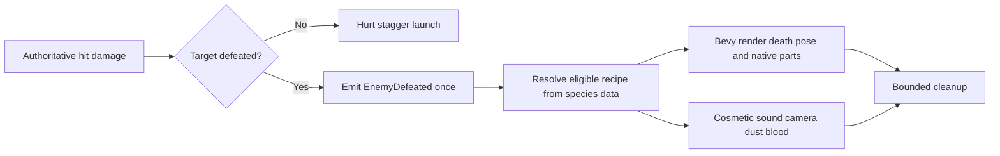

# Generic monster death and aftermath system — implementation proposal

**Status:** TECHNICAL DESIGN / NOT IMPLEMENTED / HUMAN REVIEW REQUIRED. Reference: [the offline Death Lab](../../tools/art-references/death-lab/README.md), with its selected **intensity 4** direction. This document establishes *how* to turn the reference into one maintainable, extensible Rust + Bevy system; it is **not** an approved feature list or a declaration that the prototype's visual cutouts are actual sprites.

**Requirements to preserve:** [combat feel and hybrid physics](../01-design/combat-feel-hybrid-physics.md), [destruction semantics](destruction.md), [MVP controller contract](../01-design/mvp-controller-contract.md), [GOB-01 art source](../02-art/gob-01-goblin-spec.md), and the [living character horizon](../01-design/character-progression-horizon.md). The broader universal death language v0 proposal in [PR #79](https://github.com/pando85/dungeon-floorbreak/pull/79) remains a **draft**, not merged policy.

## A. Five generic, orthogonal components

| Responsibility | Deterministic gameplay domain | Presentation-only Bevy / content |
| --- | --- | --- |
| **1. Cause + credit** | Resolve lethal damage once; record attack/prop/explosion source, owner, tick, force tier and hit direction | Choose visual variant, sound and camera response |
| **2. Species profile** | Species key; impact/mass resistance and damage semantics | Anatomy/material descriptors, allowable detachable pieces, palettes, props, unique gag |
| **3. Eligibility / recipe** | Determine *which causes are valid* (e.g., blunt cannot automatically sever a head), causal ordering and stable recipe key | Render one of several eligible non-authoritative visual finishes |
| **4. Disassembly / motion** | Stop dead actor's attacks/AI and any authoritative colliders, once | Native-pixel original parts and debris: launch, spin, floor settle, stain, fade |
| **5. Cleanup / accessibility** | Checkpoint and scene state remain consistent, collision route never blocked | Gore preset (1–4 / reduced), fragment budget, audio channels, replay-safe cosmetics |

For the MVP start with **one real reusable profile** (GOB-01 A/B) and a **simple content-based fallback** for species without specialty art. More profiles can be authored later without changing combat code.

## B. Suggested data contract (illustrative Rust design, not compile-ready ABI)

**Existing event.** The game already emits `CombatEvent::EnemyDefeated { tick, target }` (`src/combat.rs`, with `target: u32` as the domain entity id). It is emitted once per alive -> dead transition, consumed by the combat scene and mixed into the replay hash. **PR B extends or wraps this existing event; it does not add a parallel `MonsterDefeated`.** There must stay exactly one authoritative defeat event. Any change to the hashed fields is an explicit, documented replay-hash migration: golden hashes are regenerated in the same PR and the PR says so.

**Intensity is presentation-only.** The gore preset (1–4) never appears in the authoritative event, is never read by a domain system, and must change zero bytes of the replay hash. The authoritative strength of a defeat is `force_tier` (Routine | Heavy | Catastrophic).

**Reconciliation with draft PR #79.** The #79 universal death language defines `MonsterDefeated {target, cause, source, intensity, location, tick}`, where its `intensity` means ordinary / heavy / catastrophic. PR A/B must reconcile that sketch with this document: #79's `intensity` is this document's `force_tier` (authoritative), and its `MonsterDefeated` name is superseded by the extended `EnemyDefeated`. This document is the field-level authority for the event; #79 stays the authority for the visual grammar. #79's gore comfort levels map onto the 1–4 presentation scale as follows (a proposal pending gameplay signoff):

| #79 gore level | Presentation preset | Note |
| --- | --- | --- |
| `off` | 1 | Blood sprites removed; equivalent pose, silhouette and feedback kept |
| `reduced` | 2 | Fewer fragments; a detached head can become a silhouette or puff |
| `full` | 3 | Shipping default |
| (none) | 4 | Optional maximum, the Death Lab reference direction |

```rust
// Sketch of the fields the extended EnemyDefeated could carry.
// The name below is a placeholder for the existing CombatEvent::EnemyDefeated variant.
pub struct EnemyDefeatedExtended {
    pub event_id: u64,
    pub tick: u64,
    pub target: u32,                  // existing domain entity id
    pub species: SpeciesId,
    pub instigator: Option<u32>,
    pub cause: DefeatCause,
    pub force_tier: ForceTier,        // Routine | Heavy | Catastrophic
    pub hit_direction: Vec2Q,       // deterministic/quantized gameplay direction
    pub impact_position: Vec2Q,
    // Presentation seed: derive it as hash(run_seed, event_id) outside the domain; no domain system may read it.
}

pub enum DefeatCause {
    MeleeImpact, ThrownEnemyImpact, Explosion, FallingObject,
    BladeHazard, Fire, Acid, Magic, Other,
}

// Independent data file per species:
// anatomy: organic | skeletal | gelatinous | constructed | ...
// parts: head, torso, left_arm, right_arm, equipment, ...
// recipes: required cause, minimum force, output animation/parts/palette
// exclusions: nonexistent anatomy, unearned/unavailable causes
```

`EnemyDefeated` is emitted **exactly once** per alive -> dead transition by the authoritative combat simulation; do not emit kills from particles or audio. A chain like *kick -> rock crush* credits the actual lethal event and retains the earlier actor-caused prop attribution where available. No repeated impact damage per overlapping frame.

Do not use Bevy `Entity` IDs as durable persistent replay identifiers without a stable simulation mapping. Use the project's existing domain entity-ID convention (`u32` target ids) and event sequencing. `Vec2Q` above means the project's deterministic/quantized representation, **not a request to add a new crate**.

## C. Recipe selection and material differences

Recipes are **data**, evaluated from event + species profile. Examples:

| Source + eligibility | Goblin | Skeleton | Slime | Armored monster |
| --- | --- | --- | --- | --- |
| Lethal blunt hit | recoil + launch / crumple | scattered bones if heavy | splat / recoil | dented armor + recoil |
| Bladed hazard, lethal | severed head + body tumble **if head exists** | separated bones / cracked skull | split gel, **no head** | armor cut if eligible |
| Story-unlocked explosive | original-pixel body chunks + pineapple weapon | bones + dust | droplets/gel mass | armor fragments + heavy pieces |
| Falling stone | flat remnants / visible limbs + weapon | flattened bone pile | spread puddle | compressed armor |

A **routine jab does not arbitrarily decapitate**. Do not make every kill a gore jackpot; rare, clearly caused high-impact finishes should be more memorable. Intensity 4 is a **presentation setting**: more readable fragments/splashes/aftereffects, **not** a gameplay damage multiplier, altered severability rule, collision, AI or item availability. A reduced mode can remove blood sprites but preserve equivalent state and feedback.

GOB-01 variants A/B should inherit a shared profile with optional accessory override; do not duplicate the entire 27-frame existing atlas per finish.

## D. Content pipeline: reusable without losing artistic freedom

Keep original sources and frozen keys intact. Proposed minimal **additive** source pipeline:

1. Make a small **original editable Aseprite/grid source for an individual body-part sheet** per species (e.g. `goblin_a_death_parts`): head, left/right limbs, torso chunks, distinctive pineapple club, small grime/gore tiles. Use source-native palette and 1× pixel footprint.
2. Add **only missing contact/aftermath poses** per finish, e.g. `crush_contact`, `crush_remains` (owned by the GOB-02-CRUSH work order, produced once), `decap_contact`, `headless_collapse`, rather than a complete full-body animation for every weapon.
3. Export PNG atlases + manifest metadata (pivot/attachment anchors, hit-origin offsets, frames, tags, variant and material IDs) with existing repo scripts and tests.
4. Author expressive **species-specific signature finish recipes** via data, not bespoke Bevy systems. Preserve per-monster freedom of pose, expression, accessory arc, debris appearance and aftermath.
5. If a species has no head or detachable assets, choose the strongest eligible fallback, never synthesize a mismatching generic head or silent missing-sprite error.

The HTML draws approximations for anatomy splitting; **do not trace generated visual pieces** directly into official GOB-01 frames.

## E. Event -> visual pipeline



Rendering must never retroactively change death cause or damage. Use event-id + seed to get reproducible *visual* variants for QA. Limit fragment count, time-to-live, concurrent emitters and screen occupancy; choose numerical budgets only after Steam Deck / target machine profiling. Pool/atlas-batch where beneficial, but avoid speculative ECS rewrites.

**Critical scope boundary:** a launched **living** goblin hitting another enemy is authoritative CP-02 contact. A **defeated fragment** hitting the same enemy is cosmetic only until CP-04 is separately studied and explicitly enabled. The stone falling in ENV-02 is an authored CP-03 gameplay hazard with one collision/damage resolution; its generated rubble fragments are cosmetics.

## F. Implementation PR sequence

**PR A — Bridge the first fight (ongoing PR #79):** migrate approved `PhysicalAttack` from old special-as-kick binding and implement CP-02 contact + CP-03 localized rock with headless deterministic tests. Reuse GOB-01 base poses as temporary visual outputs where special art is not available. Do not present fixtures as full story-route integration. The goblin crush keys (`crush_contact` / `crush_remains`) are produced once, by the GOB-02-CRUSH art work order tracked in PR #79's implementation handoff within this PR A track; PR C reuses them and does not author them again.

**PR B — Generic death event + profile:** extend or wrap the existing `CombatEvent::EnemyDefeated` (one authoritative defeat event, no parallel `MonsterDefeated`; any replay-hash change is a documented migration with regenerated golden hashes) and add data-driven selection for ordinary knockback/down, crushed, and a fallback across at least *one additional body-material profile* (e.g., a mock skeleton/slime fixture, no new enemy artwork required). Ensure no collision/kill regression.

**PR C — Source art parts + visual renderer:** add additive editable GOB-01 death-parts sheet, pixel-art export/validator, Bevy cosmetic piece spawner/pool and a real full-speed clip. Compare intensity 1 vs 4. Presentation presets must be covered by a test that runs the same replay at preset 1 and preset 4 and gets an identical replay hash. Submit independent art review.

**PR D — Decapitation and explosive finish:** implement eligibility for environmental blade and earned explosive only, original 1× asset poses/pieces and scene examples, accurate audio. No pre-Guild bomb or universal generic decap for normal punches.

**PR E — Extend species + comfort:** more per-material profiles, signature gag/equipment, player gore settings and performance regressions. Do not build a 30-species asset catalogue before the goblin prototype is fun.

## G. Acceptance tests

- **Domain:** defeat event once/target; source/instigator attribution (direct, kicked body, falling block, blast) and stable same-seed replay; zero premature blasts; zero gore influence on combat state; fallback recipe for species with no detachable head.
- **CP-02/03:** once-per-launch contacts; once-per-landing environmental hit; no infinite debris damage chain; no permanent softlock near Tutorial Guild; checkpoint reset reproduces consistent domain state.
- **Visual:** Carl remains 52px and GOB-01 36px, genuine original-source frames, 640×360 and 640×400, 1× native view plus 3× exact scale; clear actor/hazard silhouettes even with intensity 4 effects.
- **Experience:** compare 1/4 and 4/4 at same defeat event on *real Bevy*; direct punch is still satisfying without gore; distinct explosive/decap/crush signatures; 1P and 2P input fairness.
- **Performance:** benchmark worst plausible visible simultaneous death count on target Steam Deck/lower-spec Linux; no unbounded part accumulation, physics bodies, overdraw or audio streams.
- **Approval:** human game-feel check + top-tier art review on the new source keys; green CI alone is not creative acceptance.

### Non-goals for this reference PR

This PR delivers **HTML reference and implementation specification only**. It does not implement Rust gameplay, create new production sprites, add Bevy VFX, pass CP-02/03, approve the general monster gore direction, or change the rights status of any assets.
