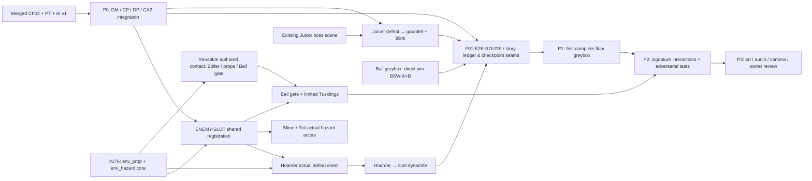

# FLOOR01-E2E-01 — Floor 01 integrated production review and release gates

**Snapshot:** 2026-11-21, `main` at `86675f40eb44c01762135f6509a67ab863a09581`.  
**Status:** production assessment and dependency-led plan, **not implementation**. This document is separate from the merged [F01-PLAYTEST integration plan](../07-agents/f01-playtest-integration-plan.md) (#182) and its in-flight revisions [#190](https://github.com/pando85/dungeon-floorbreak/pull/190) and [#193](https://github.com/pando85/dungeon-floorbreak/pull/193). **Do not overwrite or supersede those agent scheduling/merge queues.** This plan answers a different question: how to reach a **coherent, end-to-end Floor 01 that a person can play**, rather than a late-stage full-ability combat testing suite.

**Product stance:** No more new signature encounters before completing a first connected floor playthrough. Build the game, run it at native scale, record every attempt, test solo and 2P, correct weak pacing and dominant strategies, then spend on detailed art/FX. A concept-only PR is not a playable feature.

## 1. Executive assessment: design coverage is high; integrated delivery is low

There are **three different deliverables**, each with its own acceptance and not interchangeable:

| Deliverable | Objective | Source/current status | Not the same as |
| --- | --- | --- | --- |
| **F01-LATE-GATE** | Owner plays Hoarder/Boiler/Hazards/Juicer + full-ability **mastery wave** with accurate loadout flags, replay and companion | Already scheduled in #182; #190/#193 are revisions **in review**, **not merged requirements** | A connected narrative from initial entrance to Ball |
| **F01-E2E-GREYBOX** | First controllable **entrance → final boss → floor exit** journey, with all intended core rooms and honest story grants, placeholder environment art where needed | **Not integrated** on current `main`; this document defines its production gate | A fully art-approved game, no unresolved fun problems |
| **F01-ALPHA-FUN** | Integrated floor with each essential signature encounter physically interesting, clear pacing, actual 1P/2P playtests, native visual review and replay | Future human-reviewed production milestone | A Steam/releasable build; commercial rights are separate |

**Verified runtime baseline from merged PRs and main file tree:** CF02 combat (Carl kicks/stomps/dive, goblin morale/contact), early Donut active spell, Goblin Engineer behind opt-in, Juicer's **separate `boss_f01` arena**, basic AI partner/follow and camera, live PLAYTRACE/replay and AUTOPLAY's limited current modes, plus CP-A story-capability ledger merged as [#183](https://github.com/pando85/dungeon-floorbreak/pull/183) on 2026-11-21. These are genuine components; **do not infer the complete new Floor 01 scene exists** from them.

**Verified active work:** [#186](https://github.com/pando85/dungeon-floorbreak/pull/186) DM-A implementation (open draft), [#176](https://github.com/pando85/dungeon-floorbreak/pull/176) Boiler includes `src/env_prop.rs`, `src/env_hazard.rs`, room/encounter data and fixtures **on its branch**, not yet on main. [#181](https://github.com/pando85/dungeon-floorbreak/pull/181) Infernal Corral is documentation-only. [#192](https://github.com/pando85/dungeon-floorbreak/pull/192) Ball of Swine finale is documentation-only. [#184](https://github.com/pando85/dungeon-floorbreak/pull/184) Hoarder gameplay sheet, [#185](https://github.com/pando85/dungeon-floorbreak/pull/185) hazard sheet, [#187](https://github.com/pando85/dungeon-floorbreak/pull/187) quiet transitions, [#189](https://github.com/pando85/dungeon-floorbreak/pull/189) Broken Ring, [#191](https://github.com/pando85/dungeon-floorbreak/pull/191) gym approach are draft designs. [#179](https://github.com/pando85/dungeon-floorbreak/pull/179) opening Dozer choreography is not runtime implementation. This snapshot must be refreshed on each production PR; branch code ≠ merged code ≠ tested game feel.

**Hard product risk from last owner DEMO-01 playtest:** baseline combat was described as repetitive, with weak perceived environmental impacts, solo swap/AI Donut **2/5**, tone **2/5**, and local **two-pad 2P was not tested**. [Owner playtest report](demo-01-playtest-2026-11-20.md). Later CF02 merges materially change the code, but **there is no matching later owner rating in that report**; do not call the original problems solved until actually replayed.

## 2. One canonical Floor 01 route (production map, not an assertion that it ships)

The gameplay remains chiefly **rightward, combat-first and linear**, like an authored action arcade. Optional elevated routes and environmental spectacles give variety **without requiring lengthy navigation or forced puzzles**. The art concepts and fan story provide a directional chronology, not canonical approval of invented setpiece mechanics.

| Stage | Player-facing sequence and signature moment | Current implementation truth | Story/unlock gate | Concrete design/work refs |
| --- | --- | --- | --- | --- |
| **S01 — The escape** | Catacombs → Murder Dozer chase → protected refuge / machinery crash | Opening ENV-02 / DOZ-01 design/art reference; **chase not merged as playable story** | No Donut magic, Carl dynamite or gauntlet | [#179](https://github.com/pando85/dungeon-floorbreak/pull/179) |
| **S02 — First blood/Guild** | First goblins and physics retaliation → Mordecai/Guild → biscuit | Goblin/CF02 and spell core implemented in parts; **continuous act not proven** | Donut Magic Missile+reflex after biscuit; Carl base physical kit | [Act I beats](../01-design/floor-01-act-01-playable-combat-beats.md), [Donut progress](../03-tech/donut-prog-01-floor01-ability-progression.md) |
| **S03 — First magic and wrong refuge** | First easy llama → **Infernal Corral** tactical rush → absurd blue/white fast-food refuge | Llama core exists; **corral encounter and refuge unimplemented** | Light on Your Feet from **actual first safe-room reward**, never free in prior fight | [#181](https://github.com/pando85/dungeon-floorbreak/pull/181), [#187](https://github.com/pando85/dungeon-floorbreak/pull/187) |
| **S04 — The Mountain Breathes** | Hoarder, shifting junk cover, optional drop | Hoarder art/design; **gameplay sheet review / unmerged enemy** | **Carl dynamite on Hoarder defeat** (K1; CP-A trigger exists, runtime event needs Hoarder) | [#178](https://github.com/pando85/dungeon-floorbreak/pull/178), [#184](https://github.com/pando85/dungeon-floorbreak/pull/184) |
| **S05 — The Workshop** | Industrial goblins, Boiler chain reaction; **optional Dozer revenge** | Boiler core in #176 **branch**, full wiring/presentation pending; revenge design-only | Dynamite available, no gauntlet/Puddle Jumper | [#176](https://github.com/pando85/dungeon-floorbreak/pull/176), [#178](https://github.com/pando85/dungeon-floorbreak/pull/178) |
| **S06 — The Floor Lies / Broken Ring** | Slime/Rot hazards → short concentric **Broken Ring** → glimpse of survivors → Meadow Lark camp | Enemy/arena/camp design; **not main-integrated** | Donut Light on Your Feet available; no post-Juicer specials | [#185](https://github.com/pando85/dungeon-floorbreak/pull/185), [#189](https://github.com/pando85/dungeon-floorbreak/pull/189), [#187](https://github.com/pando85/dungeon-floorbreak/pull/187) |
| **S07 — The Gym** | Pygmy / Basher / Virtuoso learning fights → mixed bench fight → **Juicer** → short reward-regroup | Troglodyte native art; AI/room not wired. **Juicer fight already playable standalone** | Gauntlet + Puddle Jumper **only on Juicer defeat** | [#191](https://github.com/pando85/dungeon-floorbreak/pull/191), [#187](https://github.com/pando85/dungeon-floorbreak/pull/187) |
| **S08 — The final ring** | **Ball of Swine** committed roll/rebounds + limited Tusklings → protected exit | Ball/Tusk art sources and selected arena concept; **final boss gameplay not implemented** | No additional unlock during boss; distinct Floor 01 clear event | [#192](https://github.com/pando85/dungeon-floorbreak/pull/192) |

The eight-stage grouping is a **production/navigation index**, not eight preexisting implemented scene IDs or a declaration that exact book chapters map to our rooms. Stage 01–08 do not imply forced result screens after every individual encounter.

**Two overlapping rings, not one shared encounter:** the S06 Broken Ring is short **architectural traversal + slow positional gate**. The S08 Ball arena is a wide **kinetic boss with central gate and destructive impacts**. Distinct scenes, different tension; never create a second full moving-architecture mechanic in the labyrinth that steals the finale's identity.

## 3. Pacing budget — hypotheses to falsify with Playtrace, not elapsed-time locks

**Initial target:** a **35–45 minute first successful full-floor run**, excluding repeated deaths and optional extensive NPC exploration; practiced full run shorter, subject to real human measurement. The broad objective is that combat and physical decisions dominate time, not walks/doors, camera waits, repeated interstitial scenes or HP sponge loops. A shorter excellent floor beats a padded 45-minute floor.

| Stage | Target first-successful run | Emotional / gameplay emphasis | Danger to avoid |
| --- | --- | --- | --- |
| S01 Dozer | **3–4 min** incl. opening / staging / brief postchase combat | Fear → immediate survival | 2-minute forced chase tutorial and slow retries |
| S02 Guild | **3–4 min** | Agency, first knockbacks and cooperative identity | Unskippable exposition before fun |
| S03 Corral + restaurant | **4–6 min** | Donut empowerment → tactical pressure → absurd rest | stationary 3-missile spam and tedious forced jump puzzle |
| S04 Hoarder | **4–6 min** | Dread → physical exposure | boss HP sponge or dynamite-before-Hoarder leak |
| S05 Workshop | **5–7 min** | Skillful chain reactions and authored explosive payoff | mandatory 3-part factory puzzle or repeated waiting |
| S06 Hazards + ring + camp | **6–8 min** | Floor/ceiling pressure → monumental architecture → human relief | labyrinth navigation, too many isolated hazard tests |
| S07 Trogs + Juicer | **6–8 min** | Enemy mastery → heavy boss victory → new power | 36HP repetition, long lead-in and duplicate gym props |
| S08 Ball | **4–6 min** incl. entrance/exit | Moving threat, player-caused spectacle, finale | 128px boss with no real evade lane; 30 active pigs; minion cleanup tax |

**Arithmetic:** these lower bounds sum to 35 min and upper bounds to 49 min, so the **35–45 minute aggregate is a preferred tuning band**, not a sum guaranteed by the per-stage envelopes. Each stage's values are intentionally **provisional** and its actual trace beats the estimate. If direct first clear takes materially longer, shorten empty transition and recovery first, then reconsider content/HP.

**Beat rhythm:** DOZER fear → goblin agency → Donut power → silly silence → Hoarder dread → industrial chaos → wall/ceiling hazards → monumental architecture → human rest → trog brutality → Juicer conquest → short regroup → overwhelming rolling final boss → decisive silence. At least **one short low-pressure interlude between successive major bosses**, without three long identical safe rooms.

## 4. Product-wide game-feel scorecard and red flags

**Success is experiential, not the mere existence of an animation or a script passing.** Measure per stage and across entire runs:

| Dimension | Target for owner human trial (proposal) | Red flag / correction |
| --- | --- | --- |
| **Basic hit/combo feel** | **≥4/5** after CF02, readable impact and at least two useful physical outcomes | Mashing one attack beats every meaningful choice; fix move consequence before adding enemies |
| **Enemy response** | **≥4/5**, credible stagger/contact, rare meaningful spectacular kills | Enemy knocked into wall or body appears to ignore impact |
| **Donut agency** | **≥4/5** as P1-controlled and as AI assist, with useful real attacks; no fake companion kill credit | AI Donut idle; swapping feels like control loss; stationary magic wins every fight |
| **Arena readability** | No unseen lethal attacks; every required tell visible to targeted player, even 2P | Camera hides a second hero, Rot Sticker or rolling Ball approach |
| **Environmental spectacle** | At least **one optional meaningful physical payoff** per signature combat area; direct clear stays enjoyable | Timed scripted object auto-kills enemies regardless of contact |
| **Pace** | Little idle waiting; fast checkpoint/retry; story rooms feel like intentional contrast | 2+ repetitive recover loops, artificial prolonged room locks |
| **Solo & local co-op** | Same story-critical route; real two-pad test **performed** | Either mode requires an AI precision hit or invisible teleport |
| **Tone/identity** | **≥4/5** subjective after art/presentation pass | Looks like generic fantasy cave despite approved 80s–90s industrial/dark-comedy identity |
| **Determinism** | Fixed inputs→same gameplay event log + state hash twice, after retry and transitions | Live Playtrace can't reproduce death, grant, moving prop or actor state |
| **Performance** | Stable configured release frame budget on baseline target, no severe spikes in Boiler or Ball | Unbounded debris/actors, camera zoom shimmer, FX masking hitboxes |

**No universal need for a crowd/viewers UI or reward ladder in this first full-floor build.** Per-hero viewers unlock only when the narrative broadcast actually exists; **REWARDS-01, sponsor grants, generic gear, inventory, audience economy and custom boss phase HUDs are not hard dependencies**. Existing score/spectacle event recording may be retained without showing a new HUD panel.

**Rare slow motion** remains a *skill-gated exception*, not an ordinary kill or mandatory boss defeat cutscene. Distinct kill causes and true player attribution matter more than constant cinematic effects.

## 5. New production phases: avoid confusing the current late playtest with Floor 01 completion

These are **gate-based milestones**, not dates or promised agent durations. All statuses below reflect current observations, not assumed future merges.

### Gate P0 — Combat/ability integration, existing late playtest (ACTIVE TRACK)

**Owner:** existing #182 workstream / #190/#193 revision queue, not a new duplicate implementation team.

- Deliver `F01-LATE-GATE` when the existing plan's PT-GATE criteria pass: true Carl/dynamite/gauntlet, Donut mobility/magic/reflex/jump/blink, companion/hazard feed, ENEMY-SLOT, BOIL and at least one Hoarder/Hazard room, Juicer standalone and the separate mastery test; Playtrace, room pins and tests.
- **Current hard paths:** DM-A → companion + Donut enhancements, and #176 BOIL core → wire → environment/room implementation. CP-A is merged, but CP-B/C/D and DP-A/B/C/D are not implied complete. ENEMY-SLOT is the fan-out owner for new enemy spawning.
- May run in parallel with **P1's content/room *data* and native art** but not with uncontrolled edits to shared hot files.
- **Ship even if:** opening Dozer, Dozer revenge, Broken Ring, trog run-up, Ball and campaign-wide interstitial story flow are not yet built. Clearly label it a **late-floor capability playtest**.

### Gate P1 — Floor skeleton: first actual end-to-end 8-stage run (NEXT NEW TRACK)

**This is the most valuable missing deliverable.** Build a **single user-visible entry → progression → ending**, not a menu of debug rooms.

- New tiny integration contract **F01-E2E-ROUTE**: canonical scene/room IDs, ordered exits, checkpoint ids, one actual place for each capability trigger, carry/restore ledger across room relaunches, death/retry and story scene transitions. Reuse CP-A and PT-SCENE instead of a second story/saving engine.
- **Story route data first:** author S01–S08 as a validated manifest with both **required** and **optional** encounters, allowed active heroes, ability pins at entry/exit, boundary checks, and a structurally reachable proxy/greybox for each missing room. Use real engine collision and controls, not fake interactive screenshots or developer key jumps.
- Required first-run path: **Dozer opening → Guild grant → first magical contact + safe-room jump reward → Hoarder defeat + dynamite → Boiler → at least one verified Slime/Rot hazard pocket → safe camp transition → Juicer defeat + both upgrades → Ball boss defeat → floor exit**.
- **Skeleton allowances:** early art placeholders and **simplified but honest combat** in the Broken Ring/trog approach. The first integrated run can shorten optional enemies and interstitial detail; do not fake defeat events or grant a power in absence of the specified story event.
- **Must include a real, winnable Ball direct-only boss** to claim "from beginning to end". If Ball isn't ready, a run to the Juicer/mastery room is still P0, **not P1**.
- No hidden `--f01-loadout all` in story. If a scene-launch/reload is required, use legitimate loading screens/pins and preserve player state, rather than asserting seamless single-scene world scrolling when the architecture doesn't support it.
- Real solo Carl-active, solo Donut-active (swap), two pads, reset/retry and Playtrace integrity across **every transition**. At minimum two actual continuous complete runs with a fresh start (one solo, one 2P), plus deterministic headless route assertions; do not mark gate passed on stitched independent room clips.

### Gate P2 — Signature interactions, optional freedom and adversarial testing (AFTER P1 SKELETON / PARALLEL ROOM TRACKS)

Prove each major scene feels distinct. Work in **independent room-focused PRs** with small shared interfaces:

- **S01 Dozer:** actual cinematic-but-controllable escape, two-player reachability to the niche. Share vehicle core with *future optional* Dozer revenge; do not depend on the revenge room for first floor.
- **S03 Corral:** first llama deliberately easy; two-llama **rush-and-reposition** with true contact, environmental partition if BOIL-style prop is ready. STATIONARY-DONUT real legal press-edge exploit sweep from [#181](https://github.com/pando85/dungeon-floorbreak/pull/181).
- **S04 Hoarder:** direct boss victory with two meaningful junk states; true support collision as an optional skilled tactic; no early dynamite.
- **S05 Boiler:** genuine linked contact/steam/support events; direct, tactical and spectacular routes; actual physics and Playtrace source attribution.
- **S06 Slime/Rot:** separate corrosion vs ceiling explosive warning, real enemy-vs-blast contact; Broken Ring **one readable shutter**, not maze loops; Meadow camp safe.
- **S07 Trogs:** Pygmy leap/Basher slam/Virtuoso tongue all functioning individually; mixed fight with optional true bench hit; Juicer remains his independent boss scene.
- **S08 Ball:** genuinely committed rolling rebound, wall-protected refuges, finite detached Tuskling AI, optional central gate; direct-only clear must remain good.
- **One safe-room/epilogue pass:** fast-food visual surprise + actual Light-on-Your-Feet test, Meadow Lark human calm, tiny post-Juicer skill confirmation, safe floor results/exit; no new unlock.
- Run **anti-degeneracy fixtures** (stationary missile, repetitive single-attack melee, permanently sheltered ranged fire, boss never ends, gate always closes) plus mobile solo and real local co-op. Record best counterexample and tune AI/geometry; never "fix" by hidden magic resistance or generic HP inflation.

**P2 no-go:** if floor cannot be finished without a perfectly timed physical prop, if no player can evade Ball's 128px body at actual movement speed, if 2P gets unavoidable offscreen damage, or if a common room routinely trivializes to stationary Donut, it is **not** signed off despite a green compile/test suite.

### Gate P3 — Native art, audio, cinematic clarity and deliberate pacing

- Review/export **approved native masters** and environment kits in existing art pipeline; do not upscale/crop concept PNGs into sprites. Verify h120 Dozer, 64px llama, 40/66px trogs, 128px Ball and 30px Tusklings at actual 640×360/400.
- Use the art team's independent review and native-Bevy evidence per AGENTS.md; original 1990s-industrial texture, localized fire/corrosion, visual contrast of restaurant/camp, and rare ultraviolet Ball spectacle.
- Camera: no jitter after swap, no offscreen lethals, no 1.5× world pullback without ADR/source-pixel approval, clear 2P with detached 30px bodies. Use separate visual-only camera research PR if needed.
- Audio: first Dozer terror, llama glow/spit vs magenta bolt, Hoarder dread, Boiler impacts, human camp, gym weight blows, Ball rotating mass and final silence. Each meaningful warning works without audio and with reduced effects.
- Pace: optimize based on room-entry → first decision, time between threats, deaths/retry latency, successful route and direct vs environmental win. Remove filler before adding attack types.
- Final continuous fresh-session playtest in solo, alternate hero, and **real** local 2P on target 1080p/handheld-like output. Capture source-resolution scenes and signed owner scorecard. Report unresolved rights as a **separate commercial-release blocker** (public fan concept art ≠ game distribution license).

## 6. Prioritization: commitments vs flex vs explicit cuts

| Priority | Commitment | Why | Initial production action |
| --- | --- | --- | --- |
| **P0 hard** | Carl/Donut abilities, companion handoff, fixed-tick combat/contact/Playtrace | Everything depends on it; last owner demo flagged basic feel | Existing #182 queue; merge/test DM-A, CP/DP and CA2 work, run owner combat microtest |
| **P0 hard** | One validated `F01-E2E-ROUTE` manifest, entry/exit/checkpoint/grants, honest **Ball direct-only** | A complete floor cannot exist without start and end | New narrow route/scene PR + independent BSW-A/B implementation |
| **P0 hard** | Hoarder (dynamite trigger), Juicer (both powers) and **Boiler core**, at least one hazards section | Defining power curve and physical payoff | Use existing #176/#184/#185 and boss, no duplicated effects engine |
| **P1 strong** | Dozer opening, Corral, restaurant, major signature interactions and a credible gym approach | Identity, not merely "technically complete" | Focused room owner PRs, real first-15-minute playtest |
| **P1 strong** | Ball gate + finite Tuskling detach, 2P and show climax | Final boss should be remembered for consequence | Only after BSW direct-only loop is good |
| **P1 strong** | Distinct three safe/rest spaces and survivor reveal | Emotional rhythm and lore | Static meaningful art/level first, no NPC system |
| **P2 flexible** | Broken Ring moving shutter, extended Dozer revenge, extra acid crossover, optional bench, secondary boiler drum | Valuable, but each adds shared physics/QA | Allow direct/static variants until baseline is good |
| **P2 flexible** | Detailed dialogue, many unique background survivors, luxury FX, extreme zoom research | Art/coordination cost vs first-run fun | One review pass after physical content works |
| **Explicitly out** | 30 independent Tuskling physics, new loot/gear/inventory, generic procedural maze, new skills mid-Ball, Mongo, online multiplayer, full Floor 02, sponsor economy, cross-session campaign save | Unnecessary to establish Floor 01 game feel | Record as deferred, do not sneak into implementation tickets |

**Cut order if slipping:** Dozer **revenge** → moving Broken Ring shutter (keep short direct fight) → optional gym bench → Boiler secondary drum → hazard crossover + extra enemy varieties → elaborate survivor NPC logic → luxury show lighting/zoom. **Never cut** basic feel, opening-to-exit connection, truthful ability chronology, core Hoarder/Boiler/Juicer/Ball function, solo/2P safety, determinism or replay. A safe-room can be shorter but cannot disappear along with its unlock.

## 7. Dependency graph and fastest parallel delivery

**Critical planning insight:** the existing late-game integration queue already has two co-critical tracks of ~8 PR cycles (Donut companion and Boiler), plus ENEMY-SLOT as a near-critical fan-out. **Do not add a third code owner to those hot modules now.** The *new* end-to-end bottlenecks will be (a) an honest **Ball playable direct boss**, (b) a **route/scene/story relaunch/exit contract**, and (c) the missing opening/S03 narrative rooms. They can be prepared as **isolated fixture/sidecar** PRs while P0 owners finish their shared APIs.

**Recommended immediately parallel, no hot-file collision:** (1) Ball direct-only movement/collision **in new owned module + fixture**, (2) data-authored room manifests/path-reachability for S01–S08 and protected checkpoints **without modifying the live loader yet**, (3) native environment art kits for restaurant/Meadow/rings/trog gym/arena following source pipeline, (4) P0 feature QA and real-playtest capture. Wire each into `floor01_scene.rs` and `combat_scene.rs` only when the integration queue owner grants a slot.

## 8. Test and telemetry plan: real pass/fail gates

**One machine-readable per-attempt summary** (reuse the existing PLAYTRACE schema; do not fork its authoritative format) should include: build SHA / ruleset / scene id / room id / story loadout, player seats and AI policy, start/end capability flags, active/final HP/mana, ticks and real-time elapsed, deaths/retries, casts, melee/kicks, source-attributed hits/defeats/physical props, moving hazard warnings and contacts, special finish eligibility, checkpoint events, enemy counts, pending or executed grants, exit event, camera danger visibility, fixed state hash and strict replay result.

**Coverage layers:**

1. **Unit/domain:** attack tell→damage→recovery, Prop break impact tokens, live Ball swept collision, Tusklings cap, one-shot story grant, actor reset.
2. **Path/reachability:** Carl, Donut base, Donut boosted, solo switch, two humans separated, before/after each authored destruction/gate state, blocked or missing scene exit.
3. **Adversarial AUTOPLAY:** stationary legal missile (Corral/Trogs/Ball), no-gate boss victory, two-player separation, frozen enemy / softlock, forced world hazard hit, fastest/slowest legal clear.
4. **Full session Playtrace:** one real human solo and one **actual local two-pad** end-to-end route; strict same-input event/hash replay twice where supported across scene transitions. If recorder only verifies room-local traces, label cross-room determinism **BLOCKED** until proper snapshot support exists.
5. **Visual/manual:** real at-speed Bevy 640×360 and 640×400 plus 1080p and handheld-class inspection, audio-off/reduced-effect readability, no impossible safe route for 128px Ball.
6. **Owner emotion scorecard:** direct hit feel, Donut agency, encounter difference, difficulty fairness, memorable player-caused spectacle, overall pacing, tone, camera, 1P vs 2P and desire to retry; owner decides "fun", not scripts.

**Do not count** number of concept images, merged design docs, bots reaching `tick_limit`, test-only `--f01-loadout all` cheats, hand-edited demo clips or a passed docs CI as an end-to-end floor completion.

## 9. Gate-specific acceptance matrix

| Gate | Automated and live condition | Hard stop |
| --- | --- | --- |
| **P0 — F01-LATE** | Current #182 PT-GATE with specified minimum rooms, post-Juicer mastery, actual 1P+2P camera, replay and owner packet | Called floor completion despite no entrance/Ball |
| **P1 — connected greybox** | All required S01–S08 beats traversable from a fresh story start to valid Ball defeat and protected floor exit; correct 3 grant moments (biscuit, safe-room boost, Hoarder dynamite, Juicer two specials), all one-time and correctly ordered; preserved checkpoint/relaunch states | Debug-room hopping, fabricated story flags, no actual Ball direct win |
| **P2 — game-feel beta** | No softlocks across authored prop states, direct/gimmick-independent clears and optional skilled environmental success, enemy variety and action roles, at-speed solo/2P human proof | Static Donut spam is dominant, ball has no escape, untelegraphed damage, boss sponge |
| **P3 — reviewable alpha** | Native original art/visual provenance, soundtrack/FX clues, stable frametimes, owner-reviewed scorecard after whole-floor session, clear rights note | Claim commercial/release approval because fans saw art |

**Story grant note:** there are **five individual events/abilities across four moments**: biscuit→Magic Missile/reflex, restaurant→Light on Your Feet, Hoarder→dynamite, Juicer→Carl gauntlet **and** Donut Puddle Jumper. Use actual approved ledger IDs, not guessed labels or a redundant score economy.

## 10. Concrete next implementation work orders (no duplicate merge queues)

| Work order | Smallest useful first PR | Prerequisites | Complete when |
| --- | --- | --- | --- |
| **F01-E2E-ROUTE-0** | New authoritative **route manifest + validated room-edge/skill grant dependency tests**, **no hot-file hook** yet | Current room/level schema, CP-A ledger (#183) | Every mandatory S01–S08 edge and legal unlock position validated, no nonexistent source scene silently marked implemented |
| **F01-BSW-A/B** | Ball new-module deterministic physics and direct-only arena fixture | Approved SWINE-01 native data, existing boss/party interface audit | Real 128px roll/telegraph/rebound and legitimate kill from ordinary attacks, real safe route and evidence |
| **F01-S01-OPEN** | DOZER-CORE + ENV-02 chase playable first segment and postchase checkpoint | Dozer existing art/source/camera; current hot-file slot | Actual solo + 2P physical refuge, no unfair charge or pre-unlock abilities |
| **F01-S03-CORRAL** | #181 CORRAL-0/B/EVAL as independent scoped PRs | merged DM-A/CP-A, llama target core, future party-slot when needed | First cast + one llama easy, M2 dynamic action and executed anti-static sweep |
| **F01-ENEMY-ROSTER** | Follow #182 ENEMY-SLOT owner with Hoarder/Hazard/Trog/Tusk family modules (each isolated) | DM-A, CP-B1, BOIL core and enemy-slot interface | Real 1P/2P attack/damage/death/AI feed, not merely art manifests |
| **F01-CONTINUITY** | Wire already completed room/scene fixtures into story-capability route, ending with Ball | PT-SCENE, relevant room implementations and reviewed story ledger | Fresh-session true start→end, no test loadout and valid retry/exit |

**No proposed new full-time orchestration agent:** the first task is to integrate this **top-level floor view** into the current #182/#190/#193 orchestrator's backlog once reviewed; schedule actual code PRs only after checking current branch ownership. The lead should update statuses in the main backlog per existing speed-mode policy rather than maintaining a second contradictory per-PR truth table.

## 11. Risks and explicit decisions

| Risk | Severity | Action / proof |
| --- | --- | --- |
| **No real end-to-end player journey** | Critical | F01-E2E-ROUTE-0 then full native fresh-run test; no developer hotkeys for normal progress |
| **Fun still 2–3/5 despite more content** | Critical | Re-play CF02 after current merges; keep combat-first improvements ahead of art and extra rooms |
| **128px Ball with no reachable safe pocket** | Critical | Real geometry/collider/swept-trajectory feasibility before boss VFX |
| **Hot-file and story unlock conflicts** | High | Existing #182/#190/#193 shared owner + first-merged append/rebase; no duplicate scene or ledger core |
| **Companion/camera vs hazards in 2P** | High | Two real pads, AI hazard feed, offscreen-warning tests at 640×360/400 |
| **Overloaded boss/clutter** | High | Ball max 3 active Tusklings initially, no runtime sprite rotation, finite VFX, dynamic zoom experiments separate |
| **Pacing/quiet vs spectacle** | Medium | Track combat/idle/transition time by scene, reduce mandatory pauses first |
| **Native assets/source and publishing rights** | High for distribution | Approved art source manifests and independent reviews; public fan concept art alone does not clear a playable release |

**Open product decision deliberately deferred to measured playtest:** whether the restaurant's 128px Donut gate should remain mandatory, or become an optional shelf with a normal ground bypass. The current DP spec expects a gate; [#187](https://github.com/pando85/dungeon-floorbreak/pull/187) proposes a short Donut-led ground-opening interaction, while an optional variation requires an explicit progression-contract change. Do not silently choose during scene coding. Test both for **10–15 seconds of satisfying upgrade use versus a needless speed bump**, then submit a targeted review decision.

## 12. Status accounting policy

For every stage/encounter show **four separate axes**: design (draft/merged), gameplay (not implemented/branch only/merged), evidence (untested/headless/live 1P/live real 2P) and owner verdict (pending/accepted/needs changes). An open PR containing code is not "implemented on main"; merged code with tests still has game-feel pending. The main backlog should be updated **after** merge under speed mode, with PR links and a clear definition of the next human playtest action.

The next useful owner update should report two independent progress indicators: (1) **late-floor combat playtest readiness** and (2) **full-floor start-to-exit coverage**. Never combine them into one reassuring but meaningless percentage.

**Bottom line:** finish, measure and iterate an actual **35–45-minute-ish player journey**, not another 20 documents. Preserve the fast, irreverent, physically expressive, linear 1980s–1990s action-game identity and make every signature scene earn its screen time.
