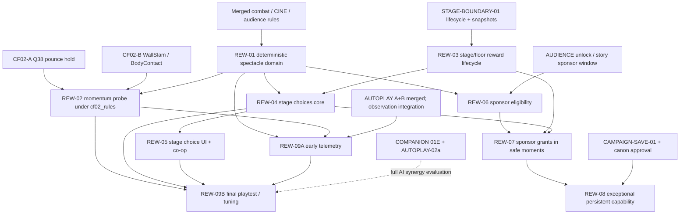

# REWARDS-01 delivery roadmap — minimal equipment, performance rewards, curated sponsorship

**Tracking status: planning baseline, 2026-11-20.** All REW-* implementation steps are **not started** at creation. The [design contract](../01-design/combat-rewards-and-no-inventory-v1.md) and [work order](../07-agents/rewards-01-workorder.md) define behavior and acceptance. [ADR-0010](../05-decisions/ADR-0010-combat-first-progression.md) records the no-inventory decision.

This is a **dependency-led roadmap, not a promised calendar**. State changes must cite a real merged PR, tested fixture and observable evidence. Do not mark complete merely because a design PR exists or another branch claims code is finished. Start the next independent step as soon as its *hard* prerequisites are merged and verified; do not wait for unrelated late-game features.

## A. Verified upstream baseline on 2026-11-20

| Dependency | Snapshot | Classification for REWARDS | Link |
| --- | --- | --- | --- |
| Combat-first vision, input grammar, character progression | Existing, authoritative, merged | Hard invariant for all | [gameplay](../01-design/gameplay.md), [MVP controller](../01-design/mvp-controller-contract.md) |
| AUDIENCE-01 per-hero viewer domain/HUD | PR #118 **merged**; actual story broadcast unlock absent | **Not** a gate for combat momentum; **hard for audience-linked sponsor UX** | [#118](https://github.com/pando85/dungeon-floorbreak/pull/118) |
| CINE-01 skill-gated cosmetic finishers | PR #122 **merged** | Optional event signal; no reward authority from cosmetics | [#122](https://github.com/pando85/dungeon-floorbreak/pull/122) |
| COMBAT-FUN-02 design | PR #124 **merged**; later CF02 runtime PRs (CF02-A and onward) not yet merged at snapshot | Style feature inputs benefit from physical chain semantics; **hard for effects using new moves** | [#124](https://github.com/pando85/dungeon-floorbreak/pull/124) |
| CF02-00 scaffold and canonical seams | PR #134 **merged** 2026-11-20 as `a572b89f`; the `--cf02` flag and `cf02_rules` switch exist, the knob schema is loaded, nothing reads a value yet | Seam available; REW-02 integration PRs rebase on it. Pure-domain REW-01 does not touch its files | [#134](https://github.com/pando85/dungeon-floorbreak/pull/134) |
| CF02-A (Q38 pounce hold, Q34 keep-down) | Not merged at snapshot; owns the hold field keyed on `MoveId::Pounce` in `src/goblin.rs` ([CF02 work order](../07-agents/combat-fun-02-workorder.md)) | **Hard for REW-02 and the M1 verdict**: `RM-DONUT-01` extends this hold; legacy `--demo` has none | [CF02 work order](../07-agents/combat-fun-02-workorder.md) |
| CF02-B (`CombatEvent::WallSlam` / `BodyContact`) | Not merged at snapshot; fourth on the CF02 critical path (00 -> A -> H -> B) | **Hard for REW-02 and the M1 verdict**: the two highest-value style categories need these events; legacy `GoblinContact` is "no damage" and does not qualify | [CF02 work order](../07-agents/combat-fun-02-workorder.md) |
| AUTOPLAY-01 design, native environment and scripted evaluation | #126, #127, #132 **merged** | **Hard for automated reward evaluation** after observation extension; no Python dependency for game logic | [#126](https://github.com/pando85/dungeon-floorbreak/pull/126), [#127](https://github.com/pando85/dungeon-floorbreak/pull/127), [#132](https://github.com/pando85/dungeon-floorbreak/pull/132) |
| AUTOPLAY-01C Python training bridge | PR #135 **open/draft** | Optional experiment accelerator; **never** a runtime or MVP release blocker | [#135](https://github.com/pando85/dungeon-floorbreak/pull/135) |
| COMPANION-AI-01 design | #128 **merged**; 01A-core #129 and 01C #130 **open**, 01B-core #131 **open/draft** (their titles said draft until CF02-00 stubs, which have now merged); AUTOPLAY-02a design #136 **open/draft** | Not needed for solo-human-only proof; **hard for factual autonomous synergy reward acceptance** | [#128](https://github.com/pando85/dungeon-floorbreak/pull/128) |
| Stage clear / floor boundary / checkpoint contract | Must **audit live Bevy code**; no REWARDS-owned contract approved yet | **Hard for stage choice + floor persistence** | New prerequisite `STAGE-BOUNDARY-01` |
| Campaign save and story grant persistence | No approved REWARDS-owned durable contract established | **Hard for permanent sponsor rewards**; not for initial combat demo | New prerequisite `CAMPAIGN-SAVE-01` |
| `broadcast_live` canonical narrative beat | AUD-Q1 remains unapproved / Floor 01 opening locked | **Hard for real sponsors**; no change to Floor 01 unlock in this PR | [AUDIENCE-01](../02-art/individual-viewers-hud-v1.md) |

Snapshot dates are *observations*, not promises. Recheck PR status and merged APIs before assigning integration files.

## B. Directed dependency graph

**Solid arrows are hard prerequisites for the named capability.** CF02-A and CF02-B are hard prerequisites of REW-02 and of the M1 human verdict (the probe runs under `cf02_rules`, `--cf02`); REW-01 does not wait for them. CF02-00 (#134) is merged and is no longer a node. The dashed companion arrow is a hard requirement **for the full AI-synergy acceptance subset**, not for basic manual tests. The first playable milestone does **not** depend on sponsors, narrative broadcast, Python PPO or a persistent campaign save.

## C. Workstream ledger — update every PR

Allowed states: `blocked`, `ready`, `in_progress`, `implemented_tested`, `merged_gamefeel_pending`, `accepted`. Every status move requires a PR URL, owner, blocking PRs and evidence in the implementation tracker. Do not use 'done' for 'design agreed'.

| ID / priority | Deliverable (PR ownership) | HARD prerequisites | Can run in parallel with | Exit criteria / acceptance gate | Initial state |
| --- | --- | --- | --- | --- | --- |
| **REW-00 / P0** | ADR, product spec, roadmap, workorder, backlog/horizon sync **(this PR)** | Existing combat/controller authority | Current CF02 and companion development | Docs validation + independent review; no runtime changes | in_progress |
| **REW-01 / P0** | Pure `SpectacleEvaluator`, derived event ids (attempt, attempt-local tick, per-tick ordinal), `party::HeroId` attribution, the provisional M1 encounter scope with its 1800-tick cooldown knob, style chain/decay/dedupe and deterministic fixtures on synthetic facts; zero rewards applied | REW-00 merged; existing combat event data; audit actual event seam | CF02-A/B and later CF02 work (no shared combat edits), stage lifecycle design | Repeatable headless traces and no change to baseline hashes | blocked |
| **REW-02 / P0** | Two opt-in momentum prototypes (Carl kick, Donut pounce), actual gameplay adapter; introduces the launch-impulse and hold-length cap knobs with tests | REW-01; **CF02-A** (Q38 pounce hold) and **CF02-B** (`WallSlam` / `BodyContact`) merged; CF02-00 seam merged (done, #134). The probe runs under `cf02_rules` (`--cf02`). Reason: without CF02-A/B legacy arithmetic reaches only 335 of 350 points (jab to haymaker 70, damped repeat 35, shore-block kill 170, three plain defeats 60) with at most one meaningful category | Stage lifecycle / story sponsor design | Same-seed A/B, 1P & 2P, cap/immunity, gamepad playtest; no baseline regression | blocked |
| **STAGE-BOUNDARY-01 / P0** | Upstream contract: authoritative unique stage clear, encounter/attempt/floor IDs, checkpoint snapshot/restore and one-time choice eligibility | Audit current demo/respawn first; agree ownership with scene lead | REW-01, REW-02 (pure modules) | Deterministic stage clear and replay fixtures; floor transition tests | blocked |
| **REW-03 / P1** | Reward state lifecycle and snapshot adapter (charges, expiration, floor boundary, choice receipts), no offer UI | REW-00; STAGE-BOUNDARY-01 | REW-01 if schema interfaces frozen | Death/checkpoint/retry/no duplicate grants golden cases | blocked |
| **REW-04 / P1** | Fixed three-choice floor modifier system, eligibility catalogue, deterministic selection and 2-modifier team cap | REW-01 + REW-03; actual moves for particular catalogue entries | HUD presentation art of existing System/CRT elements (no runtime conflict) | Two-stage fixture + floor reset; no invalid pre-story offers; 1P/2P parity | blocked |
| **REW-05 / P1** | Safe stage-end results/choice UI in existing hybrid/CRT visual language; native controller 1P/2P UX | REW-04 merged; existing UI state and stage-end visibility rules | REW-06 sponsor design | Native 640x360/400, both controllers, high contrast/reduced motion, no active combat interruptions | blocked |
| **REW-09A / P1** | Early automated reward telemetry and exploit checks, compare without/with rewards | REW-01/02; AUTOPLAY A+B merged; versioned observation additions | REW-03/04/05 | Deterministic win/damage/style/award telemetry on held-out fixtures, including extra wall slams and extra body contacts per buffed Carl kick (the indirect CF02-B effect of `RM-CARL-01`) | blocked |
| **REW-06 / P2** | Sponsor eligibility + milestone ledger **design / data only**, no drop; audience compatibility / unlock semantics | REW-01; narrative `broadcast_live` unlock + authored sponsor window; AUDIENCE-01 contract | REW-05/09 | No HUD->gameplay edge; no anticipation-only combat grants; anti-farm replay parity | blocked |
| **REW-07 / P2** | Three sponsor resolution categories, delivery at safe moments, shared floor cap | REW-06 + REW-03 + REW-04; curated sponsor catalogue | Late balance / art identity | No mid-fight modal, no repeated boxes, no inaccessible abilities | blocked |
| **CAMPAIGN-SAVE-01 / P2** | Upstream persistent story-unlock and save/load contract | Explicit campaign progression/save owner; design and evidence | Sponsor non-persistent implementation | Cross-session save/restore, migration and replay test | blocked |
| **REW-08 / P3** | Rare story-approved permanent sponsor upgrades as `CampaignCapability`, never random gear | REW-07 + CAMPAIGN-SAVE-01 + lore/canon approval for each object | New floor design | Story gate, permanently active ability, visual provenance and no equipment menu | blocked |
| **REW-09B / P1** | Final staged A/B playtests, 1P/2P and AI synergy fairness, UX tuning and owner game-feel decision | REW-02 + REW-04 + REW-05 + REW-09A; COMPANION 01E / AUTOPLAY-02a for AI-synergy rows only | Sponsor future-gated tests | Quality bar below met, knobs tuned or feature disabled | blocked |

**Milestone M0 — policy locked:** REW-00 merged.
**Milestone M1 — exciting combat:** REW-01 + REW-02 + REW-09A, human approval, under `cf02_rules` with CF02-A and CF02-B merged; no stages/loot required.
**Milestone M2 — meaningful stage decisions:** STAGE-BOUNDARY-01 + REW-03/04/05 + REW-09B; still no sponsors.
**Milestone M3 — audience-to-sponsor payoff:** story unlock + REW-06/07; separately playable and reviewable.
**Milestone M4 — exceptional lasting story items:** CAMPAIGN-SAVE-01 + REW-08; only after canon/design evidence.

## D. Critical path, ownership, collision avoidance

**Short path to first hands-on test:** REW-00 -> REW-01 -> [CF02-A, CF02-B merged] -> REW-02 -> REW-09A -> human game-feel verdict. REW-01 starts immediately on synthetic facts and does not wait for CF02; REW-02 and the verdict do (CF02-A and CF02-B are hard prerequisites, and the probe runs under `--cf02`). This deliberately avoids the entire stage/inventory/story/persistence problem.

**Long path to stage choices:** STAGE-BOUNDARY-01 -> REW-03 -> REW-04 -> REW-05 -> REW-09B. REW-01 is additionally required at REW-04. The stage-boundary API is the highest-risk cross-team dependency; freeze it early with the scene/checkpoint lead.

**Long path to sponsors:** owner-approved broadcast unlock + sponsor window -> REW-06 -> REW-07; persistent content adds campaign save and verified lore. Stage choices/safe-grant semantics come from REW-03/04, not a second invented inventory.

File boundary and owner proposal:
- REW-01 owns new `src/rewards/spectacle.rs`, `src/rewards/events.rs` and its own unit tests. **No direct edits to `src/audience.rs` or `src/cine.rs`.** For source event gaps, file a tiny coordination PR after the CF02 and COMPANION ownership freeze.
- REW-02 owns `src/rewards/momentum.rs` and test fixtures; the adapter owner of the live combat scene merges one integration PR after CF02-A, CF02-B and other combat PRs land. No parallel writes to `src/combat_scene.rs` / `src/combat.rs` / `src/input.rs` while CF02 and companion agents own them.
- STAGE-BOUNDARY-01 is **not secretly implemented by REWARDS**; the scene/checkpoint owner supplies authoritative lifecycle events and snapshots. REW-03 owns reward-specific state, restore semantics and tests.
- REW-04 owns data in `assets/data/gameplay/rewards_v0.json` and the offer engine; REW-05 owns only stage-transition UI / native evidence and coordinates with the Hybrid-A HUD owner. No new global UI framework.
- REW-06 may propose a shared pure audience scoring adapter, but any change to AUDIENCE-01 is an **explicit separate coordinated migration PR** preserving original audience fixtures.
- REW-09 owns testing adapters and metrics; no Python/ML imports in release Rust gameplay. AUTOPLAY-01C is optional.

Every implementation PR must declare file ownership, named upstream commit/API version, whether it rebased against CF02/COMPANION/AUTOPLAY changes, feature flag, changed replay goldens, one fixed-seed scenario and evidence. File ownership is a coordination plan, not a claim that the paths already exist.

## E. Quality gates / measurement program

Use **the same seeds/scenes** with rewards disabled and enabled. Never infer improvement from only more kills or artificially generated viewers.

| Gate | How to measure | Stop/rework trigger |
| --- | --- | --- |
| Correctness | Fixed-tick digest equality, no duplicated reward from replay/restart, immutable legacy baseline with flag off | Any nondeterminism / item duplication |
| Player action variety | Share of distinct meaningful contact/finish categories, repeat-action dominance, environmental usage | Rewards drive one repetitively optimal move |
| Difficulty | 1P/2P success, deaths, remaining HP, time-to-clear, boss counterplay | Danger trivialized; dramatic stages lose fail states |
| Player agency | Real pads: comprehensible grant feedback, ability to ignore reward and still progress | Mandatory new inputs or HUD clutter |
| Co-op fairness | Hero attribution, shared modifier cap, team vs hero payout, AI-only farming | AI grants self-rewards endlessly or dominates human |
| Narrative legality | Story guards for pre-biscuit Donut, explosives, broadcasts, sponsor items | An unlocked power appears early |
| Runtime performance | Fixed-step event processing, peak event count, frame-time at native target | Style/event processing causes spikes or a new render dependency |

**Hypothesis targets** for A/B tuning only (not facts): average at least one notable manual-chain opportunity in a curated 2–3 minute test; no more than one per-hero momentum grant per encounter; at least two viable choices in most eligible stage offers; no single floor modifier exceeds ~60% pick rate across representative scenes *unless the encounter intentionally calls for it*. Validate on held-out seeds with AUTOPLAY and owner hands-on sessions. If failure, simplify or retune before adding catalogue entries.

## F. Progress update protocol

At each merged REW-* PR, update this file's ledger row, add a changelog entry below, link implementation PR, list blocked/unblocked successors, evidence path, regression / CI result, and any unresolved human game-feel question. REWARDS dependency status should be rechecked whenever a CF02 PR (A, B, H) or COMPANION merge state changes. On new floor kickoffs, revalidate catalogue availability, story/canon gates and level materials.

| Date | Status change | Evidence / unblock |
| --- | --- | --- |
| 2026-11-20 | Created REWARDS-01 design roadmap; policy established, implementation 0/N | ADR/spec/workorder in this design PR; pending independent review and CI |
| 2026-11-20 | Independent review round 1 applied (rebased on `a572b89f`): REW-02 and the M1 verdict now require CF02-A and CF02-B and run under `cf02_rules`; provisional M1 encounter scope and derived event ids; caps introduced as data knobs, not "existing"; REW-09 split in the graph; `HeroId` attribution; RF-05 vs solo guard; #134 snapshot corrected (merged) | Design PR #138 head after this revision; re-review pending, docs CI re-run |

**Do not mark this roadmap complete until M2 passes human playtesting.** M3/M4 are intentionally future-gated and must be tracked as such, not silently scoped into the first slice.
