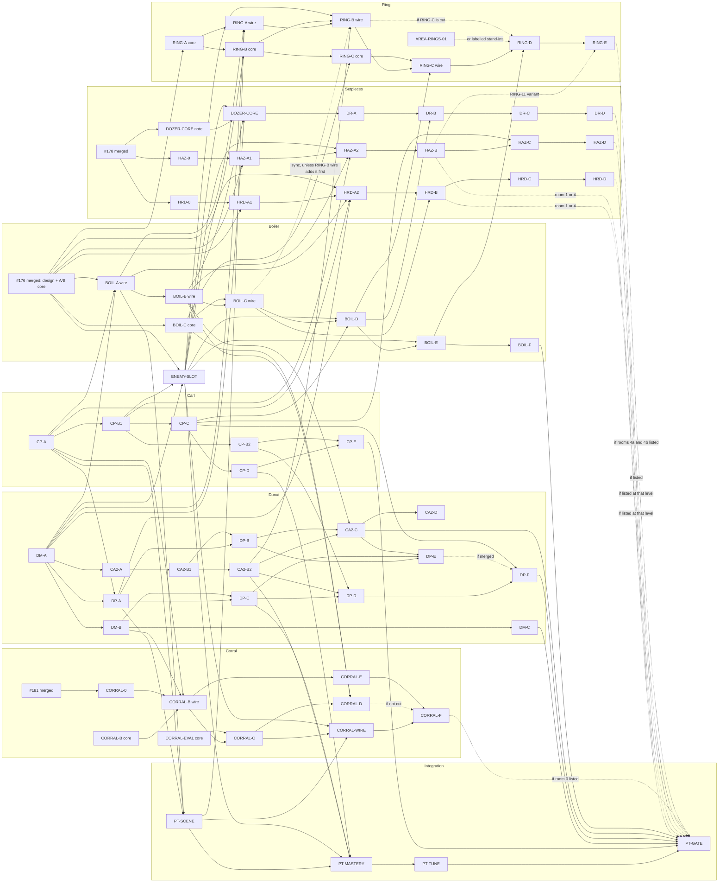

# F01-PLAYTEST-01: Floor 01 playtest integration plan

**Status:** integration plan, **Revision 6** (top-tier design integrator, 2026-11-21). Docs only; nothing here is implemented. It schedules work that the linked specs and work orders already define, plus a few new integration steps: `ENEMY-SLOT`, `PT-*`, `HRD-0`, `HAZ-0`, `DOZER-CORE`, the `CORRAL-*` steps (section 14) and the `RING-*` steps (section 15). Every resolution below is an adopted default under the owner's design-defaults and speed-mode autonomy rules ([AGENTS.md](../../AGENTS.md)). The owner-level questions are asked in section 13. Game feel stays the owner's call.

**Owner goal (2026-11-21):** "our goal here is to have a full implementation of donut and Carl for the new playtest, with all the abilities and powerful enemies". The owner opened two design PRs and wants work on them to start in parallel. [Fun over canon](../01-design/vision.md#fun-over-canon-owner-decision-2026-11-21) applies: gameplay wins, and each deviation is recorded as a game adaptation.

**Precedence:** legal and rights guardrails > accepted ADRs > the owner's newer explicit design text (#176, #178) > the merged character specs > this plan. This plan does not edit the owner's PR files or the backlog.

**Revision 1 (independent top-tier review, orchestrator rulings):**
- The waves and the critical path now follow the stated dependencies. Hot files are "first come, first rebased", not a gate, and the "disjoint files" claim is gone (B1).
- New ENEMY-SLOT step owns new-enemy integration (B2).
- PT-SCENE and PT-MASTERY carry four explicit statements and full acceptance lists. The Juicer room runs the existing boss scene (B3).
- Gate item 5 uses scripted per-room fixtures; AUTOPLAY room coverage is NOT RUN (B4).
- K1, K3, K5, K8 and K9 are corrected, and K15 to K19 are added. The hot-file queue is completed and new files are marked. DOZER-CORE gets acceptance criteria.

**Revision 2 (narrow re-review, fix-now F1 to F11, orchestrator rulings):**
- The critical-path counts are corrected (F1). K19 is extended: append-and-rebase for the shared hot files, so DP-A, BOIL-A wire, ENEMY-SLOT and PT-SCENE may merge before CA2-B2 (F2). The `combat_scene/companion.rs` queue no longer cycles (F3).
- Companion-mode room fixtures wait for CA2-B2 and may be re-pinned by CA2-C and DP-E (F4). ENEMY-SLOT reuses the existing `EnemyDefeated` (F5). HRD-A2 appends `CombatEvent::PileBoss` (F6). Every contract gap the Hoarder sheet exposes has an owner (F7).
- #175 is merged, and the text now says so (F8). The `HeroBlow` source wording is corrected (F9). PT-SCENE's grant acceptance can pass at W3 (F10). Small text fixes (F11).
- Slime/Rot sheet review (#185): CP-B1 brief (`reach()` with `core_radius == 0`, the dynamite slot index; no exemption), CP-C brief (a chain target with `detonate_tick` 0 that has not detonated is unlit, +8), and a `goblin.rs` queue row owned last by HAZ-A2 (the walk barrier list).
- Non-blocking: one shared `HeroDamagePolicy` enum for blast `hero_damage` and the hazard team policy, owned by CP-B1.

**Revision 3 (the Infernal Corral, owner draft #181, and the Hoarder re-review):**
- New section 14 integrates #181: conflicts KC1 to KC19, the `CORRAL-*` steps (core and wire split), the llama rush's owner, the STATIONARY-DONUT evaluator on the real party sim, and room 0 (`corral`) as an Act I prefix of the slice.
- Sections 1, 3, 5, 7, 8, 10, 11 and 13 gain the corral rows.
- Hoarder re-review P1 to P3: both threat-feed sites in the ENEMY-SLOT rows (P1); HRD-A2 owns the dynamite-grant code and depends on CP-A and DP-A, and the two story files join the section 7 queue (P2); the remnant-lift rule in the BOIL-C core and prop rows (P3).
- Slime/Rot re-read: the CP-C brief writes `BlastCharge.owner` only when it is `None`; the CP-B1 brief carries no exemption; the CP-C unlit rule is narrowed to "`detonate_tick` == 0 and not detonated means unlit, set it to now + 8"; ENEMY-SLOT validates at most one `boss` threat supplier kind per room.

**Revision 4 (independent top-tier review of the corral addendum, #190):**
- D1: room 0 grants nothing. #181's M3 is the threshold into the I-08 refuge, not the refuge. The refuge, its Light on Your Feet pickup and the swap of the `f01_safe_room_reward_found` row belong to REST-A of owner draft #187 (KC9). The section 14.8 mis-flag is deleted.
- D2: KC3 is rebuilt on an approach-under-fire budget (stagger 18 against refire 16, 3 HP, about 290 px reach, a 0.67 px/tick walk): a ground llama in Donut's line never reaches the rush envelope. The levers are re-ranked, the fallback is restated honestly, and section 13 question 3 matches it.
- L1: the evaluator builds its state with `with_cf02()` and `PartyFixtureSim::from_parts` and places Donut at setup, so CORRAL-EVAL core touches no shared file and can merge in W1. Name-replayed corral fixtures need a `corral_` arm in `cf02::fixture_runs_cf02`, the KC15 arm and a `PartyFixture::all()` entry.
- L2: the rush opt-in is per llama; party targeting stays room-wide.
- F1 to F14 (fix-now items): see section 14.
- #185 re-read: the HAZ-A2 walk barrier is obeyed by the grounded walk, approach, flee and the Coward hop, and knockback ignores it; the CP-B1 brief drops the exemption wording (acid patches are not in `hazards`, so `RosterInHazard` never sees them); the CP-C unlit rule reads "`detonate_tick` == 0 and not detonated".

**Revision 5 (narrow re-review of #190):**
- R1: CORRAL-B wire owns the two llama behaviours that KC3's top levers need: a per-llama spawn at an authored surface and height (for example the 32 px exit dock of the CORRAL-0 sheet, draft #195) and a per-llama activation (dormant) state, woken by an activation line, a delay or a reveal. CORRAL-C keeps only the gate decision and the tuning.
- R2: a fourth name-keyed hook, `corral_fixtures::llama_opt_ins(name)`, applied in `reset_attempt` (the `cf02_fixtures::shore_hits(name)` precedent), so name-replayed `corral_*` fixtures get party targeting, the per-llama rush, spawn surfaces and activation, and a retry restores them.
- R3: REST-A's swap retargets DP-A's `donut_prog_story_unlocks` assertion and records that the legacy `--donut-prog` corridor stops granting the boost; the inexact "HRD-A2 precedent" wording is dropped.
- R4: a direct Hoarder launch always pins Light on Your Feet; REST-A only adds the in-play grant.
- R5: owner question 3 now says that the fallback is a form of the super-armour #181 item 5 forbids, and that any guard must be visible.
- R6: the "inside the envelope" sub-option is limited to outside Donut's facing line.
- R7: the `DPA-->CWI` graph edge is removed.
- N1 to N4: the opt-ins live on `CombatState` and are reapplied by `reset_attempt`; mana joins the CORRAL-0 budget (8 bolts against 6 HP for two llamas, regen 30 then 40, wasted bolts); the evaluator sets Donut's position and facing; the tick-0 setup writes are exempt from the "no state writes" assertion.

**Revision 6 (The Broken Ring, owner draft #189):**
- New section 15 integrates #189: conflicts KR1 to KR23, the `RING-*` steps (core and wire split), the shutter rule, and rooms 4a and 4b (`ring_court`, `ring_split`) between the Floor Lies and the Juicer.
- One shared interface is named: the **runtime env solids sync** into `scene.world.solids`, owned by BOIL-C wire (section 3, KR6). BOIL-D's prop contact target covers every env solid (KR7).
- PT-SCENE's acceptance gains the generic story-order pin test (KR12).
- Sections 1, 3, 4.2, 4.7, 5, 6, 7, 8, 9, 10, 11 and 13 gain the Ring rows.

**Revision 7 (orchestrator batch after the merges through #213, docs only):**
- New steps: **PT-SCENE-B** (the Juicer pilot fixtures that #211 deferred), **HAZ-A2b** (the `f01_hazards` binary arm and its recording, deferred from HAZ-A2, #214 in review) and **HRD-A2b** (the `hoarder` room arm, manifest re-pin and recording, deferred from HRD-A2, #215 in review).
- K16 (the existing-kind roster relaxation) is assigned to **BOIL-E**: ENEMY-SLOT (#209) and PT-SCENE (#211) did not spawn a sidecar roster, so BOIL-E is the first roster-spawning step (section 4.7).
- ENEMY-SLOT file list gains `src/combat_scene/donut.rs` (four append-only one-liners in #209, and one hook in #212). The env hook calls live in `src/combat_scene/env.rs`. A launched goblin and a slot enemy are now told apart (section 4.7).
- DP-B (#213) left three acceptance items open: the HUD and auto-camera standable-surface test and the perch-to-perch sweep go to **DP-C**, and the 128 px side-by-side capture goes to **DP-E**.

## 1. Inputs

| Work | Where | State on 2026-11-21 | Steps |
| --- | --- | --- | --- |
| DONUT-MOBILITY-01 (DM) | [spec](../03-tech/donut-mobility-01.md), [work order](donut-mobility-01-workorder.md) | Design merged (#173); **DM-A in implementation** on `feat/donut-mobility-dm-a` | DM-A, DM-B, DM-C (DM-ART, DM-RACK later) |
| COMPANION-AI-02 (CA2) | [spec](../03-tech/companion-ai-02-donut-autonomy.md), [work order](companion-ai-02-workorder.md) | Design merged (#172); waits for DM-A | CA2-A, CA2-B1, CA2-B2, CA2-C, CA2-D |
| CARL-PROG-01 (CP) | [spec](../03-tech/carl-prog-01-floor01-combat-progression.md), [work order](carl-prog-01-workorder.md) | Design merged (#174); **CP-A in implementation** on `feat/carl-prog-cp-a` | CP-A, CP-B1, CP-B2, CP-C, CP-D, CP-E |
| DONUT-PROG-01 (DP) | [spec](../03-tech/donut-prog-01-floor01-ability-progression.md) and [work order](donut-prog-01-workorder.md) | Design **merged** (#175, 2026-11-21): Light on Your Feet is at the safe room after the first llama; Puddle Jumper stays on the Juicer's defeat | DP-A, DP-B, DP-C, DP-D, DP-E, DP-F |
| Goblin Boiler (BOIL) | [PR #176](https://github.com/pando85/dungeon-floorbreak/pull/176) (owner draft): `docs/01-design/floor-01-goblin-boiler-encounter.md`, `docs/07-agents/floor-01-goblin-boiler-workorder.md` | Design draft; **BOIL-A core and BOIL-B core are being implemented on the #176 branch** (K15) | BOIL-A, BOIL-B, BOIL-C, BOIL-D, BOIL-E, BOIL-F |
| Hoarder, Dozer revenge, Slimes and Rot Stickers | [PR #178](https://github.com/pando85/dungeon-floorbreak/pull/178) (owner draft): three encounter docs and `docs/07-agents/floor-01-memorable-setpieces-slate.md` | Design draft; the HRD-0 Hoarder sheet is in review as [PR #184](https://github.com/pando85/dungeon-floorbreak/pull/184) | Hoarder: HRD-A to HRD-D (the doc's five agent actions); Dozer: DR-A to DR-D; hazards: HAZ-A to HAZ-D; slate milestones SP-B0 to SP-B4 |
| The Infernal Corral (CORRAL) | [PR #181](https://github.com/pando85/dungeon-floorbreak/pull/181) (owner draft): `docs/01-design/floor-01-llama-magic-baptism.md` (v0.2), `docs/07-agents/floor-01-llama-magic-workorder.md`, `docs/07-agents/floor-01-corral-autonomous-evaluation.md` (CORRAL-AUTO-01) | Design draft, owner-approved direction; no code | the owner's C-A to C-F, split here into CORRAL-0, CORRAL-EVAL core, CORRAL-B core and wire, CORRAL-C, CORRAL-D, CORRAL-E, CORRAL-WIRE, CORRAL-F (section 14) |
| Quiet setpieces and transitions (REST) | [PR #187](https://github.com/pando85/dungeon-floorbreak/pull/187) (owner draft): `docs/01-design/floor-01-quiet-setpieces-and-transitions.md`, `docs/07-agents/floor-01-quiet-setpieces-workorder.md` | Carried onto main by the REST plan (adapted, crediting the owner draft); integrated in section 16 | REST-A (the refuge `rest_refuge` after the corral, carrying the Light on Your Feet grant), REST-B (the camp `rest_camp` after `ring_split`, KR15) and REST-C (`rest_aftermath` after the Juicer) are rooms of the run; one implementation step, REST-WIRE (section 16) |
| The Broken Ring (RING) | [PR #189](https://github.com/pando85/dungeon-floorbreak/pull/189) (owner draft): `docs/01-design/floor-01-broken-ring-labyrinth.md`, `docs/07-agents/floor-01-broken-ring-workorder.md` | Design draft; no code | the owner's RING-A to RING-E, split here into RING-A, RING-B and RING-C core and wire, AREA-RINGS-01, RING-D and RING-E (section 15) |
| Floor 01 progression bible | [floor-01-gameplay-progression-v0.md](../01-design/floor-01-gameplay-progression-v0.md) | Merged | M1 to M6 |
| Backlog rows | [backlog](../04-production/backlog.md): CHASE-01, NEXT-PLAYTEST, ENEMY-GAMEPLAY-ENGINEER | CHASE-01 not started; NEXT-PLAYTEST is a direction; Engineer merged (#168), game-feel pending | |

Merged gameplay used as is: CF02 rules (`--cf02`, microarena, contacts, morale), Bad Llama, Goblin Engineer (`--cf02-engineer`), the Juicer (`--scene boss_f01`), the biscuit and Magic Missile, PLAYTRACE recording and replay, AUTOPLAY v1 (Carl-only corridor fights). Art that exists but has no gameplay: HOARD-01, SLIME-01, ROT-01, DOZ-01, ENV-02.

## 2. Conflicts and adopted resolutions

| ID | Conflict | Adopted resolution | Owner-level? |
| --- | --- | --- | --- |
| K1 | CP-Q01 (Revision 2) grants dynamite in the room **before** the Hoarder's lair. #178 says three times, and #176 once, that dynamite is **post-Hoarder** ("not a dynamite tutorial", "no pre-Hoarder dynamite") | **Dynamite is granted on the Hoarder's defeat.** The story trigger is `pile_boss_f01_defeated` = `EnemyDefeated { target: PILE_BOSS_ID }`, with a placeholder zone until the Hoarder exists. The Boiler becomes the first dynamite room. This restores the owner's original anchor (#174's first draft: CP-Q01 granted on the Hoarder's defeat). **Fun over canon** is used explicitly to override the Hoarder doc's own condition "if chronology supports it" (fan summaries place the find before the Hoarder; the game moves it after so that the Hoarder stays a positioning fight). It is recorded as a game adaptation. CP-A ships the trigger id now, and its PR body cites K1 and this plan. PT-DOC carries the text and does **not** wait for #178 (section 4.7) | No (owner informed) |
| K2 | #176 bounds chains at 3 authored links and one activation per prop; CP-Q34 caps charge chains at depth 4, +8 ticks and 8 per tick | Both apply. CP-Q34 is the engine cap. Prop-to-prop links carry the same depth counter. The encounter validator enforces ≤ 3 authored links in an acyclic graph. The drum is an authored `BlastCharge` with a world profile | No |
| K3 | CP-Q24 (no friendly fire) vs world hazards that hurt heroes (#176 steam, #178 Rot blast) | No friendly fire applies only to the **hero-thrown dynamite profile**. World and enemy blasts and hazards hurt **every** hero by their own data, whoever triggered them. Mechanism (CP-B1): **no new owner field.** Attribution stays on the existing, hashed `BlastCharge.owner: Option<u32>` (`src/blast.rs`). It is the initiating player when a hero triggered the charge and `None` otherwise, and a chained charge inherits the initiator. One `hero_damage` policy on the profile (the shared `HeroDamagePolicy` enum: `OwnerReduced`, `AllHeroes`, `NoHeroes`) **replaces** CP's planned `hurts_owner_hero`. The hazard volumes' team policy uses the **same** enum, so world blasts and world hazards share one vocabulary. CP-B1 owns it in a neutral module, `src/hero_damage.rs` **(new)**; if BOIL-B core lands first, it defines the enum there and CP-B1 adopts it (first come, first rebased) The QA profile is `NoHeroes` and is not mixed into the hash (CP's byte-identity rule), the dynamite profile is `OwnerReduced`, and world profiles are `AllHeroes` | No (game-feel note) |
| K4 | #176 keeps the CP-02 baseline (enemy-to-enemy contact deals 0 damage); CF02-B (merged) knocks down, bowls and wall-slams for 1 | The setpiece rooms and the mastery arena run under `cf02_rules`. The #176 rule means **add** no new enemy-on-enemy damage. Prop impulse thresholds are tuned separately | No |
| K5 | #178 Dozer revenge proposes 150–195 px/s and no Donut invincibility. DOZ-01 and CHASE-01 propose 160 px/s cruise, a charge faster than Carl, a rubber band matching 185 px/s and a Donut wheel exemption. Carl runs 185 px/s | **Revenge room only.** Cruise ≤ **170 px/s**. This narrows the owner's 150–195 range, derived from the owner's "must not outrun" constraint. The charge and the rubber band never exceed Carl's 185 px/s at any time in the revenge room. **No Donut invincibility.** The DOZER-CORE design note sets a rule for an AI-driven hero near the wheel (the AI partner's regroup places it ahead of the Dozer, never between Carl and the wheel; the AI Carl of a Donut-solo run follows the same rule) and proves it with fixtures (section 4.5). **Mechanism, with no companion code:** the wheel is a hazard volume that reaches the AI through CA2-C's hazard feed, and the charge reaches it as the existing `BossThreat::Charge`. If fixtures show that this is not enough, the fix is a named CA2 append, not a DOZER-CORE edit. This is stretch work The opening chase keeps the DOZ-01 options; CHASE-01 decides them | No |
| K6 | #176 and #178 speak of a "12-second dodge/reflect"; DM-B is a reflex **evade** (nothing is reflected) | DM-Q18 already classifies hazards, falling masses, blasts, boss blows, body contacts and any future source as **not evadable**: steam, weight, drum, Rot blast, slime acid, Hoarder blows, pile slide and Dozer wheel. An enemy design sheet may opt a single targeted attack in | No |
| K7 | The owner wants "all the abilities"; #176 and #178 forbid any move before its story unlock | **Story-progressive slice by default:** each room loads its story-correct pin, the Hoarder's defeat grants dynamite and the Juicer's grants the gauntlet and the blink, and the run ends in a mastery arena with everything. `--f01-loadout all` gives every capability in every room, labelled **TEST LOADOUT** (console, HUD notice, PLAYTRACE descriptor). It never runs in the story or demo routes | **Yes** (section 13) |
| K8 | Light on Your Feet reaches 128 px ledges (DP-Q18); the setpiece docs size their ledges for a pre-boost Donut and forbid unreachable firing nests | Every setpiece room is validated for Carl (80 px class), base Donut (the 96 and 104 px classes; the 112 px class of DP-Q18 is a narrow human-only route that the AI does not attempt, so the validator never counts it as an AI route) and boosted Donut (128 px class). A surface of 81–128 px that no enemy threatens is lowered to ≤ 80 px, or declared a Donut vantage with a counter. **DP-Q45 lane ceiling:** any room where Donut can hold `jump_reach_boost` and stand on a surface more than 42 px up declares `ceiling_px` ≤ 228. This covers the boiler's 64 px perches, the Hoarder's ledge and the hazards ledge under the story pins, and DP-B's data test sweeps every room. BOIL-A core takes the DP-Q18 gate classes **as data**, not as copies of physics constants. The physics-exact check lands in BOIL-A wire (after DM-A, which brings `ceiling_px` and the agile apex). It reads DP-A's boosted launch once DP-A has merged; whichever of BOIL-A wire and DP-A merges second adds the boosted case | No |
| K9 | #175 (merged) puts Light on Your Feet at the Act I refuge, which the Act I beats reserve for no major unlock "unless explicitly added after separate review" | The review was internal to #175. **The setpieces are affected:** every setpiece pin holds Light on Your Feet, and the slate says "treat new intermediate jump upgrades as provisional until story review". The setpiece pins carry the boost **provisionally**, until the Act I doc's owner signs off. K8 validates both base and boosted Donut, so removing the boost from a pin never strands a route | No |
| K10 | BOIL-E asks for approved workshop art. HAZ-D asks for native art review. The Hoarder needs a shove and pile props. HOARD-01 has one slam attack, no boiler prop art exists, and the ROT-01 tell is 30 ticks against a proposed 18–24 | Greybox props and code-drawn stand-ins are allowed in the playtest, labelled. Art orders run as a parallel track (section 4.6). The gameplay tell timing wins | **Yes** (section 13) |
| K11 | COMBAT-LAB-01 LAB-02 (`r03_collapsing_workshop`, `r04_pressure_chamber` placeholders) duplicates the Boiler | LAB-02 reuses the Boiler's prop and hazard core after BOIL-D. The lab profile keeps dynamite off (LAB-Q01, CP-Q05). The playtest gets its own scene, not the lab | No |
| K12 | #176 B3 offers an optional Bomb Bard, which has no gameplay | Cut. Use the Goblin Engineer (K16) | No |
| K13 | #176 and #178 forbid companion rewrites, yet the AI Donut must avoid steam, footprints, acid and the wheel | CA2-C's hazard feed consumes the Boiler's hazard core (active and telegraphed rectangles per tick). Until then this is a reported gap; the D1 last-HP guard covers solo | No |
| K14 | The Hoarder comes "after the Scatterer introduction"; Scatterers and rats have no gameplay | The slice starts at the Hoarder's lair. Scatterers and rats are deferred | No |
| K15 | #176's work order says to "extend this PR/branch with implementation, tests and evidence"; the slate calls #176 "an implementation work order on its own branch" | **Partial deviation (orchestrator ruling).** BOIL-A core and BOIL-B core are implemented **on the #176 branch**. #176 merges as design plus core once that core passes review. BOIL-A wire through BOIL-F are separate follow-up PRs that reference #176. Reason: the wire steps edit hot files (`floor01_scene.rs`, `combat_scene.rs`, `combat.rs`, `contacts_cf02.rs`), and holding them on a long-lived branch would block the Carl and Donut queues (section 7) | No (owner informed) |
| K16 | ENG-G-Q25: "the Engineer exists only in the CF02 microarena". The story route, `--demo`, the lab, the boss arena and every fixture never load him. That blocks the Engineer as boiler B3 (BOIL-E) and in the mastery waves | **The ENG-G-Q25 relaxation for encounter-sidecar rosters is owned by BOIL-E** (Revision 7; ENEMY-SLOT #209 and PT-SCENE #211 spawned no sidecar roster, so there was no gate to relax): the existing-kind spawn from `RosterSpawn.existing` (goblin, Engineer, llama), the `floor01_scene.rs` arg row, and a test that the story route, `--demo`, the lab and the boss arena still never load the Engineer. Applies to sidecar rosters only. The `--cf02-engineer` behaviour is unchanged. The story route, `--demo`, the lab, the boss arena and every existing fixture still never load him | No |
| K17 | `f01_late` was meant to imply `cf02_rules` for every room. But `--cf02` forces the DEMO machinery, the boss arena refuses `--demo`, and CF02 rules have never run in `boss_scene` (13 boss goldens) | **Cheapest path:** room 5 (the Juicer) runs the **existing `boss_f01` scene with its own rules**, entered through its boss path with the CP and DP story pins (`--carl-prog --donut-prog`). `cf02_rules` applies to the setpiece rooms and the mastery arena only. Moving into or out of the boss room is a scene relaunch, not an in-scene transition. No boss-scene port to CF02 rules | No |
| K18 | #176 asks to "reuse CP-03 distinct-hit support rules if feasible"; the slate says "avoid building three conflicting falling-weight … engines". The repo already has `src/shore.rs` (CP-03), the boss rack strut (`DefeatCause::DropHazard`) and the camera-lab hanging-weight drop in `camera_lab/sim.rs` | **Deviation, recorded:** `src/env_prop.rs` is a **new** falling-mass core, because the three existing paths drive hashed goldens (CP-03 shore fixtures, the boss goldens, the lab replays), and widening them for chains, launched-body stimuli and remnants would move those hashes. The rule: `env_prop.rs` is **the** engine for every new setpiece (Boiler, Hoarder piles, Dozer stop frame, LAB-02); it reuses `shore.rs`'s pure helpers (distinct-hit counting, footprint geometry) where hashes allow; the three existing paths are frozen, not extended | No |
| K19 | The CP work order says CP-A is "serialized after the CA2-B2 and DM-A edits … (or rebased onto them)". The DP work order orders `floor01_scene.rs` and `replay.rs` as "DM-A, CA2-B2, then DP-A". The CA2 work order puts those files, and others, under "one owner at a time" | **The order flips, and the one-owner rule is relaxed (orchestrator ruling, adopted default).** CP-A goes first (in flight), and CA2-B2 rebases onto CP-A on `floor01_scene.rs` and `playtrace/replay.rs`. "Or rebased" allows this. **Extension:** for the shared hot files `src/bin/floor01_scene.rs` (args and presentation), `src/playtrace/live.rs`, `src/playtrace/replay.rs`, `src/playtrace/manifest.rs` and `scripts/ci_floor01_combat.sh`, CA2's "one owner at a time" rule is **relaxed to append-and-rebase for every PR, CA2's included**; CA2-B2's "no open PR touches these files" check does not apply to them. DP-A, BOIL-A wire, ENEMY-SLOT and PT-SCENE **may merge before CA2-B2**, which **reverses the merged DP work order's default order** ("DM-A, CA2-B2, then DP-A"). Strict one-owner stays for `companion/navfollow.rs`, `combat_scene/companion.rs`, `companion/{autonomy,profile,director,events}.rs` and `corridor.rs`. Other files in the CA2 table keep the work order's rule | No |

**CHASE-01 overlap:** CHASE-01 (the opening pursuit) and Dozer revenge need the same vehicle mechanics (h120 collider, lethal wheel, hull push, cruise and charge states, keep-up rules). One **DOZER-CORE** step builds them once, with every speed and keep-up value as per-room data. DR-A becomes "revenge room on DOZER-CORE", and DR-B's stop frame uses BOIL-C's prop core. K5 binds the revenge room only. The opening chase's semantics are untouched, and CHASE-01 picks its own DOZ-01 values on the same core.

## 3. Shared interfaces and their owners

Each interface is built **once**, by the step named here. Consumers read it or append data; they do not build a second one.

| Interface | Owner step | Owner files | Consumers | Contract |
| --- | --- | --- | --- | --- |
| Story-capability ledger, triggers, pins, snapshot | **CP-A** | `src/story_unlock.rs` (new), `assets/data/gameplay/story_unlocks_v0.json` (new) | DP-A (rows, story-order check), HRD-A2 (swaps the `pile_boss_f01_defeated` row from placeholder zone to event; **owns the grant code**: a generic `EventMatch::EnemyDefeated { target }` matcher and the Hoarder room's `SceneKind` and its arming, in `src/story_unlock.rs` and `src/combat_scene/story.rs`, plus the re-pin; Hoarder re-review P2), CORRAL-WIRE (the corral room's `SceneKind` only; room 0 grants nothing, KC9), REST-WIRE (REST-A of #187: **swaps** the existing `f01_safe_room_reward_found` row's `armed_in` from the corridor to the refuge `SceneKind`, keeping its zone because the refuge is authored around it (REST-AD4), with the re-pin, and arms DP-A's corridor fixtures by id; `story_unlock.rs` rejects duplicate trigger ids, so no second row is added), PT-SCENE (room pins, `f01_late_mastery` row) | Grants only through ledger triggers; nothing hashed while empty |
| Circle/B special press and `SpecialStarted`, `SpecialRejected`, `SpecialReady` | **CP-B1** (DP-C reuses) | `src/thrown_charge.rs` (new), `src/combat.rs` (appended) | DP-C, CP-B2, DP-D | One special per hero |
| Explosions: `BlastProfile` (radii, launch, LOS, `hero_damage` policy as the shared `HeroDamagePolicy` enum from `src/hero_damage.rs`, `breaks_structures`), attribution on the existing `BlastCharge.owner`, chain depth, cap and dedupe, a generic `BlastTarget` hook | **CP-B1** (profile, `hero_damage` and the `HeroDamagePolicy` enum, K3; BOIL-B core may define the enum first), **CP-C** (chain, initiator inheritance and hook) | `src/blast.rs`, `src/hero_damage.rs` **(new)** | BOIL-D (brace, drum), HAZ-A2 (Rot Sticker), ENEMY-SLOT (blast victims), the Juicer | World and enemy blasts are data profiles; no second explosion module and no second owner field |
| Hero-hurt source id on `HeroBlow` (`HeroBlow.source` is a `u32`; `HeroBlow` and `hurt_hero()` already exist on main in `src/boss.rs` and `src/combat_scene.rs`) | Each step that hurts heroes defines **its own constant in its own module**: CP-B1 in `thrown_charge.rs`, BOIL-B wire in `combat_scene/env.rs`, each slot enemy in its own module | `src/boss.rs` is **not edited** (no variant exists to append) | every hero-hurting setpiece | First come, first rebased. **One unit test lists every hero-hurt source id and asserts that they are distinct:** `0x4255` (boss), `0x5241` (rack), `0x5348` (shore), `0x504C` (the Hoarder), and the new CP, environment and slot ids. The first step that adds an id creates the test, and each later step appends its id. Collision is the one real risk of first-come constants |
| New-enemy slot: a per-enemy update slot (each new enemy lives in its own `src/combat_scene/<enemy>.rs` module, called from **one** hook line that ENEMY-SLOT adds), hurtboxes for hero melee, missiles, blasts and contacts, **and for env prop and hazard victims**; emit-hero-hurt; **slot enemies emit the existing `CombatEvent::EnemyDefeated { tick, target, cause, force, instigator }` (`src/combat.rs`), and ENEMY-SLOT adds no defeat variant**; the threat feed: a slot enemy may supply the existing single `boss: Option<BossThreat>` input at **both** of its supply sites, the plain bot's `PartyStepCtx.boss` (built in `src/combat_scene.rs`) and the companion mode's `CompanionView.boss` plus the follow layer (`src/combat_scene/companion.rs`), **at most one supplier per room, no new row type and no AI code change** (Hoarder re-review P1); **ENEMY-SLOT's roster validation rejects a room or fixture whose roster holds more than one `boss` threat supplier kind** (a slot kind that supplies it, or a fixture boss; Slime/Rot re-read); **read access to env prop solids and hit targets in the slot step context**; contact target; death-species hook; morale opt-out; spawning from an encounter-sidecar roster (new kinds and the existing goblin, llama and Engineer kinds, K16) | **ENEMY-SLOT** (section 4.7) | `src/scene_enemy.rs` (new) plus appended hooks in the files listed in section 4.7 | HRD-A2, HAZ-A2, DOZER-CORE, BOIL-E (Engineer as B3), PT-MASTERY | New enemies plug into the slot: they add their own module and data, and never add hooks in `combat_scene.rs`, `companion/**` or `contacts_cf02.rs`, nor a defeat variant in `combat.rs` (the existing `EnemyDefeated` covers defeat). A step that needs one more non-defeat variant joins the `combat.rs` queue: HRD-A2 always appends one `CombatEvent::PileBoss` (HRD-Q40), and HAZ-A2 does the same if HAZ-0 adds an event |
| Environmental props: a support or brace → weakened → released (warning) → falling → landed, and the valve `intact → warning → venting → spent`. Stimulus intake: distinct melee hit token with a per-move hit weight, launched-body impact (launch id, impulse), blast, prop contact, **boss shove against a prop** and **projectile against a support** (the last two requested by the Hoarder sheet, #184; BOIL-B core adds them, or HRD-B and HRD-C append them if it has merged without them). Swept landing footprint, one evaluation per victim, low remnant, **remnant lift** (a hero overlapped by a new remnant is lifted onto its top, 16 px; slot enemies ignore remnants of 16 px or less; BOIL-C core, Hoarder re-review P3), reset, link graph | **BOIL-B core** (valve and stimulus enum), **BOIL-C core** (falling mass), **BOIL-C wire** (the J-A **slide variant**, `stable -> disturbed -> slid -> settled`, a horizontal moving mass with a remnant, and the scene test of a **Magic Missile against a prop support**, DV-5, as an append in `combat_scene/env.rs` or `combat_scene/donut.rs`; BOIL-B wire may take them if it lands first). **Fallback:** HRD-B appends the slide variant to `env_prop.rs` (K18), and HRD-C appends the missile-against-support test | `src/env_prop.rs` (new) | HRD-B and HRD-C (piles J-A and J-B), DR-B (stop frame), LAB-02, RING-B core and RING-C core (the shutter) | The one falling-mass engine for new content (K18). The gauntlet's support-hit weight is a per-move value from CP-D that env props read. The Ring appends a kinematic `Shutter` machine (RING-C core) and its `ShutterConfig` (RING-B core); it is no second moving-mass engine (KR5) |
| Hazard volumes: time-windowed contact areas (steam lane, acid patch, slide push, fall footprint, wheel), activation token per victim, team policy (the shared `HeroDamagePolicy` enum), telegraph window, class (always non-evadable), hero-hurt source | **BOIL-B core** (pure), **BOIL-B wire** (scene) | `src/env_hazard.rs` (new) | HAZ-A2 (acid), HRD-B (slide), DOZER-CORE (wheel), CA2-C (nav feed of active and telegraphed rectangles), DP-C (blink rule 8) | DM-Q18 applies |
| Llama rush (RushTell → CommittedRush → Recovery) and llama party targeting, both opt-in | **CORRAL-B core** (pure machine, data), **CORRAL-B wire** (the `AttackKind::Rush` hook in `llama.rs`, the room-wide `with_llama_party_target()` builder, the **per-llama** rush opt-in `Option<RushProfile>` set from the sidecar roster or a fixture index list, the rush contact and events) | `src/llama_rush.rs` (new), `assets/data/gameplay/enemy_llama_rush_v0.json` (new), `src/llama.rs`, `src/combat_scene.rs`, `src/combat.rs` (appended events) | CORRAL-C, CORRAL-D, CORRAL-WIRE, the CA2 rush-lane append (KC7), CP-D (`pierces_commit`, KC12), PT-TUNE (may opt mastery llamas in) | No new `LlamaMode` variant; a llama's rush state is hashed only while **that llama** has a rush profile, the held target only while party targeting is set; the M1 llama has no rush but uses party targeting; legacy llamas byte-identical (section 14) |
| Launched body against a prop collider | **BOIL-D** | `src/combat_scene/contacts_cf02.rs` (prop as a contact target, after ENEMY-SLOT's enemy contact target; the target identifies **every** env solid of the runtime sync below by its index range, the Ring's shutter included, KR7) | HRD-B (bait into a pile), DR-B, RING-C wire (the shutter face pin) | Reuses CF02-B launch instances; CP-Q36 dynamite launches qualify unchanged |
| Runtime env solids: a fixed set of `Block`s from the sidecar (doors, partitions, drums, remnants, shutter slices), identified by index range in `scene.world.solids` | **BOIL-C wire** (the first real producer, the remnant). First come, first rebased: if HRD-A2, CORRAL-D or RING-B wire lands first, it adds the sync | `src/combat_scene/env.rs` (the sync step) | HRD-A2 (the exit door, `Lock::solid(opened)`), CORRAL-D (partition), BOIL-D (drum), RING-B wire and RING-C wire (shutter), ENEMY-SLOT's env-solid read access | **Sync, not a provider** (KR6): the step appends the whole set idempotently on its first tick (the `boss_scene::sync_arena_solids` lazy push) and rewrites each env block's `intact` from the prop state every tick. Every consumer reads it unchanged: party collision, the goblin `wall_stop` (CF02-B slam), globs, the missile and `NavDriver::sync`. The blocks are `Material::Timber`, the only `destructible()` material, so nav updates stay incremental after the single rebuild on the first tick; CP-B1's `breaks_structures` never targets the env range. No edits to `corridor.rs`, `goblin.rs`, `llama.rs`, `combat_scene/donut.rs`, `blast.rs` or companion files |
| Environmental defeat cause and attribution | **BOIL-B wire** | `src/combat.rs`: one appended `DefeatCause::Environment { player: Option<u32>, prop, class }` and an `EnvironmentKill` event, plus every exhaustive `DefeatCause` match (section 4.2) | every setpiece | The initiator travels with the stimulus through chains; blast kills keep `Explosion` |
| Tick slot for the env step | **BOIL-B wire** | one hook in `src/combat_scene.rs`, `src/combat_scene/env.rs` (new) | HRD, HAZ, DOZER-CORE | Order: … llamas, Engineer, **slot enemies** (ENEMY-SLOT), contacts, shore, boss, charges, **env props and hazards**, morale |
| Encounter data and gate validation: props, hazards, roster kinds, protected spawn, exit and checkpoint rectangles, exits locked until an event (for example the Hoarder's closed door until `EnemyDefeated { target: PILE_BOSS_ID }`, #184 DV-2; the validator checks that every lock opens on a reachable event; **owner: BOIL-A core**, with BOIL-A wire as the fallback if the core lands without the rule; **HRD-A2 opens the door solid at runtime** on the defeat tick, through the encounter's "solid toggled by event" hook, written through the runtime env solids sync), story pin id, goal, link graph, height-gate classes (as data), the DP-Q45 ceiling, no-softlock and reachability for Carl, base Donut, boosted Donut and 2P | **BOIL-A core** (validator, data), **BOIL-A wire** (physics-exact check) | `src/encounter.rs` (new), `*.encounter.json` sidecars next to rooms in the existing `floor01-demo-hall-v1` schema | HRD, HAZ, DR, PT-SCENE, PT-MASTERY | **One room parser.** Setpiece room files keep `props`, `enemies` and `hazards` empty (the `cf02_microarena` precedent), and the validator rejects non-empty arrays; the sidecar is the only place encounter entities live. No `camera_lab/room.rs` edit while DM-A is open. DP-C keeps `blink_barriers` in the room file as designed |
| PLAYTRACE data pins and descriptor fields | **CP-A** (pattern) | `src/playtrace/{manifest,live,replay}.rs` | every step with a data file | Fields `serde(default, skip_serializing_if)`; no breaking schema change. Suggested: a `data_pins()` list so later steps append pins in their own module |
| HUD special socket | **CP-B2**, then DP-D | `src/hud.rs`, `src/hud_adapter.rs`, `src/hud_draw.rs` | | Setpieces add no HUD. The Hoarder has no boss HP bar (#184 HRD-Q36). BOIL-B wire appends only a `DefeatCause` match arm in `hud.rs` |
| Camera | **CA2-B2**, then **DP-D** (the blink `urgent` input) | `src/scene_camera.rs`, `src/camera_lab/camera_op.rs` | | Setpieces change no camera rule in v1 (#176: "stop at a testable proposal") |

## 4. Step catalogue and file ownership

Existing steps keep the files their work orders list. This section adds what this plan changes or what the setpiece docs leave unassigned. **(new)** marks a file that does not exist on main. "Tier" follows [agent orchestration](agent-orchestration.md#model-tiers): design is top tier, execution medium, review an independent top tier.

### 4.1 Character steps (from the merged work orders)

| Step | Depends on | Owns (summary; full list in its work order) | Note from this plan |
| --- | --- | --- | --- |
| DM-A | main | `prototype.rs`, `party.rs`, `corridor.rs`, `follower.rs`, `companion/nav.rs`, `navfollow.rs`, `camera_lab/room.rs` (`ceiling_px`), `agility.rs` **(new)**, `agility_fixtures.rs` **(new)**, the playtrace motion pins, **every golden where Donut moves** | In flight. The in-flight diff also touches `combat_scene/companion.rs`, `cf02.rs` and the boss goldens in `boss_scene.rs`. Every new party fixture in this plan is recorded **after** DM-A |
| DM-B | DM-A | `combat_scene.rs` evasion checks, `llama.rs` (`Glob::spawn_tick`), `combat.rs` events, `agility.rs` | Classification K6 |
| DM-C | DM-B | Donut presentation adapters, `docs/evidence/donut-mobility-01/` | |
| CA2-A | DM-A | `companion/autonomy.rs` **(new)**, `engage.rs`, `profile.rs`, `companion_ai_v0.json`, the `corridor.rs` accessor | |
| CA2-B1 | CA2-A | `autonomy.rs`, `director.rs`, `navfollow.rs`, `events.rs` | May group with B2 |
| CA2-B2 | CA2-B1 | `combat_scene/companion.rs`, `party.rs`, `floor01_scene.rs` (`--companion cf02_free`), `playtrace/replay.rs`, `scene_camera.rs`, `camera_lab/camera_op.rs` | Rebases on CP-A, DP-A, BOIL-A wire, ENEMY-SLOT and PT-SCENE where they have merged (K19). Carries the named append **"CA2 rush lane"** (`lane_clear` and the dodge for the llama rush, KC7) if CORRAL-B wire has merged when it starts |
| CA2-C | CA2-B2, **BOIL-B wire**, DP-B on `navfollow.rs` (section 7) | `autonomy.rs`, `navfollow.rs` hazard input, `events.rs`, `combat_scene/companion.rs` | Consumes the hazard core's active and telegraphed rectangles (K13). If cut, the hazard feed still ships, as its own "CA2-C hazards" PR (section 11). Carries **"CA2 rush lane"** (KC7) if CA2-B2 did not |
| CA2-D | CA2-C | `docs/evidence/companion-ai-02/` | |
| CP-A | main | `story_unlock.rs` **(new)**, data files, `carl_prog.rs` **(new)**, flags, playtrace pins | In flight. **Takes K1 now**: the dynamite trigger row is `pile_boss_f01_defeated` (placeholder zone until HRD-A2); the PR body cites K1 |
| CP-B1 | CP-A | `thrown_charge.rs` **(new)**, `hero_damage.rs` **(new**, the shared `HeroDamagePolicy` enum, unless BOIL-B core defined it first), `blast.rs`, `combat_scene.rs`, `goblin.rs`, `llama.rs`, `boss.rs`, `combat.rs` | **K3:** the `hero_damage` policy replaces `hurts_owner_hero`; attribution stays on `BlastCharge.owner`. The thrown-charge `HeroBlow` source is a constant in `thrown_charge.rs`. **Brief additions (Slime/Rot sheet review, #185):** (1) `reach()` treats `core_radius == 0` as "no core band": it returns a core or point-blank result only when `core_radius > 0`, so a body containing the centre under a coreless profile gets the outer result (today `reach()` returns PointBlank at distance 0), with a unit test (`core_zero_never_point_blank`). (2) The dynamite slot index is "after all authored charges, fixture then sticker" (CP-Q31 wording amended to match). CP-B1 needs **no `RosterInHazard` exemption**: acid patches live in the separate `acid_patches` sidecar array, and BOIL-A core's `RosterInHazard` reads only `hazards`, so it never sees them (#185 Revision 2, re-read) |
| CP-B2 | CP-B1 | `combat_anim/`, `blast_art.rs`, HUD files, the presentation systems of `floor01_scene.rs` | |
| CP-C | CP-B1 | `blast.rs` chain, `shore.rs`, `boss.rs`, `boss_scene.rs` pilot | **Makes the structure break a `BlastTarget` hook** (shore and rack strut implement it; BOIL-C's props implement it later) and passes the initiator into a chained charge's `owner`. **Brief additions (#185, Slime/Rot re-read):** (1) the unlit rule, narrowly worded: a chain target whose `detonate_tick` == 0 and that has not detonated is unlit, and the chain sets it to now + 8 (any other stored tick, including one deferred by CP-Q34's per-tick cap, is left to CP-Q34), with a unit test, and `haz_rot_dynamite_chain` stays; (2) a chain writes `BlastCharge.owner` **only when it is `None`**, so the first initiator keeps the credit |
| CP-D | CP-C | `MoveSpec::pierces_commit`, the support-hit weight, `goblin.rs` and `engineer.rs` committed checks | The per-move support-hit weight is read by env props |
| CP-E | CP-D, CP-B2 | `docs/evidence/carl-prog-01/` | |
| DP-A | CP-A, DM-A (#175 is merged) | `donut_prog.rs` **(new)**, `donut_prog_v0.json` **(new)**, rows in `story_unlocks_v0.json`, flags | |
| DP-B | DP-A, DM-A; on `navfollow.rs` after CA2-B1 and before CA2-C (section 7) | `corridor.rs` motion choice, `follower.rs`, `companion/nav.rs`, `companion/navfollow.rs`, `combat_scene/companion.rs` only if the rebuild call site lives there, the DP-Q45 room test, `donut_prog_fixtures.rs` **(new)** | If the call site is in `combat_scene/companion.rs`, DP-B waits for CA2-B2 there. The DP-Q45 sweep covers every setpiece room (K8) |
| DP-C | DP-A, DM-B | **DP-B leftovers (#213): the HUD and auto-camera test over every standable surface at 640 x 360 and 640 x 400, and the microarena perch-to-perch sweep**; `short_blink.rs` **(new)**, `BodyDrive::warp_x` in `prototype.rs`, `DonutMana::spend` in `donut_mana.rs`, `combat_scene/donut.rs`, `blink_barriers` in the room loader | Blink rule 8 reads the hazard core when present |
| DP-D | DP-C, CP-B2, CA2-B2 (`scene_camera.rs`, `floor01_scene.rs`) | HUD files, `donut_hud.rs` **(new)**, `donut_art.rs`, `scene_camera.rs` (blink `urgent`), the presentation systems of `floor01_scene.rs` | |
| DP-E | **CA2-C** (CA2-A, B1, B2 and C merged), DP-B, DP-C | **DP-B leftover (#213): the side-by-side capture at a 128 px ledge** (it needs a boosted AI Donut on a 128 px anchor); `companion/autonomy.rs` blink action, `companion/profile.rs`, `companion_ai_v0.json` | Cut candidate (section 11) |
| DP-F | DP-D (DP-E if merged); after CP-C on `boss_scene.rs` | `docs/evidence/donut-prog-01/`, `Pilot::ArenaDuoBlink` in `boss_scene.rs` and its rule in `cf02.rs`, `donut_prog_fixtures.rs` | |

### 4.2 Goblin Boiler (owner PR #176)

The owner's BOIL-A to BOIL-F stay as written. This plan splits BOIL-A, BOIL-B and BOIL-C into a **core** part (pure, Bevy-free, new files only) and a **wire** part (hot files, queued). Per K15, the two first cores ride on the #176 branch, and every wire step is a follow-up PR that references #176. The deliverables and acceptance are unchanged.

| Step | Depends on | Owns | Shared interface it delivers |
| --- | --- | --- | --- |
| BOIL-A core (on #176) | #176 design | `assets/levels/floor01/f01_boiler.room.json` (existing schema, entity arrays empty), `f01_boiler.encounter.json` **(new)**, `src/encounter.rs` **(new**: loader, validator, data-driven gate classes, reachability for Carl, base Donut, boosted Donut and 2P, and the "exit locked until event" rule with its "solid toggled by event" hook; BOIL-A wire adds the rule if the core lands without it), `src/boiler_fixtures.rs` **(new**, headless only), the `lib.rs` mod lines | Encounter data and gate validation |
| BOIL-B core (on #176) | #176 design | `src/env_hazard.rs` **(new)**, `src/env_prop.rs` **(new**: stimulus enum, valve machine), `src/hero_damage.rs` **(new**, the shared enum, only if it lands before CP-B1), unit tests | Hazard volumes; prop stimuli |
| BOIL-A wire | #176 merged, DM-A, CP-A | the `--scene f01_boiler` arm in `floor01_scene.rs` (implies `cf02_rules` without the `--cf02` DEMO forcing), the physics-exact reachability check (K8), the playtrace pin, one CI line | |
| BOIL-C core | #176 merged | `src/env_prop.rs` (falling mass, swept landing, remnant, and the **remnant-lift rule**: a hero standing where a remnant appears is lifted onto its 16 px top, and slot enemies ignore remnants of 16 px or less; Hoarder re-review P3) | Prop core |
| BOIL-B wire | BOIL-A wire | `src/combat_scene/env.rs` **(new)**, one hook in `combat_scene.rs`, the appended `DefeatCause::Environment` and events in `combat.rs`, the environment `HeroBlow.source` constant in `combat_scene/env.rs` (no `boss.rs` edit; section 3), the `death.rs` ladder arm, and an arm in **every exhaustive `DefeatCause` match**: `audience.rs`, `audio.rs`, `autoplay/metrics.rs`, `boss_art.rs`, `cine.rs`, `cine_adapter.rs`, `combat_scene/contacts_cf02.rs`, `combat_scene/donut.rs`, `combat_scene/morale_cf02.rs`, `death_present.rs`, `demo.rs`, `donut_moves.rs`, `hud.rs` (find them with a word grep for `DefeatCause`) | Tick slot, attribution |
| BOIL-C wire | BOIL-C core, BOIL-B wire | `combat_scene/env.rs` (including the **runtime env solids sync**, section 3 and KR6; BOIL-B wire does not carry it, which keeps it off critical Path B), `boiler_fixtures.rs`, the J-A slide variant in `env_prop.rs` and the Magic Missile against a prop support (section 3; fallback HRD-B and HRD-C) | Runtime env solids |
| BOIL-D | BOIL-C wire, **CP-C** (blast hook), ENEMY-SLOT (on `contacts_cf02.rs`) | `combat_scene/contacts_cf02.rs` (prop contact target over **every** env solid of the runtime sync, by index range, the Ring's shutter included; KR7), `env_prop.rs` (link graph, depth), the `BlastTarget` impl for props, the drum as data (an authored `BlastCharge` world profile, `hero_damage: AllHeroes`) | Launched body against a prop |
| BOIL-E | BOIL-D, ENEMY-SLOT (Engineer from the sidecar roster, K16), ART-BOIL (optional) | roster and staging data (Engineer as B3), `src/env_prop_art.rs` **(new**, presentation, read-only), cue reuse; **the K16 existing-kind roster relaxation**: spawn goblin, Engineer and llama entries from `RosterSpawn.existing`, the ENG-G-Q25 relaxation for sidecar rosters in `src/bin/floor01_scene.rs`, and the test that the story route, `--demo`, the lab and the boss arena never load the Engineer (BOIL-E is the first step that spawns a sidecar roster, #209 follow-up 1; CORRAL-WIRE or a new enemy may take it only if it lands first) | |
| BOIL-F | BOIL-E | `docs/evidence/f01-boiler/` | |

Every BOIL step ships its room's scripted pilot fixtures for the gate (section 10, item 5). Companion-mode (`cf02_free`) fixtures do not exist before CA2-B2, so they land in the first BOIL owner step after CA2-B2 (golden discipline, section 7).

### 4.3 Hoarder (owner PR #178)

| Step | Depends on | Owns | Tier |
| --- | --- | --- | --- |
| HRD-0 Hoarder gameplay design sheet (new, like ENEMY-GAMEPLAY-ENGINEER #162): close swipe on the HOARD-01 slam frames, the committed displacement attack (shove), punish recovery, hurtboxes, HP and poise, exposure state, the pile bait rules, non-evadable class (K6), the ledge rule and ceiling (K8), the `pile_boss_f01_defeated` event, its ENEMY-SLOT contract rows, no boss HP bar and a closed exit door until her defeat (DV-2). In review as [PR #184](https://github.com/pando85/dungeon-floorbreak/pull/184) | #178 merged | `docs/01-design/enemy-gameplay-hoarder.md` **(new)** | Top tier |
| HRD-A1 pure core | HRD-0, BOIL-A core (schema) | `src/pile_boss.rs` **(new**, state machine and attacks, Bevy-free), `assets/data/gameplay/enemy_pile_boss_v0.json` **(new)**, `assets/levels/floor01/f01_hoarder.room.json` and `.encounter.json` **(new)**, headless unit tests | Medium |
| HRD-A2 wire and direct fight | HRD-A1, **ENEMY-SLOT**, BOIL-A wire, **CP-A, DP-A** (the story files, Hoarder re-review P2) | the K1 grant code: a generic `EventMatch::EnemyDefeated { target }` matcher and the Hoarder room's `SceneKind` and arming in `src/story_unlock.rs` and `src/combat_scene/story.rs` (section 7 queue), with the re-pin; `src/combat_scene/pile_boss.rs` **(new**, the per-enemy scene module behind ENEMY-SLOT's hook line; HRD-A2 adds **no** hook of its own), the slot registration, the closed exit door in the sidecar until `EnemyDefeated { target: PILE_BOSS_ID }` (DV-2), the trigger row swap from placeholder to event in `story_unlocks_v0.json`, the scene arm (queued), `src/hoarder_fixtures.rs` **(new**, direct-route and pilot fixtures). HRD-A2 **appends one `CombatEvent::PileBoss` variant** (HRD-Q40; it joins the `combat.rs` queue), and defeat uses the existing `EnemyDefeated`. The runtime opening of the exit door solid on the defeat tick is HRD-A2's (section 3); the door is a `Lock::solid(opened)` written through the runtime env solids sync in `combat_scene/env.rs` (KR6), which HRD-A2 adds if it lands before BOIL-C wire. Its `hrd_defeat_grants_dynamite` fixture covers the event-trigger grant | Medium |
| HRD-A2b scene arm and recording | HRD-A2 (#215, in review) | `--f01-room hoarder` in `--scene f01_late`: the `hoarder` manifest row with the **`f01_late::MANIFEST_HASH` re-pin**, the binary arm and `RoomScene` variant, the PLAYTRACE replay rebuild and source, and the scoped room pins (each listed room needs its own, as for the Boiler in #211), **deferred from HRD-A2**, which adds the library-side room and fixtures only. | Medium |
| HRD-B J-A slide and one physical cause | HRD-A2, BOIL-C wire | data in the sidecar, bait logic in `pile_boss.rs`; **fallback owner** of the J-A slide variant in `env_prop.rs` (section 3) | Medium |
| HRD-C J-B collapse finisher and exposure | HRD-B | sidecar data, `pile_boss.rs`; **fallback owner** of the Magic Missile against a prop support test (section 3) | Medium |
| HRD-D human tuning and evidence | HRD-C | `docs/evidence/f01-hoarder/` | Medium |

### 4.4 Slimes and Rot Stickers (owner PR #178)

| Step | Depends on | Owns | Tier |
| --- | --- | --- | --- |
| HAZ-0 Slime and Rot Sticker gameplay design sheet: state machines, tells (the gameplay tell wins over ROT-01's 30 ticks), the Rot blast as a `BlastProfile` (`hero_damage: AllHeroes`, 1 HP, radius 40–56; `BlastCharge.owner` is the initiating player when a hero triggered it and `None` otherwise, K3), the acid patch as a hazard volume, the non-evadable class, the ENEMY-SLOT contract rows | #178 merged | `docs/01-design/enemy-gameplay-slime-rot.md` **(new)** | Top tier |
| HAZ-A1 pure cores | HAZ-0, BOIL-B core | `src/slime.rs`, `src/rot_sticker.rs` **(new**, Bevy-free), `enemy_slime_v0.json`, `enemy_rot_sticker_v0.json` **(new)**, `f01_hazards.room.json` and `.encounter.json` **(new)**, unit tests | Medium |
| HAZ-A2 wire, isolated pockets | HAZ-A1, **ENEMY-SLOT**, CP-B1 (profile), BOIL-B wire | slot registrations, the scene arm (queued), `src/hazards_fixtures.rs` **(new)**; one appended `combat.rs` event variant if HAZ-0 adds an event; **the append-only `goblin.rs` edit: the walk barrier list** (`walk_barriers` x-intervals, each with its walking line, obeyed by the grounded walk, approach, flee and the Coward hop; the knockback integration never reads it and it is never added to `solids`, so knockback, launches and wall slams ignore it) | Medium |
| HAZ-A2b scene arm and recording | HAZ-A2 (#214, in review), PT-SCENE | `--scene f01_hazards` in `floor01_scene.rs` (the binary arm), the `f01_late` manifest row for `hazards` (re-pins `MANIFEST_HASH`), the `RoomScene` variant, the scoped room pins, and the PLAYTRACE source and recording, **deferred from HAZ-A2**: the library side (`f01_hazards::launch`, `combat_of`, `entry_line`, `data_pins`) lands in HAZ-A2, but the binary sites are queued behind HRD-A2 and PT-SCENE (section 7). Runs under the `f01_late` pin rules (KR12 order test) | Medium |
| HAZ-B tells, contact, classification | HAZ-A2 | the same modules; presentation stand-ins | Medium |
| HAZ-C mixed pocket and collateral | HAZ-B, CP-C (chain) | sidecar data, fixtures | Medium |
| HAZ-D art review, 2P, human play | HAZ-C | `docs/evidence/f01-hazards/` | Medium |

### 4.5 Dozer (CHASE-01 and owner PR #178), stretch

| Step | Depends on | Owns |
| --- | --- | --- |
| DOZER-CORE design note (top tier) | #178 merged | Reconciles DOZ-01 section 9 with DR and K5. Sets cruise, charge and rubber-band caps as per-room data (revenge room: ≤ 170 cruise, ≤ 185 at all times). Sets the AI-hero-near-the-wheel rule without Donut invincibility; the mechanism is the wheel as a hazard volume through CA2-C's feed plus `BossThreat::Charge`, with no companion code (K5). Leaves the opening chase's values to CHASE-01 |
| DOZER-CORE (medium) | the design note, DM-A, **ENEMY-SLOT**, BOIL-B wire (wheel as a hazard volume) | `src/dozer.rs` **(new)**, `assets/data/gameplay/enemy_dozer_v0.json` **(new)**, `src/dozer_fixtures.rs` **(new)** |
| DR-A revenge escape room | DOZER-CORE | `f01_dozer_revenge.room.json` and `.encounter.json` **(new)** |
| DR-B stop frame | DR-A, BOIL-D | sidecar data, the disable state in `dozer.rs` |
| DR-C crew aftermath | DR-B | sidecar roster |
| DR-D timing, evidence, human play | DR-C | `docs/evidence/f01-dozer-revenge/` |

**DOZER-CORE design note: done** in [ENEMY-GAMEPLAY-DOZER](../01-design/enemy-gameplay-dozer.md) (DZ-Q01..Q25, DZ-AD1..AD21, DZ-OQ1..OQ2). It amends this section as follows (its section 16, DV-4 to DV-6):
- **K5:** no `BossThreat` supplier in a Dozer room (the follow layer answers a `Charge` with a jump, and no jump clears this wheel). The AI rule is hazard-feed rows (the machine plus a 144 px lead zone, through a new default `SlotEnemy::nav_rects`), a slot rescue regroup that always lands beyond `stop_x`, and the D1 guard as backstop. **CA2-DZ** is pre-registered as the named CA2 append; DOZER-CORE's counts trigger it, and if triggered it merges before DR-A lists room 3 (DZ-AD2).
- Room 3 has no charge, so acceptance item 3's charge clause is vacuous there; the charge is CHASE-01's append (DZ-AD3).
- The room and sidecar files move from DR-A to DOZER-CORE, so the K5 fixtures run in the revenge room. DR-A becomes the scene arm, the listing and the presentation (DZ-AD12).
- Acceptance item 4: DOZR-03 moves to DR-B, where the frame exists. The room files are `f01_dozer.*`, not `f01_dozer_revenge.*`. BOIL-D is merged, so it is no longer a pending DR-B dependency (DV-6).
- The note also adds the stop frame (DR-B, the Boiler's `weight_rig` as data), the crew contract (DR-C) and the DOZ-02 art order.

**DOZER-CORE acceptance:**
1. Implements the states of the owner's DOZER-R machine, as data-driven per room.
2. The wheel is a hazard volume through `env_hazard.rs`, never evadable (K6).
3. K5 fixtures in the revenge room: Carl (human pilot) and the AI partner, in Carl-solo, Donut-solo (AI Carl) and companion modes, are **never caught** at cruise, during the rubber band or during a charge, at seeds 0..8.
4. The DOZR-01, 03, 05 and 07 checks of the Dozer revenge doc map one-to-one to named fixtures.
5. The owner's "no endless reappearing Dozer" holds: one Dozer per room, no respawn after the stop frame.
6. The opening-chase semantics are untouched. No CHASE-01 value or behaviour is set by this step, and no existing golden moves.

### 4.6 Art track (parallel, optional for the first playtest, see K10)

Through the [pixel-art pipeline](pixel-art-pipeline.md#routing-by-difficulty): top-tier keys and spec, medium-tier execution, independent top-tier review, merge under the art delegation.

| Order | Content | Unblocks |
| --- | --- | --- |
| ART-BOIL | Valve (four states), brace and hanging weight with the landed remnant, the drum, the boiler backdrop on the ENV-01 kit | BOIL-E presentation |
| HOARD-02 | The Hoarder's shove keys; the pile props (the HOARD-01 follow-up) | HRD-B, HRD-C presentation |
| AREA-HAZARDS-01 | Acid patch and corrosion, the Rot tell marker | HAZ-B presentation |
| `burst_large`, blink keys, visible gauntlet | Already listed as later orders by CP and DP | CP-B2 and DP-D polish |

### 4.7 Integration steps (new)

| Step | Depends on | Owns | Tier |
| --- | --- | --- | --- |
| PT-DOC (orchestrator, docs only) | none (adopted default; does **not** wait for #178) | Applies K1 to merged text. CP spec: the owner-request line, CP-Q01, CP-Q05 ("before the dynamite find"), CP-Q08, the M3 rows, the M3 acceptance test text (the stub trigger id) and the research note's "Remaining uncertainty" line. CP work order: the goal line and the "Later work" line ("the dynamite find room … and the Hoarder encounter as the first dynamite fight"). The bible's M3 row. The horizon change-record row. The merged DP spec (#175) is edited **directly**: line 52, "before Carl's dynamite find (CP-Q01, about Ch. 10)", and the D3 row, "Carl's dynamite from ~40 %", get the same change. The horizon change-record row is queued **after DM-A** (the DP work order says DM-A owns the next horizon edit), or coordinated with DM-A's author; the rest of PT-DOC does not wait | Orchestrator |
| **ENEMY-SLOT** | DM-A, CP-B1 (blast victim loop), BOIL-A core (sidecar roster schema), BOIL-B core (env prop and hazard types, on #176) | `src/scene_enemy.rs` **(new**: the slot trait or table, sidecar roster spawn), one appended hook each in `src/combat_scene.rs` (the per-enemy update slot: **one hook line** that calls each slot enemy's `src/combat_scene/<enemy>.rs` module, such as the Hoarder's `src/combat_scene/pile_boss.rs`; hurtboxes for melee, missiles, blasts, contacts and **env prop and hazard victims**; emit-hero-hurt; **read access to env prop solids and hit targets in the slot step context**, an interface that BOIL-C wire fills with the falling-mass footprints, and the prop and hazard hit loop for slot enemies, which lands in `combat_scene/env.rs` as an append from whichever of ENEMY-SLOT and BOIL-B wire merges second). **`src/combat.rs` is not edited for defeat:** slot enemies emit the existing `CombatEvent::EnemyDefeated`. The threat feed at both supply sites (Hoarder re-review P1): the plain bot's `PartyStepCtx.boss`, built in `src/combat_scene.rs`, and the companion mode's `src/combat_scene/companion.rs` (one `CompanionView.boss` row plus the follow layer); a slot enemy may supply the existing single `boss: Option<BossThreat>` input, at most one supplier per room, no new row type, no AI code change; a roster validator rule rejects more than one `boss` threat supplier kind per room or fixture (a slot kind or a fixture boss; Slime/Rot re-read); `src/combat_scene/contacts_cf02.rs` (enemy contact target), `src/death.rs` and `src/death_present.rs` (species hook), `src/morale.rs` and `src/combat_scene/morale_cf02.rs` (opt-out), `src/combat_anim.rs` (stand-in draw hook), `src/party_scene.rs`, `src/playtrace/replay.rs`, `src/audio.rs` (cue hook), `src/combat_scene/donut.rs` (Donut's targets, swat glance, pounce and missile hooks, added by #209 as four append-only one-liners although the plan's list omitted it, and the slot-missile hook that #212 follows), and the ENG-G-Q25 relaxation for sidecar rosters in `src/bin/floor01_scene.rs` (K16, **assigned to BOIL-E**, see K16). Template: the Engineer's touch list (#168) | Medium; a top-tier note only if the slot needs a design call |
| PT-SCENE: `--scene f01_late` | CP-A, DP-A, BOIL-A wire | `src/f01_late.rs` **(new)**, `assets/levels/f01_late/manifest.json` **(new)**, the arg arm in `floor01_scene.rs`, descriptor fields `f01_room` and `f01_loadout`, the `f01_late_mastery` pin row in `story_unlocks_v0.json`, `src/f01_late_fixtures.rs` **(new)** | Medium |
| PT-SCENE-B: Juicer pilot fixtures | PT-SCENE (#211 merged) | The scripted pilot fixtures of room 5 (the Juicer) that gate item 5 assigns to PT-SCENE and #211 deferred (F4c): solo Carl and solo Donut by swap, **seeds 0..8**, no hero stuck for more than 300 ticks, each replayed twice, in `src/f01_late_fixtures.rs`. Solo variants only. The `cf02_free` companion variants land in the first step after CA2-B2 (section 10, item 5) | Medium |
| PT-MASTERY: the closing arena | PT-SCENE, CP-D, DP-C, ENEMY-SLOT, **CA2-B2** (companion fixtures and M1 to M16; CA2-C too if the hazard feed matters in the arena) | `assets/levels/f01_late/mastery.encounter.json` **(new)**, reusing only the `cf02_microarena` geometry, with the CF02-F wave contract | Medium |
| PT-TUNE: the "powerful enemies" pass | PT-MASTERY, the setpieces that landed | Data only: wave rosters and compositions in the sidecars. Difficulty comes from composition, not HP (#178): at least two overlapping threats per wave, an Engineer with a llama, goblin temperaments, slime and Rot pockets under pressure. The heroes bring their full kits to the mastery waves. A **full-kit Juicer** exists only under `--f01-loadout all` or an explicit post-defeat rematch, never in the story loadout | Top-tier design note, medium execution |
| PT-GATE: evidence and owner packet | the gate list of section 10 | `docs/evidence/f01-playtest/` (README handoff, scorecard), the `f01_late` section of `docs/03-tech/floor01-scene.md` | Medium execution, independent top-tier review |

ENEMY-SLOT serves #178 and the sidecar rosters. It is **not** part of the boiler's own scope (#176 lists "a new enemy type" as a non-goal).

**ENEMY-SLOT merged (#209, `7c6c41da`), merged, game-feel review pending (no enemy is wired yet).** Two clarifications from its follow-ups:
- **The env calls live in `src/combat_scene/env.rs`.** #209 documented four env calls as a hook because `env.rs` did not exist; BOIL-B and BOIL-C wire (#212) created it and carry them: `sync_env` (the first sync before tick 1, which delegates to `env_after_reset`), `env_after_reset` (the solids and the slot's env view after a restart or respawn, through `set_slot_env`), the per-tick env step (`slot_victim_bodies`, `slot_env_hits`, `set_slot_env`) and `env_stimulate` (the one entry point for a stimulus that is not Carl's melee or Donut's missile: a launched body, a blast, the Hoarder shove). A later step that adds an env solid must keep the runtime `solid_range` covering it (the Ring's shutter slices included, KR7).
- **A launched goblin is not a slot enemy.** The launched goblin (or a bowling body) is a **flier**: a regular roster goblin at index `0..n` in `CombatState.enemies`. A slot enemy has a target id at or above `SLOT_ID_MIN` (0x1000) and lives in the slot set, so it is invisible to the goblin morale and death paths. When a flier overlaps a slot enemy's `contact_rect()`, `contact_slot_enemies` (`combat_scene/contacts_cf02.rs`) calls the slot enemy's `apply_contact` once per `(launch, id)`, and **only the slot enemy reacts**; the result is ignored, so the flier is not stopped, staggered, wall-slammed or evented by the contact and keeps its flight. That is fine for the never-bowled Hoarder. A later enemy that should stop a flier needs a `contacts_cf02.rs` edit (BOIL-D owns that file's next slot step). Goblin, Engineer and llama roster entries are not slot enemies: `spawn_from_roster` returns them as `existing` for their own spawn path (K16, BOIL-E).

**PT-SCENE: four statements.**
1. **Rules per room (K17).** Setpiece rooms and the mastery arena run under `cf02_rules`, set internally by `f01_late` without the `--cf02` DEMO forcing. Room 5 runs the existing `boss_f01` scene with its own rules and the CP and DP story pins. Entering or leaving the boss room is a scene relaunch, not an in-scene transition. Room-to-room moves are scene relaunches that carry the CP-A ledger snapshot (CP-Q07). The fallback is per-room `--f01-room` launches with per-room pins (section 11, item 8).
2. **Story programs.** `--scene f01_late` with `--f01-loadout story` (the default) implies `--carl-prog --donut-prog`, so the pins are the union of both programs' rows and the grant triggers fire. `--f01-loadout all` maps to `--carl-dynamite --carl-gauntlet --donut-puddle` (DP-Q10 implications: Light on Your Feet and the biscuit) with story triggers **off**, and it is labelled TEST LOADOUT.
3. **Mastery is its own scene id.** The mastery arena is `f01_late_mastery`, with its own pin row (every capability) and only the microarena **geometry**. CP-Q08 and DP-Q09 keep the CF02 microarena without a pin, `carl_prog_flag_parity` stays green, and every `--cf02` hash stays byte-identical.
4. **The Engineer outside the microarena (K16).** Sidecar rosters may list him through ENEMY-SLOT. `--cf02-engineer` and every route that ENG-G-Q25 excludes keep their behaviour. **PT-SCENE (#211) does not do the relaxation:** it spawns no sidecar roster (the Boiler's roster stays inert and the Juicer has none), so the K16 relaxation is **BOIL-E's**.

**PT-SCENE acceptance:**
- **CLI refusals.** `--scene f01_late` refuses `--cf02`, `--cf02-engineer`, `--demo`, `--scenario`, `--fixture`, `--party-fixture`, `--reference-frame`, `--carl-dynamite`, `--carl-gauntlet`, `--donut-light-feet` and `--donut-puddle` (the loadout sets them). `--f01-room` and `--f01-loadout` need `--scene f01_late`. An unknown or unlisted room id is refused with the list of listed rooms. Each refusal has a unit test.
- **Launches.** Each listed room launches through `--f01-room <id>` with its story pin, and a launch test asserts each room's pin set.
- **Story-order pin test (KR12).** A generic test: no room pin holds a capability whose grant point comes later in the **static story order of all slice rooms and grant points, listed or not**. Grants before the slice (the Guild biscuit) count as earlier; REST-A's Light on Your Feet is granted in the refuge room before room 1 (KC9, section 16); the Hoarder's dynamite is room 1; the Juicer's grants are room 5. Later room steps append their rows (CORRAL-WIRE for room 0, RING-A wire for rooms 4a and 4b).
- **Grants.** A story-loadout fixture run emits exactly one `CapabilityGranted` per grant moment: the gauntlet and the blink at the Juicer's defeat, and dynamite at the Hoarder's defeat. **Before HRD-A2 merges** (the Hoarder arrives with HRD-A2 in W4 at the earliest), the dynamite grant is shown by the placeholder-zone fixture; the event-trigger case is added by HRD-A2 (its `hrd_defeat_grants_dynamite`). No grant fires under `all`.
- **Ledger carry.** The ledger survives room relaunches, retries and respawns (a fixture over two relaunches).
- **PLAYTRACE.** The descriptor round-trips with `f01_room` and `f01_loadout` (`serde(default, skip_serializing_if)`), and every pre-PT-SCENE recording still loads and verifies. One recorded session per listed room verifies strict.
- **Companion fixtures.** PT-SCENE (W3) ships no `cf02_free` fixtures, because `--companion cf02_free` arrives with CA2-B2 (section 7, golden discipline).
- **Hashes.** The `--cf02` and `--scene boss_f01` fixture hashes and every golden named in the CP and DP work orders are byte-identical.

**PT-MASTERY acceptance:**
- It launches as `--scene f01_late --f01-room mastery`, with the `f01_late_mastery` pin (every capability) and no story trigger (final-boss rule).
- Its waves follow the CF02-F contract and the PT-TUNE composition rule. The roster comes from `mastery.encounter.json` through ENEMY-SLOT: goblins of three temperaments, two llamas, the Engineer, plus slime and Rot Stickers once HAZ-A2 has merged.
- The Juicer is **not** part of the mastery arena. "The Juicer as a linked room" is dropped: the Juicer stays room 5, and a full-kit Juicer exists only under `all` or as a post-defeat rematch.
- Scripted pilot fixtures, each replayed twice, cover solo Carl, solo Donut by swap and the companion (`cf02_free`) at seeds 0..8, with no hero stuck more than 300 ticks.
- The CA2 metrics M1 to M16 are measured here; it is a CF02-rules room, so CA2's harness runs.
- The `--cf02` hashes and `carl_prog_flag_parity` are unchanged.

## 5. Dependency graph and waves



Dashed edges are conditional. The corral (room 0) feeds PT-GATE only when it is listed (section 14), and so does the Ring (rooms 4a and 4b, section 15.6). PT-GATE needs **one** of HRD-B or HAZ-B (gate item 3). HRD-D, HAZ-D and DR-D feed it only when their room is listed at that milestone. BOIL-F is required: the Boiler is the one mandatory setpiece, and its evidence is part of the gate.

DP-A has no merge prerequisite besides DM-A and CP-A, because #175 is merged. CA2-B2 gates PT-MASTERY (companion fixtures, F4).

A wave starts when the previous wave's steps it depends on have merged. Steps in the same wave **may share hot files**. Section 7 serializes them as "first come, first rebased": each side appends, and the second to merge rebases. That costs a rebase, not a wave.

| Wave | Steps (parallel; hot files per section 7) |
| --- | --- |
| **W0** (in flight) | DM-A, CP-A (with K1's trigger row); BOIL-A core and BOIL-B core on the #176 branch (K15); design review and merge of #176, #178 and this plan (#175 is merged) |
| **W1** (start now) | PT-DOC; HRD-0 and HAZ-0 (once #178 merges; drafts can start on branches); the DOZER-CORE design note (stretch); BOIL-C core (once #176 merges); art key design for ART-BOIL, HOARD-02 and AREA-HAZARDS-01 (optional); **CORRAL-0** (merges after #181), **CORRAL-B core**, **CORRAL-EVAL core** (no shared file, L1), LLAMA-03 keys (optional); **RING-A core** (stacks on the #176 branch, merges after it), AREA-RINGS-01 keys (optional) |
| **W2** (DM-A and CP-A merged) | DM-B, CA2-A, CP-B1, DP-A, BOIL-A wire, HRD-A1, HAZ-A1, **RING-B core** (once #176 merges) |
| **W3** | DM-C, CA2-B1, CP-B2, CP-C, DP-C, BOIL-B wire, **ENEMY-SLOT**, PT-SCENE (first rooms: Boiler greybox, Juicer), **CORRAL-B wire** (after DM-B), **RING-C core** (after RING-B core and BOIL-C core; or grouped with RING-B core) |
| **W4** | CA2-B2, DP-B (`navfollow.rs` after CA2-B1, section 7), CP-D, BOIL-C wire, HRD-A2, HAZ-A2, DOZER-CORE (stretch), **CORRAL-C** (the STATIONARY-DONUT gate), **CORRAL-E**, **RING-A wire** |
| **W5** | CA2-C, DP-D, CP-E, BOIL-D, HRD-B, HAZ-B, PT-MASTERY, DR-A (stretch), **CORRAL-WIRE** (room 0), **CORRAL-D** (optional partition), **RING-B wire** |
| **W6** | CA2-D, DP-E, BOIL-E, HRD-C, HAZ-C, PT-TUNE, DR-B (stretch), **CORRAL-F**, **RING-C wire** |
| **W7** | DP-F, BOIL-F, HRD-D, HAZ-D, DR-C (stretch), **RING-D** (and **RING-E**, grouped with it, when the Ring is gate-listed) |
| **W8** | **PT-GATE**; DR-D (stretch) is in W8 only if it is **not** listed at the gate, because PT-GATE depends on it when it is listed (otherwise DR-D lands before the gate, in W7); RING-E only when the Ring is not gate-listed |

**Startable now without any conflict with DM-A or CP-A:**
- BOIL-A core and BOIL-B core, already running on the #176 branch;
- PT-DOC;
- HRD-0 and HAZ-0 drafts, which merge after #178;
- the DOZER-CORE design note;
- BOIL-C core, once #176 merges;
- the art key designs, as an optional parallel track;
- CORRAL-0, CORRAL-B core and CORRAL-EVAL core (section 14.6; none touches a shared file), and the LLAMA-03 keys;
- RING-A core (stacked on the #176 branch) and the AREA-RINGS-01 keys (section 15.5).

These touch only new files, design docs and `lib.rs` mod lines, and they record no party golden.

## 6. Critical path

Counted in PR cycles; each step is one PR, reviewed and merged.

- **Path D, the Donut and AI partner path (8):** DM-A → CA2-A → CA2-B1 → CA2-B2 → CA2-C → DP-E → DP-F → PT-GATE. The edge DP-B → CA2-C puts DP-B between CA2-B1 and CA2-C on `navfollow.rs`.
  - Grouping CA2-B1 with CA2-B2 alone stays **8**: DM-A → CA2-A → CA2-B1+B2 → DP-B → CA2-C → DP-E → DP-F → PT-GATE. Putting DP-B before the grouped PR also gives 8, because DP-A is itself W2.
  - A real **7** needs **DP-A and DP-B grouped** (W2, which the DP work order allows) **and** CA2-B1+B2 grouped. DP-B then lands before the grouped CA2 PR on `navfollow.rs`, and the edge DP-B → CA2-C is satisfied. DP-B cannot go after CA2-C, because DP-E waits on both.
  - Cutting DP-E: DP-F follows DP-D in W6, so the path is 7 without grouping.
- **Path B, the Boiler path (8):** CP-A (or DM-A) → BOIL-A wire → BOIL-B wire → BOIL-C wire → BOIL-D → BOIL-E → BOIL-F → PT-GATE.
  - Grouping BOIL-E with BOIL-F: **7**. Grouping BOIL-B wire with BOIL-C wire as well: **6**.
  - BOIL-B wire does **not** depend on CP-B1: both append to `combat_scene.rs` and `combat.rs`, first come, first rebased (section 3). BOIL-B wire defines its own `HeroBlow` source constant in its own module.
  - BOIL-D's other parent, CP-C (CP-A → CP-B1 → CP-C, merged by W3), has **one** wave of slack (CP-C is W3, BOIL-D is W5).
- **The paths are co-critical at 8** ungrouped. A slip on either delays the gate.
  - With the four groupings (CA2-B1+B2, DP-A+DP-B, BOIL-B wire+BOIL-C wire, BOIL-E+BOIL-F) and DP-E kept, Path D is **7** and Path B is **6**. **Path D stays critical.**
  - Cutting DP-E leaves Path B (8) as the only critical path when nothing is grouped. With all four groupings it is 6 against 6 or fewer.
- **Near-critical:**
  - HRD-0 → HRD-A1 → HRD-A2 → HRD-B (gate item 3 needs HRD-B or HAZ-B by W7).
  - HAZ-0 → HAZ-A1 → HAZ-A2 → HAZ-B.
  - ENEMY-SLOT (W3) gates HRD-A2, HAZ-A2, BOIL-D, BOIL-E and PT-MASTERY. It has one wave of slack before BOIL-D; **a longer slip moves Path B.**
- **The corral is off the critical path:** CORRAL-B core → CORRAL-B wire → CORRAL-C → CORRAL-WIRE → CORRAL-F ends in W6, and room 0 is not in the gate's minimum room set (section 14.7). A slip delists room 0; it never delays PT-GATE.
- **The Ring is off the critical path:** RING-A wire → RING-B wire → RING-C wire → RING-D ends in W7, and rooms 4a and 4b are not in the gate's minimum room set (section 15.6). A slip delists them or lists them at a lower milestone; it never delays PT-GATE.

## 7. Hot-file merge queue

The order is a **default, not a gate**: first come, first rebased. Each step only **appends** (variants, hooks, match arms, rows). The second to merge rebases. **K19 (extended)** relaxes the CA2 work order's "one owner at a time" rule to append-and-rebase for `src/bin/floor01_scene.rs`, `src/playtrace/{live,replay,manifest}.rs` and `scripts/ci_floor01_combat.sh`, for every PR, CA2's included. DP-A, BOIL-A wire, ENEMY-SLOT and PT-SCENE may merge before CA2-B2, which reverses the merged DP work order's default order ("DM-A, CA2-B2, then DP-A"). The strict exception stays for the files marked "one owner at a time" below: a PR that finds such a file held by a running PR stops and reports.

| File | Default order |
| --- | --- |
| `src/bin/floor01_scene.rs` (args) | DM-A → CP-A → DP-A, BOIL-A wire → ENEMY-SLOT (K16) → PT-SCENE → CA2-B2 → HRD-A2, HAZ-A2 scene arms. CORRAL-WIRE adds no arg: room 0 is a manifest row of `f01_late` |
| `src/bin/floor01_scene.rs` (presentation systems) | CP-B2 → CA2-B2 → DP-D |
| `src/playtrace/{manifest,live,replay}.rs` | DM-A → CP-A → DP-A → BOIL-A wire → ENEMY-SLOT (`replay.rs`) → PT-SCENE → CA2-B2 (K19: append-and-rebase, the order is a default) |
| `scripts/ci_floor01_combat.sh` | append-only, any order (K19: no one-owner rule) |
| `src/combat_scene.rs`, `src/combat.rs` | DM-B, CP-B1 → BOIL-B wire, CP-C, DP-C, ENEMY-SLOT (`combat_scene.rs` only: ENEMY-SLOT adds no defeat variant to `combat.rs`), CORRAL-B wire (`step_llamas` target choice, rush contact, appended rush events) → CP-D (all append); HRD-A2 always appends one `CombatEvent::PileBoss`; HAZ-A2 appends one event if HAZ-0 adds it |
| `src/llama.rs` | DM-B (`Glob::spawn_tick`) → CP-B1 (CP-Q26 blast reactions) → CORRAL-B wire (`AttackKind::Rush` hook, the per-llama rush profile, the approach override, the per-llama activation state, party-target input) → CP-D or CORRAL-B wire, whichever merges second (`pierces_commit`, KC12). Append-and-rebase, first come first rebased; no new `LlamaMode` variant (KC5) |
| `src/story_unlock.rs`, `src/combat_scene/story.rs` | CP-A → DP-A → HRD-A2 (the `EventMatch::EnemyDefeated` matcher, the Hoarder `SceneKind`; Hoarder re-review P2), CORRAL-WIRE (the corral `SceneKind`, KC9), REST-WIRE (the swap of the `f01_safe_room_reward_found` row's `armed_in` and the refuge `SceneKind`, KC9, section 16), any order among the last three; PT-SCENE for the room pins |
| `src/cf02_fixtures.rs` | DM-A, CP-A → CORRAL-B wire (one appended `corral_` delegate arm in `donut_start_x`, for name-replayed corral fixtures only, KC15; the evaluator does not need it, L1) |
| `src/party_scene.rs` | DM-A, CP-A, ENEMY-SLOT → CORRAL-B wire (a `corral_` chain entry in `PartyFixture::all()`, KC15) |
| `src/combat_scene/env.rs` **(new)** | BOIL-B wire creates it → ENEMY-SLOT (the slot-enemy prop and hazard hit loop) and BOIL-C wire (the runtime env solids sync, section 3 and KR6; if HRD-A2, CORRAL-D or RING-B wire lands first, it adds the sync), first come. Afterwards append-only, any order: BOIL-D, HRD-A2 (the exit door through the sync), HRD-B, HRD-C, HAZ-A2, CORRAL-D (rush-into-prop contact, the partition through the sync), RING-B wire (the static shutter through the sync), then RING-C wire after RING-B wire (the shutter step). Merged with section 15.7 |
| `src/encounter.rs` (new on #176) | BOIL-A core → other sidecar appends, first come → RING-B core (`PropKind::Shutter`, the knob parser, the KR3 rule) |
| `src/env_prop.rs` (new on #176) | BOIL-B core → BOIL-C core and RING-B core (`ShutterConfig`), first come → RING-C core (`Shutter`) → BOIL-C wire (the J-A slide variant; HRD-B is its fallback), HRD-B, BOIL-D and CORRAL-D appends, first come |
| `assets/levels/f01_late/manifest.json` **(new)** | PT-SCENE → CORRAL-WIRE and RING-A wire rows, any order |
| `src/env_prop_art.rs` **(new)** | BOIL-E → RING-D (append) |
| `src/boss.rs` | CP-B1 → CP-C → CP-D. BOIL-B wire and the slot enemies do **not** edit it (their `HeroBlow` sources are constants in their own modules) |
| `src/blast.rs` | CP-B1 → CP-C (no other step edits it) |
| `src/combat_scene/thrown.rs` (new, CP-B1) | CP-B1 → CP-C → CP-D (append). ENEMY-SLOT appends its blast-victim hook (the slot enemies' victims of a non-QA `BlastProfile`) here, and HAZ-A2 may use `push_authored_charge` (the one authored-charge count, so the thrown-charge slot stays after every sticker charge). The file holds the blast victim loop, the press gate hooks and the reserved charge slot |
| `src/goblin.rs` | CP-B1 → CP-D → HAZ-A2 (append-only; HAZ-A2 adds the walk barrier list: walk, approach, flee and the Coward hop obey it; knockback ignores it) |
| `src/shore.rs` | CP-C → CP-D (setpieces never edit it; K18) |
| `src/boss_scene.rs` | DM-A (re-pin) → CP-C (pilot) → DP-F (pilot) |
| `src/cf02.rs` | DM-A → CORRAL-B wire (a `corral_` arm in `fixture_runs_cf02`, the `eng_` precedent, KC2) → DP-F |
| `src/combat_scene/contacts_cf02.rs` | BOIL-B wire (match arm) → ENEMY-SLOT → BOIL-D (also the place to make a launched goblin react to a slot contact, section 4.7) |
| `src/combat_scene/donut.rs` | ENEMY-SLOT (four one-liners, #209) → BOIL-B wire (#212, one hook after the slot's missile hook) → DP-C (blink) |
| `src/combat_scene/companion.rs` (one owner at a time) | DM-A → ENEMY-SLOT (one row) → CA2-B2 → DP-B (if its call site lives there) → CA2-C. This agrees with section 4.1 and the graph edge DP-B → CA2-C. No CORRAL step edits it: the AI's rush-lane dodge is the named "CA2 rush lane" append carried by CA2-B2 or CA2-C, whichever starts after CORRAL-B wire merges (KC7) |
| `src/companion/navfollow.rs` (one owner at a time) | DM-A → CA2-B1 → DP-B → CA2-C |
| `src/companion/nav.rs` | DM-A → DP-B |
| `src/companion/{autonomy,profile}.rs`, `companion_ai_v0.json` | CA2-A → CA2-B1 → CA2-C → DP-E |
| `src/corridor.rs` | DM-A → CA2-A → DP-B |
| `src/prototype.rs` | DM-A → DP-C (`warp_x`) |
| `src/donut_mana.rs` | DM-B (read only) → DP-C (`spend`) |
| `src/scene_camera.rs`, `src/camera_lab/camera_op.rs` | CA2-B2 → DP-D |
| `src/camera_lab/room.rs`, `src/camera_lab/layout.rs` | DM-A → DP-C (`blink_barriers`); setpieces use sidecars |
| HUD files (`hud.rs`, `hud_adapter.rs`, `hud_draw.rs`) | CP-B2 → DP-D; BOIL-B wire appends one `DefeatCause` arm in `hud.rs` |
| `src/death.rs`, `src/death_present.rs`, `src/audience.rs`, `src/audio.rs`, morale files | BOIL-B wire, ENEMY-SLOT (append); RING-D appends cue reuse in `audio.rs` |
| `src/lib.rs` | anyone (mod lines only; trivial rebase) |
| `src/hero_damage.rs` **(new)** | CP-B1, or BOIL-B core if it lands first; later steps only use it |
| `docs/01-design/character-progression-horizon.md` | DM-A (owns the next horizon edit, per the DP work order) → PT-DOC (change-record row) |

**Golden discipline:**
- DM-A re-pins every golden where Donut moves.
- **No setpiece or PT fixture is recorded before DM-A merges.**
- After DM-A, every existing golden stays byte-identical in every PR, as the CP and DP work orders already require.
- **Companion-mode room fixtures** (`cf02_free`) cannot exist before CA2-B2, which introduces `--companion cf02_free`. Each room's companion-mode fixtures land in the **first owner step after CA2-B2 merges**. Before that, a room's fixtures cover solo Carl and solo Donut by swap.
- **CA2-C and DP-E may re-pin** setpiece and mastery `cf02_free` fixtures (CA2-C: perching and the hazard feed; DP-E: AI behaviour when the blink is held). Each such PR lists the old and new hashes with a reason, as CA2-C already does for its own.

## 8. Playtest slice

**Shape:** a late-Floor-1 run in one new scene, `--scene f01_late` (section 4.7). The rooms come in story order. Each room is a separate attempt with its own checkpoint, its own PLAYTRACE session and its own story pin. The room list is data (`assets/levels/f01_late/manifest.json`), and a room is listed only once it has landed.

| # | Room | Rules | Pin at entry (story loadout) | Grants in play | Enemies | Available from |
| --- | --- | --- | --- | --- | --- | --- |
| 0 | The Infernal Corral (CORRAL, #181; Act I prefix, I-05 to I-07 plus the M3 threshold into the refuge) | `cf02_rules` (KC2) | biscuit only (the room starts at the Guild exit; pre-boost) | none (KC9: the I-08 refuge and its Light on Your Feet pickup are the next room, `rest_refuge`) | M0 goblins, the easy M1 llama, the two M2 llamas with the opt-in rush and party targeting, the optional partition | CORRAL-WIRE (greybox); listed once CORRAL-F passes the CORRAL-AUTO gate (section 14.7) |
| 0r | The refuge (`rest_refuge`, REST-A, section 16) | `cf02_rules` | biscuit only (sidecar pin `f01_pin_refuge_entry`, no table row) | **Light on Your Feet** at the reward box; standing on the 128 px shelf opens the staff door | none | REST-WIRE (greybox) |
| 1 | Hoarder's lair (HRD) | `cf02_rules` | biscuit, Light on Your Feet (K9; a direct Hoarder launch always holds it in its entry pin, because pins are prior story grants; in the run the refuge grants it in play first, KC9) | **dynamite** on the Hoarder's defeat (K1) | the Hoarder (no boss HP bar; the exit door stays closed until her defeat, #184 DV-2), then the pile states | HRD-A2 (direct fight); HRD-C (collapse) |
| 2 | Goblin Boiler (BOIL) | `cf02_rules` | + dynamite | | goblins (temperaments), the Engineer as B3 (K16) | BOIL-A wire (greybox); BOIL-D (chains); BOIL-E (roster) |
| 3 | Dozer revenge (DR), stretch | `cf02_rules` | + dynamite | | the Dozer, then its crew | DR-A |
| 4 | The Floor Lies (HAZ) | `cf02_rules` | + dynamite | | slime, Rot Stickers, a goblin | HAZ-A2 (isolated pockets); HAZ-C (crossover) |
| 4a | The Broken Ring: Shutter Court (`ring_court`, RING, #189) | `cf02_rules` | + dynamite (the post-Hoarder pin `f01_pin_post_pile_boss`, KR12) | none | two goblins; the stone shutter (static, then moving) | RING-A wire (launchable greybox); gate-listed from RING-B wire (section 15.6) |
| 4b | The Broken Ring: the split and the first sight of the camp (`ring_split`) | `cf02_rules` | + dynamite (same pin) | none | two goblins (a Slime or Rot Sticker variant after HAZ-B, KR20) | RING-A wire; REST-B follows it (KR15, section 16) |
| 4c | The camp (`rest_camp`, REST-B, section 16) | `cf02_rules` | + dynamite (`f01_pin_post_pile_boss`) | none | none | REST-WIRE (greybox) |
| 5 | The Juicer (`boss_f01`) | boss rules (K17) | + dynamite (CP and DP pins) | **gauntlet and Puddle Jumper** on the Juicer's defeat | the Juicer (never with the heroes' full kits in the story loadout) | CP-A, DP-A pins |
| 5r | After the Juicer (`rest_aftermath`, REST-C, section 16) | `cf02_rules` | everything (`f01_late_mastery`) | none (no duplicate unlock) | none | REST-WIRE (greybox) |
| 6 | Mastery arena (`f01_late_mastery`) | `cf02_rules` | everything | none (final-boss rule) | mixed waves: goblins of three temperaments, two llamas, the Engineer, a slime and Rot Stickers once landed; overlapping threats | PT-MASTERY |

**Loadouts:** `story` (the default, K7) or `all` (every capability in every room, labelled TEST LOADOUT; section 4.7, statement 2).

**Modes:**
- **Solo:** P1 starts as Carl, and L1 swaps heroes.
  - When P1 plays Carl, the partner Donut is the CA2 AI (`--companion cf02_free`, the scene's default in `cf02_rules` rooms).
  - When P1 plays Donut, Carl is driven by the existing assist and follower. AI Carl never throws dynamite (CP-Q29); the gauntlet applies to his punches.
- **2P:** a second pad presses Start. P1 plays Carl and P2 plays Donut.

The modes are identical in route and rules (#176 BOIL-09, #178 HOARD-08 and HAZ-09).

**Fallback slice** if the setpieces are late: rooms 5 and 6 plus the CF02 arena with the Engineer. This needs only CP, DP, DM, CA2, ENEMY-SLOT and PT-SCENE/PT-MASTERY, and it still shows every ability and the strongest merged enemies.

## 9. Flags and commands for the owner

**Target (after PT-SCENE):**

```text
cargo run --release --bin floor01_scene -- --scene f01_late --scale 2
    [--f01-room corral|rest_refuge|hoarder|boiler|dozer|hazards|ring_court|ring_split|rest_camp|juicer|rest_aftermath|mastery]   # jump to a listed room with its story pin
    [--f01-loadout story|all]                                   # story implies --carl-prog --donut-prog; all = TEST LOADOUT
    [--companion cf02_free|cf02_assist]                         # AI partner profile (default cf02_free)
    [--debug-combat] [--no-record]                              # recording is on by default (PLAYTRACE)
tools/record-run.sh floor01_scene --scene f01_late --scale 2    # window video plus audio
```

To play two players, connect a second pad and press Start. Select restarts the room. Start on P1 quits.

**Interim builds (each line works once its steps merge):**

| After | Command | What the owner can judge |
| --- | --- | --- |
| now | `--cf02 --cf02-engineer --donut-biscuit` | today's base, with the Engineer |
| DM-A, DM-B | the same | agile Donut and the 12 s reflex |
| CP-B1 | `--cf02 --cf02-engineer --donut-biscuit --carl-dynamite` | dynamite feel, launches, self-damage |
| CA2-B2 | add `--companion cf02_free` | the autonomous AI partner |
| CP-D, DP-C | `--cf02 --cf02-engineer --carl-dynamite --carl-gauntlet --donut-puddle` (implies Light on Your Feet and the biscuit) | the full kits in the arena |
| CP-A, DP-A | `--scene boss_f01 --carl-prog --donut-prog` | the Juicer with dynamite, and the gauntlet and blink grants |
| BOIL-A wire to BOIL-D | `--scene f01_boiler`, which implies `cf02_rules` (BOIL-A sets the exact entry and refusals) | the Boiler setpiece |
| CORRAL-EVAL core | `cargo run --release --locked --bin corral_eval -- --out target/corral-eval` | a machine report (JSON, CSV, Markdown), not game feel: the honest stationary-cast baseline |
| CORRAL-WIRE | `--scene f01_late --f01-room corral` | Donut's magic debut, the first llama and the corral rush, up to the refuge threshold |
| RING-A wire to RING-C wire | `--scene f01_late --f01-room ring_court` (and `ring_split`) | the Broken Ring: greybox traversal, then the Shutter Court fight, then the moving shutter and its pin |

## 10. Evidence and acceptance gate: "playtest ready"

PT-GATE declares the build playtest-ready only when **every** item holds on one final head with green CI. Anything not run is listed as **NOT RUN**, never implied.

1. **Carl complete:**
   - CP-A, CP-B1, CP-B2, CP-C and CP-D are merged, and CP-E's evidence is committed;
   - dynamite (throw, ring, LOS, self-damage, chains, structure breaks) and the gauntlet (stagger, pierce, poise, support weight) work in `f01_late`.
2. **Donut complete:**
   - DM-A, DM-B, DM-C, DP-A, DP-B, DP-C and DP-D are merged, and DP-F's evidence is committed;
   - agile motion, the reflex, Magic Missile, Light on Your Feet and Puddle Jumper work for human P1, human P2 and the AI;
   - CA2-A to CA2-C are merged (the AI partner, including the hazard feed);
   - DP-E is merged, or listed as cut.
3. **Content:**
   - `f01_late` launches every listed room through `--f01-room`;
   - the story-loadout run emits exactly one `CapabilityGranted` for dynamite at the Hoarder's defeat, and one each for the gauntlet and the blink at the Juicer's defeat, visible in the PLAYTRACE journal (or, if room 1 is not listed, the dynamite grant is shown by the placeholder-zone fixture and listed as such);
   - the minimum room set is rooms 2 (BOIL-E content with BOIL-F evidence), 5 and 6, plus room 1 at HRD-B or room 4 at HAZ-B. Any other room is either listed with its honest milestone or not listed. Room 0 (the corral) is listed only with CORRAL-F's evidence and a passing CORRAL-AUTO gate (section 14.7); room 0 grants nothing, so its story-loadout run emits **no** `CapabilityGranted` (the Light on Your Feet grant belongs to REST-A of #187, KC9). Rooms 4a and 4b (the Ring) are optional: listed from RING-B wire at their honest milestone (static gate, moving shutter, art), they grant nothing, and gate items 4 to 7 plus RING-01 to RING-14 apply (section 15.6).
4. **Goldens and determinism:**
   - every golden named in the CP and DP work orders is byte-identical, except DM-A's intended re-pin;
   - every new fixture has a committed final hash and replays twice, headless and in the render loop;
   - one recorded live session per listed room verifies strict with PLAYTRACE.
5. **Encounter safety (scripted, not AUTOPLAY):**
   - each setpiece passes its direct-route scenario with props untouched (BOIL-01, HOARD-02, HAZ-06, DOZR-01);
   - each listed room has **scripted per-room pilot or replay fixtures**, shipped by the room's owner step (BOIL, HRD, HAZ, DR, PT-SCENE for room 5, PT-MASTERY for room 6). They cover solo Carl, solo Donut by swap and the companion (`cf02_free`), at seeds 0..8, with no hero stuck more than 300 ticks. The companion-mode fixtures land in the owner's first step after CA2-B2, and CA2-C and DP-E may re-pin them with listed hashes (section 7, golden discipline);
   - each setpiece passes its no-softlock and reachability validator for Carl, base Donut, boosted Donut and 2P, in every authored destruction state, plus the DP-Q45 ceiling sweep; a listed Ring room also passes the KR3 shutter rule (per-side exit proof with no shutter-top node) and its RING pilot fixtures;
   - if room 0 is listed, the **CORRAL-AUTO** scripted-policy sweep (`corral_eval`, section 14.4) passes on the final head: no reproducible low-risk stationary clear of M2, a stationary M1 win, and mobile Donut, Carl melee and 2P clears. It is a scripted evaluator on the party sim, not AUTOPLAY;
   - **AUTOPLAY coverage of the setpiece rooms is NOT RUN.** AUTOPLAY v1 is Carl-only corridor fights with no hazards or bosses. Extending it (PT-AUTOPLAY: roster, observation slots for hazards and props, party bots) is a post-playtest item (section 11).
6. **Fairness checks:**
   - no hazard is evadable (K6 fixtures);
   - world blasts hurt both heroes, and the dynamite never hurts Donut (K3 fixtures);
   - no unthreatened 81–128 px nest (K8 validator);
   - if room 3 is listed, the Dozer never catches a hero at cruise, rubber band or charge (K5, DOZER-CORE fixtures).
7. **Evidence** (real Bevy, 640x360 and 640x400, 1x):
   - one at-speed GIF per ability;
   - per setpiece, the direct, tactical and spectacular routes;
   - the two grant moments;
   - a mastery-arena wave;
   - frame time with gore preset 4 in the mastery arena and in the Boiler's full chain (`--perf-frames`);
   - a real two-pad 2P run of at least one room, or **NOT RUN**.
8. **Owner packet** (`docs/evidence/f01-playtest/`):
   - the launch commands (section 9), what to look for per room, the adopted-defaults table (K1 to K19) and the owner-level questions (section 13);
   - a scorecard per room: deaths, restarts, time, throws, chains, pierces, blinks, evades, and a rating line for "powerful enemies";
   - the CA2 metrics M1 to M16 for the mastery arena (a CF02-rules room where CA2's harness runs). For setpiece rooms, the companion fixtures' own counts (stuck ticks, AI deaths, hazard hits), with the rest marked NOT RUN;
   - the known-gaps list.
9. **Review:** an independent top-tier review of PT-GATE (and of each PR, as usual). Game feel stays **pending** until the owner plays; nothing is marked accepted.

## 11. Cut and defer list (in cutting order if time is short)

1. **Dozer revenge** (the DOZER-CORE note, DOZER-CORE, DR-A to DR-D) and the CHASE-01 opening chase. The whole track is deferred, and room 3 is not listed.
   - **The Ring's moving shutter (RING-C core and wire) and the RING-11 variant** go right after it; the static gate (RING-A, RING-B) stays while rooms 4a and 4b are listed.
   - **Corral partition (CORRAL-D)** goes with it: M2 ships without the breakable partition, as #181 allows. If CORRAL-C cannot pass the gate in time, room 0 is not listed; the CORRAL-EVAL harness and the rush stay merged.
2. **Boiler drum (P3), the boiler presentation polish and the Bomb Bard:** BOIL-E's optional parts. The Engineer roster stays.
3. **Production art:** ART-BOIL, HOARD-02, AREA-HAZARDS-01, AREA-RINGS-01 (RING-D draws labelled stand-ins, KR17), `burst_large`, the blink keys and the visible gauntlet ship as stand-ins (owner-level, K10).
4. **DP-E (the AI uses the blink):** the AI Donut never blinks; humans do.
5. **CA2-C Perch and Show-off.** The hazard feed is **not** cut. It ships as its own "CA2-C hazards" PR, and CA2-D's optional overlay is cut.
6. **HAZ-C crossover:** keep the isolated slime and Rot pockets. Or drop room 4 if HAZ-A2 slips, as long as room 1 reaches HRD-B.
7. **HRD-C collapse finisher:** keep the direct fight and the J-A slide.
8. **Ledger carry across relaunches:** fall back to `--f01-room` launches with per-room pins.

**Never cut:**
- CP-A to CP-D, DM-A, DM-B, DP-A to DP-C, CA2-A to CA2-B2 and ENEMY-SLOT;
- the Juicer and the mastery arena;
- golden and determinism discipline, PLAYTRACE recording and the no-softlock validators.

**Deferred, not part of this playtest:**
- PT-AUTOPLAY, the AUTOPLAY extension to the setpiece rooms (gate item 5);
- the audience in live play and REWARDS-01 (NEXT-PLAYTEST items 2 and 4);
- Scatterers and rats;
- TERRAIN-L1 breakable route solids (CP-Q37 rows stay disabled);
- AI Carl throwing dynamite;
- the Ball of Swine arena;
- the cross-session campaign save;
- the post-dynamite combat-lab profile;
- porting the boss scene to CF02 rules (K17).

## 12. Horizon fit, tone and rights

- **Horizon:** consulted [the progression horizon](../01-design/character-progression-horizon.md). The plan adds no verb, button or unlock beyond CP, DP and DM. K1 moves the dynamite anchor back to the Hoarder's defeat, the owner's original request. PT-DOC adds the change-record row (a game adaptation under Fun over canon). The direction is unchanged.
- **Tone:** the [antihero tone](../01-design/antihero-tone.md) applies to every setpiece. The Hoarder is a transformed woman, never comedy. Spectacle stays authored by the player, not cinematic.
- **Rights:** no new art, text or third-party assets in this plan. The setpieces are original adaptations, and the slate and the encounter docs already say so.

## 13. Owner questions (only these)

1. **K7:** should the first session use the story-progressive loadout (default) or `--f01-loadout all` from the start?
2. **K10:** may the first playtest ship with greybox setpiece props and stand-in VFX (default: yes, labelled; art orders run in parallel)? This also covers the Ring's code-drawn ring stand-in, greybox shutter and survivor silhouettes (KR17).
3. **KC3, only if it is reached:** if facing and activation geometry, height and approach-speed data cannot stop a reproducible low-risk stationary clear of M2, may a guarded corral llama take a missile's damage **without** the `Hurt` stagger, with the guard set by any missile stagger (not only a tell interrupt)? This is a new rule, not the existing Q10-06 guard (the missile path never reads it). It does not change the 3-bolt lethality, so it is likely insufficient on its own. **It is also a form of the super-armour that #181 item 5 forbids** ("No permanent stunlock exploit should be solved by invisible super-armor"), so a yes partly waives that rule, and the guard must have a visible read (no invisible guard). The orchestrator escalates only with CORRAL-0's approach-under-fire budget and the CORRAL-C counterexample traces in hand. The risk of reaching this question is real (section 14.2, KC3).

The owner is also informed of:
- **K1:** dynamite after the Hoarder is restored, from the owner's own request and from #178, and recorded as a game adaptation;
- **K15:** the partial deviation from "continue on this branch" for #176.
- **KC2, KC4, KC8, KC9:** the corral reads #181's "campaign-scope rules" as the slice's `cf02_rules` (K4, K17), and the legacy story corridor keeps no llama targets; the llama rush is not reflex-evadable (a game-feel note, flippable through the `rush_evadable` knob); the corral joins the slice as room 0, an Act I prefix, and grants nothing, because REST-A of #187 owns the I-08 refuge and its reward;
- **#181 C-A sequencing:** a harness baseline (CORRAL-EVAL core, W1) comes before any playable M0→M1, and room 0 is playable only from W5 (CORRAL-WIRE).

## 14. CORRAL: the Infernal Corral (owner draft #181)

**Scope.** [PR #181](https://github.com/pando85/dungeon-floorbreak/pull/181) specifies:
- Donut's magic debut (M0);
- an easy first llama (M1);
- a two-llama corral with a new short committed rush (M2);
- an optional rush-breakable partition;
- the threshold into the fast-food refuge (M3);
- the mandatory STATIONARY-DONUT anti-exploit sweep, CORRAL-AUTO-01.

This section schedules that work. It does not edit the owner's #181 docs; the issues found in them are listed in section 14.8. The refuge itself (I-08) and its reward belong to REST-A of owner draft [#187](https://github.com/pando85/dungeon-floorbreak/pull/187) (KC9). Every resolution is an adopted default unless it is marked owner-level. Revision 4 applies the independent review of #190 (D1, D2, L1, L2, F1 to F14).

### 14.1 Code facts on main (audited 2026-11-21)

**Targeting and rules**
- **Llamas target Carl only.** `step_llamas` (`src/combat_scene.rs`) passes `scene.world.hero.x` (Carl, `corridor.rs`) to every llama. The walk, the facing, `may_fire` and the point-blank glob fix-up all read Carl. Goblins use the party's `EnemyTargetRule` (`update_targets`); llamas do not.
- **Donut hurts llamas only under `cf02_rules`.** `LlamaTargets` is `Some` only while CF02 Q18 is effective.
  - A combat fixture runs CF02 rules **by name**: `CombatState::new` sets `cf02` from `cf02::fixture_runs_cf02(name)`, which matches `cf02_` and `eng_`.
  - `PartyFixtureSim::new` always goes through `CombatState::new`, and `floor01_scene.rs` also decides by name.
  - The story corridor and `--demo` give Donut no llama target.

**The approach-under-fire facts (D2)**
- **A missile hit staggers a llama from any mode.** `take_hit_split` puts a non-lethal llama in `Hurt` for 18 ticks, with a 30-tick hurt cooldown and knockback. That applies to a walking llama, not only a telling one.
- **The refire (16 ticks) is shorter than the stagger (18), so a llama under continuous fire is permanently locked.**
- A llama has 3 HP, and the missile deals 1 damage.
- Missile reach is about 290 px pivot to pivot: 27 spawn, plus 234 travel, plus 8 box front, plus 23 llama half-width.
- `LLAMA_WALK_SPEED` is 40 px/s (0.67 px/tick). Llamas have no gravity and no jump (`floor_y` is fixed).
- Bolts, globs and llama bodies all stop on solids.
- Only the swat sets the Q10-06 light guard, and only the swat path reads it. `missile_hits_llama` never reads the guard.

**Numbers and shared code**
- **#181's mana and missile numbers match the data** (`companion_magic_v0.json`: 8 mana, cost 1, damage 1, regen 30 then 40, 6 px/tick, 240 px travel, refire 16). Heroes have 4 HP.
- **A committed horizontal charge already exists:** the Engineer ram (`src/engineer.rs`). DM-Q17 makes it evadable, and CP-Q40 lets the gauntlet pierce it. Its geometry helpers are Engineer-specific (`ram_box` takes `&EngineerTuning`, and `lane_clear` uses the goblin half extents).
- **`src/llama.rs` is not edited by DM-A (#186), CP-A (#183) or #176.** Its queued editors are DM-B (`Glob::spawn_tick`) and CP-B1 (CP-Q26 blast reactions). `LlamaMode` is matched in 10 files, including the one-owner `combat_scene/companion.rs`.
- **Inputs:** `SlotInputs` is the alias `[RawInput; 2]` (`src/input.rs`), used by `PartyFixture::slot_inputs` and `PartyFixtureSim::step_slots`.

**Tooling**
- **AUTOPLAY `party_solo` is goblin-only** (`ap2a_*`). DM-A edits its roster and pinned hashes, and 02a-C (party evaluate and replay) is not merged.
- `cf02_donut_solo_llama` already records Donut's time to kill against one llama, which makes it a ready M1 control.
- A room loads as an `EnvKit` through the `cf02::load_arena` precedent.
- `PartyFixtureSim::from_parts` (`#[doc(hidden)]`, "tests only") accepts a prebuilt `CombatState`. `CorridorWorld::donut_body` and `sync_donut_for_tests()` place Donut at setup.

### 14.2 Conflicts and adopted resolutions

| ID | Conflict | Adopted resolution | Owner-level? |
| --- | --- | --- | --- |
| KC1 | #181 gate (b): no llama may attack only Carl. The code aims every llama at Carl | **Opt-in party targeting, room-wide.** A `CombatState::with_llama_party_target()` builder makes `step_llamas` pick each llama's hero with the party's `EnemyTargetRule` (the goblins' hysteresis rule and solo AI bias). The chosen hero drives the walk, facing, `may_fire`, the point-blank fix-up and the rush. The held target is new per-llama state, hashed only while party targeting is set. The **M1 llama uses it too**; otherwise gate (b) fails there. Legacy runs never call it, so the 5 llama `EXPECTED_HASHES` and every `cf02_llama_*` and arena golden stay byte-identical. PT-TUNE may turn it on for the mastery llamas as data. Owner: CORRAL-B wire | No |
| KC2 | Donut→llama damage is CF02-gated (Q18), and a fixture gets CF02 rules by name | The corral room runs under `cf02_rules`, like every setpiece room (K4, K17); #181's "campaign-scope rules" is read as the slice's rules (owner informed, section 13). **Evaluator:** it builds `CombatState::new(..).with_cf02().with_donut(..)` and hands it to `PartyFixtureSim::from_parts`, so it needs no name hook (L1). **Pinned corral fixtures that replay by name** (CORRAL-B wire onward) need a `corral_` arm in `cf02::fixture_runs_cf02`, following the `eng_` precedent, plus the opt-in hook of KC15. They do **not** use a `cf02_` prefix, which the CF02 roster test rejects. Q18 is unchanged | No (owner informed) |
| KC3 | A stationary Donut locks and kills a llama. #181 forbids armour, immunity and HP inflation | **The approach-under-fire budget (D2):** a ground llama in a ground Donut's facing line starts about 290 px away and must cover about 110 px to reach the 180 px edge of the rush envelope. At 0.67 px/tick that takes about 165 ticks. Under fire it is locked from the first hit (stagger 18 against refire 16), and three bolts kill it about 32 ticks after that hit, plus flight time. Even an approach at rush speed (4 px/tick) is staggered by the first bolt before the next arrives. **So approaching in Donut's line cannot work at any speed.** The levers, re-ranked, all recorded as corral data by CORRAL-0: **(1) facing and activation geometry:** the stationary policies fix Donut's x and facing, so one llama is activated or revealed **behind** her (a pincer) or inside the envelope **outside her facing line** (behind her or at another height), under the camera-safe rule (F7); a reveal inside the envelope in her line does not escape the lock, because a bolt is always in flight and reaches a llama 150 px away in about 15 ticks, half the rush tell; a solid that blocks her bolt on the llama's floor also blocks the llama's path, so plain cover gives a stall, not a rush; **(2) height:** a Donut on the +32 shelf misses a ground llama, and a llama spawned on another level (an authored surface, such as the 32 px exit dock of the CORRAL-0 draft, #195) is outside her horizontal line; **(3) approach speed as corral-profile data**, which only helps outside her line (behind her or at another height); **(4) the existing committed rule** protects the rush's commit phase only, which a locked llama never reaches; the RushTell stays interruptible by design. **Owner-level fallback, stated honestly:** a guarded corral llama would take a missile's damage **without** the `Hurt` stagger, with the guard set by **any** missile stagger, not only a tell interrupt. That is new behaviour: the Q10-06 guard is read only by the swat. It does not change the 3-bolt lethality, so it is likely insufficient alone. It is also a form of the super-armour #181 item 5 forbids, so it partly waives that rule and needs a visible guard read. **Escalation risk is real:** levers 1 to 3 are not known to suffice. Activation and per-llama spawn surfaces are new llama behaviour, owned by CORRAL-B wire (R1). CORRAL-0 must show, start by start (KC19), which lever produces a non-clear | **OWNER-LEVEL if the fallback is reached** (section 13, question 3) |
| KC4 | #181 asks whether the rush is reflex-evadable. DM-Q17 makes the Engineer ram evadable; DM-Q18 makes body contacts and any future source non-evadable until a sheet opts in | **Not evadable** (DM-Q18 default). An evadable rush would give a stationary Donut one free pass every 12 s, against KC19's ≤ 1 HP threshold. The glob stays evadable. A knob, `rush_evadable` (default `false`), lives in the rush data and is read by the hurt path; CORRAL-0 and CORRAL-B wire own it. MAG-16 asserts that only the glob consumes the reflex. This is #181's requested review, not an escalation. The Engineer-ram inconsistency is a game-feel note | No (game-feel note) |
| KC5 | `llama.rs` is shared. New `LlamaMode` variants would touch 10 files, including a one-owner file | **CORRAL-B owns the rush.** The pure machine lives in `src/llama_rush.rs` (new), with `enemy_llama_rush_v0.json` (new, FNV-pinned like `enemy_engineer_v0.json`). In `llama.rs`, the rush is an `AttackKind::Rush` inside the existing `LlamaMode::Attack`, opted in **per llama** (`Option<RushProfile>`, L2). **Kind-aware inside `llama.rs`** (F3): `telling()`, the spit release at `attack_tick == LLAMA_TELL_TICKS` and `target_state()` branch on the kind, so a rush never counts as a spit tell past its own tell and never spawns a glob. **External readers of `Attack` and `attack_tick`, by owner:** `combat_anim.rs` (CORRAL-E draws the rush, otherwise it reads as a spit, #181 gate (c)); the companion view (the KC7 gap); `autoplay/observation.rs` and `scene_camera.rs` (unchanged and documented: they see a llama attack). Hashing is per llama, only while that llama has a profile. Queue: DM-B → CP-B1 → CORRAL-B wire, append-and-rebase | No |
| KC6 | Rush contact needs a hurt path, one token and a source id | `hurt_hero` with one attack-instance token (no per-frame damage), and a new `HeroBlow.source` constant in `llama_rush.rs`, appended to the distinct-source-id test (section 3). `llama_rush.rs` **owns its own** low contact box (no taller than the 39 px body) and lane function. The Engineer's helpers do not fit a llama, and `engineer.rs` is not edited | No |
| KC7 | The AI Donut must see the rush. Companion files are one owner at a time | No CORRAL code in `companion/**` or `combat_scene/companion.rs`. `llama_rush.rs` exposes a read-only `rush_lane()`. **CA2-B2 or CA2-C, whichever starts after CORRAL-B wire merges**, carries the named append "CA2 rush lane" (`lane_clear` and the dodge; section 4.1). Until then, the AI's rush dodge is a reported gap, covered by the D1 last-HP guard | No |
| KC8 | The slice starts at the Hoarder; the corral is Act I | **Room 0, `corral`, an Act I prefix of `f01_late`** (`--f01-room corral`). It covers I-05 to I-07 plus #181's M3 threshold. Rooms stay in story order, the manifest is data, and the scene id stays. Pin at entry: the biscuit only. Room 0 is not in the gate's minimum room set (section 14.7). Rejected: a separate `f01_act1` scene, which would need a second launcher and refusal list for one room | No (owner informed) |
| KC9 | Who owns the I-08 refuge and the DP-Q02 grant? (D1) | **Room 0 grants nothing.** #181 places the corral at I-05 to I-07, **before** the I-08 refuge, and its M3 is the threshold into it. So #181's "Guild biscuit is the only unlock" agrees with DP-Q02. The refuge, its Light on Your Feet pickup and the trigger swap belong to **REST-A of owner draft #187**, which says "do not … grant the boost at the corral exit". The data path is a **swap**: `story_unlock.rs` rejects duplicate trigger ids, so REST-A moves the existing `f01_safe_room_reward_found` row from DP-A's placeholder zone to the real I-08 zone, with its `armed_in` scene and the re-pin. Unlike HRD-A2's placeholder (armed in no scene), DP-A's placeholder is armed in the story corridor, and a row holds one zone. So the swap also **retargets DP-A's `donut_prog_story_unlocks` assertion** (for example by arming the trigger by id in a fixture, which `with_trigger` allows) and **records the behaviour change**: the legacy `--donut-prog` corridor stops granting the boost. Room 1's entry pin holds Light on Your Feet (K9). **Resolved by the REST plan (section 16):** REST-WIRE arms the row in the refuge room `rest_refuge` and keeps its zone (the room is authored around it); DP-A's fixtures arm it by id with byte-identical hashes | No (owner informed) |
| KC10 | The corral is pre-boost, but `--f01-loadout all` (K7) brings every capability | K8 applies: the validator checks Carl, base Donut and boosted Donut, and every unthreatened 81–128 px surface is lowered. #181's 32 px shelves are inside the base classes. The CORRAL-AUTO gate is defined on the **story** loadout; `all` runs are reported, not gated. The "low ceiling" must let base Donut and Carl jump a 39 px llama body without a DM-Q27 bonk, and CORRAL-0 sets `ceiling_px` from that | No |
| KC11 | Dynamite (K1) arrives after the corral | Consistent with #181. The corral pin holds no dynamite (PT-SCENE's pin test). CORRAL-0 states the CP-Q26 blast rule for a rushing llama: a core kill, and the outer ring follows the committed rule. This matters only under `all` and in the mastery arena | No |
| KC12 | CP-Q40: the gauntlet pierces committed attacks; the rush is a new one | Whichever of CP-D and CORRAL-B wire merges second adds the rush commit to `pierces_commit`, with one test (section 7, `src/llama.rs`). Only `all` and the mastery arena see it | No |
| KC13 | Golden discipline: DM-A re-pins Donut motion, and DM-B's reflex changes every post-biscuit Donut fixture | Corral fixtures with pinned hashes land **after DM-B** (CORRAL-B wire onward). CORRAL-EVAL core pins **no** hash. Its determinism check compares two in-process runs, and its baseline is evidence JSON, labelled "reflex absent" if it runs before DM-B | No |
| KC14 | CORRAL-AUTO-01 wants the real party path; `party_solo` is goblin-only and 02a-C is pending | A **standalone evaluator on the real party sim** (section 14.4), under #181's names `corral_eval` and `corral_auto`. No AUTOPLAY roster change in this plan; an optional CORRAL-AP step registers `corral_*` in `party_solo` after 02a-C | No |
| KC15 | Name-replayed corral fixtures need Donut start positions, but `donut_start_x` is name-keyed in `cf02_fixtures.rs`, which DM-A and CP-A edit | **The evaluator does not need it:** it sets Donut's position and facing at setup through `donut_body` and `sync_donut_for_tests()` (L1). **Pinned corral fixtures** (CORRAL-B wire onward) add four things: one `corral_` delegate arm in `cf02_fixtures::donut_start_x` calling `corral_fixtures::donut_start_x`; a `corral_` chain entry in `PartyFixture::all()` (`src/party_scene.rs`, queued after DM-A, CP-A and ENEMY-SLOT); the KC2 `fixture_runs_cf02` arm; and **`corral_fixtures::llama_opt_ins(name)`, applied in `reset_attempt`** (the `cf02_fixtures::shore_hits(self.fixture.name)` precedent). That hook sets party targeting, each llama's rush profile, spawn surface and activation, so a name replay (headless or in the render loop) matches the builder-built run, and a retry restores the rush. The opt-ins live on `CombatState`, never only on the llamas, because `reset_attempt` rebuilds the llamas from `fixture.llamas`. Starts are set at tick 0, never mid-combat | No |
| KC16 | Geometry could live twice: in the fixture path and in the scene room | **One file:** CORRAL-C authors `assets/levels/floor01/f01_corral.room.json` (existing schema, entity arrays empty). The fixtures and the evaluator load it as an `EnvKit`, and CORRAL-WIRE adds only the sidecar on the same room | No |
| KC17 | #181's partition suggests CP-03 reuse; K18 freezes `shore.rs` | The partition is an `env_prop.rs` prop whose solid toggles off on break, with a low remnant (the remnant-lift rule applies) and a real line-of-sight change. The rush-into-prop stimulus is the same kind as the Hoarder's boss shove against a prop: BOIL-B core adds it, or HRD-B or CORRAL-D appends it, first come. The contact is an append in `combat_scene/env.rs` | No |
| KC18 | #181's rush speed range (210–250 px/s) tops the scroll camera's 4 px/tick (240 px/s); both heroes are slower (185, 207) | CORRAL-B core's **initial data is ≤ 240 px/s**, and CORRAL-0 keeps it there. CORRAL-0 proves the fairness invariant numerically, for Carl, base Donut and 2P: tell ticks × run speed against the commit distance, and the jump-clear window over the 39 px body | No |
| KC19 | "Low-risk static clear" is not quantified | Adopted gate (CORRAL-0 may refine it): **fail** if `stationary_cast` or `stationary_cast_burst` from any natural start defeats both M2 llamas within 1,800 ticks, with the tested hero losing **≤ 1 HP** of 4 and not defeated, in **≥ 50 %** of that start's attack-phase variants. A run where Carl's AI dealt any llama damage is **companion-assisted**: it is reported and never counted as proof. The decisive variant isolates Donut (Carl on `FollowAndJumpBot`, which never attacks) | No |

### 14.3 Steps

#181's C-A to C-F stay the owner's deliverables. This plan splits them, as it does the Boiler, into pure **core** steps on new files and **wire** steps on queued hot files.

| Step | From #181 | Depends on | Owns | Tier | Wave |
| --- | --- | --- | --- | --- | --- |
| **CORRAL-0** llama rush and corral gameplay sheet | C-B, C-C design | none to draft; merges after #181 | `docs/01-design/enemy-gameplay-llama-rush.md` **(new)**. Contents: **the approach-under-fire budget** (D2: reach, stagger against refire, HP, walk and rush speeds, the envelope, and **mana**: 8 bolts against 6 HP for two llamas, regen 30 then 40, bolts wasted out of reach; mana bounds the lock but stays outside the tuning authority) and, for each KC19 start, which KC3 lever yields a non-clear; the rush values as `CORRAL-Q##` data (envelope, tell, speed ≤ 240, distance, recovery, cooldown, contact box, damage, the committed rule); **the approach override** (stand-off, advance speed, leash) in the corral profile; the **per-llama** opt-in (L2); the **fair-rush rule** (F7: a rush tell needs the llama's whole body inside the simulation view and the target in its lane, like `may_fire`); the `rush_evadable` knob (KC4); the targeting rule (KC1); the CP-Q26 and CP-Q40 rows (KC11, KC12); the M2 geometry, the per-llama spawn surfaces and the activation points v0 in room coordinates, with the ceiling (KC10); the fairness proof (KC18); the gate thresholds and start list (KC19); the HeroBlow source id; the event names | Top | W1 |
| **CORRAL-EVAL core** harness and honest baseline | C-A audit, CORRAL-AUTO sections 2 to 6 | none (no shared file, L1) | `src/corral_eval/{mod,policy,metrics,report}.rs` **(new)**, `src/bin/corral_eval.rs` **(new)**, `src/corral_fixtures.rs` **(new**: baseline M1 and M2-like setups with today's llamas, built through `with_cf02()` and `from_parts`), `lib.rs` mod lines, and `docs/evidence/floor01-corral/baseline/`. **Asserted now:** press edges, no state writes after tick 0 (the tick-0 setup writes, Donut's start and the attack-phase `cooldown`, are exempt), double-run equality and the M1 positive control. **Reported only, asserted from CORRAL-C:** the M2 gate and the system-failure checks (against today's llamas the M2 gate is expected to fail, and Carl-only targeting is a listed hard failure) | Medium | W1 |
| **CORRAL-B core** pure rush machine | C-B | none (starts with #181's candidate values, speed ≤ 240 px/s; CORRAL-0 rewrites the data, not the code) | `src/llama_rush.rs` **(new**, its own box and lane functions), `assets/data/gameplay/enemy_llama_rush_v0.json` **(new**, rush and approach profile, `rush_evadable: false`). Unit tests: no tracking after commit, one token, stops on a solid, cooldown, the machine reports busy (the real spit exclusion is wire work) | Medium | W1 |
| **CORRAL-B wire** rush and targeting in the scene | C-B | CORRAL-B core, CORRAL-0, **DM-B** (KC13, `llama.rs`), CP-A (`combat_scene.rs`, `combat.rs`) | `llama.rs` (the KC5 hook, kind-aware readers, the per-llama profile, the approach override read from data, and **the per-llama activation state**: dormant until an activation line, a delay or a reveal, hashed only while set; R1); `combat_scene.rs` (**a per-llama spawn at an authored surface and height**, replacing the fixed `enemy_foot_y` line only for a llama that sets it, with the load check widened to authored surfaces; R1; `step_llamas` target, rush contact, `with_llama_party_target()`, the per-llama opt-in from a fixture index list, stored on `CombatState` and reapplied by `reset_attempt`); appended `combat.rs` events (`LlamaRushTell`, `LlamaRushCommit`, `LlamaRushEnd { contact, miss, blocked }`); the four name-replay hooks (KC2, KC15: `cf02.rs`, `cf02_fixtures.rs`, `party_scene.rs`, and the `llama_opt_ins` call in `reset_attempt`); isolated fixtures for MAG-04 to MAG-06 in `corral_fixtures.rs`; the distinct-source-id test row | Medium | W3 |
| **CORRAL-C** M1 and M2 on real geometry, the STATIONARY-DONUT gate | C-C | CORRAL-B wire, CORRAL-EVAL core | `assets/levels/floor01/f01_corral.room.json` **(new**, KC16); `corral_fixtures.rs` (`corral_m1`, `corral_m2`, the start sweep); the full CORRAL-AUTO run and tuning loop (section 14.4 tuning authority; it uses CORRAL-B wire's activation and spawn surfaces as data and adds no llama code); MAG-07, 08 and 10 to 14 headless; the before-and-after report | Medium; back to the top tier for a design wall (KC3 fallback) | W4 |
| **CORRAL-E** presentation stand-ins | C-E (greybox part) | CORRAL-B wire | the kind-aware rush draw in `combat_anim.rs` (append: brace, hoof scrape, dust, so the rush never draws as a spit); cue reuse in `audio.rs` (append). Production art is LLAMA-03 | Medium | W4 |
| **CORRAL-WIRE** room 0 in the slice | C-A, C-C, C-F wiring | CORRAL-C, **PT-SCENE**, **ENEMY-SLOT** (sidecar roster of existing kinds), BOIL-A wire (validator), CP-A | `assets/levels/floor01/f01_corral.encounter.json` **(new**: the roster with **per-llama** rush opt-ins and the room-wide party target as data, M0 to M2 activation points, checkpoints, and the M3 threshold exit; **no reward zone**); the room-0 row in `assets/levels/f01_late/manifest.json`; the corral `SceneKind` in `story_unlock.rs` and `combat_scene/story.rs` (section 7 queue); the M0→M3 route fixture; the validator run (KC10); the PLAYTRACE pin | Medium | W5 |
| **CORRAL-D** optional partition | C-D | CORRAL-C, BOIL-B wire (env step), BOIL-C core (prop solid, remnant) | sidecar prop data; the rush-into-prop stimulus if it is still missing (KC17); the contact append in `combat_scene/env.rs`; MAG-09 | Medium | W5; first cut |
| **CORRAL-F** evidence | C-F | CORRAL-WIRE, CORRAL-E, CORRAL-D if not cut | `docs/evidence/floor01-corral/`: MAG-01 to MAG-16 statuses, the final CORRAL-AUTO report, native 640x360 and 640x400 captures, a real two-pad run or NOT RUN, PLAYTRACE verify twice | Medium; independent top-tier review | W6 |
| REST-WIRE (REST-A, REST-B, REST-C of #187) | the refuge after #181's M3, the camp after `ring_split`, the quiet after the Juicer | CORRAL-WIRE, RING-A wire, CP-A, DP-A (all merged) | the three greybox rooms in the run, the I-08 Light on Your Feet pickup, the **swap** of the `f01_safe_room_reward_found` row's `armed_in`, DP-A's fixtures armed by id and the recorded legacy-corridor change (KC9); see section 16 | per section 16 and the design document, section G | scheduled (REST plan) |
| **LLAMA-03** rush art (optional, K10; LLAMA-02 is the merged death art spec) | C-E (production part) | CORRAL-0 (timings) | the pixel-art pipeline's rush tell, rush and recovery keys | Top keys, medium execution, independent top review | parallel |
| CORRAL-AP (optional) | CORRAL-AUTO "if easy" | AUTOPLAY-02a-C, CORRAL-C | `corral_*` rows in `autoplay/party/scenario.rs` | Medium | after the playtest |

**Companion-mode corral fixtures** (`cf02_free`) land in the first corral owner step after CA2-B2 (golden discipline, section 7). Before that, corral fixtures cover solo Carl, solo Donut and 2P.

### 14.4 The STATIONARY-DONUT evaluator (CORRAL-AUTO-01 on the real sim)

**Engine (L1)**
- The evaluator builds `CombatState::new(..).with_cf02().with_donut(..)`, plus the opt-ins once CORRAL-B wire exists, and runs it through `PartyFixtureSim::from_parts`.
- `from_parts` is `#[doc(hidden)]` "tests only". The evaluator bin uses it knowingly, and the corral module wraps it in one thin constructor, so a later public constructor replaces a single call.
- Donut's position and facing are set at setup (tick 0) through `scene.world.donut_body` and `sync_donut_for_tests()`; the shelf and facing starts set `y` and `facing` as well as `x`. No shared file is touched.
- The run uses the real tick order, mana, collisions, rush and targeting. There is no toy sim, no Python and no GPU.
- The evaluator never calls `missile_hits_llama`, never writes mana or health, and never moves a hero after tick 0.

**Policies** (`src/corral_eval/policy.rs`, versioned constants)
- Each policy is a pure function of observable state. It returns `SlotInputs` (`[RawInput; 2]`) per tick with true press edges: press, then release before the next legal cast (the 16-tick refire, release on tick 4), with dry presses counted.
- The policies:
  - `stationary_cast`;
  - `stationary_cast_burst`;
  - `mobile_cast` (reads only the current state: tells, rush commits, lanes);
  - `carl_melee`;
  - `coop_probe` (both slots on the same tick);
  - `no_interaction`.
- #181's "press continuously" no-op is run and labelled trivial.

**Sweep**
- **Starts** (KC19's list):
  - the M1 shot line, as the positive control;
  - M2 entry, approach lane, cover edge, and the best grid-swept ground point;
  - the +32 px shelf;
  - near the partition, intact and broken;
  - both facings.
- **Attack-phase variants:** each llama's `cooldown` is written at setup (tick 0), and is exempt from the "no state writes" assertion. From CORRAL-B wire, an activation delay is fixture data reapplied by `reset_attempt()` (R2). A variant is part of the setup, never a mid-run write.
- **Reflex variants (F6):** `dm_q11_evasion_mode` `off` and `reflex`, as test tuning. The gate is decided on `reflex`. Before DM-B merges, only `off` exists, and it is labelled.
- Seeds do not vary gameplay, so the report counts **fixtures**, not seeds (CORRAL-AUTO section 3).
- Horizons: each M2 run lasts 1,800 ticks; the M0→M3 route uses its own horizon.

**Companion isolation**
- Every Donut-seat run has two variants: the scene's default uncontrolled Carl, and Carl on `FollowAndJumpBot` (never attacks).
- Damage is attributed per hero and per source from `CombatEvent::Hit` and the defeat events. Anything the schema cannot attribute is `unknown`.

**Outputs**
- `target/corral-eval/<run_id>/summary.json`, `runs.csv`, `report.md` (generated from the data), and per-run event and hash traces.
- The columns follow CORRAL-AUTO section 4, including the terminal reason `victory | hero_defeat | timeout | softlock | invalid_setup` and the derived flags.

**Gate logic** (asserted by `corral_auto_*` tests, not only printed)
- Outcomes are `pass`, `fail`, `blocked` or `not_run`.
- **CORRAL-EVAL core** asserts press edges, no state writes after tick 0 (setup writes are exempt), double-run equality and the M1 stationary win (positive control). It **reports** everything else.
- **From CORRAL-C**, the tests also assert:
  - the KC19 M2 failure rule, with the best counterexample;
  - at least one mobile Donut, one Carl melee and one 2P victory;
  - no rush damage before its tell;
  - the hard system failures: a stuck enemy, a body out of bounds, Carl-only targeting, a non-deterministic double run, and a retry that does not reset the rush or the partition.

**Determinism**
- Each counterexample and one mobile success are run twice in process, with identical event order and identical final `state_hash`.
- Live sessions in CORRAL-F verify through PLAYTRACE. Evaluator runs do not claim a `playtrace verify`.

**Commands** (deliverables of CORRAL-EVAL core; they do not exist until it merges)
- `cargo test --locked corral_auto -- --nocapture`
- `cargo run --release --locked --bin corral_eval -- --out target/corral-eval`

**Tuning authority (F4)**
- CORRAL-C tunes **the corral profile** (approach and rush data) and **the corral geometry and activation points**. That matches CORRAL-AUTO section 5's "approach/charge logic, stage geometry and authored LoS".
- Out of bounds: Donut's motion, the reflex, companion AI, the mana economy, other llama fixtures and the PLAYTRACE schemas.
- A design wall goes back to CORRAL-0 (top tier) and, for the KC3 fallback, to the owner.

### 14.5 Who owns the llama rush state

**CORRAL-B owns it.**
- **CORRAL-B core** owns `src/llama_rush.rs` and its data, the rush and approach profile.
- **CORRAL-B wire** owns:
  - the `AttackKind::Rush` hook and its kind-aware readers in `src/llama.rs`;
  - the per-llama profile;
  - the per-llama activation state and spawn surface (R1);
  - the approach override;
  - the party-target input;
  - the scene hooks and the events.
- **Queue:** `src/llama.rs` has no in-flight editor. Its queue is DM-B → CP-B1 → CORRAL-B wire (section 7), append-and-rebase.
- **Later readers append, never fork:**
  - CORRAL-E (the rush draw, KC5);
  - CA2-B2 or CA2-C (the rush lane, KC7);
  - CP-D (`pierces_commit`, KC12);
  - CORRAL-D (the prop contact);
  - PT-TUNE (opt-ins as data).
- Every existing llama fixture stays without a rush and without party targeting.

### 14.6 Startable now, without DM-A or CP-A hot files

- **CORRAL-0** (top tier): a design doc, merging after #181. Its brief includes the D2 budget, L2, F4, F5 and F7.
- **CORRAL-B core** (medium): new files only, with initial speed data ≤ 240 px/s.
- **CORRAL-EVAL core** (medium): new files and `lib.rs` mod lines only, under L1's construction path. It pins no hash and can merge in W1.
- **LLAMA-03 keys** (top-tier keys, optional art track).

CORRAL-B wire waits for DM-B. CORRAL-C, CORRAL-WIRE and CORRAL-D wait for their rows above.

### 14.7 Room 0 in the playtest slice

- **Placement:** room 0 (I-05 to I-07 plus #181's M3 threshold) precedes the Hoarder (section 8).
  - It starts at the Guild exit with the biscuit pinned. MAG-01's single grant is covered by the existing guild-unlock fixtures plus a pin test: no second grant on entry.
  - It ends at the threshold into the I-08 refuge and grants nothing.
  - The refuge and its Light on Your Feet pickup are REST-A, the room `rest_refuge` that follows the corral (section 16). Room 1's entry pin still holds Light on Your Feet for a direct launch (K9).
- **Listing rule:** room 0 is listed only when CORRAL-F has landed and CORRAL-AUTO passes on the final head.
  - It is **not** in the minimum room set of gate item 3, so it adds nothing to the critical path.
  - A late corral delists room 0. The harness, the rush and the fixtures stay merged.
- **Gate:** when room 0 is listed, gate items 3, 4, 5 and 7 apply to it, including the CORRAL-AUTO checks in gate item 5. MAG-01 to MAG-16 also apply, with any `NOT RUN` stated.

### 14.8 Issues in the #181 docs (flagged here, not edited)

1. Section 9, C-D, suggests CP-03 reuse; K18 freezes CP-03 for new setpieces (KC17).
2. The rush speed range tops the camera cap (KC18).
3. The docs do not name the missile stagger, which applies from any mode and outlasts the refire, as the main lock mechanism (KC3).
4. The work order's C-A asks for a Guild→M0 build; the slice relaunches rooms with ledger pins (section 14.7).
5. The work order lists `src/prototype.rs` and `src/party.rs` among the files to inspect. Both belong to DM-A and DP-C, and the corral edits neither.
6. The evaluation doc's `playtrace verify` applies to live sessions only; evaluator runs verify by in-process double runs (KC13).

### 14.9 Horizon, tone and rights

- **Horizon:** consulted [the progression horizon](../01-design/character-progression-horizon.md). The corral adds no hero verb, button or unlock. The rush is an enemy action, and room 0 grants nothing. The direction is unchanged, and no horizon edit is needed.
- **Tone:** the llama stays a scorched, plain-looking dungeon beast. The rush reads as body weight and effort, not as spectacle. Spectacle stays authored by the player (the partition break).
- **Rights:** no new art, text or third-party assets. LLAMA-03 follows the pixel-art pipeline and the provenance rules.

## 15. RING (owner PR #189)

**Scope.** [PR #189](https://github.com/pando85/dungeon-floorbreak/pull/189) (owner draft, head `5616d7ca`) specifies **The Broken Ring**: a side-view concentric combat passage between the Slime and Rot Sticker pockets (room 4) and the Meadow Lark camp, with a two-goblin **Shutter Court**, an optional pin against a slow stone shutter, a short fork that rejoins and a first sight of the camp. Its stages are RING-A to RING-E, with acceptance RING-01 to RING-14. This section schedules it. It does not edit the owner's #189 docs; issues found in them are listed in section 15.8. The camp interior (REST-B) belongs to the owner's [PR #187](https://github.com/pando85/dungeon-floorbreak/pull/187), which this plan has not integrated yet (section 1). Every resolution is an adopted default unless it is marked owner-level. [Fun over canon](../01-design/vision.md#fun-over-canon-owner-decision-2026-11-21) applies: goblins in the labyrinth are a game adaptation, as #189 already says.

**Revision 2 (independent top-tier review of #193):** B1 (the shelf no longer overlaps the walkway or the step; headroom check), B2 (a closed shutter cuts the lane for every class; the waiver and the 2P proof are defined), B3 (encounter solids sync into `scene.world.solids`; no separate provider and no hidden hot-file edits), F1 to F8, and the text items N1 to N10.

**Revision 3 (narrow re-review of #193):** L1 (a closed shutter is never a standable node and sits under a platform slab; the per-side proof has no shutter-top node; the KR8 headroom scope), X1 (the blocked window is closing, closed and opening, at most 222 ticks; closing ticks bounded to 24–36), X2 (env solids are Timber so nav updates stay incremental; a frame-time note), X3 (the sync appends on its first tick in `combat_scene/env.rs`), X4 (RING-C core in W3 or grouped with RING-B core), X5 (the `env_prop.rs` queue order), X6 (the #176 head). With #190 merged, the matching rows in sections 1, 3, 4.2, 4.7, 5, 6, 7, 8, 9, 10, 11 and 13 are now edited in place (header Revision 6).

**Revision 4 (check 3 of #193, fix-now):** FN1 (a living body under the edge can hold the lane shut for Carl without a time bound; the 222-tick bound is for an unheld cycle; the walkway bypass covers the hold, and RING-C wire adds a held-edge fixture), FN2 (the general KR3 shutter rule: no overlapping solid, bottom on `floor_y`, a floor node on each side, shutter-aware blockers in every validator graph), FN3 (BOIL-C wire in the `env_prop.rs` queue), FN4 (rooms 4a and 4b), FN5 (`slice_px` 4 gives 17 slices), and NB1 to NB5 (a conditional graph edge, the `env.rs` queue order, HRD-A2's door through the sync, index-range stability, the Timber future guard and the incremental-equals-fresh nav test).

### 15.1 Code facts (audited 2026-11-21)

- **The encounter core is on the #176 branch (head `d1c1009e`), not on main.** `src/encounter.rs` reads a room file plus an `*.encounter.json` sidecar with **one** `protected_spawn`, `checkpoint` and `exit` each, a `story_pin`, an empty `grants` (a room never grants), `locks` (a solid closed until an event, opening once), props (`valve`, `weight_rig`, `drum`), links, roster and vantages. It caps props at 8 and a lane obstacle at **48 px**, and it proves reachability for Carl, base Donut, boosted Donut and 2P in every prop state. The height classes are data (`height_classes_v0.json`): Carl 80 (reach 146), base Donut **104** (reach 188), boosted Donut 128, `carl_height_px` 52. The review fixes D1 (base Donut 104) and D3 (stacked routes, `GateBypassed`) are already on that head.
- **What the route graph sees.** `nodes_for` cuts the floor only at a blocker taller than a class's `max_rise` or wider than its `reach_x`. `PlatformBlocksLane` measures a slab's clearance from the floor only, not from a lower slab. `regroup` means both spawns on one floor node. The classes are monotone (`HeightClasses::parse` enforces it).
- **No moving solid exists.** `src/env_prop.rs` (#176) has the stimulus enum (melee hit, launched body, blast, projectile, shove, prop contact), the `ValveConfig` type (imported by `encounter.rs`) and the valve machine. The falling mass, the swept footprint and the remnant are BOIL-C core's.
- **Every solid consumer already reads `scene.world.solids`** (`Vec<Block>` with `intact`; `combat::solid_at` honours `intact`): party collision, the goblin launch `wall_stop` that drives the CF02-B slam (`Goblin::wall_slam` sets the goblin down), the glob step, the Magic Missile in `combat_scene/donut.rs` and the companion's `NavDriver::sync(solids)`, which notices `intact` flips, not rect changes. A runtime toggle precedent exists: `boss_scene::sync_arena_solids`, called from `combat_scene.rs`.
- **`Goblin::mode` and `stagger_left` (u8) are public**, so an env step can stagger a goblin without editing `goblin.rs`.
- **CP-A pins are per `SceneKind`** (`story_unlocks_v0.json` `pins`). The effective set is the pin plus the ledger's grants. The Boiler sidecar names the post-Hoarder pin `f01_pin_post_pile_boss` (IP-neutral, like `PILE_BOSS_ID` and `pile_boss_f01_defeated`).
- **DP-Q45:** a room where boosted Donut can stand on a surface more than 42 px up declares `ceiling_px` ≤ 228, **measured above the walking line**. `ceiling_px` is a flat, collision-only lane ceiling (DM-Q27). Magic Missile flies level, about 19 px above Donut's feet (DP spec section 4.3), so from a 128 px shelf it passes over every grounded goblin.
- **No hero stands on another hero** in the party sim (Shoulder Mode is lab-only, per the asymmetric traversal doc).

### 15.2 Conflicts and adopted resolutions

| ID | Conflict | Adopted resolution | Owner-level? |
| --- | --- | --- | --- |
| KR1 | #189 sketches one ~3200 px level with stage checkpoints. A sidecar has one checkpoint, and each slice room is one attempt with one PLAYTRACE session | **Two rooms:** `ring_court` (R0 and R1, about 2048 px) and `ring_split` (R2 and R3, about 1152 px, local coordinates). A move between them is a relaunch that carries the ledger (PT-SCENE). A death in R2 does not replay the court. No multi-checkpoint schema | No |
| KR2 | The shutter's axis, size and speed are unspecified. "Slow" does not match 24–36 closing ticks over a tall door | **A portcullis in an arch.** The ground lane passes under a stone walkway (top 80, underside 68: the CF02-Q45 and HAZ-Q41 slab). Carl reaches the walkway from a **64 px step** (a 16 px rise), not by an 80 px jump from the floor (about 8.5 px apex margin); RING-A wire's physics-exact run confirms it. The shutter fills the arch opening (68 px) and descends at ≤ 2 px/tick: 34 ticks, inside #189's 24–36. It stops on the floor at its authored position. Warning 40 ticks (inside 36–48). Every number is sidecar data | No |
| KR3 | A closed shutter blocks the ground lane. The Boiler validator forbids lane obstacles over 48 px, the route graph would treat a 68 px blocker as hoppable, and RING-01 says "ground-only route" | **Opt-in `shutter` rule** (RING-B core, `encounter.rs` append), keyed to `PropKind::Shutter` only, so every other prop keeps the Boiler rules. (1) In a closed state a shutter is a **cut for every class, whatever its height, and it is never a standable node** (its top is capped by a slab). `nodes_for` otherwise pushes any blocker within a class's `max_rise` as a surface node, and the 68 px shutter top is within reach of every class, so the graph would step over the closed shutter with no crossing at all. The validator also requires the closed shutter to **sit under a platform**: its target's top equals that platform's slab underside, and the target lies inside the platform's x range. That bounds the shutter's height now that `ObstacleTooTall` is waived. **General form (any shutter room, without `ring_fixtures.rs` or the physics-exact run):** no platform, prop target, remnant or lock solid may overlap the closed shutter's rect, the target's bottom is `floor_y` (KR2), a floor node exists on each side of it, and every graph the validator builds (`reach_matrix`, and through it the perches and the D3 check, and `locked_unreachable`) uses the shutter-aware blockers, a cut with no surface node. (2) The open state must keep Carl's lane intact. (3) The waiver covers only `ObstacleTooTall` for the shutter and Carl's `LaneCut` error in the states where the closed shutter causes the cut. (4) **The bypass proof ("2P regroup")** is per class: in each closed state, the exit is reachable from the floor node on **each** side of the shutter, on a graph that has **no shutter-top node** (clause 1), so the proof passes only through a real crossing such as the walkway. Because the classes are monotone, Carl's route covers both Donut classes, and his route never uses the 128 px shelf. (5) **Static and moving shutters:** `max_closed_ticks` and the closing-tick bounds (KR19) apply to the moving machine (RING-C). A static closed shutter (RING-B) relies on the bypass proof alone, and its companion fixtures assert a walkway crossing. RING-01 is read as "no optional route, no interaction, no switch; ordinary jumps allowed", which is RING-14's wording | No |
| KR4 | Contact with the moving shutter: #189 allows a shove, a stagger or a pause. It wants an enemy pin and no hero harm | **Hold rule:** while any **living** hero or living enemy body is under the descending lower edge, the shutter holds. `Down` and `Corpse` goblins have no collision and never hold it. Nobody is squeezed, shoved or teleported, and heroes are never hurt or staggered. The hold has no time bound. The held shutter is passable **only for the holding body and anything no taller than it**: a goblin (38 px) or Donut under the edge holds it below Carl's 52 px, so the lane can stay shut for Carl for as long as the hold lasts. Safety comes from the walkway bypass (KR3) and from the nav, which sees the intact slices above the holder and routes over the walkway (KR19). The closed state is still a superset of any held partial state for the validator. **Pins, one token per enemy per closure:** (1) A `Neutral` or `Attack` goblin under the edge is pinned: the env step sets the public `Goblin::mode` and `stagger_left` (`pin_ticks`, default 36) with 0 damage. (2) A launched goblin that hits the shutter's face takes the existing CF02-B slam (K4: no new damage), and the slam's down state consumes the token. A pin never overwrites `Launched`, `Downed`, `Down` or `Airborne`. The source is the launch's instigator, or none for a walk-in. No `goblin.rs` edit, no `HeroBlow` source id, no new `DefeatCause` (a slam kill keeps the existing cause) | No |
| KR5 | #189 says to reuse the BOIL prop core. K18 makes `env_prop.rs` the one engine for new setpieces. The shutter is a kinematic solid, not a falling mass | **A `Shutter` machine appended to `src/env_prop.rs`** (RING-C core): `Open → Warning → Closing → Closed → Opening → Open`, integer ticks, `cycles` (default 1: one close per attempt, then it reopens and stays open), the hold rule, pin tokens, `reset` and `mix_into`. It reuses the stimulus enum, the per-victim token pattern and BOIL-C core's swept-footprint helper. Following the valve precedent, its `ShutterConfig` type is appended to `env_prop.rs` by **RING-B core**, which parses and bounds every knob in `encounter.rs` (F5). RING-C core consumes the config without editing `encounter.rs`. No new file, no second moving-mass engine, no general moving-platform physics | No |
| KR6 | Runtime encounter solids (the Hoarder door, the corral partition, the drum, remnants, the shutter) need to reach collision, the CF02-B slam, line of sight and the companion nav | **Sync, not a provider.** `env_solids` is a **fixed set of `Block`s** built from the sidecar and identified by **index range** (not by rect, as `sync_arena_solids` matches). **Site:** the sync step in `combat_scene/env.rs` appends the whole set to `scene.world.solids` **idempotently on its first tick** (the lazy push of `boss_scene::sync_arena_solids`), so no edit lands in `combat_scene.rs`, the scene binary or PT-SCENE's loader. On every tick it rewrites each env block's `intact` from the prop state, so the sync is the only writer of that range. Every existing consumer reads them unchanged: party collision, the goblin `wall_stop` (the CF02-B slam), globs, the missile and `NavDriver::sync`. **Nav cost:** the one-time count change causes a single full nav rebuild if a companion nav is already built. After that, `NavDriver::sync` updates incrementally only for blocks whose material is `destructible()`, which today is **Timber** alone; a Stone block turning non-intact makes it fall back to a full rebuild (correct, but up to one per shutter slice per opening). So the sync authors every env block as **`Material::Timber`**, which keeps all flips incremental; nothing in the combat scene breaks Timber today, CP-B1's `breaks_structures` never targets the env index range (env props break through `BlastTarget`, KC17), and env solids are drawn by the prop art layer, not by their material. RING-C wire still records the frame time of a full shutter cycle in its evidence, and RING-C core or RING-C wire tests that the nav after a full cycle by incremental `sync` equals a fresh `NavGraph::build` (by `state_hash`). **Index-range stability:** `boss_scene::sync_arena_solids` removes blocks with `retain`, which would shift an env range appended after them; no planned room has both a boss arena and env solids, and the sync asserts that its range start and count are unchanged on every tick (or re-derives the start when the solid count changes). **Future guard:** any later system that breaks Timber in `scene.world.solids` by material (for example TERRAIN-L1) must skip the env index range. **No edits** to `corridor.rs`, `goblin.rs`, `llama.rs`, `combat_scene/donut.rs`, `blast.rs` or any companion file. A moving shutter is a fixed stack of **slices**: `slice_px` is the slice height (data, default 4), so the 68 px shutter is 68 / 4 = **17 slices of 4 px**. A slice turns intact once the lower edge passes its bottom, and the hold rule guarantees no slice turns intact over a body. ENEMY-SLOT's env-solid read access and HRD-A2's `Lock::solid(opened)` read and write through the same sync. **Owner: BOIL-C wire**, the first real producer (the remnant), which already fills ENEMY-SLOT's env-solid read access and keeps the sync off BOIL-B wire on critical Path B. First come, first rebased: if HRD-A2, CORRAL-D or RING-B wire lands first, it adds the sync. The matching rows in sections 3, 4.2 and 7 carry this (Revision 3) | No |
| KR7 | Telling "hit the shutter" from "hit a wall" needs prop identity in `contacts_cf02.rs` | RING-C wire uses **BOIL-D's prop contact target**. That target identifies **every** env solid of the KR6 sync by its index range, the shutter included, not only the Boiler's props (the BOIL-D rows in sections 3 and 4.2 say so, Revision 3). RING-C wire never edits `contacts_cf02.rs` | No |
| KR8 | #189 calls the 128 px shelf an optional **combat vantage**. A level missile from it flies over every grounded goblin. K8's nest rule and the stacked-route check (D3) apply | The shelf is a **flank, view and drop-in surface on the goblins' side of the court**. It does **not** overlap the 80 px walkway or the 64 px step in x, and its horizontal gap to both is more than base Donut's `reach_x` (188, the binding class), so no chain reaches it. The walkway, not the shelf, is the crossing over the shutter. It is declared a vantage with the `lane_ceiling` counter (DP-Q45). With no hero-on-hero standing, only boosted Donut reaches it, and the validator proves it. Donut's firing line is the 80 px walkway (missile at about 99 px, level with a goblin on that walkway) and the floor. **Headroom check** (`ring_fixtures.rs`): any two x-overlapping surfaces leave at least `carl_height_px` (52) between the lower top and the upper slab's underside. "Surfaces" are the floor, platforms and every standable solid; a shutter is excluded because it is never standable (KR3 clause 1), and the closed shutter sitting flush under the walkway is the intended cap | No (game-feel note) |
| KR9 | The DP-Q45 ceiling against an "immense" ring over two height bands | Both rooms declare `ceiling_px` 228 above the walking line. A **flat soffit band** is drawn at 228 wherever a jump can reach it, so the bonk line matches the drawn geometry. The ring arcs sit above it as backdrop. The full-ring landmark is at most 288 px above the walking line (the view top, DP spec 4.3), so it fits a 640x360 frame from the floor. Larger rings show as arcs. The relief is never a collider | No |
| KR10 | R3's "high view-only ledge" is an unthreatened 81–128 px surface (K8) that leaves Carl out of the reveal | The R3 view ledge is at most **80 px**: both heroes and both players see the camp together. A shared reveal is more fun than a Donut-only peek | No |
| KR11 | R2: "Carl can break one existing material for a shortcut". TERRAIN-L1 breakable route solids are deferred, and CP-Q37's rows stay disabled | **Cut from v1.** Both R2 routes are walkable. A later optional breakable is an `env_prop.rs` prop in the KR6 sync (the KC17 pattern, a `BlastTarget` after BOIL-D), never terrain and never required | No |
| KR12 | Dynamite "if the ledger has granted it", against per-room story pins | Both sidecars name the existing post-Hoarder pin `f01_pin_post_pile_boss`: biscuit, Light on Your Feet (provisional, K9) and dynamite (K1). The rooms grant nothing; the validator rejects `grants`. **Ordering rule, owned by PT-SCENE** as a generic pin test for every room: no room pin holds a capability whose grant point comes later in the **static story order of all slice rooms and grant points, listed or not**. Grants made before the slice (the Guild biscuit) count as earlier; REST-A's Light on Your Feet is granted in the refuge room before room 1 (KC9, section 16); the Hoarder's dynamite is room 1; the Juicer's grants are room 5. RING-A wire adds only the Ring rows. If K1 ever moves past the Ring, the test fails until the pin drops dynamite. Nothing in the Ring needs dynamite: `ring_*_no_dynamite` direct-route fixtures run with the pin minus dynamite, and AI Carl never throws (CP-Q29) | No |
| KR13 | #189 omits the shelf if Light on Your Feet is absent; K9 keeps the boost provisional | K9 and K8 apply. The validator checks base and boosted Donut, so removing the boost from the pin only removes an optional shelf | No |
| KR14 | R3 shows lanterns and cloth beyond the ring. #187 REST-B beat 1 shows "lanterns beyond the final maze gateway" and a sentry who notices the party | **The Ring owns the view; REST-B owns every actor.** R3's composition is static backdrop art: cloth, lanterns, crates and **anonymous distant human silhouettes** (the first sight of living people). The sentry and every survivor live in REST-B. One shared marker (the torn cloth strip and warm lantern) comes from AREA-RINGS-01 and appears at both the Ring's exit and REST-B's entrance | No |
| KR15 | RING-E hands off to REST-B, which no plan step schedules | The `ring_split` exit ends the room, and the manifest's next room follows (the Juicer, a relaunch). When #187's REST-B lands as a room, the manifest inserts it after `ring_split`. RING-E never waits for #187. **Scheduled by the REST plan:** REST-WIRE lists `rest_camp` after `ring_split` (section 16) | No |
| KR16 | Survivor identities: the concept boards are not sprites, the named characters need narrative review, and engine data is IP-neutral | No named survivor, dialogue or voice in the Ring. Silhouettes are original pixel art through the pipeline, with data ids such as `survivor_silhouette_a`. Odette never appears (as #189 says) | No |
| KR17 | #189 says to "reuse the AREA-RINGS-01 art kit", which does not exist (a planned row in the area-kits plan). The awe and relief beats depend on art | The playtest may list the Ring with a code-drawn concentric stand-in and greybox shutter, labelled. AREA-RINGS-01 (rings, gates, landmarks, shutter states, camp props and silhouettes) runs on the pixel-art pipeline in parallel | **Owner-level, folded into K10** (section 13, question 2); no new question |
| KR18 | Shutter fairness under 2P lag and the AI partner (#179's arm-and-commit lesson), and #189's wish that P2 sees the warning | The warning arms only when **a hero has crossed `arm_x`** (within 256 px of the shutter) **and the trailing living hero is within `arm_trail_px`** (data, default 320) of the shutter. This is a deterministic position bound, not a camera read, so both heroes are near the shutter when it warns. If the trailing hero stays back, the shutter simply stays open. The hold rule makes the closure safe, the bypass is static, and an **unheld** cycle blocks the lane for at most 222 ticks (closing, closed and opening, KR19). A living body holding the edge below Carl's height can extend the lane block; the walkway bypass covers it (KR4). RING-09 uses #179's CHDIR-06 lags (P2 0, 96, 224 and 448 px behind); at 448 the warning waits until P2 is within 320. Whether the warning reads in time stays a game-feel note | No (game-feel note) |
| KR19 | The AI partner must not get stranded by a closed shutter. Companion files are one owner at a time | **No companion code.** The AI's nav sees the closed shutter's slices through `NavDriver::sync` (KR6) and routes over the walkway. The static RING-B gate relies on that alone, and its companion fixtures assert the walkway crossing. A failure is a reported gap that goes back to design, not a companion patch. With the moving shutter, in an **unheld** cycle an AI that presses against it is **blocked at most the closing, closed and opening windows (≤ 222 ticks), under 300**: RING-B core bounds the closing ticks, `ceil(height / speed_px_per_tick)`, to #189's 24–36, opening takes as long as closing, `max_closed_ticks` ≤ 150, and the knob parser rejects any shutter where `2 × closing ticks + max_closed_ticks` is not under the 300-tick stuck limit. At the authored numbers (68 px, 2 px/tick, 150) the window is about 34 + 150 + 34 = 218 ticks. A living body holding the edge below Carl's height (a goblin, or Donut) can extend the lane block without a time bound; the walkway bypass covers it, and RING-C wire's held-edge fixture proves Carl crosses the walkway within 300 ticks. An AI Donut under the edge holds it open only for bodies no taller than her | No |
| KR20 | R2 wants a Slime or Rot Sticker "when stable" | v1 uses two goblins. RING-11 is a **data-only** roster swap in `f01_ring_split.encounter.json` (one species, HAZ sidecar arrays, HAZ placement rules) after HAZ-B. Until then RING-11 is reported as deferred | No |
| KR21 | Shutter phases and pins in the journal would add `combat.rs` events | **None in v1.** The phase and the pin tokens are hashed shutter state, and RING-05 asserts on them. If evidence needs journal lines, one appended `CombatEvent` joins the `combat.rs` queue in RING-C wire | No |
| KR22 | A Ring scene arm would add another `floor01_scene.rs` edit | **No scene arm.** The rooms launch as `--scene f01_late --f01-room ring_court` and `ring_split` through PT-SCENE's manifest. RING-A wire waits for PT-SCENE | No |
| KR23 | Golden discipline and fixture names | Ring fixtures are recorded after DM-A, named `ring_*` (never `cf02_*`, KC2). The companion-mode (`cf02_free`) fixtures land in **the first Ring owner step after CA2-B2**, RING-B wire by default. CA2-C and DP-E may re-pin them with listed hashes | No |

### 15.3 Steps

#189's RING-A to RING-E stay the owner's deliverables. This plan splits them, as it does the Boiler and the corral, into **core** steps on new or new-on-#176 files and **wire** steps on queued files. There is no separate design sheet: the KR defaults above are the design decisions, and the numbers are sidecar data within those bounds.

| Step | From #189 | Depends on | Owns | Tier | Wave |
| --- | --- | --- | --- | --- | --- |
| **RING-A core** topology greybox | RING-A | BOIL-A core (on #176; drafts stack on that branch, merge after #176) | `assets/levels/floor01/f01_ring_court.room.json` and `f01_ring_split.room.json` **(new**, existing schema, entity arrays empty, `ceiling_px` 228), their `.encounter.json` sidecars **(new**: spawn, checkpoint, exit, `f01_pin_post_pile_boss`, empty roster), `src/ring_fixtures.rs` **(new**, headless validator tests: Carl via the 64 px step onto the 80 px walkway, base and boosted Donut, the KR3 per-side exit proof once the shutter exists, the KR8 shelf placement (gap > 188 from the step and walkway, boosted-only), the KR8 headroom check, the KR10 view ledge ≤ 80, R2's routes rejoining within 640 px), `lib.rs` mod line | Medium | W1 (start now) |
| **RING-B core** static shutter and knobs | RING-B | #176 merged, RING-A core | the `ShutterConfig` type appended to `src/env_prop.rs` (valve precedent) and its parser and bounds in `src/encounter.rs`: `initial`, `arm_x` (≤ 256 px from the shutter), `arm_trail_px`, `warning_ticks`, `speed_px_per_tick` (≤ 2), with closing ticks `ceil(height / speed)` in 24–36, `slice_px`, `cycles`, `pin_ticks`, `max_closed_ticks` (≤ 150, moving only), and the check `2 × closing ticks + max_closed_ticks` < 300 (KR19); `PropKind::Shutter` and the KR3 rule (a closed shutter is a cut and **never a standable node**, sits under a platform slab, stands on `floor_y` with a floor node on each side, overlaps no platform, prop target, remnant or lock solid, and every validator graph uses the shutter-aware blockers); the court sidecar's shutter (`initial: closed`, static); two staggered goblins in each sidecar (existing kind); validator tests | Medium | W2 |
| **RING-C core** shutter machine | RING-C | RING-B core, **BOIL-C core** (swept-footprint helper) | the `Shutter` machine appended to `src/env_prop.rs` (KR2, KR4, KR5: phases, ≤ 2 px/tick, slices, the hold rule over living bodies, pin tokens per enemy per closure, `cycles`, reset, hashing). No `encounter.rs` edit. Unit tests: no motion before the warning ends; holds over a living body and ignores a downed one; held N ticks, then released, completes; one pin per token; no slice turns intact over a body; reset mid-closing; two runs give the same hash | Medium; back to top tier only for a design wall | W3 (after RING-B core, whose `ShutterConfig` it consumes; or **grouped with RING-B core** in one W2 PR when BOIL-C core has already merged) |
| **RING-A wire** rooms in the slice | RING-A, RING-E entry | RING-A core, **PT-SCENE**, BOIL-A wire (physics-exact check), DM-A | the two rows in `assets/levels/f01_late/manifest.json` after room 4 (**launchable** with the `greybox` milestone; see 15.6 for gate listing), the physics-exact reachability run for both rooms, the Ring rows in PT-SCENE's ordering test (KR12), solo Carl and solo Donut (swap) traversal fixtures, a PLAYTRACE session per room | Medium | W4 |
| **RING-B wire** Shutter Court fight, static gate | RING-B | RING-A wire, RING-B core, **ENEMY-SLOT** (sidecar roster), **BOIL-C wire** (the KR6 sync, or it adds the sync first-come), **CA2-B2** (companion fixtures) | the static closed shutter through the KR6 sync, fixtures: RING-06 direct win (no shutter use, no dynamite), RING-01 and RING-14 move-right pilot with travel, backtrack and forced-wait metrics, the LoS checks (bolt, glob and blast stop on the closed shutter; the walkway lane stays open), RING-07, RING-08, `cf02_free` companion runs that assert the walkway crossing (KR19), seeds 0..8, no hero stuck over 300 ticks | Medium | W5 (not grouped into W4: its companion fixtures need CA2-B2) |
| **RING-C wire** moving shutter and pin | RING-C | RING-C core, RING-B wire, **BOIL-D** (prop contact target over every env solid, KR7) | the shutter step in `combat_scene/env.rs` (inside the env slot), the KR18 arm rule, the slice toggles through the KR6 sync, the pins through the public goblin fields (no `goblin.rs` edit), the face pin through BOIL-D's target, fixtures RING-03, 04, 05, 09 (KR18 lags) and 10 (retry while closing, while pinned, no duplicate tokens), a **held-edge fixture** (a living goblin holds the edge below Carl's height, and Carl crosses the walkway within the 300-tick stuck limit, both as the AI partner and as a pilot), and the frame time of a full shutter cycle in its evidence (KR6) | Medium | W6 |
| **AREA-RINGS-01** ring kit (art track) | RING-D art | none for the keys; the room sizes from RING-A core for the backdrop | the pixel-art pipeline: ring arcs above a flat soffit band (KR9), the crowned keystone, the three-notch shield and the canvas-and-lantern landmarks, the shutter's states, the camp prop family and the anonymous silhouettes (KR14, KR16), a shared marker for REST-B | Top-tier keys and spec, medium execution, independent top-tier review | W1 keys; parallel |
| **RING-D** presentation | RING-D | RING-C wire (or RING-B wire if RING-C is cut), AREA-RINGS-01 (or labelled stand-ins, KR17), BOIL-E (`src/env_prop_art.rs`) | shutter, soffit and landmark drawing as an append in `src/env_prop_art.rs` (read-only presentation), cue reuse in `audio.rs` (append; new sounds come from the art track and are original), RING-02 captures at two heights | Medium | W7 |
| **RING-E** evidence and handoff | RING-E | RING-D, HAZ-B for the RING-11 variant (or reported deferred) | `docs/evidence/f01-ring/`: RING-01 to RING-14 as pass, fail, blocked or NOT RUN, the R3 reveal at 640x360 and 640x400, a real two-pad run or NOT RUN, PLAYTRACE verify, the KR15 exit to the next room, and the RING-11 data swap (KR20) if HAZ-B has merged | Medium; independent top-tier review | W8; **grouped with RING-D in W7** when the Ring is gate-listed at PT-GATE, so that it lands before the gate (the DR-D rule of section 5) |

### 15.4 Reuse of the encounter core and the prop core

- **Encounter sidecar and validator (BOIL-A core):** one room parser, two sidecars, the existing reachability matrix, height classes and DP-Q45 rule. The Ring adds one prop kind (`shutter`), its knob parser and its lane rule (KR3), and nothing else in `encounter.rs`. It uses no `locks`: the shutter reopens, and a lock only opens once.
- **Prop core (BOIL-B core, BOIL-C core):** the shutter is an `env_prop.rs` machine with a `ShutterConfig`, using the existing stimulus enum and token pattern (KR5). It is never a hazard volume: it hurts nobody. So it adds no `HeroDamagePolicy` use, no `HeroBlow` id and no nav-feed row.
- **Scene (BOIL-B wire, BOIL-C wire, BOIL-D):** the shutter runs in the env slot (section 3 tick order), its slices are `Block`s in `scene.world.solids` toggled by the KR6 sync, and the face pin uses the prop contact target (KR7).

### 15.5 Startable now, without DM-A or CP-A hot files

- **RING-A core** (medium): new room and sidecar files plus `src/ring_fixtures.rs`. It reads `encounter.rs` without editing it, so drafts stack on the #176 branch and rebase over its fix round. It merges after #176 and records no party golden.
- **AREA-RINGS-01 keys and spec** (top tier, art track): new art files and a spec, no code.

Next, once #176 merges: **RING-B core** (medium, W2). After RING-B core and BOIL-C core: **RING-C core** (medium, W3, or grouped with RING-B core when BOIL-C core is already in). Every wire step waits for its rows above.

### 15.6 The Ring in the playtest slice

- **Placement:** after room 4 (the Floor Lies) and before room 5 (the Juicer): room **4a** `ring_court` and room **4b** `ring_split`, both under `cf02_rules`, with the post-Hoarder pin `f01_pin_post_pile_boss` (KR12) and no grant. REST-B (#187) follows 4b (KR15, section 16). The story order is corral (room 0) → refuge → Hoarder → Boiler → Dozer (stretch) → Slime and Rot → **Ring** → camp → Juicer → aftermath → mastery.
- **Launchable vs gate-listed:** the manifest rows make the rooms **launchable** from RING-A wire on, labelled with their milestone (`greybox`). PT-GATE counts a Ring room as **gate-listed** from RING-B wire on (direct fight and static gate, the minimum viable encounter), each with its honest milestone (static gate, moving shutter, art). The Ring rooms are **not** in the minimum room set of gate item 3 and add nothing to the critical path.
- **Gate:** when gate-listed, gate items 3, 4, 5, 6 (including the K8 nest rule, which covers the 128 px shelf) and 7 apply, plus RING-01 to RING-14 with any NOT RUN stated. AUTOPLAY coverage stays NOT RUN (gate item 5).
- **Cutting order:** RING-C (the moving shutter) and the RING-11 variant are cut right after the Dozer track (section 11, item 1). RING-D's production art follows item 3 (stand-ins). RING-A and RING-B are kept while rooms 4a and 4b are listed.

### 15.7 Hot-file queue entries

Section 7 carries these rows (Revision 3); this table stays as the Ring's view of them.

| File | Default order (append-and-rebase) |
| --- | --- |
| `src/encounter.rs` (new on #176) | BOIL-A core → other sidecar appends, first come → RING-B core (`PropKind::Shutter`, the knob parser, the KR3 rule) |
| `src/env_prop.rs` (new on #176) | BOIL-B core → BOIL-C core and RING-B core (`ShutterConfig`), first come → RING-C core (`Shutter`) → BOIL-C wire (the J-A slide variant; HRD-B is its fallback), HRD-B, BOIL-D and CORRAL-D appends, first come |
| `src/combat_scene/env.rs` (new in BOIL-B wire) | BOIL-B wire → BOIL-C wire (the KR6 sync of `scene.world.solids`) → BOIL-D → RING-B wire (uses the sync; adds it only if missing) → RING-C wire (shutter step). Section 7's row is the merged queue (Revision 3); it also lists CORRAL-D, the slot-enemy hit loop (ENEMY-SLOT or BOIL-B wire) and HRD-A2's door through the same sync |
| `assets/levels/f01_late/manifest.json` | PT-SCENE → CORRAL-WIRE and RING-A wire rows, any order |
| PT-SCENE's pin test | PT-SCENE (the generic KR12 ordering rule) → RING-A wire (the Ring rows) |
| `src/env_prop_art.rs` (new in BOIL-E), `src/audio.rs` | BOIL-E → RING-D (append) |

The Ring edits none of `src/bin/floor01_scene.rs`, `src/combat_scene.rs`, `src/combat.rs`, `src/corridor.rs`, `src/combat_scene/contacts_cf02.rs`, `src/combat_scene/donut.rs`, `src/combat_scene/companion.rs`, `src/companion/**`, `src/playtrace/**`, `src/goblin.rs`, `src/llama.rs`, `src/blast.rs`, `src/boss.rs`, `src/hero_damage.rs` or `story_unlocks_v0.json` (KR12 reuses an existing pin).

### 15.8 Issues in the #189 docs (flagged here, not edited)

1. The shutter's axis, size and speed are unspecified, and "slow" conflicts with 24–36 closing ticks over a tall door (KR2).
2. RING-01's "ground-only route" conflicts with a shutter that blocks the ground lane; RING-14's "move right, jump, attack" is the workable reading (KR3).
3. The 128 px shelf is called a combat vantage, but a level missile from it passes over grounded goblins (DP spec 4.3). Next to the 64 px step or over the walkway it would be reachable by Carl and would cut the walkway's headroom (KR8).
4. R3's high view-only ledge breaks K8 and leaves Carl out of the reveal (KR10).
5. R2's breakable shortcut needs deferred terrain breaking (KR11).
6. "Reuse AREA-RINGS-01 art kit": no such kit exists yet (KR17).
7. The doc promises a "first sight of living humans" in its memory line, but R3's table lists only structures. KR14 settles it with silhouettes, and REST-B keeps the actors.
8. "Three short room sections or one level" plus "stage checkpoint": the sidecar has one checkpoint per room (KR1).
9. "Pause closure on blocked player motion" leaves enemies unspecified; KR4 sets one hold rule for every living body.
10. The work order's RING-C "safe heroic contact" names no mechanism; the hold rule is that mechanism, and no `HeroBlow` source is needed.

**In #187 (camp):** REST-B beat 1 shows lanterns "beyond the final maze gateway" and a sentry, which overlaps the Ring's reveal (KR14). REST-B opens on the shared marker at its entrance and keeps the far view to the Ring (section 16). **In #179 (Dozer opening):** no conflict; its arm-and-commit lag cases are reused for RING-09 (KR18). #179's content is now on main as [the Dozer opening choreography](../01-design/floor-01-dozer-opening-choreography.md) (section 17).

### 15.9 Horizon, tone and rights

- **Horizon:** consulted [the progression horizon](../01-design/character-progression-horizon.md). The Ring adds no hero verb, button or unlock. The shutter is an authored environmental opportunity that uses existing verbs (kick launches, CF02-B slams, Magic Missile, the boosted jump). The direction is unchanged, and no horizon edit is needed.
- **Tone:** the ring is old, heavy stone. The shutter's payoff is a pin and a punish, not a cinematic kill. The first sight of the camp is quiet and human, not triumphant.
- **Rights:** no new art, text, audio or third-party assets in this plan. The atlas image `08-circular-maze-survivor-camp.png` is visual direction only, never level geometry. Survivor concept boards are not sprites. AREA-RINGS-01 follows the pixel-art pipeline and the provenance rules.

## 16. REST: the quiet setpieces (owner draft #187)

The owner draft #187 is carried onto main, adapted, in [Floor 01 Quiet Setpieces and Transitions](../01-design/floor-01-quiet-setpieces-and-transitions.md) and its [workorder](floor-01-quiet-setpieces-workorder.md). Under the owner decision of 2026-11-25 ("go with all"), its three rooms join the run through **REST-WIRE**, two PRs in sequence (REST-AD11): PR 1 the refuge (listed in the manifest after the corral), the lock, the grant move and the DP fixture retarget; PR 2 the camp, the aftermath and the twelve-room run walk; the design document's section G holds every number. This section records only what this plan owns.

- **Run order (REST-AD2):** corral → **`rest_refuge`** → hoarder → boiler → dozer → hazards → ring_court → ring_split → **`rest_camp`** → juicer → **`rest_aftermath`** → mastery. Slot S0 (#179 opening) is planned by ACT1-PLAN (section 17); the documentation-only slots S1 (Scatterers), S2 (further #189 Ring regions), S3 (#191 troglodytes and gym approach) and S4 (#192 Ball of Swine) get no manifest row until their own steps.
- **KC9 settled:** the refuge arms the existing `f01_safe_room_reward_found` row through a new `SceneKind::RestRefuge` (`armed_in` changes from the corridor; the zone stays). `f01_pin_pre_pile_boss` is unchanged; the legacy `--donut-prog` corridor stops granting the boost.
- **KR12:** `rest_refuge` becomes a room row of the story order carrying the grant (it replaces the point `refuge_light_feet`); `rest_camp` carries `f01_pin_post_pile_boss`; `rest_aftermath` carries `f01_late_mastery`. No pin holds a later grant.
- **KR15 settled:** `rest_camp` follows `ring_split`; the shared marker `ring_marker_a` stands at its entrance (KR14).
- **Pins that move in REST-WIRE:** `TABLE_HASH`, `MANIFEST_HASH` (once per PR), six new `f01_rest` room and sidecar hashes, `SCOPED_PIN_KEYS` 19 → 25, PLAYTRACE `data_pins()` +6. Every committed or local PLAYTRACE recording made before the table and manifest re-pins fails strict verification. No golden and no physics value changes; the DP fixtures are rebuilt on `SceneKind::RestRefuge` and keep their hashes.
- **AUDIENCE-RUN:** unchanged in the REST rooms (REST-AD14); AR-AD1's text becomes "live from the corral exit (the refuge onward)" with the current room count; REST-Q10 asks whether decay freezes in enemy-free rooms.
- **Hot files:** `src/story_unlock.rs` and `src/combat_scene/story.rs` (section 7), `src/encounter.rs` and `src/combat_scene/env.rs` (the `hero_on_surface` lock), `src/f01_late.rs`, `assets/levels/f01_late/manifest.json`, `src/bin/floor01_scene.rs` and the PLAYTRACE dispatch: REST-WIRE queues behind any open step on them.
- **Status after merge:** "merged, game-feel review pending", milestone `greybox`. Art follows as AREA-FASTFOOD-01 and AREA-CAMP-01.
- **Horizon:** no new button or ability; the refuge makes an approved grant felt once, the camp and the aftermath grant nothing. The direction is unchanged.

## 17. ACT1: Act I at the start of the run (owner draft #179 and GUILD-BEAT-01)

The owner draft #179 is carried onto main, adapted, as [the Dozer opening choreography](../01-design/floor-01-dozer-opening-choreography.md) and its [work order](floor-01-dozer-opening-workorder.md). [The Act I integration plan](../01-design/floor-01-act-01-integration.md) holds every number. Under the owner decision of 2026-11-25 ("go with all"), Act I joins the run as three greybox rooms **before** the corral, in two PRs: ACT1-A (the shore, the guild and the run plumbing), then ACT1-B (the chase). This section records only what this plan owns.

- **Run order:** **`act1_chase`** → **`act1_shore`** → **`act1_guild`** → corral → rest_refuge → … (ACT1-AD1). CORRAL-F becomes ACT1-F: the listed Act I rooms come first, in that order, and the corral directly follows.
- **The machine:** the chase reuses DOZER-CORE with a second profile `opening` from a new tuning file. Room 3's `TUNING_HASH`, sidecar, fixtures and goldens do not move (Dozer note section 4.4).
- **Fairness (replaces #179's fail-open):** the charge arms on the leader and commits only when every living hero can reach the pocket (integration plan section 5.3). Without a commit the cruise still breaks the barricade. KR18's position bound for the Ring shutter is the same idea.
- **GUILD-BEAT-01 and KR12:** the story-order point `guild_biscuit` becomes the room row `act1_guild`, which keeps the read-through `primary_ranged` grant. `TABLE_HASH` is unchanged and no pin holds a later grant.
- **Pins:** `MANIFEST_HASH` once per PR, seven new room, sidecar and tuning pins, `SCOPED_PIN_KEYS` +4 then +3, PLAYTRACE `data_pins()` the same. `dozer::PIN_KEY` also applies to `act1_chase`. Strict verification of older late-floor recordings fails after each manifest re-pin.
- **AUDIENCE-RUN:** off in the Act I rooms with no code change (positional `AUDIENCE_UNLOCK_AFTER`).
- **Hot files:** the REST-WIRE list, plus `src/dozer.rs`, `src/combat_scene/dozer.rs` and `src/encounter/haz.rs` for ACT1-B. REST-WIRE PR 2 and ACT1 rebase on whichever lands first.
- **Status after merge:** "merged, game-feel review pending", milestone `greybox`. Audio, the end-on wedge art and the ENV-02 dressing stay open (ACT1-Q2, Q3, Q7).
- **Horizon:** no new button or ability. The biscuit moves from a run point into a room, and the chase teaches "too strong to kill yet". The direction is unchanged.
