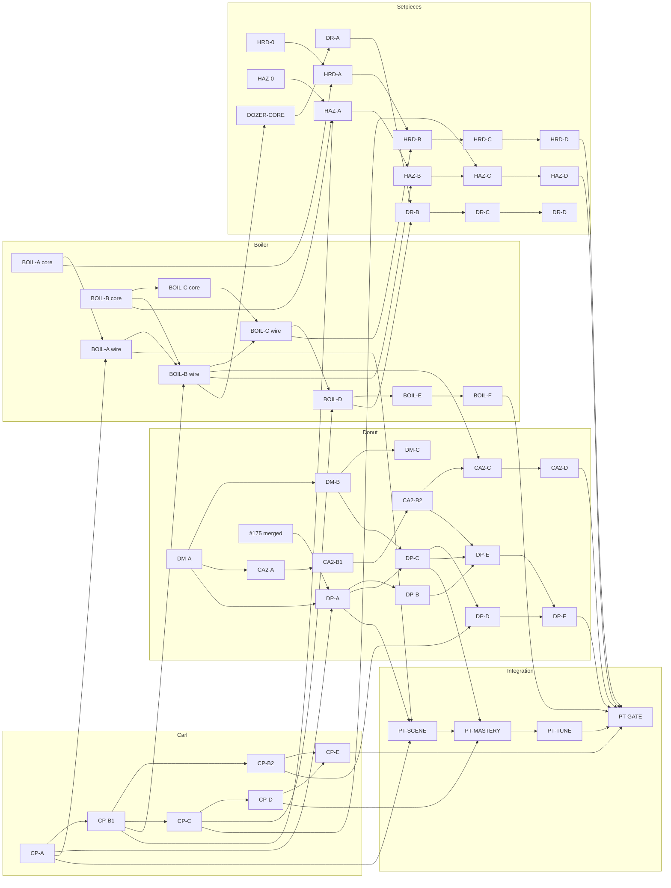

# F01-PLAYTEST-01: Floor 01 playtest integration plan

**Status:** integration plan (top-tier design integrator, 2026-11-21). Docs only; nothing here is implemented. It schedules work that the linked specs and work orders already define, plus a few new integration steps (prefixed `PT-`, `HRD-0`, `HAZ-0`, `DOZER-CORE`). Every adopted resolution below is an adopted default under the owner's design-defaults and speed-mode autonomy rules ([AGENTS.md](../../AGENTS.md)). Two questions are marked **owner-level** (section 2). Game feel stays the owner's call.

**Owner goal (2026-11-21):** "our goal here is to have a full implementation of donut and Carl for the new playtest, with all the abilities and powerful enemies". The owner opened two design PRs and wants work on them to start in parallel. [Fun over canon](../01-design/vision.md#fun-over-canon-owner-decision-2026-11-21) applies: gameplay wins, and each deviation is recorded as a game adaptation.

**Precedence:** legal and rights guardrails > accepted ADRs > the owner's newer explicit design text (#176, #178) > the merged character specs > this plan. This plan does not edit the owner's PR files or the backlog.

## 1. Inputs

| Work | Where | State on 2026-11-21 | Steps |
| --- | --- | --- | --- |
| DONUT-MOBILITY-01 (DM) | [spec](../03-tech/donut-mobility-01.md), [work order](donut-mobility-01-workorder.md) | Design merged (#173); **DM-A in implementation** on `feat/donut-mobility-dm-a` | DM-A, DM-B, DM-C (DM-ART, DM-RACK later) |
| COMPANION-AI-02 (CA2) | [spec](../03-tech/companion-ai-02-donut-autonomy.md), [work order](companion-ai-02-workorder.md) | Design merged (#172); waits for DM-A | CA2-A, CA2-B1, CA2-B2, CA2-C, CA2-D |
| CARL-PROG-01 (CP) | [spec](../03-tech/carl-prog-01-floor01-combat-progression.md), [work order](carl-prog-01-workorder.md) | Design merged (#174); **CP-A in implementation** on `feat/carl-prog-cp-a` | CP-A, CP-B1, CP-B2, CP-C, CP-D, CP-E |
| DONUT-PROG-01 (DP) | [PR #175](https://github.com/pando85/dungeon-floorbreak/pull/175), branch `design/donut-prog-01` | Design **in revision**: Light on Your Feet moves to the safe room after the first llama; Puddle Jumper stays on the Juicer's defeat | DP-A, DP-B, DP-C, DP-D, DP-E, DP-F |
| Goblin Boiler (BOIL) | [PR #176](https://github.com/pando85/dungeon-floorbreak/pull/176) (owner draft): `docs/01-design/floor-01-goblin-boiler-encounter.md`, `docs/07-agents/floor-01-goblin-boiler-workorder.md` | Design draft | BOIL-A, BOIL-B, BOIL-C, BOIL-D, BOIL-E, BOIL-F |
| Hoarder, Dozer revenge, Slimes and Rot Stickers | [PR #178](https://github.com/pando85/dungeon-floorbreak/pull/178) (owner draft): three encounter docs and `docs/07-agents/floor-01-memorable-setpieces-slate.md` | Design draft | Hoarder: HRD-A to HRD-D (the doc's five agent actions); Dozer: DR-A to DR-D; hazards: HAZ-A to HAZ-D; slate milestones SP-B0 to SP-B4 |
| Floor 01 progression bible | [floor-01-gameplay-progression-v0.md](../01-design/floor-01-gameplay-progression-v0.md) | Merged | M1 to M6 |
| Backlog rows | [backlog](../04-production/backlog.md): CHASE-01, NEXT-PLAYTEST, ENEMY-GAMEPLAY-ENGINEER | CHASE-01 not started; NEXT-PLAYTEST is a direction; Engineer merged (#168), game-feel pending | |

Merged gameplay used as is: CF02 rules (`--cf02`, microarena, contacts, morale), Bad Llama, Goblin Engineer (`--cf02-engineer`), the Juicer (`--scene boss_f01`), the biscuit and Magic Missile, PLAYTRACE recording and replay, AUTOPLAY. Art that exists but has no gameplay: HOARD-01, SLIME-01, ROT-01, DOZ-01, ENV-02.

## 2. Conflicts and adopted resolutions

| ID | Conflict | Adopted resolution | Owner-level? |
| --- | --- | --- | --- |
| K1 | CP-Q01 (Revision 2) grants dynamite in the room **before** the Hoarder's lair. #178 says three times, and #176 once, that dynamite is **post-Hoarder** ("not a dynamite tutorial", "no pre-Hoarder dynamite") | **Dynamite is granted on the Hoarder's defeat:** story trigger `pile_boss_f01_defeated` = `EnemyDefeated { target: PILE_BOSS_ID }`, with a placeholder zone until the Hoarder exists. The Boiler becomes the first dynamite room. This restores the owner's original anchor (#174's first draft) and is recorded as a **game adaptation** (fan summaries place the find before the Hoarder; the game moves it after so that the Hoarder stays a positioning fight). Data only: CP-A should ship this trigger id now. The CP-Q01, CP-Q08 and M3 text and the bible's M3 row follow in PT-DOC | No (owner informed) |
| K2 | #176 bounds chains at 3 authored links and one activation per prop; CP-Q34 caps charge chains at depth 4, +8 ticks and 8 per tick | Both apply. CP-Q34 is the engine cap. Prop-to-prop links carry the same depth counter. The encounter validator enforces ≤ 3 authored links in an acyclic graph. The drum is an authored `BlastCharge` with a world profile | No |
| K3 | CP-Q24 (no friendly fire) vs world hazards that hurt heroes (#176 steam, #178 Rot blast) | No friendly fire applies only to the **hero-owned dynamite profile**. World and enemy blasts and hazards hurt **every** hero by their own data, whoever triggered them; kill credit goes to the initiating player. CP-B1 adds `hero_damage` and `owner: Option` to `BlastProfile` | No (game-feel note) |
| K4 | #176 keeps the CP-02 baseline (enemy-to-enemy contact deals 0 damage); CF02-B (merged) knocks down, bowls and wall-slams for 1 | The playtest runs under `cf02_rules`. The #176 rule means **add** no new enemy-on-enemy damage. Prop impulse thresholds are tuned separately | No |
| K5 | #178 Dozer revenge proposes 150–195 px/s and no Donut invincibility. DOZ-01 and CHASE-01 propose 160 px/s and a Donut wheel exemption. Carl runs 185 px/s | Cruise ≤ **170 px/s** (data, inside the owner's range, never faster than Carl). **No Donut exemption**: DM-A's 207 px/s outruns any cruise, and the AI partner regroups | No |
| K6 | #176 and #178 speak of a "12-second dodge/reflect"; DM-B is a reflex **evade** (nothing is reflected) | DM-Q18 already classifies hazards, falling masses, blasts, boss blows, body contacts and any future source as **not evadable**: steam, weight, drum, Rot blast, slime acid, Hoarder blows, pile slide and Dozer wheel. An enemy design sheet may opt a single targeted attack in | No |
| K7 | The owner wants "all the abilities"; #176 and #178 forbid any move before its story unlock | **Story-progressive slice by default:** each room loads its story-correct pin, the Hoarder's defeat grants dynamite and the Juicer's grants the gauntlet and the blink, and the run ends in a mastery arena with everything. `--f01-loadout all` gives every capability in every room, labelled **TEST LOADOUT** (console, HUD notice, PLAYTRACE descriptor). It never runs in the story or demo routes | **Yes**: which loadout the owner's first session uses |
| K8 | Light on Your Feet reaches 128 px ledges (DP-Q18); the setpiece docs size their ledges for a pre-boost Donut and forbid unreachable firing nests | Every setpiece greybox is validated against a **boosted** Donut (apex 137.95 px) and Carl's 80 px class. A surface of 81–128 px that no enemy threatens is lowered to ≤ 80 px, or declared a Donut vantage with a counter | No |
| K9 | The #175 revision puts Light on Your Feet at the Act I refuge, which the Act I beats reserve for no major unlock "unless explicitly added after separate review" | Internal to #175; its revision is that review. No setpiece is affected | No |
| K10 | BOIL-E asks for approved workshop art. HAZ-D asks for native art review. The Hoarder needs a shove and pile props. HOARD-01 has one slam attack, no boiler prop art exists, and the ROT-01 tell is 30 ticks against a proposed 18–24 | Greybox props and code-drawn stand-ins are allowed in the playtest, labelled. Art orders run as a parallel track (section 4.6). The gameplay tell timing wins | **Yes**: may the first playtest ship greybox setpiece props |
| K11 | COMBAT-LAB-01 LAB-02 (`r03_collapsing_workshop`, `r04_pressure_chamber` placeholders) duplicates the Boiler | LAB-02 reuses the Boiler's prop and hazard core after BOIL-D. The lab profile keeps dynamite off (LAB-Q01, CP-Q05). The playtest gets its own scene, not the lab | No |
| K12 | #176 B3 offers an optional Bomb Bard, which has no gameplay | Cut. Use the Goblin Engineer | No |
| K13 | #176 and #178 forbid companion rewrites, yet the AI Donut must avoid steam, footprints, acid and the wheel | CA2-C's hazard feed consumes the Boiler's hazard core (active and telegraphed rectangles per tick). Until then this is a reported gap; the D1 last-HP guard covers solo | No |
| K14 | The Hoarder comes "after the Scatterer introduction"; Scatterers and rats have no gameplay | The slice starts at the Hoarder's lair. Scatterers and rats are deferred | No |

**CHASE-01 overlap:** CHASE-01 (the opening pursuit) and Dozer revenge need the same vehicle core (h120 collider, lethal wheel, hull push, cruise and charge states, keep-up rules). One **DOZER-CORE** step owned by CHASE-01 builds it once. DR-A becomes "revenge room on DOZER-CORE", and DR-B's stop frame uses BOIL-C's prop core. The K5 numbers apply to both.

## 3. Shared interfaces and their owners

Each interface is built **once**, by the step named here. Consumers read it or append data; they do not build a second one.

| Interface | Owner step | Owner files | Consumers | Contract |
| --- | --- | --- | --- | --- |
| Story-capability ledger, triggers, pins, snapshot | **CP-A** | `src/story_unlock.rs`, `assets/data/gameplay/story_unlocks_v0.json` | DP-A (rows, story-order check), HRD-A (the `pile_boss_f01_defeated` event row), PT-SCENE (room pins) | Grants only through ledger triggers; nothing hashed while empty |
| Circle/B special press and `SpecialStarted`, `SpecialRejected`, `SpecialReady` | **CP-B1** (DP-C reuses) | `src/thrown_charge.rs`, `src/combat.rs` (appended) | DP-C, CP-B2, DP-D | One special per hero |
| Explosions: `BlastProfile` (radii, launch, LOS, `hero_damage`, `owner: Option`, `breaks_structures`), chain depth, cap and dedupe, a generic `BlastTarget` hook | **CP-B1** (profile and policy), **CP-C** (chain and hook) | `src/blast.rs` | BOIL-C and BOIL-D (brace, drum), HAZ-A to HAZ-C (Rot Sticker), the Juicer | World and enemy blasts are data profiles; no second explosion module |
| Environmental props: a support or brace → weakened → released (warning) → falling → landed, and the valve `intact → warning → venting → spent`. Stimulus intake: distinct melee hit token with a per-move hit weight, launched-body impact (launch id, impulse), blast, prop contact. Swept landing footprint, one evaluation per victim, low remnant, reset, link graph | **BOIL-B** (valve and stimulus enum), **BOIL-C** (falling mass) | `src/env_prop.rs` (new) | HRD-B and HRD-C (piles J-A and J-B), DR-B (stop frame), LAB-02 | `src/shore.rs` and the boss rack strut stay as they are (goldens). The gauntlet's support-hit weight is a per-move value from CP-D that env props read |
| Hazard volumes: time-windowed contact areas (steam lane, acid patch, slide push, fall footprint, wheel), activation token per victim, team policy, telegraph window, class (always non-evadable), hero-hurt source | **BOIL-B** | `src/env_hazard.rs` (new) | HAZ (acid), HRD-B (slide), DOZER-CORE (wheel), CA2-C (nav feed of active and telegraphed rectangles), DP-C (blink rule 8) | Hurts heroes through the existing hero-hurt path with a new `HeroBlow` source; DM-Q18 applies |
| Launched body against a prop collider | **BOIL-D** | `src/combat_scene/contacts_cf02.rs` (prop as a contact target) | HRD-B (bait into a pile), DR-B | Reuses CF02-B launch instances; CP-Q36 dynamite launches qualify unchanged |
| Environmental defeat cause and attribution | **BOIL-B** | `src/combat.rs`: one appended `DefeatCause::Environment { player: Option<u32>, prop, class }` and an `EnvironmentKill` event; `src/death.rs` ladder arm | Every setpiece | The initiator travels with the stimulus through chains; blast kills keep `Explosion` |
| Tick slot for the env step and the new enemies | **BOIL-B** | one hook in `src/combat_scene.rs`, `src/combat_scene/env.rs` (new) | HRD, HAZ, DOZER-CORE | Order: … llamas, Engineer, **new enemies**, contacts, shore, boss, charges, **env props and hazards**, morale |
| Encounter data and gate validation: props, hazards, roster kinds, protected spawn, exit and checkpoint rectangles, story pin id, goal, link graph, height-gate classes, no-softlock and reachability for Carl (80 px), Donut (base, boosted 128 px) and 2P | **BOIL-A** | `src/encounter.rs` (new), `*.encounter.json` sidecars next to rooms in the existing `floor01-demo-hall-v1` schema | HRD, HAZ, DR, PT-SCENE | No second room parser; no `camera_lab/room.rs` edit while DM-A is open. DP-C keeps `blink_barriers` in the room file as designed |
| PLAYTRACE data pins and descriptor fields | **CP-A** (pattern) | `src/playtrace/{manifest,live,replay}.rs` | every step with a data file | Fields `serde(default, skip_serializing_if)`; no breaking schema change. Suggested: a `data_pins()` list so later steps append pins in their own module |
| HUD special socket | **CP-B2**, then DP-D | `src/hud.rs`, `hud_adapter.rs`, `hud_draw.rs` | | Setpieces add no HUD |
| Camera | **CA2-B2** only | `src/scene_camera.rs`, `src/camera_lab/camera_op.rs` | | Setpieces change no camera rule in v1 (#176: "stop at a testable proposal") |

## 4. Step catalogue and file ownership

Existing steps keep the files their work orders list. This table adds what this plan changes or what the setpiece docs leave unassigned. "Tier" follows [agent orchestration](agent-orchestration.md#model-tiers): design is top tier, execution medium, review an independent top tier.

### 4.1 Character steps (from the merged work orders)

| Step | Depends on | Owns (summary; full list in its work order) | Note from this plan |
| --- | --- | --- | --- |
| DM-A | main | `prototype.rs`, `party.rs`, `corridor.rs`, `follower.rs`, `companion/nav.rs`, `navfollow.rs`, `camera_lab/room.rs` (`ceiling_px`), `agility.rs`, the playtrace motion pins, **every golden where Donut moves** | In flight. The in-flight diff also touches `combat_scene/companion.rs` and `cf02.rs`. Every new party fixture in this plan is recorded **after** DM-A |
| DM-B | DM-A | `combat_scene.rs` evasion checks, `llama.rs` (`Glob::spawn_tick`), `combat.rs` events, `agility.rs` | Classification K6 |
| DM-C | DM-B | Donut presentation adapters, `docs/evidence/donut-mobility-01/` | |
| CA2-A | DM-A | `companion/autonomy.rs`, `engage.rs`, `profile.rs`, `companion_ai_v0.json`, the `corridor.rs` accessor | |
| CA2-B1 | CA2-A | `autonomy.rs`, `director.rs`, `navfollow.rs`, `events.rs` | May group with B2 |
| CA2-B2 | CA2-B1 | `combat_scene/companion.rs`, `party.rs`, `floor01_scene.rs` (`--companion cf02_free`), `playtrace/replay.rs`, camera files | |
| CA2-C | CA2-B2, **BOIL-B** (for real hazards) | `autonomy.rs`, `navfollow.rs` hazard input, `events.rs` | Consumes the hazard core's active and telegraphed rectangles (K13). If it lands before BOIL-B it ships the empty-list plumbing its work order allows |
| CA2-D | CA2-C | `docs/evidence/companion-ai-02/` | |
| CP-A | main | ledger, data files, `carl_prog.rs`, flags, playtrace pins | In flight. **Takes K1 now**: the dynamite trigger row is `pile_boss_f01_defeated` (placeholder zone until HRD-A) |
| CP-B1 | CP-A | `thrown_charge.rs`, `blast.rs`, `combat_scene.rs`, `goblin.rs`, `llama.rs`, `boss.rs`, `combat.rs` | **Adds `hero_damage` and `owner: Option` to `BlastProfile`** (K3), unused by the dynamite profile, so Rot Sticker and drum never reopen `blast.rs` |
| CP-B2 | CP-B1 | `combat_anim/`, `blast_art.rs`, HUD files, scene presentation | |
| CP-C | CP-B1 | `blast.rs` chain, `shore.rs`, `boss.rs`, `boss_scene.rs` pilot | **Makes the structure break a `BlastTarget` hook** (shore and rack strut implement it; BOIL-C's props implement it later) |
| CP-D | CP-C | `MoveSpec::pierces_commit`, the support-hit weight, `goblin.rs` and `engineer.rs` committed checks | The per-move support-hit weight is read by env props |
| CP-E | CP-D | `docs/evidence/carl-prog-01/` | |
| DP-A | #175 merged, CP-A, DM-A | `donut_prog.rs`, `donut_prog_v0.json`, rows in `story_unlocks_v0.json`, flags | |
| DP-B | DP-A | `corridor.rs` motion choice, `follower.rs`, `companion/nav.rs` | Parallel with DP-C |
| DP-C | DP-A, DM-B | `short_blink.rs`, `BodyDrive::warp_x`, `DonutMana::spend`, `combat_scene/donut.rs`, `blink_barriers` in the room loader | Blink rule 8 reads the hazard core when present |
| DP-D | DP-C, CP-B2 | HUD files, `donut_hud.rs`, `donut_art.rs` | |
| DP-E | CA2-B2, DP-B, DP-C | `companion/autonomy.rs` blink action, `companion_ai_v0.json` | Cut candidate (section 11) |
| DP-F | DP-D (DP-E if merged) | `docs/evidence/donut-prog-01/`, AUTOPLAY entries | |

### 4.2 Goblin Boiler (owner PR #176)

The owner's BOIL-A to BOIL-F stay as written. This plan splits BOIL-A, BOIL-B and BOIL-C into a **core** part (pure, Bevy-free, new files only, startable now) and a **wire** part (hot files, queued). The deliverables and acceptance are unchanged.

| Step | Depends on | Owns | Shared interface it delivers |
| --- | --- | --- | --- |
| BOIL-A core | #176 merged | `assets/levels/floor01/f01_boiler.room.json` (existing schema), `f01_boiler.encounter.json`, `src/encounter.rs` (loader, validator, reachability for Carl, base Donut, boosted Donut and 2P), `src/boiler_fixtures.rs` (headless only), the `lib.rs` mod lines | Encounter data and gate validation |
| BOIL-A wire | BOIL-A core, DM-A, CP-A | the `--scene f01_boiler` arm in `floor01_scene.rs`, the playtrace pin, one CI line | |
| BOIL-B core | #176 merged | `src/env_hazard.rs` (new), `src/env_prop.rs` (new: stimulus enum, valve machine), unit tests | Hazard volumes; prop stimuli |
| BOIL-B wire | BOIL-B core, BOIL-A wire, CP-B1 (queue on `combat_scene.rs`) | `src/combat_scene/env.rs` (new), one hook in `combat_scene.rs`, appended `DefeatCause::Environment`, `HeroBlow` source and events in `combat.rs`, the `death.rs` ladder arm | Tick slot, attribution |
| BOIL-C core | BOIL-B core | `src/env_prop.rs` (falling mass, swept landing, remnant) | Prop core |
| BOIL-C wire | BOIL-C core, BOIL-B wire | `combat_scene/env.rs`, `boiler_fixtures.rs` | |
| BOIL-D | BOIL-C wire, **CP-C** (blast hook), CP-B1 | `combat_scene/contacts_cf02.rs` (prop contact target), `env_prop.rs` (link graph, depth), the `BlastTarget` impl for props, the drum as data (an authored `BlastCharge` world profile) | Launched body against a prop |
| BOIL-E | BOIL-D, ART-BOIL (optional) | roster and staging data (Engineer as B3), `src/env_prop_art.rs` (new presentation, read-only), cue reuse | |
| BOIL-F | BOIL-E | `docs/evidence/f01-boiler/` | |

### 4.3 Hoarder (owner PR #178)

| Step | Depends on | Owns | Tier |
| --- | --- | --- | --- |
| HRD-0 Hoarder gameplay design sheet (new, like ENEMY-GAMEPLAY-ENGINEER #162): close swipe on the HOARD-01 slam frames, the committed displacement attack (shove), punish recovery, hurtboxes, HP and poise, exposure state, the pile bait rules, non-evadable class (K6), the ledge rule (K8), the `pile_boss_f01_defeated` event | #178 merged | `docs/01-design/enemy-gameplay-hoarder.md` (new) | Top tier |
| HRD-A room and direct fight | HRD-0, BOIL-A core (schema), DM-A (fixtures) | `src/pile_boss.rs` (new), `assets/data/gameplay/enemy_pile_boss_v0.json` (new), `assets/levels/floor01/f01_hoarder.room.json` and `.encounter.json`, `src/hoarder_fixtures.rs`, the trigger row swap from placeholder to event in `story_unlocks_v0.json`, the scene arm (queued) | Medium |
| HRD-B J-A slide and one physical cause | HRD-A, BOIL-B wire, BOIL-C wire | data in the sidecar, bait logic in `pile_boss.rs` | Medium |
| HRD-C J-B collapse finisher and exposure | HRD-B | sidecar data, `pile_boss.rs` | Medium |
| HRD-D human tuning and evidence | HRD-C | `docs/evidence/f01-hoarder/` | Medium |

### 4.4 Slimes and Rot Stickers (owner PR #178)

| Step | Depends on | Owns | Tier |
| --- | --- | --- | --- |
| HAZ-0 Slime and Rot Sticker gameplay design sheet: state machines, tells (the gameplay tell wins over ROT-01's 30 ticks), Rot blast as a `BlastProfile` (`owner: None`, `hero_damage` all heroes, 1 HP, radius 40–56), the acid patch as a hazard volume, the non-evadable class | #178 merged | `docs/01-design/enemy-gameplay-slime-rot.md` (new) | Top tier |
| HAZ-A isolated prototypes | HAZ-0, CP-B1 (profile fields), BOIL-B core | `src/slime.rs`, `src/rot_sticker.rs` (new), `enemy_slime_v0.json`, `enemy_rot_sticker_v0.json`, `src/hazards_fixtures.rs`, `f01_hazards.room.json` and `.encounter.json` | Medium |
| HAZ-B tells, contact, classification | HAZ-A, BOIL-B wire | the same modules; presentation stand-ins | Medium |
| HAZ-C mixed pocket and collateral | HAZ-B, CP-C (chain) | sidecar data, fixtures | Medium |
| HAZ-D art review, 2P, human play | HAZ-C | `docs/evidence/f01-hazards/` | Medium |

### 4.5 Dozer (CHASE-01 and owner PR #178), stretch

| Step | Depends on | Owns |
| --- | --- | --- |
| DOZER-CORE (top-tier design note reconciling the DOZ-01 section 9 proposals with DR and K5, then medium execution) | DM-A, BOIL-B wire (wheel as a hazard volume) | `src/dozer.rs` (new), `assets/data/gameplay/enemy_dozer_v0.json` (new), `src/dozer_fixtures.rs` |
| DR-A revenge escape room | DOZER-CORE | `f01_dozer_revenge.room.json` and `.encounter.json` |
| DR-B stop frame | DR-A, BOIL-C wire, BOIL-D | sidecar data, the disable state in `dozer.rs` |
| DR-C crew aftermath | DR-B | sidecar roster |
| DR-D timing, evidence, human play | DR-C | `docs/evidence/f01-dozer-revenge/` |

### 4.6 Art track (parallel, optional for the first playtest, see K10)

Through the [pixel-art pipeline](pixel-art-pipeline.md#routing-by-difficulty): top-tier keys and spec, medium-tier execution, independent top-tier review, merge under the art delegation.

| Order | Content | Unblocks |
| --- | --- | --- |
| ART-BOIL | Valve (four states), brace and hanging weight with the landed remnant, the drum, the boiler backdrop on the ENV-01 kit | BOIL-E presentation |
| HOARD-02 | The Hoarder's shove keys; the pile props (the HOARD-01 follow-up) | HRD-B, HRD-C presentation |
| AREA-HAZARDS-01 | Acid patch and corrosion, the Rot tell marker | HAZ-B presentation |
| `burst_large`, blink keys, visible gauntlet | Already listed as later orders by CP and DP | CP-B2 and DP-D polish |

### 4.7 Integration steps (new)

| Step | Depends on | Owns | Tier |
| --- | --- | --- | --- |
| PT-DOC (orchestrator, docs only) | #178 merged | CP-Q01, CP-Q08 and the M3 rows in the CARL-PROG spec; the bible's M3 row (K1); the horizon change-record row | Orchestrator |
| PT-SCENE: `--scene f01_late` | CP-A, DP-A, BOIL-A wire | `src/f01_late.rs` (new: room list, per-room story pins, `--f01-room`, `--f01-loadout`, room-to-room transition as `--lab-next` does, one attempt and one PLAYTRACE session per room), `assets/levels/f01_late/manifest.json` (new), the arg arm in `floor01_scene.rs`, descriptor fields `f01_room` and `f01_loadout`, `src/f01_late_fixtures.rs` | Medium |
| PT-MASTERY: the closing arena | PT-SCENE, CP-D, DP-C | `assets/levels/f01_late/mastery.encounter.json` on the `cf02_microarena` geometry with the CF02-F wave contract; the Juicer as a linked room | Medium |
| PT-TUNE: the "powerful enemies" pass | PT-MASTERY, the setpieces that landed | Data only: wave rosters and compositions in the sidecars and in the AUTOPLAY scenarios. Difficulty comes from composition, not HP (#178): at least two overlapping threats per wave, an Engineer with a llama, goblin temperaments, the Juicer with full kits | Top-tier design note, medium execution |
| PT-GATE: evidence and owner packet | everything in the gate (section 10) | `docs/evidence/f01-playtest/` (README handoff, scorecard), the `f01_late` section of `docs/03-tech/floor01-scene.md` | Medium execution, independent top-tier review |

## 5. Dependency graph and waves



The waves assume each step merges before the next wave starts. A wave's steps run in parallel because they own disjoint files. Where two steps share a hot file, the queue in section 7 orders them.

| Wave | Starts when | Steps (parallel) |
| --- | --- | --- |
| **W0** (in flight) | now | DM-A, CP-A (with K1's trigger row); design review and merge of #175, #176, #178 and this plan |
| **W1** (start now) | #176 and #178 merged as designs (their docs and code fences are not touched) | **BOIL-A core**, **BOIL-B core**, **HRD-0**, **HAZ-0**, PT-DOC, the DOZER-CORE design note (stretch), art key design for ART-BOIL, HOARD-02 and AREA-HAZARDS-01 (optional) |
| **W2** | DM-A and CP-A merged | DM-B, CA2-A, CP-B1, DP-A (once #175 merges), BOIL-A wire, BOIL-C core, HRD-A |
| **W3** | W2 merged | CP-B2 and CP-C, DP-B and DP-C, CA2-B1 (or B1 grouped with B2), DM-C, BOIL-B wire, HAZ-A, PT-SCENE (first rooms: Boiler greybox, Juicer, CF02 arena) |
| **W4** | W3 merged | CP-D, DP-D, CA2-B2 (if not grouped), BOIL-C wire, HRD-B, HAZ-B, DOZER-CORE (stretch), PT-MASTERY |
| **W5** | W4 merged | CP-E, DP-E, CA2-C, BOIL-D, HRD-C, HAZ-C, DR-A and DR-B (stretch) |
| **W6** | W5 merged | DP-F, CA2-D, BOIL-E, HRD-D, HAZ-D, DR-C, PT-TUNE |
| **W7** | the gate list of section 10 | BOIL-F, DR-D (stretch), **PT-GATE** |

**Startable now without any conflict with DM-A or CP-A:** BOIL-A core, BOIL-B core, HRD-0, HAZ-0 and PT-DOC. They touch only new files, design docs and one `lib.rs` mod line each, and they record no party golden. The art key designs are also startable, as an optional parallel track. BOIL-A core and BOIL-B core start once #176 merges as a design; HRD-0 and HAZ-0 once #178 does. Until then they can be drafted on branches.

## 6. Critical path

Counted in PR cycles. Each step is one PR, reviewed and merged.

- **Path 1, the Carl and Boiler path:** CP-A → CP-B1 → CP-C → BOIL-D → BOIL-E → BOIL-F → PT-GATE (7). It holds only if BOIL-A, B and C (core and wire) are done by the time CP-C merges. That is why the two core steps start in W1.
- **Path 2, the AI partner path:** DM-A → CA2-A → CA2-B1 → CA2-B2 → DP-E → DP-F → PT-GATE (7).
- The two paths are **co-critical**: a slip on either delays the gate.
- **Shortening:**
  - group CA2-B1 with CA2-B2, and BOIL-E with BOIL-F (both work orders allow grouping): 6 cycles each;
  - keep CP-B1 whole, not split into B1a and B1b;
  - cutting DP-E (section 11) leaves Path 1 as the only critical path.
- **Near-critical:** HRD-0 → HRD-A → HRD-B → HRD-C → HRD-D, which waits on BOIL-C wire for HRD-B.

## 7. Hot-file merge queue

Each step only **appends** (variants, hooks, rows) and rebases on the step ahead of it. A PR that finds a queued file owned by an open PR stops and reports.

| File | Order |
| --- | --- |
| `src/bin/floor01_scene.rs`, `src/playtrace/{manifest,live,replay}.rs`, `scripts/ci_floor01_combat.sh` | DM-A → CP-A → DP-A → BOIL-A wire → CA2-B2 → HRD-A, HAZ-A scene arms → PT-SCENE |
| `src/combat_scene.rs`, `src/combat.rs` | CP-A → DM-B → CP-B1 → BOIL-B wire (one hook) → CP-C → DP-B, DP-C → CP-D |
| `src/blast.rs` | CP-B1 → CP-C (no other step edits it) |
| `src/shore.rs`, `src/boss.rs` | CP-B1 → CP-C → CP-D (setpieces never edit them) |
| `src/combat_scene/contacts_cf02.rs` | BOIL-D only |
| `src/camera_lab/room.rs`, `layout.rs` | DM-A → DP-C (`blink_barriers`); setpieces use sidecars |
| HUD files | CP-B2 → DP-D |
| `src/companion/**` | DM-A → CA2-A → CA2-B1 → CA2-B2 → CA2-C → DP-E |
| `src/lib.rs` | anyone (mod lines only; trivial rebase) |

Golden discipline: DM-A re-pins every golden where Donut moves. **No setpiece or PT fixture is recorded before DM-A merges.** After that, every existing golden is byte-identical in every PR, as the CP and DP work orders already require.

## 8. Playtest slice

**Shape:** a late-Floor-1 run in one new scene, `--scene f01_late`, which implies `cf02_rules`. Rooms in story order, each a separate attempt with its own checkpoint, its own PLAYTRACE session and its own story pin. The room list is data (`assets/levels/f01_late/manifest.json`), and a room is listed only once it has landed.

| # | Room | Pin at entry (story loadout) | Grants in play | Enemies | Available from |
| --- | --- | --- | --- | --- | --- |
| 1 | Hoarder's lair (HRD) | biscuit, Light on Your Feet | **dynamite** on the Hoarder's defeat (K1) | the Hoarder, then the pile states | HRD-A (direct fight); HRD-C (collapse) |
| 2 | Goblin Boiler (BOIL) | + dynamite | | goblins (temperaments), the Engineer as B3 | BOIL-A wire (greybox); BOIL-D (chains) |
| 3 | Dozer revenge (DR), stretch | + dynamite | | the Dozer, then its crew | DR-A |
| 4 | The Floor Lies (HAZ) | + dynamite | | slime, Rot Stickers, a goblin | HAZ-A (isolated pockets); HAZ-C (crossover) |
| 5 | The Juicer (`boss_f01`) | + dynamite | **gauntlet and Puddle Jumper** on the Juicer's defeat | the Juicer | CP-A, DP-A pins |
| 6 | Mastery arena (PT-MASTERY) | everything | none (final-boss rule: no trigger) | mixed waves: goblins of three temperaments, two llamas, the Engineer, a slime and Rot Stickers if landed; overlapping threats | PT-MASTERY |

**Loadouts:** `story` (default, see K7) or `all` (every capability in every room, labelled TEST LOADOUT).

**Modes:**
- **Solo:** P1 starts as Carl and L1 swaps heroes.
  - When P1 plays Carl, the partner Donut is the CA2 AI (`--companion cf02_free`, the scene's default).
  - When P1 plays Donut, Carl is AI-driven by the existing assist and follower. AI Carl never throws dynamite (CP-Q29); the gauntlet applies to his punches.
- **2P:** a second pad presses Start; P1 plays Carl and P2 plays Donut.

The modes are identical in route and rules (#176 BOIL-09, #178 HOARD-08 and HAZ-09).

**Fallback slice** if the setpieces are late: rooms 5 and 6 plus the CF02 arena with the Engineer. This needs only CP, DP, DM, CA2 and PT-SCENE and still shows every ability and the strongest enemies on main.

## 9. Flags and commands for the owner

**Target (after PT-SCENE):**

```text
cargo run --release --bin floor01_scene -- --scene f01_late --scale 2
    [--f01-room hoarder|boiler|dozer|hazards|juicer|mastery]   # jump to a room with its story pin
    [--f01-loadout story|all]                                   # all = TEST LOADOUT
    [--companion cf02_free|cf02_assist]                         # AI partner profile (default cf02_free)
    [--debug-combat] [--no-record]                              # recording is on by default (PLAYTRACE)
tools/record-run.sh floor01_scene --scene f01_late --scale 2    # window video plus audio
```

2P: connect a second pad and press Start. Select restarts the room; Start on P1 quits.

**Interim builds (each line works once its steps merge):**

| After | Command | What the owner can judge |
| --- | --- | --- |
| now | `--cf02 --cf02-engineer --donut-biscuit` | today's base, with the Engineer |
| DM-A, DM-B | the same | agile Donut and the 12 s reflex |
| CP-B1 | `--cf02 --cf02-engineer --donut-biscuit --carl-dynamite` | dynamite feel, launches, self-damage |
| CA2-B2 | add `--companion cf02_free` | the autonomous AI partner |
| CP-D, DP-C | `--cf02 --cf02-engineer --carl-dynamite --carl-gauntlet --donut-puddle` (implies Light on Your Feet and the biscuit) | the full kits in the arena |
| CP-A, DP-A | `--scene boss_f01 --carl-prog --donut-prog` | the Juicer with dynamite, and the gauntlet and blink grants |
| BOIL-A wire to BOIL-D | `--cf02 --scene f01_boiler --carl-dynamite --donut-biscuit` (exact entry per BOIL-A) | the Boiler setpiece |

## 10. Evidence and acceptance gate: "playtest ready"

PT-GATE declares the build playtest-ready only when **every** item holds on one final head with green CI. Anything not run is listed as **NOT RUN**, never implied.

1. **Carl complete:**
   - CP-A, CP-B1, CP-B2, CP-C and CP-D are merged, and CP-E's evidence is committed;
   - dynamite (throw, ring, LOS, self-damage, chains, structure breaks) and the gauntlet (stagger, pierce, poise, support weight) work in `f01_late`.
2. **Donut complete:**
   - DM-A, DM-B, DM-C, DP-A, DP-B, DP-C and DP-D are merged, and DP-F's evidence is committed;
   - agile motion, the reflex, Magic Missile, Light on Your Feet and Puddle Jumper work for human P1, P2 and the AI;
   - CA2-A to CA2-C are merged (the AI partner, including the hazard feed);
   - DP-E is merged, or listed as cut.
3. **Content:**
   - `f01_late` launches every listed room through `--f01-room`;
   - the story loadout run emits exactly one `CapabilityGranted` for dynamite at the Hoarder's defeat, and one each for the gauntlet and the blink at the Juicer's defeat, visible in the PLAYTRACE journal;
   - the minimum room set is rooms 2 (BOIL-D level), 5 and 6, plus at least one of rooms 1 and 4 at slate milestone SP-B2. Any other room is either listed with its honest milestone or not listed.
4. **Goldens and determinism:**
   - every golden named in the CP and DP work orders is byte-identical, except DM-A's intended re-pin;
   - every new fixture has a committed final hash and replays twice, headless and in the render loop;
   - one recorded live session per room verifies strict with PLAYTRACE.
5. **Encounter safety:**
   - each setpiece passes its direct-route scenario with props untouched (BOIL-01, HOARD-02, HAZ-06, DOZR-01);
   - each setpiece passes its no-softlock and reachability validator for Carl, base Donut, boosted Donut and 2P, in every authored destruction state;
   - AUTOPLAY clears every room in solo Carl, solo Donut (by swap) and with the companion, at seeds 0..8, with no hero stuck more than 300 ticks.
6. **Fairness checks:**
   - no hazard is evadable (K6 fixtures);
   - world blasts hurt both heroes and the dynamite never hurts Donut (K3 fixtures);
   - no 81–128 px nest (K8 validator);
   - the Dozer never outruns Carl (K5, if DR is listed).
7. **Evidence** (real Bevy, 640x360 and 640x400, 1x):
   - one at-speed GIF per ability;
   - per setpiece, the direct, tactical and spectacular routes;
   - the two grant moments;
   - a mastery-arena wave;
   - frame time with gore preset 4 in the mastery arena and in the Boiler's full chain (`--perf-frames`);
   - a real two-pad 2P run of at least one room, or **NOT RUN**.
8. **Owner packet** (`docs/evidence/f01-playtest/`):
   - launch commands (section 9), what to look for per room, the adopted-defaults table (K1 to K14) and the two owner-level questions;
   - a scorecard per room: deaths, restarts, time, throws, chains, pierces, blinks, evades, AI partner metrics M1 to M16, and a rating line for "powerful enemies";
   - the known-gaps list.
9. **Review:** an independent top-tier review of PT-GATE (and of each PR, as usual). Game feel stays **pending** until the owner plays; nothing is marked accepted.

## 11. Cut and defer list (in cutting order if time is short)

1. **Dozer revenge** (DOZER-CORE, DR-A to DR-D) and the CHASE-01 opening chase. The whole track is deferred, and room 3 is not listed.
2. **Boiler drum (P3), the boiler presentation polish, the Bomb Bard:** BOIL-E's optional parts.
3. **Production art:** ART-BOIL, HOARD-02, AREA-HAZARDS-01, `burst_large`, the blink keys and the visible gauntlet ship as stand-ins (owner-level, K10).
4. **DP-E (the AI uses the blink):** the AI Donut never blinks, while humans do.
5. **CA2-C Perch and Show-off.** CA2-C's hazard feed is **not** cut. CA2-D's optional overlay is also cut.
6. **HAZ-C crossover:** keep the isolated slime and Rot pockets. Or drop room 4 if HAZ-A slips.
7. **HRD-C collapse finisher:** keep the direct fight and the J-A slide.
8. **In-scene room transitions:** fall back to `--f01-room` launches with per-room pins.

**Never cut:** CP-A to CP-D, DM-A, DM-B, DP-A to DP-C, CA2-A to CA2-B2, the Juicer and the mastery arena, golden and determinism discipline, PLAYTRACE recording, and the no-softlock validators.

**Deferred, not part of this playtest:**
- the audience in live play and REWARDS-01 (NEXT-PLAYTEST items 2 and 4);
- Scatterers and rats;
- TERRAIN-L1 breakable route solids (CP-Q37 rows stay disabled);
- AI Carl throwing dynamite;
- the Ball of Swine arena;
- the cross-session campaign save;
- the post-dynamite combat-lab profile.

## 12. Horizon fit, tone and rights

- **Horizon:** consulted [the progression horizon](../01-design/character-progression-horizon.md). The plan adds no verb, button or unlock beyond CP, DP and DM. K1 moves the dynamite anchor back to the Hoarder's defeat, the owner's original request. PT-DOC adds the change-record row (a game adaptation under Fun over canon). The direction is unchanged.
- **Tone:** the [antihero tone](../01-design/antihero-tone.md) applies to every setpiece. The Hoarder is a transformed woman, never comedy. Spectacle stays authored by the player, not cinematic.
- **Rights:** no new art, text or third-party assets in this plan. The setpieces are original adaptations, and the slate and the encounter docs already say so.

## 13. Owner questions (only these)

1. **K7:** should the first session use the story-progressive loadout (default) or `--f01-loadout all` from the start?
2. **K10:** may the first playtest ship with greybox setpiece props and stand-in VFX (default: yes, labelled; art orders run in parallel)?

The owner is also informed that K1 restores "dynamite after the Hoarder" from the owner's own request and from #178, and records it as a game adaptation.
