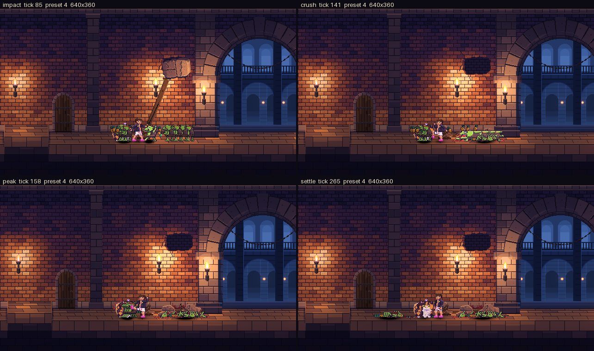
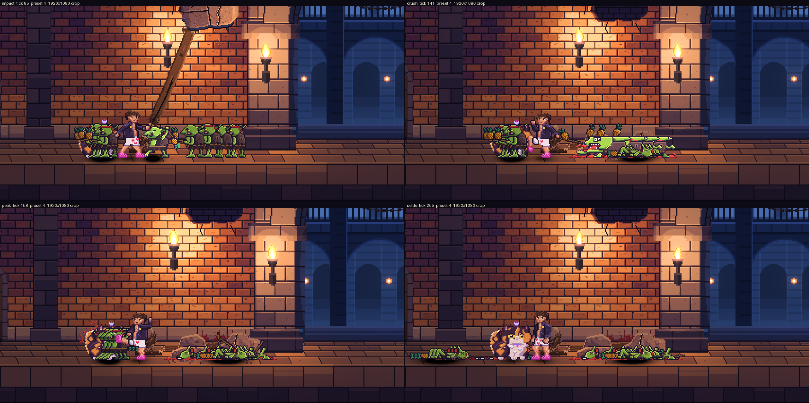

# DEATH-E1 evidence: intensity-4 goblin validation and first measured budgets

**Status:** measured and captured, **nobody has judged the look or the feel yet** (owner game-feel review and independent review pending). Everything here was measured on a **development machine, not on the Steam Deck**: no Steam Deck figure, no Deck-verified claim and no lower-spec measurement exists. Design and behaviour: [DEATH-E1 in the floor 01 scene doc](../../03-tech/floor01-scene.md#death-e1-goblin-validation-and-budgets).

## What was measured, and on what

| | |
| --- | --- |
| CPU | AMD Ryzen 9 5950X (16 cores, 32 threads), 64 GB RAM |
| GPU | NVIDIA GeForce RTX 4060 Ti 16 GB, Vulkan (driver 615.71), drawing into an Xvfb virtual display |
| Build | `cargo build --locked --release` (the default release profile, rustc 1.100, Bevy 0.20.1), `floor01_scene` |
| Display | Xvfb, 640x360 (`--scale 1`) and 1920x1080 (`--scale 3`), lighting on, `AutoNoVsync` |
| Load | a shared machine: other builds ran now and then (load average 4 to 10 during the runs, see the raw files) |

Scenario: the new fixture `cp03_goblin_pileup` (a presenter stress scenario, not a gameplay design). Ten stationary goblins (five of them goblin variant B) are defeated by three causes inside 65 ticks: three jab defeats on tick 83, four shore-block crushes on tick 139 and three lethal kicks on tick 148. At preset 4 that draws, without any pool limit, a peak of **128 launched pieces, 130 floor decals and 18 wall spatters** and 238 visible death sprites. `--death-stress` additionally keeps every pool completely full (synthetic crushes and decapitations every third tick, recycled thousands of times), which is the max-load row.

The probe (`--perf-from-tick 70 --perf-frames 600`, driven by `scripts/measure_death_e1.py`) steps exactly one fixture tick per measured frame after a 120-frame warm-up, so every run covers the same deaths whatever the frame time. Three runs per row; the table gives the median of the runs (maximum of the maxima).

### How to read the frame interval

The wall-clock frame interval under Xvfb says very little about cost: at 640x360 it is pinned to 16.67 ms (a 60 Hz pacing of the virtual display, even with the present mode set to no-vsync), and at 1920x1080 it is about 60 ms in **every** row, including the scene with nobody dying, because the present path copies the whole frame through the X server on the CPU. Read it only as "no frame was missed because of the deaths". The cost of the presentation is read from timers inside the process:

* **GPU ms**: the sum of the render passes Bevy times with Vulkan timestamp queries (the 2D opaque and transparent passes, auxiliary views and the upscaling). The custom lighting pass has no timer, so this is the sprite part only, which is the part the death pieces change.
* **tick us**: CPU time of one fixture tick (simulation, animation and the death presenter) in microseconds.
* **sprite sync us**: CPU time of the system that moves the pre-spawned death sprites.

### Results at the budgets of this PR (parts 256, floor decals 192, wall decals 32)

Source: [perf_table.md](perf_table.md) and the raw lines in [perf_raw.txt](perf_raw.txt).

| Resolution | Scenario | frame ms mean / p95 / max | GPU ms mean / p95 | tick us mean / max | sprite sync us mean / max | RSS MiB | peak parts / floor / wall / visible sprites | recycled (parts, floor, wall) |
| --- | --- | --- | --- | --- | --- | --- | --- | --- |
| 640x360 | baseline, nobody dies | 16.67 / 18.10 / 20.67 | 0.016 / 0.019 | 8.0 / 26 | 6.5 / 60 | 418 | 0 / 0 / 0 / 0 | 0, 0, 0 |
| 640x360 | pileup, preset 1 | 16.66 / 18.57 / 50.90 | 0.016 / 0.019 | 12.7 / 112 | 9.0 / 77 | 416 | 4 / 0 / 0 / 8 | 0, 0, 0 |
| 640x360 | pileup, preset 4 | 16.67 / 18.69 / 43.52 | 0.016 / 0.019 | 15.9 / 129 | 15.2 / 74 | 420 | 128 / 130 / 18 / 238 | 0, 0, 0 |
| 640x360 | pileup + pools full, preset 1 | 16.67 / 18.48 / 48.31 | 0.016 / 0.019 | 24.9 / 192 | 13.8 / 117 | 417 | 227 / 0 / 0 / 231 | 0, 0, 0 |
| 640x360 | pileup + pools full, preset 4 | 16.67 / 18.55 / 44.47 | 0.016 / 0.019 | 48.2 / 1040 | 24.6 / 163 | 413 | 256 / 192 / 32 / 606 | 1814, 2495, 442 |
| 1920x1080 | baseline, nobody dies | 63.59 / 70.31 / 99.24 | 0.050 / 0.065 | 11.0 / 46 | 8.1 / 74 | 431 | 0 / 0 / 0 / 0 | 0, 0, 0 |
| 1920x1080 | pileup, preset 1 | 61.41 / 66.12 / 74.24 | 0.049 / 0.053 | 15.0 / 132 | 9.8 / 63 | 432 | 4 / 0 / 0 / 8 | 0, 0, 0 |
| 1920x1080 | pileup, preset 4 | 58.52 / 66.27 / 137.46 | 0.114 / 0.205 | 11.6 / 146 | 11.7 / 102 | 433 | 128 / 130 / 18 / 238 | 0, 0, 0 |
| 1920x1080 | pileup + pools full, preset 1 | 57.18 / 63.08 / 86.73 | 0.089 / 0.173 | 16.0 / 103 | 11.9 / 67 | 432 | 227 / 0 / 0 / 231 | 0, 0, 0 |
| 1920x1080 | pileup + pools full, preset 4 | 57.08 / 63.48 / 78.33 | 0.105 / 0.227 | 40.6 / 321 | 21.1 / 149 | 437 | 256 / 192 / 32 / 606 | 1814, 2495, 442 |

Entities: 3924 with nobody dying, 3942 in the other rows (the death sprites are pre-spawned hidden and reused, nothing is spawned at runtime). Peak resident memory was 419 to 437 MiB in every row, **at most about 6 MiB above the scene with nobody dying** in the same resolution. "Pools full" rows recycle thousands of pieces by design: that is the stress, not a loss.

Reading: at preset 4 in the worst case the deaths cost under 0.15 ms of GPU time on this card, about 40 microseconds of CPU per tick with every pool full (0.25 percent of a 16.7 ms frame) and a few MiB. Nothing was missed. The maxima (isolated CPU spikes of 100 to 1000 microseconds and frame-interval spikes of 40 to 140 ms) also appear in rows with nobody dying or at preset 1, on a machine that was shared with other builds, so they are not attributed to the deaths; three runs per row cannot settle it, and a quieter machine should repeat the probe.

### Before the budgets (160 / 96 / 12, oldest-first recycling)

The same probe on the build before this PR's budget change ([perf_before_table.md](perf_before_table.md), [perf_before_raw.txt](perf_before_raw.txt); the three melee groups of the fixture stood a few pixels differently, the same ten defeats). The cost was equally small (GPU 0.016 to 0.05 ms, tick 10 to 32 us, sync 27 to 36 us, RSS 404 to 424 MiB), but the pileup at preset 4 **ran out of pool**: it recycled 34 floor decals and 6 wall spatters before their time to live (peaks 96 of 96 and 12 of 12). Decals of the first deaths were being taken back while still fresh and, being oldest-first, a corpse's blood pool could go before the splats around it. That is what the new budgets fix, not a cost problem.

## The budgets

All are fields of `DeathBudget` in `src/death_present.rs` (`DEATH_BUDGET`), tested in `death_present::tests`.

| Budget | Before | Now | Why |
| --- | --- | --- | --- |
| launched parts, gibs and drops | 160 | **256** | the pileup needs 128 at preset 4 (2.0 x margin); 256 full cost 40 us CPU per tick |
| floor decals (a two-cell pool is one entry) | 96 | **192** | the pileup needs 130 (1.5 x); the old 96 recycled 34 early |
| wall spatters | 12 | **32** | the pileup needs 18 (1.8 x); the old 12 recycled 6 early |
| death scripts alive at once | 24 | **48** | real defeats keep their script and pose until the room restarts, so a larger fight must not run out; the fixtures have at most 10 goblins |
| time to live (long / short, then fade) | 360 / 30 and 120 / 12 ticks | unchanged | the live count they allow (128 parts at the peak) fits the pools with margin; nothing measured asks for a change |
| drop splats and part stains per death | 8 and 6 | unchanged | spec section 8 |

**Intensity is not lowered anywhere**: preset 4 draws exactly what it drew (the tests pin it; the budget only grows). What a budget may do is cap recycling: a full pool now recycles by time-to-live class first (short pieces such as blood drops and gibs, then long ones such as splats and limbs, then kept ones such as the head, the torso, the club, blood pools, smears and wall spatters), oldest first within a class. A fresh drop therefore never evicts a corpse's pool, and the pileup recycles nothing at all.

The budgets are first measured values from one development machine. They are **not** a Steam Deck figure and must be re-measured on a Deck-class machine; the probe commands below do that unchanged.

## Variant B

Goblins with an odd index (the same parity as the GOB-01 atlases) are variant B: their death poses and parts come from the GOB-02B-DEATH sheets (the same frames, pivots, anchors and part ids plus the `accessory` layer: bandana, ear notch, vest patch), and every piece launched by their death is drawn from the B parts sheet. The accessory is not gore, so it is drawn at preset 1 too (art ruling 13.1a). The pileup has five B goblins (indices 1, 3, 5, 7, 9).

## Captures: Carl and Donut next to the debris

Real `floor01_scene` captures (xvfb, the real render loop, lighting on, one frame per tick), preset 4, ticks 70 to 269 of `cp03_goblin_pileup`; the final `COMBAT_STATE` of each run equals the headless replay (the script fails otherwise).

| File | Content |
| --- | --- |
| [sheet_pileup_p4_640x360.png](sheet_pileup_p4_640x360.png) | the four moments at the native 640x360 |
| [sheet_pileup_p4_actors_1920x1080.png](sheet_pileup_p4_actors_1920x1080.png) | crops of the same four moments at 1920x1080 around Carl, Donut and the gore |
| `still_pileup_impact_1920x1080.png`, `still_pileup_crush_1920x1080.png`, `still_pileup_peak_1920x1080.png`, `still_pileup_settle_1920x1080.png` | the full 1920x1080 frames: impact (tick 85, the jab defeats), crush (141, the block lands), peak gore (158, kick defeats on top of the crush) and settle (265) |
| `pileup_p4_640x360_60fps.mp4`, `pileup_p4_1920x1080_60fps.mp4` | every tick, 60 fps = real time |





Silhouette check, from the captures and the draw-order tests: **Carl stays readable in all four moments at both resolutions** (he is drawn above every piece of debris, floor decal and wall spatter: debris sits 0.4 and decals 0.5 under the actor layer, unit-tested against every actor offset of the scene) and his outline is never lost against the red and the green. At the 640x360 size the ten-goblin pile reads as a pile, not as individual goblins, which is expected at 1x. **Donut is readable except while living or airborne goblin bodies are in front of her**: in the peak frame the three launched goblins (the GOB-01 knockback sprites, an existing actor order, not debris) are drawn over her for a few ticks. The debris and decals themselves never cover her. This is a note for the owner, see the design questions in the PR.

## Reproduce

```text
bash scripts/export_assets.sh
cargo build --locked --release --bin floor01_scene
python3 scripts/measure_death_e1.py        # the probe matrix: perf_raw.txt and perf_table.md (about 25 minutes)
python3 scripts/make_death_e1_evidence.py  # the captures and the sheets (needs xvfb-run, ffmpeg, Pillow)
```

One probe by hand (needs `xvfb-run`):

```text
xvfb-run -a -s "-screen 0 1920x1080x24" ./target/release/floor01_scene --scale 3 --fixture cp03_goblin_pileup --gore-preset 4 --perf-from-tick 70 --perf-frames 600
xvfb-run -a -s "-screen 0 1920x1080x24" ./target/release/floor01_scene --scale 3 --fixture cp03_goblin_pileup --gore-preset 4 --perf-from-tick 70 --perf-frames 600 --death-stress
```

The headless replay of the new fixture and its presets: `./target/release/floor01_scene --headless-floor01-smoke --fixture cp03_goblin_pileup --gore-preset 1` (and 2, 3, 4) all end in `hash=43d9d35a23344531`; `bash scripts/ci_floor01_combat.sh headless` checks it with every other fixture.

## Rights/Provenance

Code, probe, fixture, documentation and evidence by Claude (medium tier, execution of the DEATH-E1 work order); no new art was drawn and every pixel in the captures is committed GOB-02-DEATH, GOB-02B-DEATH, GOB-01, Carl, Donut and Floor 1 art under the owner-reported `ART-PUBLICATION-ALL-V1` scope, unchanged here. Independent top-tier review: pending.
